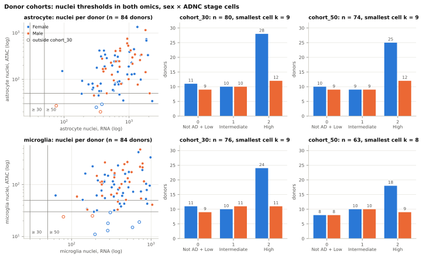
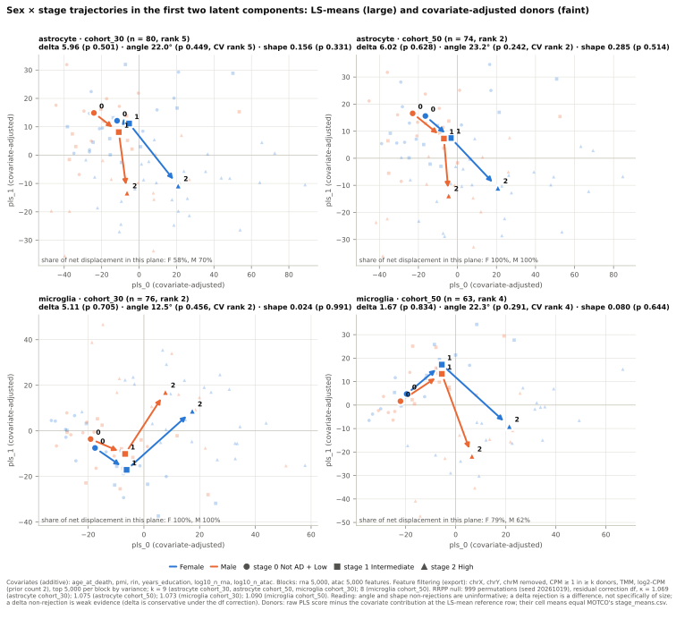
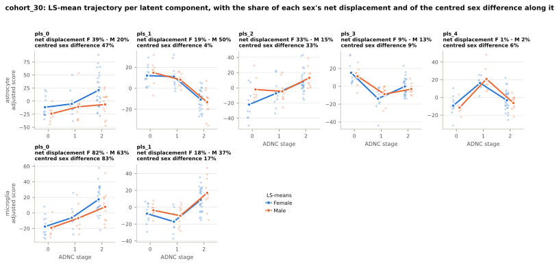
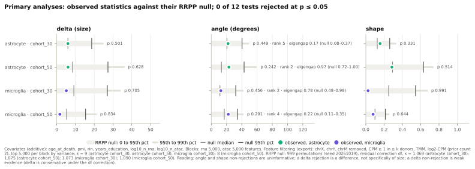
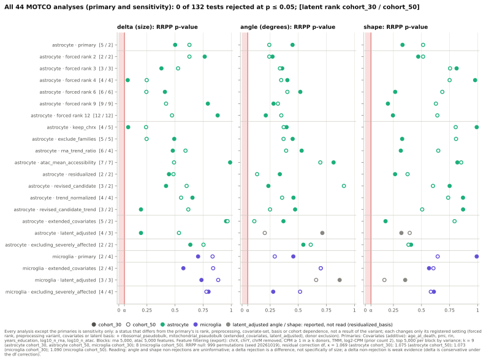
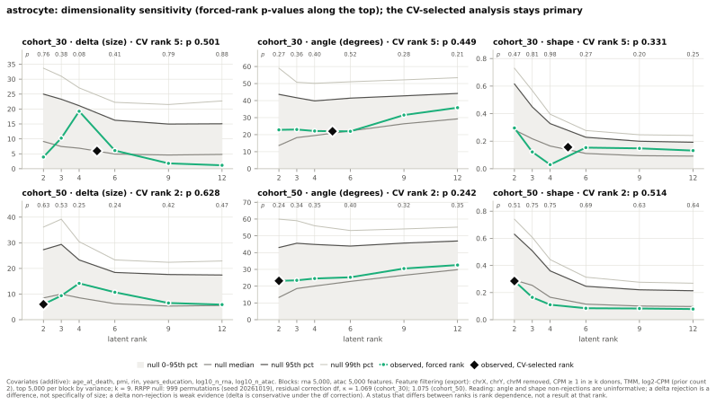
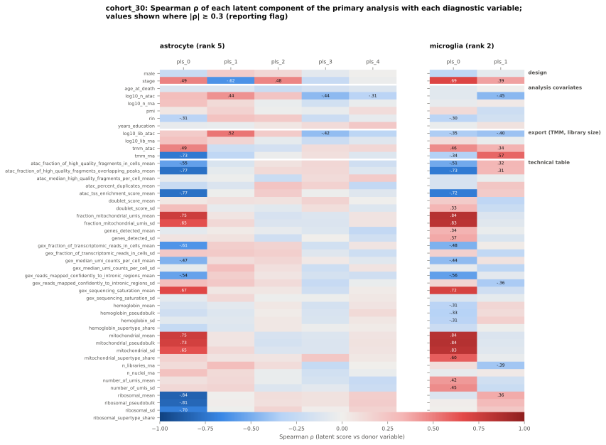
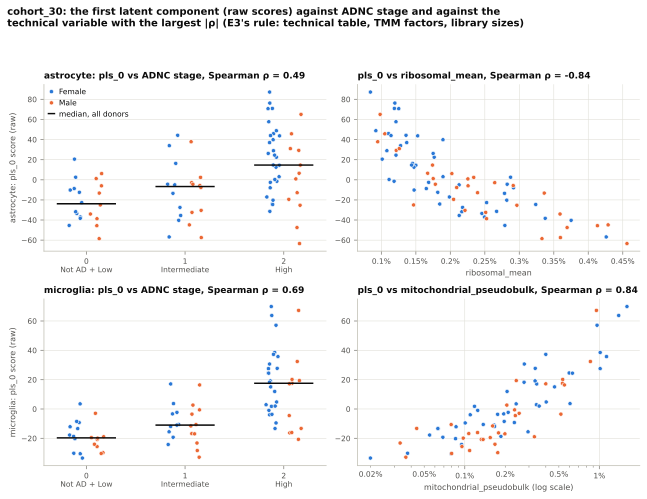
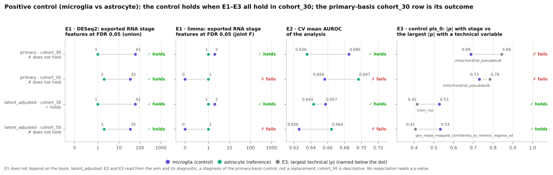
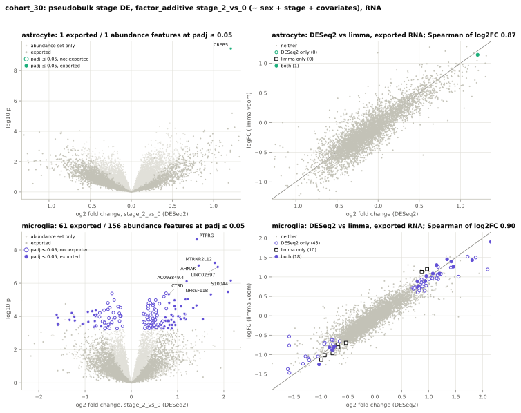

# Case-study figures

Drawn by `sead-sexdiff figures` from the generated outputs listed in `figures_manifest.json`. Each caption has three parts: how the figure is made, the values read from the files when it was drawn, and the registered reading rules that apply to it.

## Figure 1. Donor cohorts

*Construction.* Left: nuclei of the cell type per donor in RNA against ATAC (log scales), from each cell type's donor table, with the cohort thresholds in both omics; hollow markers lie outside cohort_30. Right: donors per sex x ADNC stage cell in each cohort; the cells are checked against the pseudobulk manifest.

*Values.* astrocyte: 84 donors in the donor table; cohort_30 n = 80 (Female 11 / 10 / 28, Male 9 / 10 / 12 by stage 0 / 1 / 2; smallest cell k = 9); cohort_50 n = 74 (Female 10 / 9 / 25, Male 9 / 9 / 12 by stage 0 / 1 / 2; smallest cell k = 9). microglia: 84 donors in the donor table; cohort_30 n = 76 (Female 11 / 10 / 24, Male 9 / 11 / 11 by stage 0 / 1 / 2; smallest cell k = 9); cohort_50 n = 63 (Female 8 / 10 / 18, Male 8 / 10 / 9 by stage 0 / 1 / 2; smallest cell k = 8).

*Reading.* The figure displays outputs already reported; it tests nothing, is an input of no step and changes no reading of the reports that made the outputs.

## Figure 2. Sex x stage trajectories

*Construction.* Per cell type and cohort, the primary analysis in its first two latent components: MOTCO's LS-means per sex and stage (stage_means.csv, joined by arrows in stage order) and the covariate-adjusted donor scores (raw PLS score minus the covariate contribution at the LS-mean reference row, whose cell means are checked against stage_means.csv); the share of each sex's net displacement in the plane is read from geometry_shares.csv. The panel titles give each statistic with its p-value and the CV-selected rank; the footnote gives the covariate block, the feature filtering and the RRPP null of the records.

*Values.* astrocyte cohort_30 (n = 80, CV-selected rank 5): delta 5.96 (p 0.501), angle 22.0° (p 0.449, rank 5), shape 0.156 (p 0.331); share of each sex's net displacement in the pls_0 × pls_1 plane: Female 58%, Male 70%. astrocyte cohort_50 (n = 74, CV-selected rank 2): delta 6.02 (p 0.628), angle 23.2° (p 0.242, rank 2), shape 0.285 (p 0.514); share of each sex's net displacement in the pls_0 × pls_1 plane: Female 100%, Male 100%. microglia cohort_30 (n = 76, CV-selected rank 2): delta 5.11 (p 0.705), angle 12.5° (p 0.456, rank 2), shape 0.024 (p 0.991); share of each sex's net displacement in the pls_0 × pls_1 plane: Female 100%, Male 100%. microglia cohort_50 (n = 63, CV-selected rank 4): delta 1.67 (p 0.834), angle 22.3° (p 0.291, rank 4), shape 0.080 (p 0.644); share of each sex's net displacement in the pls_0 × pls_1 plane: Female 79%, Male 62%.

*Reading.* The figure displays outputs already reported; it tests nothing, is an input of no step and changes no reading of the reports that made the outputs. MOTCO results are reported under the binding rules: the CV-selected rank beside angle; angle and shape non-rejections uninformative; a delta rejection a difference, not specifically of size; the covariate block and the feature filtering beside the results. The rank floor defines angle and shape in at least two dimensions without making them powerful (two dimensions, not a second axis with signal), so each analysis's configuration eigengap and null summary belong beside angle. Under the df residual correction the p-values are size-controlled at the configuration MOTCO measured (six covariates, both cohort_30 tables), with delta conservative there, so a delta non-rejection stays weak evidence; the size is inferred from the mechanism (n and the reduced rank), not measured, for cohort_50, the eight-covariate latent arms, the exclusion variants, the forced ranks and the preprocessing variants.

## Figure 3. Latent components by stage

*Construction.* For cohort_30, every latent component of each cell type's primary analysis against ADNC stage: covariate-adjusted donor scores (jittered) and the LS-mean trajectory per sex, with the shares of each sex's net displacement and of the centred sex difference along the component (geometry_shares.csv of axis-diagnostics).

*Values.* astrocyte cohort_30 (n = 80, CV-selected rank 5): shares of the net displacement and of the centred sex difference per component: pls_0 F 39%, M 20%, sex difference 47%; pls_1 F 19%, M 50%, sex difference 4%; pls_2 F 33%, M 15%, sex difference 33%; pls_3 F 9%, M 13%, sex difference 9%; pls_4 F 1%, M 2%, sex difference 6%. microglia cohort_30 (n = 76, CV-selected rank 2): shares of the net displacement and of the centred sex difference per component: pls_0 F 82%, M 63%, sex difference 83%; pls_1 F 18%, M 37%, sex difference 17%.

*Reading.* The figure displays outputs already reported; it tests nothing, is an input of no step and changes no reading of the reports that made the outputs. MOTCO results are reported under the binding rules: the CV-selected rank beside angle; angle and shape non-rejections uninformative; a delta rejection a difference, not specifically of size; the covariate block and the feature filtering beside the results. The rank floor defines angle and shape in at least two dimensions without making them powerful (two dimensions, not a second axis with signal), so each analysis's configuration eigengap and null summary belong beside angle. The diagnostics read sex and stage, so they are diagnostics and never a filter: their outputs feed no export, analysis or sensitivity run, and no preprocessing variant is derived from a diagnostic value.

## Figure 4. Statistics against their RRPP null

*Construction.* Per primary analysis (both cell types and cohorts), each observed statistic against the summary of its RRPP null from result.json (band to the 95th percentile, thinner band to the 99th, ticks at the median and the 95th percentile); angle carries the CV-selected rank, the pooled configuration eigengap and the 5th to 95th percentile of its permutation null.

*Values.* 0 of 12 tests rejected at p <= 0.05. astrocyte cohort_30 (CV-selected rank 5; configuration eigengap 0.17, permutation null 0.08–0.37): delta 5.96 against null median 5.96 and 95th percentile 18.65 (p 0.501); angle 22.0 against null median 20.6 and 95th percentile 40.3 (p 0.449); shape 0.156 against null median 0.125 and 95th percentile 0.261 (p 0.331). astrocyte cohort_50 (CV-selected rank 2; configuration eigengap 0.97, permutation null 0.72–1.00): delta 6.02 against null median 8.50 and 95th percentile 27.32 (p 0.628); angle 23.2 against null median 13.3 and 95th percentile 43.0 (p 0.242); shape 0.285 against null median 0.292 and 95th percentile 0.630 (p 0.514). microglia cohort_30 (CV-selected rank 2; configuration eigengap 0.78, permutation null 0.48–0.98): delta 5.11 against null median 9.13 and 95th percentile 26.97 (p 0.705); angle 12.5 against null median 11.4 and 95th percentile 32.1 (p 0.456); shape 0.024 against null median 0.250 and 95th percentile 0.544 (p 0.991). microglia cohort_50 (CV-selected rank 4; configuration eigengap 0.22, permutation null 0.11–0.35): delta 1.67 against null median 5.27 and 95th percentile 15.38 (p 0.834); angle 22.3 against null median 17.0 and 95th percentile 34.2 (p 0.291); shape 0.080 against null median 0.100 and 95th percentile 0.214 (p 0.644).

*Reading.* The figure displays outputs already reported; it tests nothing, is an input of no step and changes no reading of the reports that made the outputs. MOTCO results are reported under the binding rules: the CV-selected rank beside angle; angle and shape non-rejections uninformative; a delta rejection a difference, not specifically of size; the covariate block and the feature filtering beside the results. The rank floor defines angle and shape in at least two dimensions without making them powerful (two dimensions, not a second axis with signal), so each analysis's configuration eigengap and null summary belong beside angle. Under the df residual correction the p-values are size-controlled at the configuration MOTCO measured (six covariates, both cohort_30 tables), with delta conservative there, so a delta non-rejection stays weak evidence; the size is inferred from the mechanism (n and the reduced rank), not measured, for cohort_50, the eight-covariate latent arms, the exclusion variants, the forced ranks and the preprocessing variants.

## Figure 5. Every MOTCO analysis

*Construction.* Every MOTCO analysis of the registries outside results/superseded/ (primary, forced ranks, preprocessing variants, latent-sensitivity arms, donor-exclusion variants; per cohort), one row per analysis with the latent rank per cohort, and its RRPP p-value per statistic (filled: cohort_30, hollow: cohort_50); the latent_adjusted angle and shape markers are grey (reported, not read).

*Values.* 44 analyses in 22 rows, 132 p-values; 0 at p <= 0.05: none. Latent rank per analysis (CV-selected, or forced): astrocyte primary cohort_30 5, astrocyte forced rank 2 cohort_30 2, astrocyte forced rank 3 cohort_30 3, astrocyte forced rank 4 cohort_30 4, astrocyte forced rank 6 cohort_30 6, astrocyte forced rank 9 cohort_30 9, astrocyte forced rank 12 cohort_30 12, astrocyte keep_chrx cohort_30 4, astrocyte exclude_families cohort_30 5, astrocyte rna_trend_ratio cohort_30 6, astrocyte atac_mean_accessibility cohort_30 7, astrocyte residualized cohort_30 2, astrocyte revised_candidate cohort_30 3, astrocyte trend_normalized cohort_30 4, astrocyte revised_candidate_trend cohort_30 3, astrocyte extended_covariates cohort_30 5, astrocyte latent_adjusted cohort_30 4, astrocyte excluding_severely_affected cohort_30 2, astrocyte primary cohort_50 2, astrocyte forced rank 2 cohort_50 2, astrocyte forced rank 3 cohort_50 3, astrocyte forced rank 4 cohort_50 4, astrocyte forced rank 6 cohort_50 6, astrocyte forced rank 9 cohort_50 9, astrocyte forced rank 12 cohort_50 12, astrocyte keep_chrx cohort_50 5, astrocyte exclude_families cohort_50 5, astrocyte rna_trend_ratio cohort_50 4, astrocyte atac_mean_accessibility cohort_50 7, astrocyte residualized cohort_50 2, astrocyte revised_candidate cohort_50 2, astrocyte trend_normalized cohort_50 4, astrocyte revised_candidate_trend cohort_50 2, astrocyte extended_covariates cohort_50 2, astrocyte latent_adjusted cohort_50 3, astrocyte excluding_severely_affected cohort_50 2, microglia primary cohort_30 2, microglia extended_covariates cohort_30 2, microglia latent_adjusted cohort_30 3, microglia excluding_severely_affected cohort_30 4, microglia primary cohort_50 4, microglia extended_covariates cohort_50 4, microglia latent_adjusted cohort_50 3, microglia excluding_severely_affected cohort_50 4.

*Reading.* The figure displays outputs already reported; it tests nothing, is an input of no step and changes no reading of the reports that made the outputs. MOTCO results are reported under the binding rules: the CV-selected rank beside angle; angle and shape non-rejections uninformative; a delta rejection a difference, not specifically of size; the covariate block and the feature filtering beside the results. The rank floor defines angle and shape in at least two dimensions without making them powerful (two dimensions, not a second axis with signal), so each analysis's configuration eigengap and null summary belong beside angle. Under the df residual correction the p-values are size-controlled at the configuration MOTCO measured (six covariates, both cohort_30 tables), with delta conservative there, so a delta non-rejection stays weak evidence; the size is inferred from the mechanism (n and the reduced rank), not measured, for cohort_50, the eight-covariate latent arms, the exclusion variants, the forced ranks and the preprocessing variants. Every analysis other than the primary is sensitivity only: a rejection status that differs from the primary's is rank, preprocessing, covariate-set, basis or cohort dependence, not a result of the variant; a CV-selected rank that differs is reported beside angle, not as better or worse; the non-rejection rules hold in every variant; the primary analysis stays primary. The forced-rank sweep is sensitivity only: the CV-selected analysis stays primary, and a rejection status that differs between ranks is rank dependence, not a result at that rank. MOTCO's forced-rank operating characteristics are carried as limitations (Type I checked at forced 4 only, unadjusted; shape power loss and angle leakage at forced 2(K - 1); a wider angle null above n_stages - 1), and the adjusted analysis has no Type I check at any forced rank. The latent_adjusted arm's angle and shape p-values are reported but not read (MOTCO's diagnosis residualized_basis: the stage latent adjustment is liberal on both at this configuration, an excess of the basis the residual correction does not address, so neither a rejection nor a non-rejection is interpretable); its delta is read under the rules above.

## Figure 6. Rank sensitivity

*Construction.* For astrocytes (rank-sensitivity runs on astrocytes only), per cohort and statistic, the observed value at each forced rank of ANALYSIS_FORCED_RANKS against its RRPP null (median, 95th and 99th percentile), the CV-selected analysis at its rank (diamond), and the forced-rank p-values along the top.

*Values.* astrocyte cohort_30: CV-selected rank 5 (p delta 0.501, angle 0.449, shape 0.331); forced ranks 2, 3, 4, 6, 9, 12: p delta 0.764, 0.379, 0.079, 0.410, 0.792, 0.879; angle 0.271, 0.357, 0.403, 0.518, 0.280, 0.211; shape 0.471, 0.812, 0.977, 0.266, 0.201, 0.246. astrocyte cohort_50: CV-selected rank 2 (p delta 0.628, angle 0.242, shape 0.514); forced ranks 2, 3, 4, 6, 9, 12: p delta 0.628, 0.527, 0.248, 0.245, 0.420, 0.473; angle 0.242, 0.337, 0.348, 0.403, 0.319, 0.349; shape 0.514, 0.754, 0.750, 0.685, 0.628, 0.641.

*Reading.* The figure displays outputs already reported; it tests nothing, is an input of no step and changes no reading of the reports that made the outputs. MOTCO results are reported under the binding rules: the CV-selected rank beside angle; angle and shape non-rejections uninformative; a delta rejection a difference, not specifically of size; the covariate block and the feature filtering beside the results. The rank floor defines angle and shape in at least two dimensions without making them powerful (two dimensions, not a second axis with signal), so each analysis's configuration eigengap and null summary belong beside angle. The forced-rank sweep is sensitivity only: the CV-selected analysis stays primary, and a rejection status that differs between ranks is rank dependence, not a result at that rank. MOTCO's forced-rank operating characteristics are carried as limitations (Type I checked at forced 4 only, unadjusted; shape power loss and angle leakage at forced 2(K - 1); a wider angle null above n_stages - 1), and the adjusted analysis has no Type I check at any forced rank. Under the df residual correction the p-values are size-controlled at the configuration MOTCO measured (six covariates, both cohort_30 tables), with delta conservative there, so a delta non-rejection stays weak evidence; the size is inferred from the mechanism (n and the reduced rank), not measured, for cohort_50, the eight-covariate latent arms, the exclusion variants, the forced ranks and the preprocessing variants.

## Figure 7. Axis correlations

*Construction.* For cohort_30, the Spearman correlation of every latent component of each cell type's primary analysis with every diagnostic variable (axis_correlations.csv of axis-diagnostics: design, analysis covariates, the export's TMM factors and library sizes, the technical table), grouped by source; values are printed where |rho| reaches the reporting flag DIAGNOSTIC_CORRELATION_THRESHOLD.

*Values.* astrocyte cohort_30 (rank 5): 26 of 235 correlations at |rho| >= 0.3; largest |rho| per component: pls_0 ribosomal_mean -0.84; pls_1 stage -0.62; pls_2 stage 0.48; pls_3 log10_n_atac -0.44; pls_4 log10_n_atac -0.31. microglia cohort_30 (rank 2): 37 of 94 correlations at |rho| >= 0.3; largest |rho| per component: pls_0 mitochondrial_pseudobulk 0.84; pls_1 tmm_rna 0.57.

*Reading.* The figure displays outputs already reported; it tests nothing, is an input of no step and changes no reading of the reports that made the outputs. An axis correlated with a technical variable is a measurement-space finding about the analysis, not a reinterpretation of its statistics; the primary analysis stays primary with its non-rejection rules. The diagnostics read sex and stage, so they are diagnostics and never a filter: their outputs feed no export, analysis or sensitivity run, and no preprocessing variant is derived from a diagnostic value.

## Figure 8. The first latent axis

*Construction.* For cohort_30, the raw pls_0 scores of each cell type's primary analysis against ADNC stage (jittered, with the median per stage) and against the technical variable picked by E3's rule (the largest |Spearman| among the technical table's columns and the export's TMM factors and library sizes); both Spearman correlations are recomputed and checked against axis_correlations.csv.

*Values.* astrocyte cohort_30 (n = 80): Spearman of pls_0 with stage 0.49; the largest |rho| among 39 technical variables is ribosomal_mean (donor_technical.csv) at -0.84. microglia cohort_30 (n = 76): Spearman of pls_0 with stage 0.69; the largest |rho| among 39 technical variables is mitochondrial_pseudobulk (donor_technical.csv) at 0.84.

*Reading.* The figure displays outputs already reported; it tests nothing, is an input of no step and changes no reading of the reports that made the outputs. An axis correlated with a technical variable is a measurement-space finding about the analysis, not a reinterpretation of its statistics; the primary analysis stays primary with its non-rejection rules. The diagnostics read sex and stage, so they are diagnostics and never a filter: their outputs feed no export, analysis or sensitivity run, and no preprocessing variant is derived from a diagnostic value.

## Figure 9. Positive control

*Construction.* The positive control's expectations E1 (exported RNA stage counts at FDR 0.05 under DESeq2 and limma), E2 (CV mean AUROC) and E3 (|Spearman| of the control's pls_0 with stage against the largest with a technical variable) per basis of POSITIVE_CONTROL_BASES and cohort, control against reference, from positive_control.csv, with each expectation's and the overall outcome as recorded.

*Values.* primary basis, cohort_30 (microglia vs astrocyte): E1 deseq2 61 vs 1 (holds); limma 2 vs 1 (holds); E2 CV mean AUROC 0.685 vs 0.636 (holds); E3 |rho| with stage 0.69 vs mitochondrial_pseudobulk 0.84 (fails); overall does not hold. primary basis, cohort_50 (microglia vs astrocyte): E1 deseq2 35 vs 2 (holds); limma 0 vs 1 (fails); E2 CV mean AUROC 0.656 vs 0.697 (fails); E3 |rho| with stage 0.73 vs mitochondrial_pseudobulk 0.78 (fails); overall does not hold. latent_adjusted basis, cohort_30 (microglia vs astrocyte): E1 deseq2 61 vs 1 (holds); limma 2 vs 1 (holds); E2 CV mean AUROC 0.657 vs 0.643 (holds); E3 |rho| with stage 0.53 vs tmm_rna 0.42 (holds); overall holds. latent_adjusted basis, cohort_50 (microglia vs astrocyte): E1 deseq2 35 vs 2 (holds); limma 0 vs 1 (fails); E2 CV mean AUROC 0.626 vs 0.664 (fails); E3 |rho| with stage 0.53 vs gex_reads_mapped_confidently_to_intronic_regions_sd 0.41 (holds); overall does not hold.

*Reading.* The figure displays outputs already reported; it tests nothing, is an input of no step and changes no reading of the reports that made the outputs. The positive control is about the stage signal, not the sex x stage hypothesis: it holds when E1, E2 and E3 all hold in cohort_30, and the primary-basis cohort_30 row is its outcome; cohort_50 is descriptive. If it holds, the reference's null is not a pipeline failure; if not, the latent construction is in question for any cell type. E1 does not depend on the basis; the latent_adjusted basis is a diagnosis of the primary-basis control, never a replacement (the arm is not promoted). No expectation reads a p-value.

## Figure 10. Pseudobulk stage DE

*Construction.* For cohort_30, RNA, factor_additive stage_2_vs_0 (the contrast between the extreme stages): left, the DESeq2 volcano over the abundance-passing features (exported features darker, padj <= 0.05 in the cell type's colour, the eight smallest exported padj labelled); right, the DESeq2 log2 fold change against limma-voom's logFC over the exported features, by significance under each method. The counts are checked against stage_de_summary.csv and method_comparison.csv, a missing DESeq2 padj counting as not significant.

*Values.* astrocyte cohort_30, RNA (5,000 exported of 20,387 abundance features; covariates age_at_death, pmi, rin, years_education, log10_n_rna): exported features at FDR 0.05, DESeq2 factor_additive stage_1_vs_0 0, stage_2_vs_0 1, union 1; limma stage_1_vs_0 0, stage_2_vs_0 1, stage_joint 1. stage_2_vs_0: both methods 1, DESeq2 only 0, limma only 0 (DESeq2 padj missing for 0 exported features, read as not significant); Spearman of log2 fold changes 0.87. microglia cohort_30, RNA (5,000 exported of 20,660 abundance features; covariates age_at_death, pmi, rin, years_education, log10_n_rna): exported features at FDR 0.05, DESeq2 factor_additive stage_1_vs_0 0, stage_2_vs_0 61, union 61; limma stage_1_vs_0 0, stage_2_vs_0 28, stage_joint 2. stage_2_vs_0: both methods 18, DESeq2 only 43, limma only 10 (DESeq2 padj missing for 2,159 exported features, read as not significant); Spearman of log2 fold changes 0.90.

*Reading.* The figure displays outputs already reported; it tests nothing, is an input of no step and changes no reading of the reports that made the outputs. The stage counts describe the stage signal in the pseudobulks; the MOTCO non-rejection rules are untouched. A zero count is none detected at this n; the union counts carry no joint error-rate claim and limma's joint F claim is approximate; a call that differs between DESeq2 and limma is method dependence, not a result of either, and agreement is not replication (same donors and counts). The FDR of padj <= alpha is approximate and Cook's handling is inactive with continuous covariates; the covariates, the feature set and each method's normalization (DESeq2's median of ratios; limma-voom's log-CPM on the export's TMM) are stated beside the counts.
