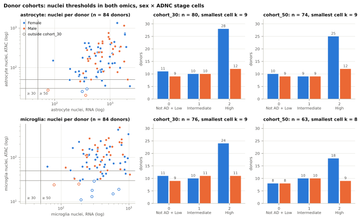
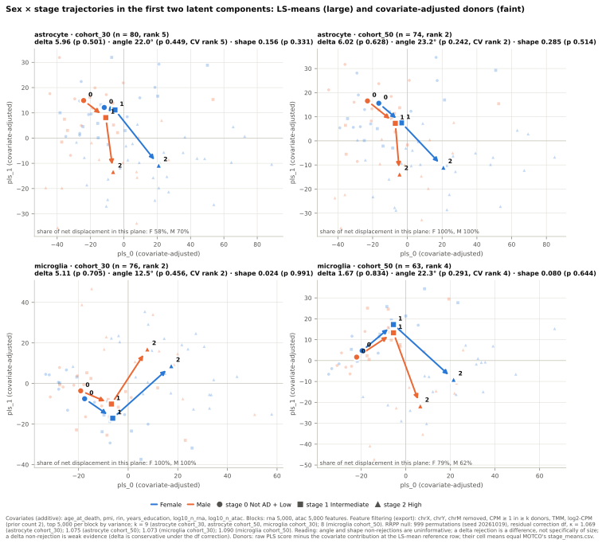
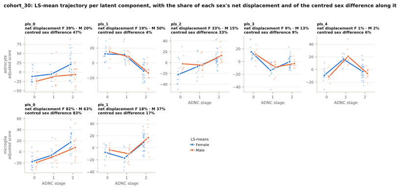
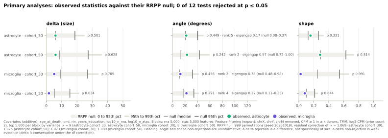
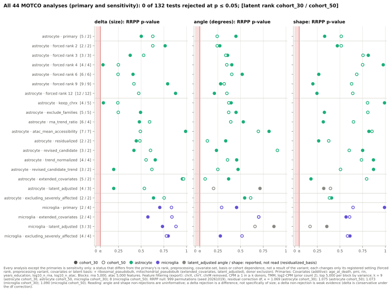
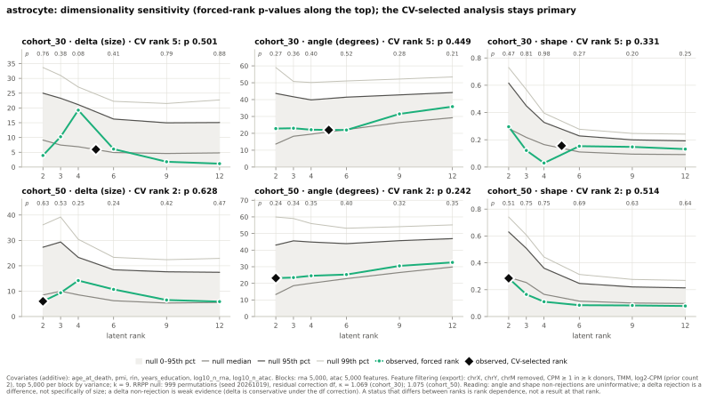
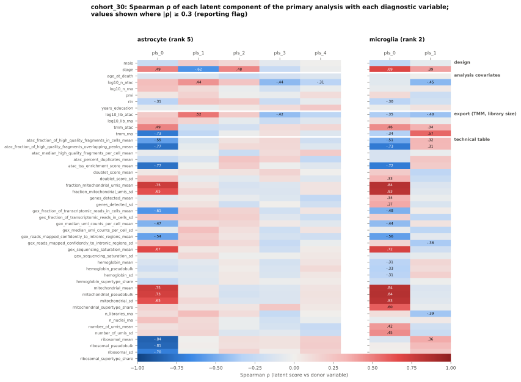
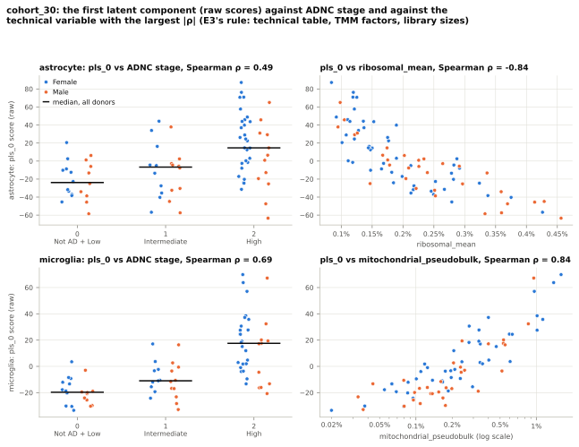
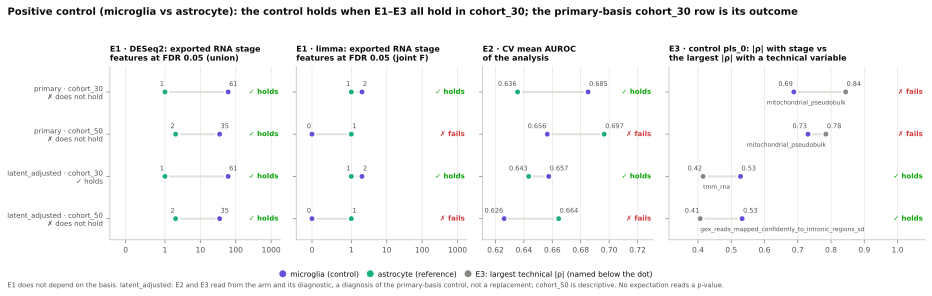
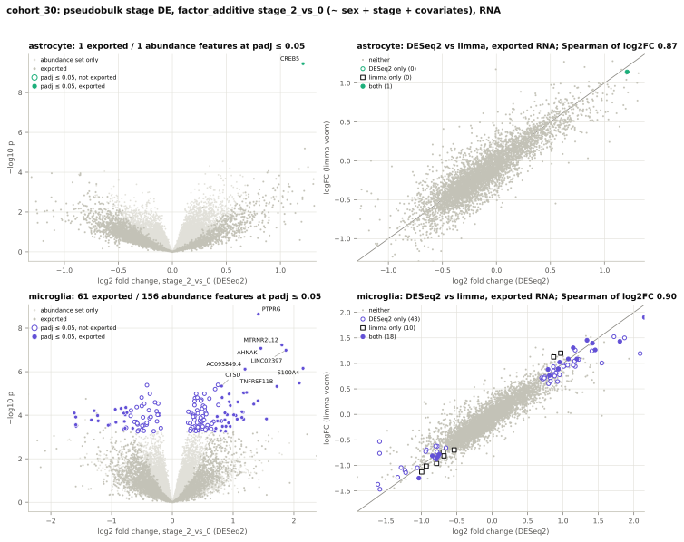

# MOTCO case-study figures: the registered figure set, astrocytes and microglia — 2026-11-02

> The first report of OpenSpec change `mtg-case-study-figures` (specs `case-study-figures`, `motco-release-migration`). The new command `sead-sexdiff figures` draws the ten figures of the registry `FIGURES` from the generated outputs of both cell types. Before drawing, it checks every manifest those outputs carry. Each caption is generated from the files, and a manifest ties every image to the files it was made from. This report presents the first frozen set, made by `figures --report motco-case-study-figures-2026-11-02` and stored under `reports/figures/motco-case-study-figures-2026-11-02/`. The set was drawn from the outputs that `mtg-residual-correction-primary` re-issued, and each figure appears with its caption pasted verbatim from the frozen `figures.md`. **The figures and captions show outputs already reported. The readings are those of the reports that made each output, the latest being `motco-residual-correction-primary-2026-10-31.md`. No figure is a new analysis.**

> **Result.** The consistency check passed, so drawing started:
> - 156 manifests were checked (110 named by the registries, 46 more found under the registered directories), with each cell type checked against its root's;
> - all 1,498 recorded `{path, sha256}` entries (398 files) hash as recorded;
> - the 44 analyses drawn all carry MOTCO 0.13.0, residual correction `df`, rank floor 2, 999 permutations and seed 20261019, forced ranks only under `rank-sensitivity`.
>
> Every reproduction check passed: adjusted cell means against `stage_means.csv`, first-axis Spearman correlations against `axis_correlations.csv`, stage-DE counts against the summaries, overlap counts against `method_comparison.csv`, and cohort cells against the pseudobulk manifests. Two runs on the same inputs gave byte-identical PNG, PDF and SVG files (30 of 30). The report's check script found the following:
> - all 382 numbers in the captions equal their source values;
> - all 257 values the captions share with the 2026-10-31 report are equal (p-values, ranks, observed statistics, eigengaps, CV AUROCs, E1–E3 values and outcomes, stage-DE counts, cohort cells);
> - the frozen SVGs hash as their manifest records;
> - every input it records hashes as recorded on disk.

**Reading (predeclared in the proposal).** The figures are a display step. They test nothing and feed no export, analysis, sensitivity, diagnostic, stage-DE or positive-control step. They change no reading of the reports that made the outputs. Each caption has three parts:
- the construction, which is fixed text;
- the values, read from the files when the figure was drawn;
- the registered reading rules that apply, which restate this repository's rules and interpret nothing beyond them.

Every binding rule holds in the captions as in the reports:
- the CV-selected rank, the eigengap and the null summary are given beside `angle`;
- `angle` and `shape` non-rejections are uninformative, and a `delta` rejection is a difference, not specifically of size;
- under the `df` correction `delta` is conservative, so a `delta` non-rejection stays weak evidence;
- the `latent_adjusted` arm's `angle` and `shape` p-values are reported but not read;
- every sensitivity analysis is read as dependence, never as a result;
- axis correlations are measurement-space findings;
- the stage-DE counts describe the stage signal and carry no joint error-rate claim;
- the positive control's primary-basis `cohort_30` row is its outcome.

A caption value that differs from the report that made the output would be a finding about that report, recorded with both values. None differs.

## 1. Provenance

- **Software:** sead-sexdiff 0.1.0, module `src/sead_sexdiff/figures.py` sha256 `55600962a96c5504eab404cf783e665ec1f60f204a658efffe53883cce89d864`; matplotlib 3.10.7 (pinned exactly, `matplotlib==3.10.7`; the font is matplotlib's bundled DejaVu Sans: `fonts/ttf/DejaVuSans.ttf`, `fonts/ttf/DejaVuSans-Oblique.ttf`, `fonts/ttf/DejaVuSans-Bold.ttf`, `fonts/ttf/DejaVuSans-BoldOblique.ttf`); numpy 2.3.5, pandas 2.3.3; python 3.12.15 (the Nix shell).
- **Code revision:** `2d427b05376069f4ad06542f8a9983b00939265c`, recorded `dirty: True`. The uncommitted files at drawing time were this change's own: the new module, `cli.py`, `pyproject.toml` / `uv.lock` (the matplotlib pin), the docs and the change's `tasks.md`. The module is committed unchanged with sha256 `55600962a96c5504eab404cf783e665ec1f60f204a658efffe53883cce89d864`, the value every figure's fingerprint carries.
- **Machine:** `nixos-dell-laptop`, the holder of the re-issued outputs of both cell types (MOTCO 0.13.0, `df`). The working copy was copied to the cluster's `results/figures/`, the canonical copy; all 32 files hash equal on both machines.
- **Frozen set:** `reports/figures/motco-case-study-figures-2026-11-02/`, made at 2026-11-02T22:23:37+00:00. Its `figures_manifest.json` has sha256 `dbd30353722693f5d214480e311571f65cd5305390d6e16f38ae4821ac285d57`.

| file | bytes | sha256 |
|---|---:|---|
| `01_cohorts.svg` | 169,130 | `8c14636da973503a99b4cd19c0f7d15f50f081ba5f8e4a487b627518c7c3b95f` |
| `02_trajectories.svg` | 297,407 | `ab560b2682f04a1a3e84b2d5e6ddd5a2174273b4fa090aa65184273af3c44823` |
| `03_components_by_stage.svg` | 199,447 | `cf9c041eeb1b113c65b402dbc2c4d91a766bb8408a71770ee889cf6225caefc0` |
| `04_statistics_vs_null.svg` | 174,178 | `5cf198636c17eccacd54dfab7feb734a3979afbc5330152779b95a8c8a5e29cb` |
| `05_pvalue_overview.svg` | 291,523 | `2078767e12b41f195b141842b10824fd98f1870e0d016324acb5055dc6ada08f` |
| `06_rank_sensitivity.svg` | 221,331 | `ff827e470356205dc5267b6dcc08e8eccb4696fc9c95897975fef7d328e6d129` |
| `07_axis_correlations.svg` | 228,770 | `a5d0fcea2df46bdadb47ea22b15bffab23a3086549571ed17540d62af15a4c56` |
| `08_first_axis.svg` | 164,407 | `2b91724a9bd16461f23f751b9325777fc34b9826cd381bf3927ac1eea20ce7b3` |
| `09_positive_control.svg` | 175,345 | `a90e5569d80cc00eb1e832ce1a5ee12817929bd6c6c4c7a774947c33852947a9` |
| `10_stage_de.svg` | 432,100 | `2e82060ccefdb8316d948c744c120a0a0a1c0e4210fa6107bad93576f8a03629` |
| `figures.md` | 22,978 | `49de54f7105d64145fe15619d1020984cf5a2ef7f39a6a684a10b4ad90a3bf5d` |
| `figures_manifest.json` | 123,888 | `dbd30353722693f5d214480e311571f65cd5305390d6e16f38ae4821ac285d57` |

### 1.1 Consistency check

The pre-pass derives the manifests from the registries: per cell type and cohort, the export, analysis, diagnostics, stage-DE, limma, latent-sensitivity and exclusion manifests; for astrocytes, the rank-sensitivity and preprocessing manifests; and the positive-control manifests per basis. It adds every other `*manifest.json` under the registered directories (every cell type's `cell_type_dirs`, plus `results/motco_sensitivity/`). For each manifest it checks the cell type against its root's and that every recorded `{path, sha256}` entry exists under `results/` outside `superseded/` and hashes as recorded. For every analysis of the registries, it checks the MOTCO version and the measurement in `result.json`.

- Manifests: 156 (110 named by the registries, 46 found under the registered directories).
- Recorded entries: 1,498, all hashing as recorded (398 distinct files).
- Analyses: 44. They carry one MOTCO version (0.13.0) and one measurement: residual correction `df`, `min_components` 2, 999 permutations, seed 20261019, and `forced_components` 2, 3, 4, 6, 9, 12 under `rank-sensitivity` only.
- Cell-type findings (23): the manifests written before the cell-type registry record no `cell_type` and read as astrocyte (listed in section 6).

### 1.2 The analyses drawn (MOTCO version and measurement, from the frozen manifest)

Every analysis any figure read, with the values of its `result.json` as the frozen manifest records them:

| `result.json` | MOTCO | residual correction | κ | rank floor | forced | selection | rank | permutations | seed | figures |
|---|---|---|---:|---:|---:|---|---:|---:|---:|---|
| `results/microglia/motco_analysis/cohort_30/result.json` | 0.13.0 | df | 1.0731 | 2 | — | cv | 2 | 999 | 20261019 | 02, 03, 04, 05, 08 |
| `results/microglia/motco_analysis/cohort_50/result.json` | 0.13.0 | df | 1.0903 | 2 | — | cv | 4 | 999 | 20261019 | 02, 04, 05 |
| `results/motco_analysis/cohort_30/result.json` | 0.13.0 | df | 1.0690 | 2 | — | cv | 5 | 999 | 20261019 | 02, 03, 04, 05, 06, 08 |
| `results/motco_analysis/cohort_50/result.json` | 0.13.0 | df | 1.0753 | 2 | — | cv | 2 | 999 | 20261019 | 02, 04, 05, 06 |
| `results/microglia/motco_exclusion_sensitivity/excluding_severely_affected/motco_analysis/cohort_30/result.json` | 0.13.0 | df | 1.0814 | 2 | — | cv | 4 | 999 | 20261019 | 05 |
| `results/microglia/motco_exclusion_sensitivity/excluding_severely_affected/motco_analysis/cohort_50/result.json` | 0.13.0 | df | 1.0992 | 2 | — | cv | 4 | 999 | 20261019 | 05 |
| `results/microglia/motco_latent_sensitivity/extended_covariates/motco_analysis/cohort_30/result.json` | 0.13.0 | df | 1.0897 | 2 | — | cv | 2 | 999 | 20261019 | 05 |
| `results/microglia/motco_latent_sensitivity/extended_covariates/motco_analysis/cohort_50/result.json` | 0.13.0 | df | 1.1114 | 2 | — | cv | 4 | 999 | 20261019 | 05 |
| `results/microglia/motco_latent_sensitivity/latent_adjusted/motco_analysis/cohort_30/result.json` | 0.13.0 | df | 1.0897 | 2 | — | cv | 3 | 999 | 20261019 | 05 |
| `results/microglia/motco_latent_sensitivity/latent_adjusted/motco_analysis/cohort_50/result.json` | 0.13.0 | df | 1.1114 | 2 | — | cv | 3 | 999 | 20261019 | 05 |
| `results/motco_exclusion_sensitivity/excluding_severely_affected/motco_analysis/cohort_30/result.json` | 0.13.0 | df | 1.0801 | 2 | — | cv | 2 | 999 | 20261019 | 05 |
| `results/motco_exclusion_sensitivity/excluding_severely_affected/motco_analysis/cohort_50/result.json` | 0.13.0 | df | 1.0887 | 2 | — | cv | 2 | 999 | 20261019 | 05 |
| `results/motco_latent_sensitivity/extended_covariates/motco_analysis/cohort_30/result.json` | 0.13.0 | df | 1.0847 | 2 | — | cv | 5 | 999 | 20261019 | 05 |
| `results/motco_latent_sensitivity/extended_covariates/motco_analysis/cohort_50/result.json` | 0.13.0 | df | 1.0925 | 2 | — | cv | 2 | 999 | 20261019 | 05 |
| `results/motco_latent_sensitivity/latent_adjusted/motco_analysis/cohort_30/result.json` | 0.13.0 | df | 1.0847 | 2 | — | cv | 4 | 999 | 20261019 | 05 |
| `results/motco_latent_sensitivity/latent_adjusted/motco_analysis/cohort_50/result.json` | 0.13.0 | df | 1.0925 | 2 | — | cv | 3 | 999 | 20261019 | 05 |
| `results/motco_rank_sensitivity/cohort_30/rank_02/result.json` | 0.13.0 | df | 1.0690 | 2 | 2 | forced | 2 | 999 | 20261019 | 05, 06 |
| `results/motco_rank_sensitivity/cohort_30/rank_03/result.json` | 0.13.0 | df | 1.0690 | 2 | 3 | forced | 3 | 999 | 20261019 | 05, 06 |
| `results/motco_rank_sensitivity/cohort_30/rank_04/result.json` | 0.13.0 | df | 1.0690 | 2 | 4 | forced | 4 | 999 | 20261019 | 05, 06 |
| `results/motco_rank_sensitivity/cohort_30/rank_06/result.json` | 0.13.0 | df | 1.0690 | 2 | 6 | forced | 6 | 999 | 20261019 | 05, 06 |
| `results/motco_rank_sensitivity/cohort_30/rank_09/result.json` | 0.13.0 | df | 1.0690 | 2 | 9 | forced | 9 | 999 | 20261019 | 05, 06 |
| `results/motco_rank_sensitivity/cohort_30/rank_12/result.json` | 0.13.0 | df | 1.0690 | 2 | 12 | forced | 12 | 999 | 20261019 | 05, 06 |
| `results/motco_rank_sensitivity/cohort_50/rank_02/result.json` | 0.13.0 | df | 1.0753 | 2 | 2 | forced | 2 | 999 | 20261019 | 05, 06 |
| `results/motco_rank_sensitivity/cohort_50/rank_03/result.json` | 0.13.0 | df | 1.0753 | 2 | 3 | forced | 3 | 999 | 20261019 | 05, 06 |
| `results/motco_rank_sensitivity/cohort_50/rank_04/result.json` | 0.13.0 | df | 1.0753 | 2 | 4 | forced | 4 | 999 | 20261019 | 05, 06 |
| `results/motco_rank_sensitivity/cohort_50/rank_06/result.json` | 0.13.0 | df | 1.0753 | 2 | 6 | forced | 6 | 999 | 20261019 | 05, 06 |
| `results/motco_rank_sensitivity/cohort_50/rank_09/result.json` | 0.13.0 | df | 1.0753 | 2 | 9 | forced | 9 | 999 | 20261019 | 05, 06 |
| `results/motco_rank_sensitivity/cohort_50/rank_12/result.json` | 0.13.0 | df | 1.0753 | 2 | 12 | forced | 12 | 999 | 20261019 | 05, 06 |
| `results/motco_sensitivity/atac_mean_accessibility/motco_analysis/cohort_30/result.json` | 0.13.0 | df | 1.0690 | 2 | — | cv | 7 | 999 | 20261019 | 05 |
| `results/motco_sensitivity/atac_mean_accessibility/motco_analysis/cohort_50/result.json` | 0.13.0 | df | 1.0753 | 2 | — | cv | 7 | 999 | 20261019 | 05 |
| `results/motco_sensitivity/exclude_families/motco_analysis/cohort_30/result.json` | 0.13.0 | df | 1.0690 | 2 | — | cv | 5 | 999 | 20261019 | 05 |
| `results/motco_sensitivity/exclude_families/motco_analysis/cohort_50/result.json` | 0.13.0 | df | 1.0753 | 2 | — | cv | 5 | 999 | 20261019 | 05 |
| `results/motco_sensitivity/keep_chrx/motco_analysis/cohort_30/result.json` | 0.13.0 | df | 1.0690 | 2 | — | cv | 4 | 999 | 20261019 | 05 |
| `results/motco_sensitivity/keep_chrx/motco_analysis/cohort_50/result.json` | 0.13.0 | df | 1.0753 | 2 | — | cv | 5 | 999 | 20261019 | 05 |
| `results/motco_sensitivity/residualized/motco_analysis/cohort_30/result.json` | 0.13.0 | df | 1.0690 | 2 | — | cv | 2 | 999 | 20261019 | 05 |
| `results/motco_sensitivity/residualized/motco_analysis/cohort_50/result.json` | 0.13.0 | df | 1.0753 | 2 | — | cv | 2 | 999 | 20261019 | 05 |
| `results/motco_sensitivity/revised_candidate/motco_analysis/cohort_30/result.json` | 0.13.0 | df | 1.0690 | 2 | — | cv | 3 | 999 | 20261019 | 05 |
| `results/motco_sensitivity/revised_candidate/motco_analysis/cohort_50/result.json` | 0.13.0 | df | 1.0753 | 2 | — | cv | 2 | 999 | 20261019 | 05 |
| `results/motco_sensitivity/revised_candidate_trend/motco_analysis/cohort_30/result.json` | 0.13.0 | df | 1.0690 | 2 | — | cv | 3 | 999 | 20261019 | 05 |
| `results/motco_sensitivity/revised_candidate_trend/motco_analysis/cohort_50/result.json` | 0.13.0 | df | 1.0753 | 2 | — | cv | 2 | 999 | 20261019 | 05 |
| `results/motco_sensitivity/rna_trend_ratio/motco_analysis/cohort_30/result.json` | 0.13.0 | df | 1.0690 | 2 | — | cv | 6 | 999 | 20261019 | 05 |
| `results/motco_sensitivity/rna_trend_ratio/motco_analysis/cohort_50/result.json` | 0.13.0 | df | 1.0753 | 2 | — | cv | 4 | 999 | 20261019 | 05 |
| `results/motco_sensitivity/trend_normalized/motco_analysis/cohort_30/result.json` | 0.13.0 | df | 1.0690 | 2 | — | cv | 4 | 999 | 20261019 | 05 |
| `results/motco_sensitivity/trend_normalized/motco_analysis/cohort_50/result.json` | 0.13.0 | df | 1.0753 | 2 | — | cv | 4 | 999 | 20261019 | 05 |

### 1.3 Checks run before freezing

The checks ran on a full scratch copy of `results/` outside `superseded/` (`cp -r`, run with the scratch directory as working directory), on scratch output directories, and on the real outputs. Each result below was generated by a scratch script.

**Pre-pass negative checks.** Each of the following stopped the run, named the manifest, the file and the values, and left no `results/figures*`:
- one byte appended to `results/motco_analysis/cohort_30/latent_scores.csv`: three diagnostic and exclusion manifests named it with both hashes;
- `params.residual_correction` removed from `results/motco_latent_sensitivity/latent_adjusted/motco_analysis/cohort_30/result.json`: "expected 'df'";
- `software.motco` set to 0.14.0 in `results/microglia/motco_analysis/cohort_50/result.json`: "records MOTCO 0.14.0; results/motco_analysis/cohort_30/result.json records MOTCO 0.13.0";
- `cell_type` changed in `results/motco_diagnostics/cohort_30/diagnostics_manifest.json`;
- `results/motco_sensitivity/keep_chrx/motco_analysis/cohort_50/` removed: the missing registered outputs were named, with `sead-sexdiff preprocessing-sensitivity`.

**Reproductions.** A copy of `results/microglia/stage_de_limma/cohort_30/method_comparison.csv` with `n_only_limma` set to 8 stopped figure 10 with "n_only_limma recomputes to 10; the file holds 8". No `results/figures*` was left behind.

**Reader.** The reader logs `(path, sha256)` per figure and hashes each file once (3 files read 6 times, 3 hashes). It refuses an absolute path, a path outside `results/`, and a path under `results/superseded/`, naming the path. For every figure, the manifest's input list equals a fresh reader's log. No path lies under `superseded/`, and figure 04 lists `results/microglia/motco_analysis/cohort_50/result.json` with its current sha256.

**Captions.** An independent rebuild from the input files matches all 382 caption numbers. In figures 02, 04, 05 and 06 the in-figure footnote holds every record's covariate columns, blocks, permutations, correction and κ, and a reader returning altered records changes all of them.

**Files.**
- Two runs into scratch directories gave 30 of 30 byte-identical images; the real working copy is byte-identical to them.
- `10_stage_de.svg` is 432 KB (4.6 MB without rasterization, the prototype's measurement).
- Every PNG, PDF and SVG carries its figure stem and the manifest's fingerprint in its metadata; none carries the git revision or a creation date.

**Working copy.**
- A second run printed that the set was fresh and wrote nothing (hashes and mtimes unchanged).
- With the recorded module sha256 changed, the run listed all ten figures as stale through the code hash, redrew the set byte-identically and left no `.tmp` or `.old`.
- A failure injected in figure 07 left the previous set byte-identical and no `.tmp`.

**`--check`.**
- It exits 0 on a fresh set and 2 without a manifest.
- With `results/motco_analysis/` moved aside and re-copied with one changed byte in `cohort_30/result.json`, it exits 1. Figures 02–10 are listed (07 and 10 through their manifests' recorded hashes), and figure 01 stays fresh.
- After an edit to the module, all ten are stale through the code hash.
- Nothing was written in any case.

**`--report`.**
- On a fresh set it froze 10 SVGs, `figures.md` and the manifest, each SVG hashing as recorded.
- On a stale set it redrew first.
- A second `--report` to the same stem, and the stems `../x`, `Upper` and `.hidden`, were refused before anything was drawn.
- A second stem frozen from unchanged inputs gave byte-identical SVGs and `figures.md`.

**Palette.** The dataviz validator ran in light mode on white. The sex pair (`#2a78d6`, `#eb6834`) passes every check: CVD ΔE 24.7 (protan), normal-vision ΔE 33.6. The cell-type pair (`#1baf7a`, `#6250d6`) passes (CVD ΔE 27.1 deutan, normal 32.8) with one WARN: `#1baf7a` reaches only 2.82:1 against white. Every cell-type mark has a legend entry or a direct label (section 6).

### 1.4 Commands

```
# real run, nixos-dell-laptop, repository root
nix develop -c uv run sead-sexdiff figures
nix develop -c uv run sead-sexdiff figures --check            # exit 0
nix develop -c uv run sead-sexdiff figures --report motco-case-study-figures-2026-11-02
rsync -a results/figures/ tgonza@cluster.ing.uc.cl:/home1/tgonza/sead_sexdiff/results/figures/
```

## 2. The figures

Each figure is the frozen SVG; its caption is pasted from the frozen `figures.md`.

### Figure 1. Donor cohorts



*Construction.* Left: nuclei of the cell type per donor in RNA against ATAC (log scales), from each cell type's donor table, with the cohort thresholds in both omics; hollow markers lie outside cohort_30. Right: donors per sex x ADNC stage cell in each cohort; the cells are checked against the pseudobulk manifest.

*Values.* astrocyte: 84 donors in the donor table; cohort_30 n = 80 (Female 11 / 10 / 28, Male 9 / 10 / 12 by stage 0 / 1 / 2; smallest cell k = 9); cohort_50 n = 74 (Female 10 / 9 / 25, Male 9 / 9 / 12 by stage 0 / 1 / 2; smallest cell k = 9). microglia: 84 donors in the donor table; cohort_30 n = 76 (Female 11 / 10 / 24, Male 9 / 11 / 11 by stage 0 / 1 / 2; smallest cell k = 9); cohort_50 n = 63 (Female 8 / 10 / 18, Male 8 / 10 / 9 by stage 0 / 1 / 2; smallest cell k = 8).

*Reading.* The figure displays outputs already reported; it tests nothing, is an input of no step and changes no reading of the reports that made the outputs.

### Figure 2. Sex x stage trajectories



*Construction.* Per cell type and cohort, the primary analysis in its first two latent components: MOTCO's LS-means per sex and stage (stage_means.csv, joined by arrows in stage order) and the covariate-adjusted donor scores (raw PLS score minus the covariate contribution at the LS-mean reference row, whose cell means are checked against stage_means.csv); the share of each sex's net displacement in the plane is read from geometry_shares.csv. The panel titles give each statistic with its p-value and the CV-selected rank; the footnote gives the covariate block, the feature filtering and the RRPP null of the records.

*Values.* astrocyte cohort_30 (n = 80, CV-selected rank 5): delta 5.96 (p 0.501), angle 22.0° (p 0.449, rank 5), shape 0.156 (p 0.331); share of each sex's net displacement in the pls_0 × pls_1 plane: Female 58%, Male 70%. astrocyte cohort_50 (n = 74, CV-selected rank 2): delta 6.02 (p 0.628), angle 23.2° (p 0.242, rank 2), shape 0.285 (p 0.514); share of each sex's net displacement in the pls_0 × pls_1 plane: Female 100%, Male 100%. microglia cohort_30 (n = 76, CV-selected rank 2): delta 5.11 (p 0.705), angle 12.5° (p 0.456, rank 2), shape 0.024 (p 0.991); share of each sex's net displacement in the pls_0 × pls_1 plane: Female 100%, Male 100%. microglia cohort_50 (n = 63, CV-selected rank 4): delta 1.67 (p 0.834), angle 22.3° (p 0.291, rank 4), shape 0.080 (p 0.644); share of each sex's net displacement in the pls_0 × pls_1 plane: Female 79%, Male 62%.

*Reading.* The figure displays outputs already reported; it tests nothing, is an input of no step and changes no reading of the reports that made the outputs. MOTCO results are reported under the binding rules: the CV-selected rank beside angle; angle and shape non-rejections uninformative; a delta rejection a difference, not specifically of size; the covariate block and the feature filtering beside the results. The rank floor defines angle and shape in at least two dimensions without making them powerful (two dimensions, not a second axis with signal), so each analysis's configuration eigengap and null summary belong beside angle. Under the df residual correction the p-values are size-controlled at the configuration MOTCO measured (six covariates, both cohort_30 tables), with delta conservative there, so a delta non-rejection stays weak evidence; the size is inferred from the mechanism (n and the reduced rank), not measured, for cohort_50, the eight-covariate latent arms, the exclusion variants, the forced ranks and the preprocessing variants.

### Figure 3. Latent components by stage



*Construction.* For cohort_30, every latent component of each cell type's primary analysis against ADNC stage: covariate-adjusted donor scores (jittered) and the LS-mean trajectory per sex, with the shares of each sex's net displacement and of the centred sex difference along the component (geometry_shares.csv of axis-diagnostics).

*Values.* astrocyte cohort_30 (n = 80, CV-selected rank 5): shares of the net displacement and of the centred sex difference per component: pls_0 F 39%, M 20%, sex difference 47%; pls_1 F 19%, M 50%, sex difference 4%; pls_2 F 33%, M 15%, sex difference 33%; pls_3 F 9%, M 13%, sex difference 9%; pls_4 F 1%, M 2%, sex difference 6%. microglia cohort_30 (n = 76, CV-selected rank 2): shares of the net displacement and of the centred sex difference per component: pls_0 F 82%, M 63%, sex difference 83%; pls_1 F 18%, M 37%, sex difference 17%.

*Reading.* The figure displays outputs already reported; it tests nothing, is an input of no step and changes no reading of the reports that made the outputs. MOTCO results are reported under the binding rules: the CV-selected rank beside angle; angle and shape non-rejections uninformative; a delta rejection a difference, not specifically of size; the covariate block and the feature filtering beside the results. The rank floor defines angle and shape in at least two dimensions without making them powerful (two dimensions, not a second axis with signal), so each analysis's configuration eigengap and null summary belong beside angle. The diagnostics read sex and stage, so they are diagnostics and never a filter: their outputs feed no export, analysis or sensitivity run, and no preprocessing variant is derived from a diagnostic value.

### Figure 4. Statistics against their RRPP null



*Construction.* Per primary analysis (both cell types and cohorts), each observed statistic against the summary of its RRPP null from result.json (band to the 95th percentile, thinner band to the 99th, ticks at the median and the 95th percentile); angle carries the CV-selected rank, the pooled configuration eigengap and the 5th to 95th percentile of its permutation null.

*Values.* 0 of 12 tests rejected at p <= 0.05. astrocyte cohort_30 (CV-selected rank 5; configuration eigengap 0.17, permutation null 0.08–0.37): delta 5.96 against null median 5.96 and 95th percentile 18.65 (p 0.501); angle 22.0 against null median 20.6 and 95th percentile 40.3 (p 0.449); shape 0.156 against null median 0.125 and 95th percentile 0.261 (p 0.331). astrocyte cohort_50 (CV-selected rank 2; configuration eigengap 0.97, permutation null 0.72–1.00): delta 6.02 against null median 8.50 and 95th percentile 27.32 (p 0.628); angle 23.2 against null median 13.3 and 95th percentile 43.0 (p 0.242); shape 0.285 against null median 0.292 and 95th percentile 0.630 (p 0.514). microglia cohort_30 (CV-selected rank 2; configuration eigengap 0.78, permutation null 0.48–0.98): delta 5.11 against null median 9.13 and 95th percentile 26.97 (p 0.705); angle 12.5 against null median 11.4 and 95th percentile 32.1 (p 0.456); shape 0.024 against null median 0.250 and 95th percentile 0.544 (p 0.991). microglia cohort_50 (CV-selected rank 4; configuration eigengap 0.22, permutation null 0.11–0.35): delta 1.67 against null median 5.27 and 95th percentile 15.38 (p 0.834); angle 22.3 against null median 17.0 and 95th percentile 34.2 (p 0.291); shape 0.080 against null median 0.100 and 95th percentile 0.214 (p 0.644).

*Reading.* The figure displays outputs already reported; it tests nothing, is an input of no step and changes no reading of the reports that made the outputs. MOTCO results are reported under the binding rules: the CV-selected rank beside angle; angle and shape non-rejections uninformative; a delta rejection a difference, not specifically of size; the covariate block and the feature filtering beside the results. The rank floor defines angle and shape in at least two dimensions without making them powerful (two dimensions, not a second axis with signal), so each analysis's configuration eigengap and null summary belong beside angle. Under the df residual correction the p-values are size-controlled at the configuration MOTCO measured (six covariates, both cohort_30 tables), with delta conservative there, so a delta non-rejection stays weak evidence; the size is inferred from the mechanism (n and the reduced rank), not measured, for cohort_50, the eight-covariate latent arms, the exclusion variants, the forced ranks and the preprocessing variants.

### Figure 5. Every MOTCO analysis



*Construction.* Every MOTCO analysis of the registries outside results/superseded/ (primary, forced ranks, preprocessing variants, latent-sensitivity arms, donor-exclusion variants; per cohort), one row per analysis with the latent rank per cohort, and its RRPP p-value per statistic (filled: cohort_30, hollow: cohort_50); the latent_adjusted angle and shape markers are grey (reported, not read).

*Values.* 44 analyses in 22 rows, 132 p-values; 0 at p <= 0.05: none. Latent rank per analysis (CV-selected, or forced): astrocyte primary cohort_30 5, astrocyte forced rank 2 cohort_30 2, astrocyte forced rank 3 cohort_30 3, astrocyte forced rank 4 cohort_30 4, astrocyte forced rank 6 cohort_30 6, astrocyte forced rank 9 cohort_30 9, astrocyte forced rank 12 cohort_30 12, astrocyte keep_chrx cohort_30 4, astrocyte exclude_families cohort_30 5, astrocyte rna_trend_ratio cohort_30 6, astrocyte atac_mean_accessibility cohort_30 7, astrocyte residualized cohort_30 2, astrocyte revised_candidate cohort_30 3, astrocyte trend_normalized cohort_30 4, astrocyte revised_candidate_trend cohort_30 3, astrocyte extended_covariates cohort_30 5, astrocyte latent_adjusted cohort_30 4, astrocyte excluding_severely_affected cohort_30 2, astrocyte primary cohort_50 2, astrocyte forced rank 2 cohort_50 2, astrocyte forced rank 3 cohort_50 3, astrocyte forced rank 4 cohort_50 4, astrocyte forced rank 6 cohort_50 6, astrocyte forced rank 9 cohort_50 9, astrocyte forced rank 12 cohort_50 12, astrocyte keep_chrx cohort_50 5, astrocyte exclude_families cohort_50 5, astrocyte rna_trend_ratio cohort_50 4, astrocyte atac_mean_accessibility cohort_50 7, astrocyte residualized cohort_50 2, astrocyte revised_candidate cohort_50 2, astrocyte trend_normalized cohort_50 4, astrocyte revised_candidate_trend cohort_50 2, astrocyte extended_covariates cohort_50 2, astrocyte latent_adjusted cohort_50 3, astrocyte excluding_severely_affected cohort_50 2, microglia primary cohort_30 2, microglia extended_covariates cohort_30 2, microglia latent_adjusted cohort_30 3, microglia excluding_severely_affected cohort_30 4, microglia primary cohort_50 4, microglia extended_covariates cohort_50 4, microglia latent_adjusted cohort_50 3, microglia excluding_severely_affected cohort_50 4.

*Reading.* The figure displays outputs already reported; it tests nothing, is an input of no step and changes no reading of the reports that made the outputs. MOTCO results are reported under the binding rules: the CV-selected rank beside angle; angle and shape non-rejections uninformative; a delta rejection a difference, not specifically of size; the covariate block and the feature filtering beside the results. The rank floor defines angle and shape in at least two dimensions without making them powerful (two dimensions, not a second axis with signal), so each analysis's configuration eigengap and null summary belong beside angle. Under the df residual correction the p-values are size-controlled at the configuration MOTCO measured (six covariates, both cohort_30 tables), with delta conservative there, so a delta non-rejection stays weak evidence; the size is inferred from the mechanism (n and the reduced rank), not measured, for cohort_50, the eight-covariate latent arms, the exclusion variants, the forced ranks and the preprocessing variants. Every analysis other than the primary is sensitivity only: a rejection status that differs from the primary's is rank, preprocessing, covariate-set, basis or cohort dependence, not a result of the variant; a CV-selected rank that differs is reported beside angle, not as better or worse; the non-rejection rules hold in every variant; the primary analysis stays primary. The forced-rank sweep is sensitivity only: the CV-selected analysis stays primary, and a rejection status that differs between ranks is rank dependence, not a result at that rank. MOTCO's forced-rank operating characteristics are carried as limitations (Type I checked at forced 4 only, unadjusted; shape power loss and angle leakage at forced 2(K - 1); a wider angle null above n_stages - 1), and the adjusted analysis has no Type I check at any forced rank. The latent_adjusted arm's angle and shape p-values are reported but not read (MOTCO's diagnosis residualized_basis: the stage latent adjustment is liberal on both at this configuration, an excess of the basis the residual correction does not address, so neither a rejection nor a non-rejection is interpretable); its delta is read under the rules above.

### Figure 6. Rank sensitivity



*Construction.* For astrocytes (rank-sensitivity runs on astrocytes only), per cohort and statistic, the observed value at each forced rank of ANALYSIS_FORCED_RANKS against its RRPP null (median, 95th and 99th percentile), the CV-selected analysis at its rank (diamond), and the forced-rank p-values along the top.

*Values.* astrocyte cohort_30: CV-selected rank 5 (p delta 0.501, angle 0.449, shape 0.331); forced ranks 2, 3, 4, 6, 9, 12: p delta 0.764, 0.379, 0.079, 0.410, 0.792, 0.879; angle 0.271, 0.357, 0.403, 0.518, 0.280, 0.211; shape 0.471, 0.812, 0.977, 0.266, 0.201, 0.246. astrocyte cohort_50: CV-selected rank 2 (p delta 0.628, angle 0.242, shape 0.514); forced ranks 2, 3, 4, 6, 9, 12: p delta 0.628, 0.527, 0.248, 0.245, 0.420, 0.473; angle 0.242, 0.337, 0.348, 0.403, 0.319, 0.349; shape 0.514, 0.754, 0.750, 0.685, 0.628, 0.641.

*Reading.* The figure displays outputs already reported; it tests nothing, is an input of no step and changes no reading of the reports that made the outputs. MOTCO results are reported under the binding rules: the CV-selected rank beside angle; angle and shape non-rejections uninformative; a delta rejection a difference, not specifically of size; the covariate block and the feature filtering beside the results. The rank floor defines angle and shape in at least two dimensions without making them powerful (two dimensions, not a second axis with signal), so each analysis's configuration eigengap and null summary belong beside angle. The forced-rank sweep is sensitivity only: the CV-selected analysis stays primary, and a rejection status that differs between ranks is rank dependence, not a result at that rank. MOTCO's forced-rank operating characteristics are carried as limitations (Type I checked at forced 4 only, unadjusted; shape power loss and angle leakage at forced 2(K - 1); a wider angle null above n_stages - 1), and the adjusted analysis has no Type I check at any forced rank. Under the df residual correction the p-values are size-controlled at the configuration MOTCO measured (six covariates, both cohort_30 tables), with delta conservative there, so a delta non-rejection stays weak evidence; the size is inferred from the mechanism (n and the reduced rank), not measured, for cohort_50, the eight-covariate latent arms, the exclusion variants, the forced ranks and the preprocessing variants.

### Figure 7. Axis correlations



*Construction.* For cohort_30, the Spearman correlation of every latent component of each cell type's primary analysis with every diagnostic variable (axis_correlations.csv of axis-diagnostics: design, analysis covariates, the export's TMM factors and library sizes, the technical table), grouped by source; values are printed where |rho| reaches the reporting flag DIAGNOSTIC_CORRELATION_THRESHOLD.

*Values.* astrocyte cohort_30 (rank 5): 26 of 235 correlations at |rho| >= 0.3; largest |rho| per component: pls_0 ribosomal_mean -0.84; pls_1 stage -0.62; pls_2 stage 0.48; pls_3 log10_n_atac -0.44; pls_4 log10_n_atac -0.31. microglia cohort_30 (rank 2): 37 of 94 correlations at |rho| >= 0.3; largest |rho| per component: pls_0 mitochondrial_pseudobulk 0.84; pls_1 tmm_rna 0.57.

*Reading.* The figure displays outputs already reported; it tests nothing, is an input of no step and changes no reading of the reports that made the outputs. An axis correlated with a technical variable is a measurement-space finding about the analysis, not a reinterpretation of its statistics; the primary analysis stays primary with its non-rejection rules. The diagnostics read sex and stage, so they are diagnostics and never a filter: their outputs feed no export, analysis or sensitivity run, and no preprocessing variant is derived from a diagnostic value.

### Figure 8. The first latent axis



*Construction.* For cohort_30, the raw pls_0 scores of each cell type's primary analysis against ADNC stage (jittered, with the median per stage) and against the technical variable picked by E3's rule (the largest |Spearman| among the technical table's columns and the export's TMM factors and library sizes); both Spearman correlations are recomputed and checked against axis_correlations.csv.

*Values.* astrocyte cohort_30 (n = 80): Spearman of pls_0 with stage 0.49; the largest |rho| among 39 technical variables is ribosomal_mean (donor_technical.csv) at -0.84. microglia cohort_30 (n = 76): Spearman of pls_0 with stage 0.69; the largest |rho| among 39 technical variables is mitochondrial_pseudobulk (donor_technical.csv) at 0.84.

*Reading.* The figure displays outputs already reported; it tests nothing, is an input of no step and changes no reading of the reports that made the outputs. An axis correlated with a technical variable is a measurement-space finding about the analysis, not a reinterpretation of its statistics; the primary analysis stays primary with its non-rejection rules. The diagnostics read sex and stage, so they are diagnostics and never a filter: their outputs feed no export, analysis or sensitivity run, and no preprocessing variant is derived from a diagnostic value.

### Figure 9. Positive control



*Construction.* The positive control's expectations E1 (exported RNA stage counts at FDR 0.05 under DESeq2 and limma), E2 (CV mean AUROC) and E3 (|Spearman| of the control's pls_0 with stage against the largest with a technical variable) per basis of POSITIVE_CONTROL_BASES and cohort, control against reference, from positive_control.csv, with each expectation's and the overall outcome as recorded.

*Values.* primary basis, cohort_30 (microglia vs astrocyte): E1 deseq2 61 vs 1 (holds); limma 2 vs 1 (holds); E2 CV mean AUROC 0.685 vs 0.636 (holds); E3 |rho| with stage 0.69 vs mitochondrial_pseudobulk 0.84 (fails); overall does not hold. primary basis, cohort_50 (microglia vs astrocyte): E1 deseq2 35 vs 2 (holds); limma 0 vs 1 (fails); E2 CV mean AUROC 0.656 vs 0.697 (fails); E3 |rho| with stage 0.73 vs mitochondrial_pseudobulk 0.78 (fails); overall does not hold. latent_adjusted basis, cohort_30 (microglia vs astrocyte): E1 deseq2 61 vs 1 (holds); limma 2 vs 1 (holds); E2 CV mean AUROC 0.657 vs 0.643 (holds); E3 |rho| with stage 0.53 vs tmm_rna 0.42 (holds); overall holds. latent_adjusted basis, cohort_50 (microglia vs astrocyte): E1 deseq2 35 vs 2 (holds); limma 0 vs 1 (fails); E2 CV mean AUROC 0.626 vs 0.664 (fails); E3 |rho| with stage 0.53 vs gex_reads_mapped_confidently_to_intronic_regions_sd 0.41 (holds); overall does not hold.

*Reading.* The figure displays outputs already reported; it tests nothing, is an input of no step and changes no reading of the reports that made the outputs. The positive control is about the stage signal, not the sex x stage hypothesis: it holds when E1, E2 and E3 all hold in cohort_30, and the primary-basis cohort_30 row is its outcome; cohort_50 is descriptive. If it holds, the reference's null is not a pipeline failure; if not, the latent construction is in question for any cell type. E1 does not depend on the basis; the latent_adjusted basis is a diagnosis of the primary-basis control, never a replacement (the arm is not promoted). No expectation reads a p-value.

### Figure 10. Pseudobulk stage DE



*Construction.* For cohort_30, RNA, factor_additive stage_2_vs_0 (the contrast between the extreme stages): left, the DESeq2 volcano over the abundance-passing features (exported features darker, padj <= 0.05 in the cell type's colour, the eight smallest exported padj labelled); right, the DESeq2 log2 fold change against limma-voom's logFC over the exported features, by significance under each method. The counts are checked against stage_de_summary.csv and method_comparison.csv, a missing DESeq2 padj counting as not significant.

*Values.* astrocyte cohort_30, RNA (5,000 exported of 20,387 abundance features; covariates age_at_death, pmi, rin, years_education, log10_n_rna): exported features at FDR 0.05, DESeq2 factor_additive stage_1_vs_0 0, stage_2_vs_0 1, union 1; limma stage_1_vs_0 0, stage_2_vs_0 1, stage_joint 1. stage_2_vs_0: both methods 1, DESeq2 only 0, limma only 0 (DESeq2 padj missing for 0 exported features, read as not significant); Spearman of log2 fold changes 0.87. microglia cohort_30, RNA (5,000 exported of 20,660 abundance features; covariates age_at_death, pmi, rin, years_education, log10_n_rna): exported features at FDR 0.05, DESeq2 factor_additive stage_1_vs_0 0, stage_2_vs_0 61, union 61; limma stage_1_vs_0 0, stage_2_vs_0 28, stage_joint 2. stage_2_vs_0: both methods 18, DESeq2 only 43, limma only 10 (DESeq2 padj missing for 2,159 exported features, read as not significant); Spearman of log2 fold changes 0.90.

*Reading.* The figure displays outputs already reported; it tests nothing, is an input of no step and changes no reading of the reports that made the outputs. The stage counts describe the stage signal in the pseudobulks; the MOTCO non-rejection rules are untouched. A zero count is none detected at this n; the union counts carry no joint error-rate claim and limma's joint F claim is approximate; a call that differs between DESeq2 and limma is method dependence, not a result of either, and agreement is not replication (same donors and counts). The FDR of padj <= alpha is approximate and Cook's handling is inactive with continuous covariates; the covariates, the feature set and each method's normalization (DESeq2's median of ratios; limma-voom's log-CPM on the export's TMM) are stated beside the counts.

## 3. Display choices and why each is fixed

The proposal fixed the display choices before any figure was drawn from the module. They are constants recorded in the manifest, never flags. None of them selects which results are shown: every analysis of the registries, both cell types and both positive-control bases are drawn.

- **`FIGURE_COHORT = cohort_30`** for figures 03, 07, 08 and 10. It is the primary cohort, tied at import to `POSITIVE_CONTROL_PRIMARY_COHORT`. Every figure that draws both cohorts (01, 02, 04, 05, 06, 09) draws `cohort_50` beside it.
- **`FIGURE_STAGE_DE`: `factor_additive` `stage_2_vs_0` on RNA** for figure 10. It is the contrast between the extreme stages, checked at import against `STAGE_DE_MODELS`. RNA is the stage-DE reading of the reports (the positive control's E1 reads exported RNA). The caption also gives the `stage_1_vs_0`, union and limma `stage_joint` counts from the summaries, so no count is hidden.
- **Figure 08's technical variable** is picked by E3's rule: the largest |Spearman| with `pls_0` among the sources of `POSITIVE_CONTROL_TECHNICAL_SOURCES` (the technical table, the export's TMM factors and library sizes). This is the rule the positive control applies, so the figure shows the comparison E3 makes. The prototype searched the technical table only; with E3's sources it picks the same variables for both cell types (`ribosomal_mean` and `mitochondrial_pseudobulk`).
- **The heatmap labels** of figure 07 are printed where |ρ| ≥ `DIAGNOSTIC_CORRELATION_THRESHOLD` (0.3), the diagnostics' own reporting flag.
- **Astrocytes only for figure 06**, because `rank-sensitivity` runs on astrocytes only.
- **Rendering constants:** the palette, 200 dpi, rasterization above 500 points, the SVG id salt, the bundled font and fixed jitter seeds. They make the files deterministic and legible and carry no data choice.

## 4. Why every recomputed value is checked against its source

The prototype figures drawn on 2026-11-02 already checked their recomputed numbers against the pipeline's own tables. One check caught a plotting bug before anyone saw the plot. For the microglia `cohort_30` `stage_2_vs_0` comparison, pydeseq2's independent filter leaves `padj` empty for 2,159 exported features. Dropping those rows before counting gave 8 limma-only calls, where `method_comparison.csv` holds 10. Read as not significant, as `stage-de-limma` reads them, the counts are 43 DESeq2-only, 10 limma-only and 18 by both, equal to the file. The command therefore checks every value a figure recomputes that an output already holds, and stops on a difference, naming the value and both numbers:
- adjusted cell means to 1e-8;
- Spearman correlations to 1e-9;
- counts and cohort cells exactly.

## 5. Reading

The figures display the outputs of `mtg-residual-correction-primary` and of the steps it re-issued. They are read as those outputs' reports read them. Nothing here is a new result, and nothing changes any output, cohort, primary analysis or reading:

- The primaries (02, 04) and every sensitivity analysis (05, 06) follow the binding rules of `motco-residual-correction-primary-2026-10-31.md`. No statistic is rejected in any of the 44 analyses (0 of 132 tests at p ≤ 0.05). `angle` and `shape` non-rejections are uninformative, and a `delta` non-rejection is weak evidence under the `df` correction. The `latent_adjusted` arm's `angle` and `shape` are drawn grey and not read. The forced ranks and the variants are sensitivity, read as dependence.
- Figures 03, 07 and 08 are diagnostics. The first axis's correlation with a technical variable is a measurement-space finding about the primary analysis, not a reinterpretation of its statistics.
- Figure 09 is the positive control as recorded. On the primary basis it does not hold in `cohort_30` (E3 fails), and that row is its outcome. The restated control on `latent_adjusted` holds in `cohort_30`, and it is a diagnosis of the primary-basis control, not a replacement.
- Figure 10 shows the stage signal in the pseudobulks. DESeq2 and limma disagree on 43 + 10 exported microglia features at `stage_2_vs_0`; that is method dependence, not a result of either method.

## 6. Findings

1. **Manifests written before the cell-type registry.** 23 manifests record no `cell_type` and read as astrocyte, each with a finding:
   - `results/pseudobulk/manifest.json`
   - `results/pseudobulk/technical_manifest.json`
   - `results/motco_input/cohort_30/manifest.json`
   - `results/motco_rank_sensitivity/cohort_30/rank_sensitivity_manifest.json`
   - `results/motco_sensitivity/keep_chrx/comparison/cohort_30/sensitivity_manifest.json`
   - `results/motco_sensitivity/exclude_families/comparison/cohort_30/sensitivity_manifest.json`
   - `results/motco_sensitivity/rna_trend_ratio/comparison/cohort_30/sensitivity_manifest.json`
   - `results/motco_sensitivity/atac_mean_accessibility/comparison/cohort_30/sensitivity_manifest.json`
   - `results/motco_sensitivity/residualized/comparison/cohort_30/sensitivity_manifest.json`
   - `results/motco_sensitivity/revised_candidate/comparison/cohort_30/sensitivity_manifest.json`
   - `results/motco_sensitivity/trend_normalized/comparison/cohort_30/sensitivity_manifest.json`
   - `results/motco_sensitivity/revised_candidate_trend/comparison/cohort_30/sensitivity_manifest.json`
   - `results/motco_input/cohort_50/manifest.json`
   - `results/motco_rank_sensitivity/cohort_50/rank_sensitivity_manifest.json`
   - `results/motco_sensitivity/keep_chrx/comparison/cohort_50/sensitivity_manifest.json`
   - `results/motco_sensitivity/exclude_families/comparison/cohort_50/sensitivity_manifest.json`
   - `results/motco_sensitivity/rna_trend_ratio/comparison/cohort_50/sensitivity_manifest.json`
   - `results/motco_sensitivity/atac_mean_accessibility/comparison/cohort_50/sensitivity_manifest.json`
   - `results/motco_sensitivity/residualized/comparison/cohort_50/sensitivity_manifest.json`
   - `results/motco_sensitivity/revised_candidate/comparison/cohort_50/sensitivity_manifest.json`
   - `results/motco_sensitivity/trend_normalized/comparison/cohort_50/sensitivity_manifest.json`
   - `results/motco_sensitivity/revised_candidate_trend/comparison/cohort_50/sensitivity_manifest.json`
   - `results/pseudobulk/covariates_manifest.json`
2. **The pre-pass covers the `{path, sha256}` entries only.** The design counted 1,498 such entries, and the walk covers exactly them. Applying the change showed that steps also record hashes in other forms:
   - the stage-DE manifests' `tables` blocks;
   - limma's `inputs.deseq2` record (a `dir`, `manifest_sha256`, `summary_sha256` and a `files` map);
   - `*_sha256` keys such as `export_manifest_sha256` or `result_sha256`.

   Each step checked these when it ran, and the pre-pass does not walk them. Figure 10 draws DESeq2 and limma side by side, so it now checks this binding explicitly, as `positive-control` does: the tables drawn must hash as each step's `tables` block records, and the DESeq2 table, summary and manifest as limma's `inputs.deseq2` records. The other forms bind outputs that no figure draws side by side.
3. **The registered directories hold 46 manifests beyond those the registries name.** They are the variant, arm and exclusion diagnostics and their stage-DE runs, plus `results/motco_latent_sensitivity/diagnostics/primary/` (astrocytes only, written for the latent-adjustment report's primary column). All of them pass. A later stale one would stop the figures, as the version-consistency rule of a re-issue requires.
4. **The prototype's layout still had collisions.** Looking at every figure found four:
   - figure 03's component titles ran into each other;
   - figure 09's value labels overlapped for close pairs (0.643 / 0.657, 0.73 / 0.78), and the E3 variable `gex_reads_mapped_confidently_to_intronic_regions_sd` left its panel;
   - figure 10's volcano labels overlapped each other and neighbouring points;
   - the one-line titles of figures 07 and 08 widened the page.

   The module now splits the titles, lets the value labels diverge from the pair's midpoint, keeps the E3 name inside its panel, places the volcano labels with a deterministic placer and leader lines, and breaks the long titles. After the fixes no label collides with data or with another label. As the design's risk section says, a re-issue with longer names or new registry entries needs the same look before `--report`.
5. **Aqua contrast.** The cell-type colour `#1baf7a` is 2.82:1 against white. Every cell-type mark has a legend entry or a direct label: the legends of 04, 05, 09 and 10, the row labels of 04 and 05, and the panel titles of 10. Figure 06 draws one cell type and names it in its title.
6. **Size.** The ten SVGs total 2.35 MB, above the proposal's estimate of about 2.1 MB. Figure 10 accounts for 432 KB of it, after rasterization took it from 4.6 MB. Unchanged figures are byte-identical across reports, so git stores them once.
7. **Captions against the 2026-10-31 report.** All 257 shared values are equal, with no rounding ties (section 1). No caption value is a finding about that report.
8. **Reading texts.** The reading texts were compared with AGENTS.md before freezing, and three were brought closer to it:
   - `latent_adjusted_not_read` now says that neither a rejection nor a non-rejection is interpretable;
   - `stage_de_counts` now says what AGENTS.md says of stage counts: they describe the stage signal and leave the MOTCO non-rejection rules untouched ("not a second test" is AGENTS.md's rule for the interaction counts, which no figure draws). It also gained the Cook's note;
   - `positive_control` gained the registered holds / does-not-hold reading.
9. **Implementation choices beyond the spec's wording, both stricter:**
   - `--check` also reports a working-copy image that is missing or differs from its recorded sha256, so a damaged working copy is never called fresh;
   - `--report` runs the consistency pre-pass even when the working copy is fresh.
