# MOTCO per-feature interaction scan: the case study re-issued under MOTCO 0.20.0 (astrocytes and microglia, 2026-11-10)

**Change:** `mtg-interaction-scan` (branch `mtg-interaction-scan`; the policy, the power statement and the reading were committed as `67e7cdc` before any real-label scan ran). **Machine:** `nixos-home` (Nix shell). **Scope:** every MOTCO-dependent output of both cell types (44 analyses: 4 primaries, 12 forced ranks, 16 preprocessing variants, 8 latent-sensitivity arms, 4 donor-exclusion variants, and everything made from them), re-issued under `motco==0.20.0` with MOTCO's per-feature interaction scan (`ANALYSIS_INTERACTION_SCAN`) in every analysis; the superseded 0.18.0 outputs are under `results/superseded/mtg-interaction-scan/`.

**In one paragraph.** Neither cell type's `cohort_30` primary rejects the scan, its global p-value being the one confirmatory reading (astrocyte global p = 0.962, microglia p = 0.956); no feature is a hit (step-down max-T adjusted p ≤ 0.05) in any primary. For the astrocyte `cohort_30` primary the predeclared power statement applies (its export hashes as MOTCO's plasmode read it): no sparse stage ramp of the plasmode's form was detected, where MOTCO measured that such a ramp on 20 features in one sex is detected in 1.000 of replicates at 3 within-stage SDs and in 0.692 at 2 SDs; it excludes neither smaller effects, nor effects spread thinly over many features, nor other shapes. The microglia non-rejection and every other one are uninformative. The scan is rejected in 0 of the 44 analyses (28 distinct: the 12 forced ranks and the 4 `latent_adjusted` arms equal their reference by construction, checked byte for byte), so no status differs from its primary's, and every scan concordance cell against the stage DE is concordant (28 of 28: no hit, and no exported interaction feature under DESeq2 or limma). The scan only adds a block and a table: the pin-move and contract gates passed on this machine, and every other value of every re-issued output reproduces the superseded one byte for byte or at equal values; nothing rejects `delta`, `angle`, `shape` or the split test's complement in any analysis (0 rejections), and the positive control is unchanged.

## 1. Provenance

- Software: python 3.12.15, sead-sexdiff 0.1.0, anndata 0.12.7, numpy 2.3.5, scipy 1.15.3, pandas 2.3.3, h5py 3.15.1, boto3 1.42.12, motco 0.20.0, scikit-learn 1.8.0 (MOTCO from PyPI, `motco==0.20.0`).
- Machine: `nixos-home` (Nix shell), the design's re-issue machine (D14): it holds the GENCODE annotation, made the superseded 0.18.0 outputs on 2026-11-06, and its current outputs were sha256-equal to the cluster's before the change (task 2.1: the 44 `result.json` and 44 `analysis_manifest.json` of both cell types).
- Code: the gate runs of this change (tasks 2.3, 2.6) and all 145 manifests the re-issue wrote (the figures manifest included) record git `67e7cdc` (dirty: the change's code on top of the predeclaration commit, committed after the re-issue as `9897f0b` and `01724e7`, as the earlier re-issues did); the task 2.2 runs record the pre-change commit `5f70673`. The source files at the re-issue, equal to `9897f0b`'s, hash as: `cli.py` `cbc2ffafdbaa…`, `data.py` `f8868fadb172…`, `figures.py` `22cec0726fb2…`, `stage_de_limma.R` `0543a17dc2d1…`.

### 1.1 Predeclaration

The change's proposal, design, specs and tasks, with the policy, the power statement and the reading of section 3, were committed as `67e7cdc` (2026-11-10T16:06:38-03:00, pushed to `origin/mtg-interaction-scan`). The first real-label scan (the contract gate's `analyze`, section 1.4) wrote its first manifest at 2026-11-10T19:52:25+00:00. Code checks before the gates ran on a synthetic fixture only (the real pseudobulk tables with Poisson counts from the real per-feature shares and random library sizes, plus a planted 4-fold stage ramp in `Male` on 4 RNA genes and 3 ATAC peaks so that the hit paths were exercised), so no real-label scan value was seen before the gates. Before this change was written, every exported stage-DE interaction count of the primaries was already known to be 0 (both methods, cohorts, cell types and omics).

### 1.2 The PyPI pin and the wheel check

- `uv add "motco==0.20.0"`: `uv.lock` records motco 0.20.0 from `https://pypi.org/simple`, wheel `motco-0.20.0-py3-none-any.whl` sha256 `d4248a8e19fd65f86db07e3296a320dac837565889d3db0f94d57b6f4d191823`, sdist sha256 `8c2588056c9f5c378f7308d09408f5b2424dfbf8ce5005e53cb4883400c1c472` (uploaded 2026-11-10).
- `uv export --no-hashes` differs from main's in one line, `motco==0.18.0` → `motco==0.20.0`; `scikit-learn==1.8.0` is unchanged.
- The wheel downloaded from the lock's URL hashes as the lock records, and its `motco/` tree (52 files) equals `git -C ../MOTCO archive v0.20.0 src/motco` (tag commit `5f6b07d`) file by file.
- `import motco` prints 0.20.0 in the Nix shell.

Between `v0.18.0` and `v0.20.0` MOTCO changed `analysis.py` (the scan opt-in; `_split_feature_names` factored out of `_loadings_frame`), `cli.py`, `stats/interaction.py` (the scan; the split test's model spaces and input checks moved into shared helpers), `stats/__init__.py` and `simulations/*` (0.19.0's harness-only orthonormal coordinates, verdict `power_loss`); `stats/permutation.py`, `stats/pls.py`, `stats/trajectory.py`, `stats/design.py` and the dependency pins are unchanged.

### 1.3 Same-machine pin-move gate (before any scan)

The four primaries were run on this machine on the real exports twice: from the pre-change commit `5f70673` (a scratch worktree, `uv sync --locked`, MOTCO 0.18.0) with `analyze --cell-type {astrocyte,microglia} --cohort all`, and from this change with the analyze parameters and `interaction_scan=False` (MOTCO 0.20.0). Pass condition: the four CSVs byte-identical, `result.json` and the manifest equal after dropping `runtime_seconds`, `created_at`, `git`, `software.motco`, `cli_equivalent` and `measurement.interaction_scan`; the `span_split` block is compared, which checks MOTCO's refactor of the split test.

| cell type / cohort | latent_scores.csv | pls_loadings.csv | stage_means.csv | analysis_metadata.csv | result.json (span_split included) | analysis_manifest.json | gate |
|---|---|---|---|---|---|---|---|
| astrocyte cohort_30 | byte-identical | byte-identical | byte-identical | byte-identical | equal | equal | pass |
| astrocyte cohort_50 | byte-identical | byte-identical | byte-identical | byte-identical | equal | equal | pass |
| microglia cohort_30 | byte-identical | byte-identical | byte-identical | byte-identical | equal | equal | pass |
| microglia cohort_50 | byte-identical | byte-identical | byte-identical | byte-identical | equal | equal | pass |

Nothing on the default path moved across MOTCO 0.19.0–0.20.0, the split block included.

### 1.4 Contract gate: the scan only adds a block and a table

This change's `analyze --cell-type {astrocyte,microglia} --cohort all` (MOTCO 0.20.0, `df`, split test, scan) was compared on this machine with the runs of 1.3 without the scan: the four CSVs byte for byte; `interaction_scan.csv` present only with the scan; `result.json` after dropping `interaction_scan`, `params.interaction_scan` and `measurement.runtime_seconds` (every p-value, null summary and the `span_split` block included); the block's permutations, seed and correction against the analysis's, and `df_residual` against n − 12.

| cell type / cohort | four CSVs | interaction_scan.csv only with the scan | result.json outside the block | block settings | df (interaction, residual) | draws_match_rrpp | gate |
|---|---|---|---|---|---|---|---|
| astrocyte cohort_30 | byte-identical | True | equal | 999, seed 20261019, `df`: equal | 2, 68 (n = 80) | True | pass |
| astrocyte cohort_50 | byte-identical | True | equal | 999, seed 20261019, `df`: equal | 2, 62 (n = 74) | True | pass |
| microglia cohort_30 | byte-identical | True | equal | 999, seed 20261019, `df`: equal | 2, 64 (n = 76) | True | pass |
| microglia cohort_50 | byte-identical | True | equal | 999, seed 20261019, `df`: equal | 2, 51 (n = 63) | True | pass |

The re-issued primaries (task 4.1) are byte-identical in their four CSVs and `interaction_scan.csv` to these runs and their records equal after dropping the runtime: the reproducibility rerun.

### 1.5 The new pin against the kept primaries (recorded, not a gate)

The runs of 1.3 (MOTCO 0.18.0 from `5f70673` and 0.20.0 without the scan, this machine) against the kept 0.18.0 primaries (made on this machine on 2026-11-06, now under `results/superseded/mtg-interaction-scan/`):

| cell type / cohort | run | four CSVs | result.json (outside runtime and version) |
|---|---|---|---|
| astrocyte cohort_30 | v0180 | byte-identical | equal |
| astrocyte cohort_30 | v0200_none | byte-identical | equal |
| astrocyte cohort_50 | v0180 | byte-identical | equal |
| astrocyte cohort_50 | v0200_none | byte-identical | equal |
| microglia cohort_30 | v0180 | byte-identical | equal |
| microglia cohort_30 | v0200_none | byte-identical | equal |
| microglia cohort_50 | v0180 | byte-identical | equal |
| microglia cohort_50 | v0200_none | byte-identical | equal |

Same machine, same inputs: byte identity, as expected.

### 1.6 Superseded outputs moved

Before the reruns, `scripts/move_superseded.py` moved 15 directories (1130 files) to `results/superseded/mtg-interaction-scan/` with their paths relative to `results/` kept: `motco_analysis` (14), `motco_rank_sensitivity` (90), `motco_diagnostics` (12), `motco_sensitivity` (384), `motco_latent_sensitivity` (72), `stage_de` (46), `stage_de_limma` (56), `motco_exclusion_sensitivity` (128), `microglia/motco_analysis` (14), `microglia/motco_diagnostics` (12), `microglia/motco_latent_sensitivity` (60), `microglia/stage_de` (46), `microglia/stage_de_limma` (56), `microglia/motco_exclusion_sensitivity` (128), `microglia/positive_control` (12). Every file hashes as before (`MOVED.json`), nothing is left at an old path, and `results/figures/` was not moved. After the move, the 75 MOTCO-independent files (`pseudobulk/`, `motco_input/` of both cell types, `data/annotation/`) hash as before, and every input recorded by the frozen set `reports/figures/motco-span-split-2026-11-06/` (140 files) and every output hash cited by `reports/motco-span-split-2026-11-06.md` (114 files, 8 `result.json`) is found under `results/superseded/mtg-interaction-scan/` or unchanged at its MOTCO-independent path, so the earlier report stays resolvable without edits.

### 1.7 Checks after the re-issue

- Version and measurement consistency (design D12), outside `results/superseded/`:

```
manifests outside superseded/: 157; recording a MOTCO version: 87 (287 fields); result.json: 44 (32 CV, 12 forced; 4 latent-adjusted without the test)
nothing listed
```

- MOTCO-independent files re-hashed (task 5.3):

```
MOTCO-independent files recorded before the move: 75 (results/pseudobulk 27, results/motco_input 14, results/microglia/pseudobulk 19, results/microglia/motco_input 14, data/annotation 1); changed or missing now: 0
inputs of the 2026-11-06 frozen figure set: 140, unresolved: 0; output hashes cited by the 2026-11-06 report: 114 files, unresolved: 0
```

### 1.8 Cluster

- The cluster clone (`/home1/tgonza/sead_sexdiff`) checked out `mtg-interaction-scan` at `01724e7` and ran `uv sync --locked` on the login node (motco 0.18.0 → 0.20.0); `import motco` prints 0.20.0.
- `scripts/move_superseded.py --change mtg-interaction-scan` moved the same 15 directories (1,130 files) there; every file hashes as before, `MOVED.json` lists none absent, and the 758 files under both cell types' `pseudobulk/` and `motco_input/` (per-donor caches included) hash as before the move.
- The re-issued directories of both cell types and the figures working copy (1,212 files) were copied from `nixos-home` with `rsync -aR --delete`; every file's sha256 on the cluster equals `nixos-home`'s. The consistency check of section 1.7 run on the cluster's tree lists nothing (157 manifests, 87 recording MOTCO 0.20.0; 44 `result.json`).

### 1.9 Commands

```
# pin (design D1), repository root, Nix shell
uv add "motco==0.20.0"
# gates (nixos-home): scratch worktree of 5f70673 (MOTCO 0.18.0), then this change (MOTCO 0.20.0)
git worktree add --detach <scratch>/main-5f70673 5f70673 && (cd <scratch>/main-5f70673 && uv sync --locked)
(cd <scratch>/main-5f70673 && sead-sexdiff analyze --cell-type {astrocyte,microglia} --cohort all --input-dir <repo>/results/[microglia/]motco_input --out-dir <scratch>/v0180/<ct>)
python gate_none.py <repo> <scratch>/v0200_none      # run_analysis with ANALYSIS_INTERACTION_SCAN = False
sead-sexdiff analyze --cell-type {astrocyte,microglia} --cohort all --input-dir <repo>/results/[microglia/]motco_input --out-dir <scratch>/v0200_scan/<ct>
# move
python3 scripts/move_superseded.py --change mtg-interaction-scan motco_analysis motco_rank_sensitivity motco_diagnostics \
    motco_sensitivity motco_latent_sensitivity stage_de stage_de_limma motco_exclusion_sensitivity microglia/motco_analysis \
    microglia/motco_diagnostics microglia/motco_latent_sensitivity microglia/stage_de microglia/stage_de_limma \
    microglia/motco_exclusion_sensitivity microglia/positive_control
# re-issue (nix develop -c .venv/bin/sead-sexdiff ...; the chains side by side after the primaries)
sead-sexdiff analyze --cohort all --n-jobs 1
sead-sexdiff analyze --cell-type microglia --cohort all --n-jobs 1
sead-sexdiff rank-sensitivity --cohort all --n-jobs 1
sead-sexdiff axis-diagnostics --cohort all
sead-sexdiff axis-diagnostics --cell-type microglia --cohort all
sead-sexdiff preprocessing-sensitivity --variant all --cohort all --n-jobs 1
V=results/motco_sensitivity/<variant>   # each of the eight
sead-sexdiff axis-diagnostics --cohort all --input-dir $V/motco_input --analysis-dir $V/motco_analysis --rank-dir $V/motco_rank_sensitivity --out-dir $V/diagnostics
sead-sexdiff latent-sensitivity --cohort all --n-jobs 1                       # and --cell-type microglia
sead-sexdiff axis-diagnostics --cohort all --analysis-dir <primary or arm root> --rank-dir results/motco_latent_sensitivity/motco_rank_sensitivity --out-dir results/motco_latent_sensitivity/diagnostics/<name>
sead-sexdiff axis-diagnostics --cell-type microglia --cohort all --analysis-dir <arm root> --out-dir results/microglia/motco_latent_sensitivity/diagnostics/<arm>
sead-sexdiff stage-de --cohort all --omic both --n-cpus 10                    # and --cell-type microglia
sead-sexdiff stage-de-limma --cohort all --omic both                          # and --cell-type microglia
sead-sexdiff exclusion-sensitivity --cohort all --n-jobs 1                    # and --cell-type microglia
V=results/motco_exclusion_sensitivity/excluding_severely_affected            # results/microglia/... with --cell-type microglia
sead-sexdiff axis-diagnostics --cohort all --input-dir $V/motco_input --analysis-dir $V/motco_analysis --rank-dir $V/motco_rank_sensitivity --out-dir $V/diagnostics
sead-sexdiff stage-de --cohort all --omic both --input-dir $V/motco_input --analysis-dir $V/motco_analysis --out-dir $V/stage_de --n-cpus 10
sead-sexdiff stage-de-limma --cohort all --omic rna --input-dir $V/motco_input --analysis-dir $V/motco_analysis --deseq2-dir $V/stage_de --out-dir $V/stage_de_limma
sead-sexdiff positive-control --cohort all
sead-sexdiff positive-control --basis latent_adjusted --cohort all
sead-sexdiff figures --report <this report's stem>
```

### 1.10 Deviations from the task list

- Task 1.9 asks for `figures --check` to fail the consistency pre-pass on the 0.18.0 outputs. `--check` only compares the working copy with the files on disk and never runs the pre-pass (it listed the twelve figures as stale, the module having changed), so the pre-pass was exercised by a plain `figures --out <scratch>` run: it stopped with 44 problems, one per registered analysis, each naming a `result.json` and the scan expected (the four `latent_adjusted` arms included), and wrote nothing. This is the deviation recorded for the split test's task 1.8.
- Task 1.3 asks for a 6-feature planted ramp in the fixture; the fixture planted 7 (4 RNA genes and 3 ATAC peaks, a 4-fold ramp in `Male`). All 7 were the fixture's hits and nothing else was.
- Task 1.7's reference without the scan was the fixture analysis made before the scan code (MOTCO 0.20.0, no `interaction_scan` block), not a run with `interaction_scan=False`; both are records without the block, which is what the check reads.
- The gates (tasks 2.2–2.6) ran while the fixture checks of tasks 1.8 (stage DE) and 1.9 (figure 12) were still running; the gates exercise only `analyze`, whose code did not change afterwards. One edit came after the gates started: the stage-DE summaries write the two scan counts as nullable integers (they had been written as `4.0`); it touches the summary writers only, and every stage-DE output of the re-issue was made after it.
- Figure 01 reads no MOTCO-dependent file, but `figures.py` changed in this change (figure 12, the checks, the five-test texts), so its fingerprint and bytes differ from the 2026-11-06 frozen copy; the byte-identity check of figure 01 applies only when the module and matplotlib are unchanged.

## 2. MOTCO's validation: `interaction-scan-2026-11-09` (`scan_validated`)

MOTCO 0.20.0 (`interaction-feature-scan`, `../MOTCO/docs/reports/interaction-scan-2026-11-09.md`, records `results/interaction-scan-2026-11-09/`) adds `TrajectoryAnalysisParams.interaction_scan`. Its numbers are quoted here, not re-derived. Rule version 1; S1–S3 under the stage-span paper grade's count-plus-ceiling rule (per-cell bound 0.0695 at R = 500).

| criterion | what | m | rates | holds |
|---|---|---|---|---|
| S1 simulation size | global scan at the anchor and translation of `n200`, `seaad`, `seaad_weak` | 6 | 0.048–0.058 | yes |
| S2 real-noise size | global scan at the plasmode anchor (the astrocyte `cohort_30` export, six covariates, `df`) | 1 | 0.042 | yes |
| S3 familywise control | units with a hit outside the planted set at e = 2.0 and 3.0 | 2 | 0.042, 0.042 | yes |
| G sparse gain | at e = 3.0, the scan against the best of the six existing tests | — | 1.000 against 0.048 (`span`) | yes |

- **Real noise on this export.** The plasmode settings (`plasmode/settings.json` at `v0.20.0`, sha256 `514381d8b88bddae…`) record the five astrocyte `cohort_30` export files, which hash exactly as ours: `atac.csv` `32ebd055a8f5…`, `covariates.csv` `7ed4b1bffd19…`, `manifest.json` `18f2289e0d4c…`, `metadata.csv` `e2d8a4127eee…`, `rna.csv` `186198b9c52d…`. Its labels were within-stage permutations; no real-label scan ran there.
- **Power and recovery on the plasmode** (500 × 999; a stage ramp on 20 features, 10 per block, in `Male`, stage weights 0 / 0.5 / 1, random signs): e = 2.0 rejected in 0.692 of replicates (recall 0.059, hit precision 0.966 over 346 units, top-20 precision 0.473), e = 3.0 in 1.000 (recall 0.525, hit precision 0.995, top-20 precision 0.887); the six existing tests read 0.016–0.048 on the same units.
- **Block balance.** On the SEA-AD export ATAC gives 0.618 of the null maxima with half the features, so the common familywise threshold leans on ATAC; per-block maxima are a possible MOTCO follow-up, not done here.
- **Localization (simulation).** The scan is strong on in-span rotation (1.00 against `angle`'s 0.47 on the SEA-AD table at e = 0.25) and on a 20-feature out-of-span orientation, and weak where a difference spreads thinly over many features (magnitude 0.01 against `delta`'s 0.21, a weak bend 0.20 against `shape`'s 0.70, on the SEA-AD table). At the weak design nothing has power, the scan included (0.07–0.08 against controls of 0.056–0.058).
- **What it does not provide.** No geometry; hits are detections, not drivers (correlated neighbours can be hits); the F is the plain, unmoderated per-feature F.

## 3. The predeclared policy and reading

Quoted verbatim from the proposal as committed in `67e7cdc`, before any real-label scan:

> - **Multiplicity.**
>   - The scan's **global p-value** (`p_value_global`) is confirmatory. It is read at α = 0.05 under `ANALYSIS_REJECTION_RULE` (p ≤ α), unadjusted.
>   - Under step-down max-T a global rejection is equivalent to at least one hit. The hits are the features with `p_value_adjusted ≤ 0.05`, so the familywise error rate over the scanned features is controlled within the scan.
>   - No adjustment is made across `delta`, `angle`, `shape`, the complement and the scan, or across cohorts and cell types. The report states that each primary carries five tests read at α.
>   - Reported and not read: the per-feature F and interaction SS, the maximum F, the per-stage differences (they show how a hit differs; none is tested per stage) and the null-maximum shares.
> - **Roles.** Each cell type's `cohort_30` primary gives the scan result, and `cohort_50` is sensitivity. In the preprocessing variants, the `extended_covariates` arm and the exclusion variants, a scan status that differs from the primary's is preprocessing, covariate-set or cohort dependence, not a result of that analysis. The forced ranks and `latent_adjusted` cannot differ (checked).
> - **A rejection** names features whose covariate-adjusted sex difference changes across stages, with the familywise error rate over the 10,000 scanned features at 0.05.
>   - It does not say that a feature drives a latent trajectory difference. Correlated neighbours of a differing feature can be hits too.
>   - It carries no geometry or trajectory claim and starts no attribution.
>   - It changes no reading of `delta`, `angle`, `shape` or the complement.
>   - ATAC hits are named by peak coordinates only; no gene is assigned here.
> - **A non-rejection.**
>   - **Astrocyte `cohort_30` primary:** it reads "no sparse ramp of the plasmode's form detected". At this export's design such a ramp (20 features, one sex, stage weights 0 / 0.5 / 1) is detected in 1.000 of replicates at 3 within-stage SDs and in 0.692 at 2 SDs.
>     - It holds only while the export's five files hash as the plasmode's (checked). Otherwise it falls back to uninformative, with a finding.
>     - It excludes nothing smaller, nothing spread thinly over many features (where the scan is weak) and no other shape.
>   - **Every other analysis:** uninformative (no power measured there).
> - **Concordance cells.** A disagreement between the scan and a stage-DE method is a finding, never a result, and agreement is not replication (same donors). The tests differ:
>   - in features and scale: z-scored log2-CPM of the exported features against raw counts;
>   - in covariates: both nuclei counts against the omic's own;
>   - in the null: permutation against parametric;
>   - in the error criterion: familywise against BH FDR.
>
>   So "stage DE detected, scan not" is the expected direction of a disagreement at equal power, and the other direction is possible too.
> - **Size** was measured on real noise only for the astrocyte `cohort_30` export at six covariates: global 0.042, familywise 0.042 under the partial null. For `cohort_50`, microglia, the eight-covariate arms, the exclusion variants and the preprocessing variants it is inferred. Each is carried as a limitation.
> - **Known when this change was written.**
>   - No analysis rejects `delta`, `angle` or `shape` in any of the 44 analyses, and no complement is rejected in the 40 that carry the split test.
>   - Every exported stage-DE interaction count of the primaries is 0: both methods, both cohorts, both cell types, both omics.
>
>   The scan only adds a block and a table, so every other value is expected to reproduce. The contract gate checks the primaries and the comparison script checks every other analysis. A failed reproduction is a finding and changes no reading.
>
>   Nothing else is re-read:
>   - the stage-DE `delta` cells;
>   - the positive control (no p-value);
>   - the adoption, mediator, flag and axis checks;
>   - the `latent_adjusted` reading;
>   - the split-test policy, apart from "four tests" becoming "five tests".

## 4. The re-issued primary analyses with the scan

### 4.1 Microglia

#### cohort_30 (≥ 30 microglia nuclei in both omics, n = 76) — primary cohort

##### MOTCO trajectory analysis: cohort_30

MOTCO 0.20.0; n = 76; groups Female vs Male; stages 0 → 1 → 2; orientation `net_displacement`; 999 RRPP permutations, seed 20261019; α = 0.05 (rejected when p ≤ α).

RRPP null: residual correction `df` (κ = 1.07309; n = 76, reduced rank 10).

###### Statistics

| statistic | observed | p (RRPP) | rejected | null mean | null sd | null q95 | note |
|---|---:|---:|:---:|---:|---:|---:|---|
| delta | 5.10924 | 0.705 | no | 10.8174 | 8.13722 | 26.9672 |  |
| angle | 12.5272 | 0.456 | no | 13.6061 | 10.1863 | 32.1219 | degrees; CV-selected rank 2 (rank floor 2) |
| shape | 0.0242177 | 0.991 | no | 0.272507 | 0.148066 | 0.544 |  |

###### Split interaction test

Group × stage interaction energy of the analysed features split into the fitted stage-PLS span (rank 2), its orthogonal complement and all of it; a trace pseudo-F per part under 999 Freedman–Lane draws with seed 20261019 and residual correction `df`. Only the complement is read (p ≤ α, unadjusted); the span part is a concordance cell against `delta`, `angle` and `shape`; `total` and the in-span share are reported and not read. A complement non-rejection is uninformative.

| part | role | dimension | pseudo-F | p (pseudo-F) |
|---|---|---:|---:|---:|
| total | descriptive, not read | 10000 | 0.888846 | 0.854 |
| span | concordance cell: rejected no, any of delta, angle, shape rejected no: concordant | 2 | 0.387428 | 0.694 |
| complement | confirmatory: rejected no | 9998 | 0.93425 | 0.795 |

- in-span share: 0.03619 (descriptive, not read)
- draws: RRPP's permutation sequence at the analysis's seed

###### Interaction scan

Per-feature group × stage interaction F of the 10000 analysed features (df 2, 64) with the covariate-adjusted trajectory models, combined by the maximum F; Westfall–Young step-down max-T adjusted p-values under 999 Freedman–Lane draws with seed 20261019 and residual correction `df`. The global p-value is confirmatory (p ≤ α, unadjusted); a hit is a feature with adjusted p ≤ 0.05 (familywise over the scanned features). The F values, the per-stage differences and the null-maximum shares are reported and not read.

| entry | value |
|---|---|
| global p (confirmatory) | 0.956 |
| rejected | no |
| maximum F | 8.44975 (`CCDC26`, rna) |
| features (degenerate) | 10000 (0) |
| hits, rna | 0 |
| hits, atac | 0 |
| null-maximum share, rna (descriptive, not read; 5000 of 10000 features) | 0.4084 |
| null-maximum share, atac (descriptive, not read; 5000 of 10000 features) | 0.5916 |

No hit (adjusted p ≤ 0.05).

- draws: RRPP's permutation sequence at the analysis's seed

###### Cell sizes

| group | stage 0 | stage 1 | stage 2 | total |
|---|---:|---:|---:|---:|
| Female | 11 | 10 | 24 | 45 |
| Male | 9 | 11 | 11 | 31 |

###### Latent space

- PLS-DA rank: 2 (`cv`)
- cv_mean_auroc: 0.6852
- CV: cv2_splits 4, cv1_splits 3, n_repeats 5 (5 completed), max_components 20, rank floor 2, random_state 1203
- blocks: rna (5000 features, identity), atac (5000 features, identity)

###### Covariates

- entered (in order): `age_at_death` (numeric), `pmi` (numeric), `rin` (numeric), `years_education` (numeric), `log10_n_rna` (numeric), `log10_n_atac` (numeric)
- design columns: 6 (age_at_death, pmi, rin, years_education, log10_n_rna, log10_n_atac)
- missing policy: `error`; dropped donors: 0
- LS-means evaluated at the reference row (`pooled_mean`):

| design column | reference value |
|---|---:|
| age_at_death | 88.8684 |
| pmi | 6.95281 |
| rin | 8.335 |
| years_education | 16.2632 |
| log10_n_rna | 2.5772 |
| log10_n_atac | 1.98488 |

#### cohort_50 (≥ 50 microglia nuclei in both omics, n = 63) — sensitivity cohort

##### MOTCO trajectory analysis: cohort_50

MOTCO 0.20.0; n = 63; groups Female vs Male; stages 0 → 1 → 2; orientation `net_displacement`; 999 RRPP permutations, seed 20261019; α = 0.05 (rejected when p ≤ α).

RRPP null: residual correction `df` (κ = 1.09027; n = 63, reduced rank 10).

###### Statistics

| statistic | observed | p (RRPP) | rejected | null mean | null sd | null q95 | note |
|---|---:|---:|:---:|---:|---:|---:|---|
| delta | 1.6686 | 0.834 | no | 6.37019 | 4.88809 | 15.3753 |  |
| angle | 22.2604 | 0.291 | no | 18.0464 | 8.60842 | 34.1958 | degrees; CV-selected rank 4 (rank floor 2) |
| shape | 0.0797433 | 0.644 | no | 0.106788 | 0.0560953 | 0.21359 |  |

###### Split interaction test

Group × stage interaction energy of the analysed features split into the fitted stage-PLS span (rank 4), its orthogonal complement and all of it; a trace pseudo-F per part under 999 Freedman–Lane draws with seed 20261019 and residual correction `df`. Only the complement is read (p ≤ α, unadjusted); the span part is a concordance cell against `delta`, `angle` and `shape`; `total` and the in-span share are reported and not read. A complement non-rejection is uninformative.

| part | role | dimension | pseudo-F | p (pseudo-F) |
|---|---|---:|---:|---:|
| total | descriptive, not read | 10000 | 0.888659 | 0.827 |
| span | concordance cell: rejected no, any of delta, angle, shape rejected no: concordant | 4 | 1.08153 | 0.353 |
| complement | confirmatory: rejected no | 9996 | 0.859329 | 0.957 |

- in-span share: 0.1606 (descriptive, not read)
- draws: RRPP's permutation sequence at the analysis's seed

###### Interaction scan

Per-feature group × stage interaction F of the 10000 analysed features (df 2, 51) with the covariate-adjusted trajectory models, combined by the maximum F; Westfall–Young step-down max-T adjusted p-values under 999 Freedman–Lane draws with seed 20261019 and residual correction `df`. The global p-value is confirmatory (p ≤ α, unadjusted); a hit is a feature with adjusted p ≤ 0.05 (familywise over the scanned features). The F values, the per-stage differences and the null-maximum shares are reported and not read.

| entry | value |
|---|---|
| global p (confirmatory) | 0.913 |
| rejected | no |
| maximum F | 8.91333 (`chr13:25847855-25849247`, atac) |
| features (degenerate) | 10000 (0) |
| hits, rna | 0 |
| hits, atac | 0 |
| null-maximum share, rna (descriptive, not read; 5000 of 10000 features) | 0.3824 |
| null-maximum share, atac (descriptive, not read; 5000 of 10000 features) | 0.6176 |

No hit (adjusted p ≤ 0.05).

- draws: RRPP's permutation sequence at the analysis's seed

###### Cell sizes

| group | stage 0 | stage 1 | stage 2 | total |
|---|---:|---:|---:|---:|
| Female | 8 | 10 | 18 | 36 |
| Male | 8 | 10 | 9 | 27 |

###### Latent space

- PLS-DA rank: 4 (`cv`)
- cv_mean_auroc: 0.6565
- CV: cv2_splits 4, cv1_splits 3, n_repeats 5 (5 completed), max_components 20, rank floor 2, random_state 1203
- blocks: rna (5000 features, identity), atac (5000 features, identity)

###### Covariates

- entered (in order): `age_at_death` (numeric), `pmi` (numeric), `rin` (numeric), `years_education` (numeric), `log10_n_rna` (numeric), `log10_n_atac` (numeric)
- design columns: 6 (age_at_death, pmi, rin, years_education, log10_n_rna, log10_n_atac)
- missing policy: `error`; dropped donors: 0
- LS-means evaluated at the reference row (`pooled_mean`):

| design column | reference value |
|---|---:|
| age_at_death | 89 |
| pmi | 7.05048 |
| rin | 8.3927 |
| years_education | 16.2063 |
| log10_n_rna | 2.58304 |
| log10_n_atac | 2.06888 |

#### Eigengap and `angle` null (microglia, from `result.json` `config_spectrum` and `null_summary`)

| cohort | CV rank | pooled relative eigengap | permutation-pooled eigengap q05 / q50 / q95 | angle null q50 / q95 |
|---|---:|---:|---|---|
| cohort_30 | 2 | 0.775273 | 0.479501 / 0.792841 / 0.982397 | 11.3761 / 32.1219 |
| cohort_50 | 4 | 0.224779 | 0.11458 / 0.232549 / 0.354435 | 17.0142 / 34.1958 |

### 4.2 Astrocyte

#### cohort_30 (≥ 30 astrocyte nuclei in both omics, n = 80) — primary cohort

##### MOTCO trajectory analysis: cohort_30

MOTCO 0.20.0; n = 80; groups Female vs Male; stages 0 → 1 → 2; orientation `net_displacement`; 999 RRPP permutations, seed 20261019; α = 0.05 (rejected when p ≤ α).

RRPP null: residual correction `df` (κ = 1.06904; n = 80, reduced rank 10).

###### Statistics

| statistic | observed | p (RRPP) | rejected | null mean | null sd | null q95 | note |
|---|---:|---:|:---:|---:|---:|---:|---|
| delta | 5.95773 | 0.501 | no | 7.38883 | 5.76462 | 18.6479 |  |
| angle | 21.9941 | 0.449 | no | 22.0577 | 9.8721 | 40.3393 | degrees; CV-selected rank 5 (rank floor 2) |
| shape | 0.15645 | 0.331 | no | 0.132161 | 0.0684683 | 0.26132 |  |

###### Split interaction test

Group × stage interaction energy of the analysed features split into the fitted stage-PLS span (rank 5), its orthogonal complement and all of it; a trace pseudo-F per part under 999 Freedman–Lane draws with seed 20261019 and residual correction `df`. Only the complement is read (p ≤ α, unadjusted); the span part is a concordance cell against `delta`, `angle` and `shape`; `total` and the in-span share are reported and not read. A complement non-rejection is uninformative.

| part | role | dimension | pseudo-F | p (pseudo-F) |
|---|---|---:|---:|---:|
| total | descriptive, not read | 10000 | 0.92188 | 0.642 |
| span | concordance cell: rejected no, any of delta, angle, shape rejected no: concordant | 5 | 0.995787 | 0.427 |
| complement | confirmatory: rejected no | 9995 | 0.897222 | 0.886 |

- in-span share: 0.2702 (descriptive, not read)
- draws: RRPP's permutation sequence at the analysis's seed

###### Interaction scan

Per-feature group × stage interaction F of the 10000 analysed features (df 2, 68) with the covariate-adjusted trajectory models, combined by the maximum F; Westfall–Young step-down max-T adjusted p-values under 999 Freedman–Lane draws with seed 20261019 and residual correction `df`. The global p-value is confirmatory (p ≤ α, unadjusted); a hit is a feature with adjusted p ≤ 0.05 (familywise over the scanned features). The F values, the per-stage differences and the null-maximum shares are reported and not read.

| entry | value |
|---|---|
| global p (confirmatory) | 0.962 |
| rejected | no |
| maximum F | 7.85702 (`AC091074.2`, rna) |
| features (degenerate) | 10000 (0) |
| hits, rna | 0 |
| hits, atac | 0 |
| null-maximum share, rna (descriptive, not read; 5000 of 10000 features) | 0.3854 |
| null-maximum share, atac (descriptive, not read; 5000 of 10000 features) | 0.6146 |

No hit (adjusted p ≤ 0.05).

- draws: RRPP's permutation sequence at the analysis's seed

###### Cell sizes

| group | stage 0 | stage 1 | stage 2 | total |
|---|---:|---:|---:|---:|
| Female | 11 | 10 | 28 | 49 |
| Male | 9 | 10 | 12 | 31 |

###### Latent space

- PLS-DA rank: 5 (`cv`)
- cv_mean_auroc: 0.6356
- CV: cv2_splits 4, cv1_splits 3, n_repeats 5 (5 completed), max_components 20, rank floor 2, random_state 1203
- blocks: rna (5000 features, identity), atac (5000 features, identity)

###### Covariates

- entered (in order): `age_at_death` (numeric), `pmi` (numeric), `rin` (numeric), `years_education` (numeric), `log10_n_rna` (numeric), `log10_n_atac` (numeric)
- design columns: 6 (age_at_death, pmi, rin, years_education, log10_n_rna, log10_n_atac)
- missing policy: `error`; dropped donors: 0
- LS-means evaluated at the reference row (`pooled_mean`):

| design column | reference value |
|---|---:|
| age_at_death | 89.025 |
| pmi | 7.0935 |
| rin | 8.15087 |
| years_education | 16.1375 |
| log10_n_rna | 2.82437 |
| log10_n_atac | 2.22423 |

#### cohort_50 (≥ 50 astrocyte nuclei in both omics, n = 74) — sensitivity cohort

##### MOTCO trajectory analysis: cohort_50

MOTCO 0.20.0; n = 74; groups Female vs Male; stages 0 → 1 → 2; orientation `net_displacement`; 999 RRPP permutations, seed 20261019; α = 0.05 (rejected when p ≤ α).

RRPP null: residual correction `df` (κ = 1.07529; n = 74, reduced rank 10).

###### Statistics

| statistic | observed | p (RRPP) | rejected | null mean | null sd | null q95 | note |
|---|---:|---:|:---:|---:|---:|---:|---|
| delta | 6.01569 | 0.628 | no | 10.5899 | 8.56419 | 27.3174 |  |
| angle | 23.1596 | 0.242 | no | 16.3255 | 13.4558 | 43.0401 | degrees; CV-selected rank 2 (rank floor 2) |
| shape | 0.284932 | 0.514 | no | 0.313708 | 0.17022 | 0.630147 |  |

###### Split interaction test

Group × stage interaction energy of the analysed features split into the fitted stage-PLS span (rank 2), its orthogonal complement and all of it; a trace pseudo-F per part under 999 Freedman–Lane draws with seed 20261019 and residual correction `df`. Only the complement is read (p ≤ α, unadjusted); the span part is a concordance cell against `delta`, `angle` and `shape`; `total` and the in-span share are reported and not read. A complement non-rejection is uninformative.

| part | role | dimension | pseudo-F | p (pseudo-F) |
|---|---|---:|---:|---:|
| total | descriptive, not read | 10000 | 0.911608 | 0.665 |
| span | concordance cell: rejected no, any of delta, angle, shape rejected no: concordant | 2 | 1.02723 | 0.378 |
| complement | confirmatory: rejected no | 9998 | 0.891508 | 0.814 |

- in-span share: 0.1669 (descriptive, not read)
- draws: RRPP's permutation sequence at the analysis's seed

###### Interaction scan

Per-feature group × stage interaction F of the 10000 analysed features (df 2, 62) with the covariate-adjusted trajectory models, combined by the maximum F; Westfall–Young step-down max-T adjusted p-values under 999 Freedman–Lane draws with seed 20261019 and residual correction `df`. The global p-value is confirmatory (p ≤ α, unadjusted); a hit is a feature with adjusted p ≤ 0.05 (familywise over the scanned features). The F values, the per-stage differences and the null-maximum shares are reported and not read.

| entry | value |
|---|---|
| global p (confirmatory) | 0.888 |
| rejected | no |
| maximum F | 8.58753 (`chr9:23667507-23675068`, atac) |
| features (degenerate) | 10000 (0) |
| hits, rna | 0 |
| hits, atac | 0 |
| null-maximum share, rna (descriptive, not read; 5000 of 10000 features) | 0.4054 |
| null-maximum share, atac (descriptive, not read; 5000 of 10000 features) | 0.5946 |

No hit (adjusted p ≤ 0.05).

- draws: RRPP's permutation sequence at the analysis's seed

###### Cell sizes

| group | stage 0 | stage 1 | stage 2 | total |
|---|---:|---:|---:|---:|
| Female | 10 | 9 | 25 | 44 |
| Male | 9 | 9 | 12 | 30 |

###### Latent space

- PLS-DA rank: 2 (`cv`)
- cv_mean_auroc: 0.6965
- CV: cv2_splits 4, cv1_splits 3, n_repeats 5 (5 completed), max_components 20, rank floor 2, random_state 1203
- blocks: rna (5000 features, identity), atac (5000 features, identity)

###### Covariates

- entered (in order): `age_at_death` (numeric), `pmi` (numeric), `rin` (numeric), `years_education` (numeric), `log10_n_rna` (numeric), `log10_n_atac` (numeric)
- design columns: 6 (age_at_death, pmi, rin, years_education, log10_n_rna, log10_n_atac)
- missing policy: `error`; dropped donors: 0
- LS-means evaluated at the reference row (`pooled_mean`):

| design column | reference value |
|---|---:|
| age_at_death | 89.3108 |
| pmi | 7.23847 |
| rin | 8.14784 |
| years_education | 16 |
| log10_n_rna | 2.832 |
| log10_n_atac | 2.2729 |

#### Eigengap and `angle` null (astrocyte, from `result.json` `config_spectrum` and `null_summary`)

| cohort | CV rank | pooled relative eigengap | permutation-pooled eigengap q05 / q50 / q95 | angle null q50 / q95 |
|---|---:|---:|---|---|
| cohort_30 | 5 | 0.170868 | 0.0778579 / 0.214017 / 0.366814 | 20.6337 / 40.3393 |
| cohort_50 | 2 | 0.969992 | 0.716187 / 0.961496 / 0.999554 | 13.2889 / 43.0401 |

### 4.3 The smallest adjusted p-values of the primaries (from `interaction_scan.csv`, descriptive)

No primary has a hit. The five smallest step-down adjusted p-values per block, with their F (reported, not read):

| cell type | cohort | block | feature | F | adjusted p |
|---|---|---|---|---:|---:|
| microglia | cohort_30 | rna | `CCDC26` | 8.44975 | 0.956 |
| microglia | cohort_30 | rna | `CLSPN` | 7.23966 | 0.995 |
| microglia | cohort_30 | rna | `HPN` | 6.98947 | 0.999 |
| microglia | cohort_30 | rna | `FAM71F2` | 6.79328 | 1 |
| microglia | cohort_30 | rna | `AL049779.4` | 6.42496 | 1 |
| microglia | cohort_30 | atac | `chr2:120201907-120205301` | 7.91822 | 0.98 |
| microglia | cohort_30 | atac | `chr8:38526073-38530966` | 7.53915 | 0.991 |
| microglia | cohort_30 | atac | `chr13:25847855-25849247` | 6.94575 | 0.999 |
| microglia | cohort_30 | atac | `chr15:91120527-91132222` | 6.9058 | 0.999 |
| microglia | cohort_30 | atac | `chr5:16523937-16528955` | 6.85077 | 1 |
| microglia | cohort_50 | rna | `AC113418.1` | 7.97513 | 0.984 |
| microglia | cohort_50 | rna | `TTC34` | 7.49234 | 0.997 |
| microglia | cohort_50 | rna | `AC022211.2` | 7.30843 | 0.998 |
| microglia | cohort_50 | rna | `VGF` | 7.04739 | 1 |
| microglia | cohort_50 | rna | `ZPLD1` | 6.89318 | 1 |
| microglia | cohort_50 | atac | `chr13:25847855-25849247` | 8.91333 | 0.913 |
| microglia | cohort_50 | atac | `chr4:151639401-151641654` | 8.75073 | 0.931 |
| microglia | cohort_50 | atac | `chr15:91120527-91132222` | 8.5165 | 0.954 |
| microglia | cohort_50 | atac | `chr16:841202-844075` | 8.39363 | 0.967 |
| microglia | cohort_50 | atac | `chr9:18436605-18439329` | 8.11425 | 0.979 |
| astrocyte | cohort_30 | rna | `AC091074.2` | 7.85702 | 0.962 |
| astrocyte | cohort_30 | rna | `AC133785.1` | 6.92728 | 0.997 |
| astrocyte | cohort_30 | rna | `LINC01088` | 6.19492 | 1 |
| astrocyte | cohort_30 | rna | `AC068408.1` | 6.09149 | 1 |
| astrocyte | cohort_30 | rna | `AC099343.4` | 5.99809 | 1 |
| astrocyte | cohort_30 | atac | `chr1:154341827-154343122` | 7.74301 | 0.97 |
| astrocyte | cohort_30 | atac | `chr7:30924156-30925045` | 7.3332 | 0.99 |
| astrocyte | cohort_30 | atac | `chr17:59110350-59113132` | 7.30105 | 0.99 |
| astrocyte | cohort_30 | atac | `chr22:41263294-41265940` | 7.04718 | 0.996 |
| astrocyte | cohort_30 | atac | `chr9:109811926-109812483` | 6.69483 | 0.998 |
| astrocyte | cohort_50 | rna | `AC091074.2` | 7.87866 | 0.972 |
| astrocyte | cohort_50 | rna | `AL022310.1` | 7.86752 | 0.972 |
| astrocyte | cohort_50 | rna | `AC099343.4` | 6.78787 | 0.997 |
| astrocyte | cohort_50 | rna | `AC133785.1` | 6.59289 | 0.999 |
| astrocyte | cohort_50 | rna | `AC068408.2` | 6.05717 | 1 |
| astrocyte | cohort_50 | atac | `chr9:23667507-23675068` | 8.58753 | 0.888 |
| astrocyte | cohort_50 | atac | `chr8:40369869-40372919` | 7.53733 | 0.988 |
| astrocyte | cohort_50 | atac | `chr4:103853114-103855375` | 7.50285 | 0.989 |
| astrocyte | cohort_50 | atac | `chr12:130685593-130688893` | 6.91638 | 0.995 |
| astrocyte | cohort_50 | atac | `chr8:138374559-138376715` | 6.83839 | 0.997 |

### 4.4 The scan in every analysis (new)

Generated from every `result.json` (`interaction_scan`). `vs primary`: the scan status against the same cell type's and cohort's primary; a difference would be preprocessing, covariate-set or cohort dependence, not a result of that analysis. `identity`: the forced ranks and the `latent_adjusted` arms, whose scan (block and table) equals their reference's by construction, checked by the steps and by the comparison script.


#### primary

| cell type | analysis | cohort | rank | df | global p | rejected | hits (rna / atac) | max F (not read) | max feature | null-max share rna / atac (not read) | vs primary | identity |
|---|---|---|---:|---|---:|:---:|---|---:|---|---|---|---|
| astrocyte | primary | cohort_30 | 5 | 2, 68 | 0.962 | no | 0 / 0 | 7.857 | `AC091074.2` (rna) | 0.3854 / 0.6146 | same |  |
| astrocyte | primary | cohort_50 | 2 | 2, 62 | 0.888 | no | 0 / 0 | 8.588 | `chr9:23667507-23675068` (atac) | 0.4054 / 0.5946 | same |  |
| microglia | primary | cohort_30 | 2 | 2, 64 | 0.956 | no | 0 / 0 | 8.45 | `CCDC26` (rna) | 0.4084 / 0.5916 | same |  |
| microglia | primary | cohort_50 | 4 | 2, 51 | 0.913 | no | 0 / 0 | 8.913 | `chr13:25847855-25849247` (atac) | 0.3824 / 0.6176 | same |  |

#### forced rank

| cell type | analysis | cohort | rank | df | global p | rejected | hits (rna / atac) | max F (not read) | max feature | null-max share rna / atac (not read) | vs primary | identity |
|---|---|---|---:|---|---:|:---:|---|---:|---|---|---|---|
| astrocyte | forced rank 2 | cohort_30 | 2 | 2, 68 | 0.962 | no | 0 / 0 | 7.857 | `AC091074.2` (rna) | 0.3854 / 0.6146 | same | = reference |
| astrocyte | forced rank 3 | cohort_30 | 3 | 2, 68 | 0.962 | no | 0 / 0 | 7.857 | `AC091074.2` (rna) | 0.3854 / 0.6146 | same | = reference |
| astrocyte | forced rank 4 | cohort_30 | 4 | 2, 68 | 0.962 | no | 0 / 0 | 7.857 | `AC091074.2` (rna) | 0.3854 / 0.6146 | same | = reference |
| astrocyte | forced rank 6 | cohort_30 | 6 | 2, 68 | 0.962 | no | 0 / 0 | 7.857 | `AC091074.2` (rna) | 0.3854 / 0.6146 | same | = reference |
| astrocyte | forced rank 9 | cohort_30 | 9 | 2, 68 | 0.962 | no | 0 / 0 | 7.857 | `AC091074.2` (rna) | 0.3854 / 0.6146 | same | = reference |
| astrocyte | forced rank 12 | cohort_30 | 12 | 2, 68 | 0.962 | no | 0 / 0 | 7.857 | `AC091074.2` (rna) | 0.3854 / 0.6146 | same | = reference |
| astrocyte | forced rank 2 | cohort_50 | 2 | 2, 62 | 0.888 | no | 0 / 0 | 8.588 | `chr9:23667507-23675068` (atac) | 0.4054 / 0.5946 | same | = reference |
| astrocyte | forced rank 3 | cohort_50 | 3 | 2, 62 | 0.888 | no | 0 / 0 | 8.588 | `chr9:23667507-23675068` (atac) | 0.4054 / 0.5946 | same | = reference |
| astrocyte | forced rank 4 | cohort_50 | 4 | 2, 62 | 0.888 | no | 0 / 0 | 8.588 | `chr9:23667507-23675068` (atac) | 0.4054 / 0.5946 | same | = reference |
| astrocyte | forced rank 6 | cohort_50 | 6 | 2, 62 | 0.888 | no | 0 / 0 | 8.588 | `chr9:23667507-23675068` (atac) | 0.4054 / 0.5946 | same | = reference |
| astrocyte | forced rank 9 | cohort_50 | 9 | 2, 62 | 0.888 | no | 0 / 0 | 8.588 | `chr9:23667507-23675068` (atac) | 0.4054 / 0.5946 | same | = reference |
| astrocyte | forced rank 12 | cohort_50 | 12 | 2, 62 | 0.888 | no | 0 / 0 | 8.588 | `chr9:23667507-23675068` (atac) | 0.4054 / 0.5946 | same | = reference |

#### preprocessing

| cell type | analysis | cohort | rank | df | global p | rejected | hits (rna / atac) | max F (not read) | max feature | null-max share rna / atac (not read) | vs primary | identity |
|---|---|---|---:|---|---:|:---:|---|---:|---|---|---|---|
| astrocyte | keep_chrx | cohort_30 | 4 | 2, 68 | 0.965 | no | 0 / 0 | 7.847 | `AC091074.2` (rna) | 0.3804 / 0.6196 | same |  |
| astrocyte | exclude_families | cohort_30 | 5 | 2, 68 | 0.964 | no | 0 / 0 | 7.844 | `AC091074.2` (rna) | 0.3844 / 0.6156 | same |  |
| astrocyte | rna_trend_ratio | cohort_30 | 6 | 2, 68 | 0.964 | no | 0 / 0 | 7.743 | `chr1:154341827-154343122` (atac) | 0.3073 / 0.6927 | same |  |
| astrocyte | atac_mean_accessibility | cohort_30 | 7 | 2, 68 | 0.636 | no | 0 / 0 | 8.868 | `chr8:143242725-143253309` (atac) | 0.7077 / 0.2923 | same |  |
| astrocyte | residualized | cohort_30 | 2 | 2, 68 | 0.984 | no | 0 / 0 | 7.529 | `chr8:132486329-132488058` (atac) | 0.4464 / 0.5536 | same |  |
| astrocyte | revised_candidate | cohort_30 | 3 | 2, 68 | 0.341 | no | 0 / 0 | 10.37 | `chr22:23891585-23899996` (atac) | 0.5986 / 0.4014 | same |  |
| astrocyte | trend_normalized | cohort_30 | 4 | 2, 68 | 0.963 | no | 0 / 0 | 7.787 | `AC091074.2` (rna) | 0.4364 / 0.5636 | same |  |
| astrocyte | revised_candidate_trend | cohort_30 | 3 | 2, 68 | 0.465 | no | 0 / 0 | 10.4 | `chr17:2373886-2404329` (atac) | 0.3764 / 0.6236 | same |  |
| astrocyte | keep_chrx | cohort_50 | 5 | 2, 62 | 0.903 | no | 0 / 0 | 8.528 | `chr9:23667507-23675068` (atac) | 0.4034 / 0.5966 | same |  |
| astrocyte | exclude_families | cohort_50 | 5 | 2, 62 | 0.891 | no | 0 / 0 | 8.588 | `chr9:23667507-23675068` (atac) | 0.4134 / 0.5866 | same |  |
| astrocyte | rna_trend_ratio | cohort_50 | 4 | 2, 62 | 0.863 | no | 0 / 0 | 8.588 | `chr9:23667507-23675068` (atac) | 0.3363 / 0.6637 | same |  |
| astrocyte | atac_mean_accessibility | cohort_50 | 7 | 2, 62 | 0.461 | no | 0 / 0 | 9.877 | `chr8:143242725-143253309` (atac) | 0.6837 / 0.3163 | same |  |
| astrocyte | residualized | cohort_50 | 2 | 2, 62 | 0.538 | no | 0 / 0 | 10.4 | `AL160408.1` (rna) | 0.4695 / 0.5305 | same |  |
| astrocyte | revised_candidate | cohort_50 | 2 | 2, 62 | 0.384 | no | 0 / 0 | 10.28 | `chr22:23891585-23899996` (atac) | 0.5876 / 0.4124 | same |  |
| astrocyte | trend_normalized | cohort_50 | 4 | 2, 62 | 0.824 | no | 0 / 0 | 8.997 | `chr4:103853114-103855375` (atac) | 0.4234 / 0.5766 | same |  |
| astrocyte | revised_candidate_trend | cohort_50 | 2 | 2, 62 | 0.851 | no | 0 / 0 | 8.607 | `AC006213.2` (rna) | 0.4234 / 0.5766 | same |  |

#### latent

| cell type | analysis | cohort | rank | df | global p | rejected | hits (rna / atac) | max F (not read) | max feature | null-max share rna / atac (not read) | vs primary | identity |
|---|---|---|---:|---|---:|:---:|---|---:|---|---|---|---|
| astrocyte | extended_covariates | cohort_30 | 5 | 2, 66 | 0.945 | no | 0 / 0 | 8.234 | `chr22:41263294-41265940` (atac) | 0.4124 / 0.5876 | same |  |
| astrocyte | latent_adjusted | cohort_30 | 4 | 2, 66 | 0.945 | no | 0 / 0 | 8.234 | `chr22:41263294-41265940` (atac) | 0.4124 / 0.5876 | same | = reference |
| astrocyte | extended_covariates | cohort_50 | 2 | 2, 60 | 0.829 | no | 0 / 0 | 9.143 | `chr4:103853114-103855375` (atac) | 0.4274 / 0.5726 | same |  |
| astrocyte | latent_adjusted | cohort_50 | 3 | 2, 60 | 0.829 | no | 0 / 0 | 9.143 | `chr4:103853114-103855375` (atac) | 0.4274 / 0.5726 | same | = reference |
| microglia | extended_covariates | cohort_30 | 2 | 2, 62 | 0.974 | no | 0 / 0 | 8.163 | `AL049779.4` (rna) | 0.4234 / 0.5766 | same |  |
| microglia | latent_adjusted | cohort_30 | 3 | 2, 62 | 0.974 | no | 0 / 0 | 8.163 | `AL049779.4` (rna) | 0.4234 / 0.5766 | same | = reference |
| microglia | extended_covariates | cohort_50 | 4 | 2, 49 | 0.746 | no | 0 / 0 | 10.15 | `AC092819.3` (rna) | 0.4174 / 0.5826 | same |  |
| microglia | latent_adjusted | cohort_50 | 3 | 2, 49 | 0.746 | no | 0 / 0 | 10.15 | `AC092819.3` (rna) | 0.4174 / 0.5826 | same | = reference |

#### exclusion

| cell type | analysis | cohort | rank | df | global p | rejected | hits (rna / atac) | max F (not read) | max feature | null-max share rna / atac (not read) | vs primary | identity |
|---|---|---|---:|---|---:|:---:|---|---:|---|---|---|---|
| astrocyte | excluding_severely_affected | cohort_30 | 2 | 2, 58 | 0.982 | no | 0 / 0 | 7.715 | `chr9:109811926-109812483` (atac) | 0.4004 / 0.5996 | same |  |
| astrocyte | excluding_severely_affected | cohort_50 | 2 | 2, 52 | 0.550 | no | 0 / 0 | 10.6 | `AL160408.1` (rna) | 0.4084 / 0.5916 | same |  |
| microglia | excluding_severely_affected | cohort_30 | 4 | 2, 57 | 0.812 | no | 0 / 0 | 9.579 | `AC092819.3` (rna) | 0.4104 / 0.5896 | same |  |
| microglia | excluding_severely_affected | cohort_50 | 4 | 2, 46 | 0.687 | no | 0 / 0 | 10.45 | `ZPLD1` (rna) | 0.3994 / 0.6006 | same |  |

### 4.5 The split test in every analysis (unchanged)

Generated from every `result.json` (`span_split`, pseudo-F p-values); each block equals the superseded one (section 4.6 and the comparison script). The complement is the split test's one confirmatory part; `total` and the in-span share are reported and not read. The `latent_adjusted` rows carry no test.

| cell type | analysis | cohort | rank | dimensions (span / complement / total) | total F | total p | span F | span p | complement F | complement p | in-span share |
|---|---|---|---:|---|---:|---:|---:|---:|---:|---:|---:|
| astrocyte | primary | cohort_30 | 5 | 5 / 9,995 / 10,000 | 0.92188 | 0.642 | 0.995787 | 0.427 | 0.897222 | 0.886 | 0.2702 |
| astrocyte | forced rank 2 | cohort_30 | 2 | 2 / 9,998 / 10,000 | 0.92188 | 0.642 | 0.971765 | 0.393 | 0.913879 | 0.748 | 0.1457 |
| astrocyte | forced rank 3 | cohort_30 | 3 | 3 / 9,997 / 10,000 | 0.92188 | 0.642 | 1.13269 | 0.341 | 0.874899 | 0.888 | 0.2239 |
| astrocyte | forced rank 4 | cohort_30 | 4 | 4 / 9,996 / 10,000 | 0.92188 | 0.642 | 1.06644 | 0.382 | 0.883683 | 0.890 | 0.2418 |
| astrocyte | forced rank 6 | cohort_30 | 6 | 6 / 9,994 / 10,000 | 0.92188 | 0.642 | 0.915683 | 0.482 | 0.924222 | 0.818 | 0.2724 |
| astrocyte | forced rank 9 | cohort_30 | 9 | 9 / 9,991 / 10,000 | 0.92188 | 0.642 | 0.901181 | 0.496 | 0.932142 | 0.803 | 0.3240 |
| astrocyte | forced rank 12 | cohort_30 | 12 | 12 / 9,988 / 10,000 | 0.92188 | 0.642 | 0.914672 | 0.499 | 0.926498 | 0.835 | 0.3874 |
| astrocyte | keep_chrx | cohort_30 | 4 | 4 / 9,996 / 10,000 | 0.922139 | 0.638 | 1.07047 | 0.381 | 0.882509 | 0.894 | 0.2448 |
| astrocyte | exclude_families | cohort_30 | 5 | 5 / 9,995 / 10,000 | 0.921274 | 0.642 | 0.993511 | 0.428 | 0.897165 | 0.885 | 0.2698 |
| astrocyte | rna_trend_ratio | cohort_30 | 6 | 6 / 9,994 / 10,000 | 0.925635 | 0.626 | 0.870809 | 0.530 | 0.94934 | 0.688 | 0.2840 |
| astrocyte | atac_mean_accessibility | cohort_30 | 7 | 7 / 9,993 / 10,000 | 0.767746 | 0.799 | 0.539989 | 0.767 | 0.964256 | 0.621 | 0.3258 |
| astrocyte | residualized | cohort_30 | 2 | 2 / 9,998 / 10,000 | 0.937895 | 0.638 | 0.993522 | 0.385 | 0.934055 | 0.695 | 0.0684 |
| astrocyte | revised_candidate | cohort_30 | 3 | 3 / 9,997 / 10,000 | 0.871276 | 0.648 | 0.929518 | 0.418 | 0.852174 | 0.827 | 0.2635 |
| astrocyte | trend_normalized | cohort_30 | 4 | 4 / 9,996 / 10,000 | 0.905244 | 0.724 | 0.773048 | 0.566 | 0.937712 | 0.731 | 0.1684 |
| astrocyte | revised_candidate_trend | cohort_30 | 3 | 3 / 9,997 / 10,000 | 0.856506 | 0.819 | 1.05356 | 0.370 | 0.831635 | 0.890 | 0.1379 |
| astrocyte | extended_covariates | cohort_30 | 5 | 5 / 9,995 / 10,000 | 0.927765 | 0.680 | 1.12095 | 0.327 | 0.885256 | 0.909 | 0.2179 |
| astrocyte | latent_adjusted | cohort_30 | 4 | not available | not available | not available | not available | not available | not available | not available | not available |
| astrocyte | excluding_severely_affected | cohort_30 | 2 | 2 / 9,998 / 10,000 | 0.905388 | 0.699 | 0.750434 | 0.484 | 0.92908 | 0.672 | 0.1099 |
| astrocyte | primary | cohort_50 | 2 | 2 / 9,998 / 10,000 | 0.911608 | 0.665 | 1.02723 | 0.378 | 0.891508 | 0.814 | 0.1669 |
| astrocyte | forced rank 2 | cohort_50 | 2 | 2 / 9,998 / 10,000 | 0.911608 | 0.665 | 1.02723 | 0.378 | 0.891508 | 0.814 | 0.1669 |
| astrocyte | forced rank 3 | cohort_50 | 3 | 3 / 9,997 / 10,000 | 0.911608 | 0.665 | 0.929817 | 0.438 | 0.907569 | 0.794 | 0.1851 |
| astrocyte | forced rank 4 | cohort_50 | 4 | 4 / 9,996 / 10,000 | 0.911608 | 0.665 | 0.886984 | 0.494 | 0.919432 | 0.812 | 0.2346 |
| astrocyte | forced rank 6 | cohort_50 | 6 | 6 / 9,994 / 10,000 | 0.911608 | 0.665 | 0.88256 | 0.520 | 0.923972 | 0.802 | 0.2890 |
| astrocyte | forced rank 9 | cohort_50 | 9 | 9 / 9,991 / 10,000 | 0.911608 | 0.665 | 0.824932 | 0.586 | 0.957996 | 0.660 | 0.3155 |
| astrocyte | forced rank 12 | cohort_50 | 12 | 12 / 9,988 / 10,000 | 0.911608 | 0.665 | 0.822138 | 0.620 | 0.974062 | 0.587 | 0.3707 |
| astrocyte | keep_chrx | cohort_50 | 5 | 5 / 9,995 / 10,000 | 0.90741 | 0.677 | 0.895836 | 0.506 | 0.91183 | 0.846 | 0.2728 |
| astrocyte | exclude_families | cohort_50 | 5 | 5 / 9,995 / 10,000 | 0.912374 | 0.662 | 0.914032 | 0.495 | 0.91174 | 0.849 | 0.2770 |
| astrocyte | rna_trend_ratio | cohort_50 | 4 | 4 / 9,996 / 10,000 | 0.908527 | 0.667 | 0.811784 | 0.538 | 0.94002 | 0.694 | 0.2194 |
| astrocyte | atac_mean_accessibility | cohort_50 | 7 | 7 / 9,993 / 10,000 | 0.730842 | 0.853 | 0.413923 | 0.877 | 1.01014 | 0.444 | 0.2653 |
| astrocyte | residualized | cohort_50 | 2 | 2 / 9,998 / 10,000 | 0.950961 | 0.595 | 2.04825 | 0.131 | 0.810217 | 0.982 | 0.2449 |
| astrocyte | revised_candidate | cohort_50 | 2 | 2 / 9,998 / 10,000 | 0.771663 | 0.845 | 0.296295 | 0.763 | 0.902438 | 0.683 | 0.0828 |
| astrocyte | trend_normalized | cohort_50 | 4 | 4 / 9,996 / 10,000 | 0.895401 | 0.736 | 0.835742 | 0.530 | 0.912931 | 0.836 | 0.2120 |
| astrocyte | revised_candidate_trend | cohort_50 | 2 | 2 / 9,998 / 10,000 | 0.827132 | 0.866 | 1.14169 | 0.340 | 0.786968 | 0.955 | 0.1563 |
| astrocyte | extended_covariates | cohort_50 | 2 | 2 / 9,998 / 10,000 | 0.908591 | 0.723 | 1.44826 | 0.241 | 0.875726 | 0.854 | 0.0915 |
| astrocyte | latent_adjusted | cohort_50 | 3 | not available | not available | not available | not available | not available | not available | not available | not available |
| astrocyte | excluding_severely_affected | cohort_50 | 2 | 2 / 9,998 / 10,000 | 0.838273 | 0.825 | 0.550399 | 0.597 | 0.884364 | 0.800 | 0.0906 |
| microglia | primary | cohort_30 | 2 | 2 / 9,998 / 10,000 | 0.888846 | 0.854 | 0.387428 | 0.694 | 0.93425 | 0.795 | 0.0362 |
| microglia | extended_covariates | cohort_30 | 2 | 2 / 9,998 / 10,000 | 0.920305 | 0.801 | 0.18899 | 0.913 | 0.947836 | 0.712 | 0.0075 |
| microglia | latent_adjusted | cohort_30 | 3 | not available | not available | not available | not available | not available | not available | not available | not available |
| microglia | excluding_severely_affected | cohort_30 | 4 | 4 / 9,996 / 10,000 | 0.918048 | 0.746 | 0.980438 | 0.382 | 0.910041 | 0.849 | 0.1215 |
| microglia | primary | cohort_50 | 4 | 4 / 9,996 / 10,000 | 0.888659 | 0.827 | 1.08153 | 0.353 | 0.859329 | 0.957 | 0.1606 |
| microglia | extended_covariates | cohort_50 | 4 | 4 / 9,996 / 10,000 | 0.832718 | 0.963 | 0.236065 | 0.938 | 0.881554 | 0.907 | 0.0214 |
| microglia | latent_adjusted | cohort_50 | 3 | not available | not available | not available | not available | not available | not available | not available | not available |
| microglia | excluding_severely_affected | cohort_50 | 4 | 4 / 9,996 / 10,000 | 0.885132 | 0.847 | 0.790669 | 0.527 | 0.898724 | 0.854 | 0.1124 |

### 4.6 Superseded → new (primaries)

Generated by the comparison script (design D11) from each superseded and new `result.json` and the four CSVs; `a → b` where the values differ, one value where they are equal.

| cell type | analysis | cohort | rank | CV AUROC | κ | delta p | angle p | shape p | statuses | four CSVs | record |
|---|---|---|---:|---:|---:|---:|---:|---:|---|---|---|
| astrocyte | primary | cohort_30 | 5 | 0.6356 | 1.0690 | 0.501 | 0.449 | 0.331 | equal | identical (max 0) | max rel 0 |
| astrocyte | primary | cohort_50 | 2 | 0.6965 | 1.0753 | 0.628 | 0.242 | 0.514 | equal | identical (max 0) | max rel 0 |
| microglia | primary | cohort_30 | 2 | 0.6852 | 1.0731 | 0.705 | 0.456 | 0.991 | equal | identical (max 0) | max rel 0 |
| microglia | primary | cohort_50 | 4 | 0.6565 | 1.0903 | 0.834 | 0.291 | 0.644 | equal | identical (max 0) | max rel 0 |

## 5. Rank sensitivity (astrocytes)

### 5.1 cohort_30 (≥ 30 astrocyte nuclei in both omics, n = 80) — primary cohort

#### MOTCO rank sensitivity: cohort_30

Forced-rank sweep of the covariate-adjusted trajectory analysis. The reference row (`cv`) is the CV-selected analysis at rank 5, which stays the primary result; the forced ranks 2, 3, 4, 6, 9, 12 are read as sensitivity to it, and no rank is chosen from the results. 999 RRPP permutations with seed 20261019 at every rank (the same permutation indices throughout); α = 0.05 (rejected when p ≤ α). `angle` and `shape` non-rejections are uninformative at every rank; a `delta` rejection is a difference, not specifically of size.

##### delta

| selection | rank | observed | p (RRPP) | rejected | null mean | null sd | null q95 |
|---|---:|---:|---:|:---:|---:|---:|---:|
| cv | 5 | 5.95773 | 0.501 | no | 7.38883 | 5.76462 | 18.6479 |
| forced | 2 | 3.91847 | 0.764 | no | 10.323 | 7.75591 | 24.9881 |
| forced | 3 | 10.2517 | 0.379 | no | 9.15613 | 7.3164 | 23.2727 |
| forced | 4 | 19.247 | 0.079 | no | 8.42977 | 6.54143 | 21.1146 |
| forced | 6 | 6.08738 | 0.41 | no | 6.2179 | 5.05874 | 16.2431 |
| forced | 9 | 1.79797 | 0.792 | no | 5.77816 | 4.75609 | 14.9617 |
| forced | 12 | 1.15591 | 0.879 | no | 5.85988 | 4.74306 | 15.0591 |

##### angle (degrees)

| selection | rank | observed | p (RRPP) | rejected | null mean | null sd | null q95 |
|---|---:|---:|---:|:---:|---:|---:|---:|
| cv | 5 | 21.9941 | 0.449 | no | 22.0577 | 9.8721 | 40.3393 |
| forced | 2 | 22.832 | 0.271 | no | 16.8725 | 13.578 | 43.6636 |
| forced | 3 | 23.0297 | 0.357 | no | 20.0799 | 11.2524 | 41.674 |
| forced | 4 | 22.1423 | 0.403 | no | 20.9569 | 10.3038 | 39.8287 |
| forced | 6 | 21.9664 | 0.518 | no | 23.4375 | 9.52376 | 41.4501 |
| forced | 9 | 31.5192 | 0.28 | no | 27.0358 | 8.58543 | 42.8006 |
| forced | 12 | 35.8438 | 0.211 | no | 30.15 | 7.86997 | 44.1979 |

##### shape

| selection | rank | observed | p (RRPP) | rejected | null mean | null sd | null q95 |
|---|---:|---:|---:|:---:|---:|---:|---:|
| cv | 5 | 0.15645 | 0.331 | no | 0.132161 | 0.0684683 | 0.26132 |
| forced | 2 | 0.295865 | 0.471 | no | 0.305979 | 0.165745 | 0.615801 |
| forced | 3 | 0.121943 | 0.812 | no | 0.232822 | 0.12249 | 0.448958 |
| forced | 4 | 0.0296112 | 0.977 | no | 0.172843 | 0.0873044 | 0.327695 |
| forced | 6 | 0.153228 | 0.266 | no | 0.118237 | 0.0617083 | 0.228477 |
| forced | 9 | 0.147921 | 0.201 | no | 0.101946 | 0.0542056 | 0.199609 |
| forced | 12 | 0.131817 | 0.246 | no | 0.0983606 | 0.052514 | 0.192181 |

##### Split interaction test

Pseudo-F p-values of the parts (MOTCO's split interaction test, the span being each row's own rank). Only the complement is read (rejected when p ≤ α, unadjusted); the span part is a concordance cell against any of `delta`, `angle`, `shape` rejected in the same row; `total` and the in-span share are reported and not read. A complement status that differs from the reference row's is dependence of the split test, not a result of that row; a complement non-rejection is uninformative.

| component_selection | rank | total p | span F | span p | span rejected | span concordant | complement F | complement p | complement rejected | in-span share (not read) |
|---|---:|---:|---:|---:|:---:|:---:|---:|---:|:---:|---:|
| cv | 5 | 0.642 | 0.995787 | 0.427 | no | yes | 0.897222 | 0.886 | no | 0.2702 |
| forced | 2 | 0.642 | 0.971765 | 0.393 | no | yes | 0.913879 | 0.748 | no | 0.1457 |
| forced | 3 | 0.642 | 1.13269 | 0.341 | no | yes | 0.874899 | 0.888 | no | 0.2239 |
| forced | 4 | 0.642 | 1.06644 | 0.382 | no | yes | 0.883683 | 0.89 | no | 0.2418 |
| forced | 6 | 0.642 | 0.915683 | 0.482 | no | yes | 0.924222 | 0.818 | no | 0.2724 |
| forced | 9 | 0.642 | 0.901181 | 0.496 | no | yes | 0.932142 | 0.803 | no | 0.324 |
| forced | 12 | 0.642 | 0.914672 | 0.499 | no | yes | 0.926498 | 0.835 | no | 0.3874 |

##### Interaction scan

MOTCO's per-feature interaction scan: the global p-value of the largest group × stage interaction F over the analysed features is read (rejected when p ≤ α, unadjusted); hits are features with step-down max-T adjusted p ≤ α (familywise over the scanned features); the maximum F is reported and not read. A scan status that differs from the reference row's is dependence of the scan, not a result of that row; a scan without hits is uninformative unless power has been shown at the design.

The scan reads the features and trajectory models only, not the latent space, so it does not depend on the latent rank: every forced rank's scan equals the CV-selected analysis's (checked before the table is written).

| component_selection | rank | global p | rejected | max F (not read) | max block | hits, rna | hits, atac |
|---|---:|---:|:---:|---:|---|---:|---:|
| cv | 5 | 0.962 | no | 7.85702 | rna | 0 | 0 |
| forced | 2 | 0.962 | no | 7.85702 | rna | 0 | 0 |
| forced | 3 | 0.962 | no | 7.85702 | rna | 0 | 0 |
| forced | 4 | 0.962 | no | 7.85702 | rna | 0 | 0 |
| forced | 6 | 0.962 | no | 7.85702 | rna | 0 | 0 |
| forced | 9 | 0.962 | no | 7.85702 | rna | 0 | 0 |
| forced | 12 | 0.962 | no | 7.85702 | rna | 0 | 0 |

##### Runs

| selection | rank | cv_mean_auroc | runtime (s) | directory |
|---|---:|---:|---:|---|
| cv | 5 | 0.6356 | 130.8 | `results/motco_analysis/cohort_30` |
| forced | 2 | n/a | 10.7 | `rank_02` |
| forced | 3 | n/a | 10.8 | `rank_03` |
| forced | 4 | n/a | 20.3 | `rank_04` |
| forced | 6 | n/a | 18.9 | `rank_06` |
| forced | 9 | n/a | 19.8 | `rank_09` |
| forced | 12 | n/a | 19.6 | `rank_12` |

Manifest: rank floor 2, residual correction `df`, split test True; the reference's rank 5 is not in the ladder, so the reference row stands in for it; every forced rank's scan equals the reference's (block and `interaction_scan.csv`); findings: CV-selected rank 5 is not in the ladder (2, 3, 4, 6, 9, 12); the reference row stands in for it.

### 5.2 cohort_50 (≥ 50 astrocyte nuclei in both omics, n = 74) — sensitivity cohort

#### MOTCO rank sensitivity: cohort_50

Forced-rank sweep of the covariate-adjusted trajectory analysis. The reference row (`cv`) is the CV-selected analysis at rank 2, which stays the primary result; the forced ranks 2, 3, 4, 6, 9, 12 are read as sensitivity to it, and no rank is chosen from the results. 999 RRPP permutations with seed 20261019 at every rank (the same permutation indices throughout); α = 0.05 (rejected when p ≤ α). `angle` and `shape` non-rejections are uninformative at every rank; a `delta` rejection is a difference, not specifically of size.

##### delta

| selection | rank | observed | p (RRPP) | rejected | null mean | null sd | null q95 |
|---|---:|---:|---:|:---:|---:|---:|---:|
| cv | 2 | 6.01569 | 0.628 | no | 10.5899 | 8.56419 | 27.3174 |
| forced | 2 | 6.01569 | 0.628 | no | 10.5899 | 8.56419 | 27.3174 |
| forced | 3 | 9.36583 | 0.527 | no | 11.9926 | 9.26716 | 29.3778 |
| forced | 4 | 14.1822 | 0.248 | no | 9.77049 | 7.1315 | 23.309 |
| forced | 6 | 10.7046 | 0.245 | no | 7.46128 | 5.73876 | 18.4253 |
| forced | 9 | 6.51697 | 0.42 | no | 6.80668 | 5.46153 | 17.6321 |
| forced | 12 | 5.88663 | 0.473 | no | 6.83839 | 5.48645 | 17.4329 |

##### angle (degrees)

| selection | rank | observed | p (RRPP) | rejected | null mean | null sd | null q95 |
|---|---:|---:|---:|:---:|---:|---:|---:|
| cv | 2 | 23.1596 | 0.242 | no | 16.3255 | 13.4558 | 43.0401 |
| forced | 2 | 23.1596 | 0.242 | no | 16.3255 | 13.4558 | 43.0401 |
| forced | 3 | 23.4732 | 0.337 | no | 20.6913 | 12.448 | 45.5826 |
| forced | 4 | 24.5502 | 0.348 | no | 21.9741 | 11.4489 | 44.8719 |
| forced | 6 | 25.2911 | 0.403 | no | 24.1728 | 10.1042 | 43.9033 |
| forced | 9 | 30.5012 | 0.319 | no | 27.5517 | 9.16436 | 45.6858 |
| forced | 12 | 32.5938 | 0.349 | no | 30.7019 | 8.52074 | 46.9294 |

##### shape

| selection | rank | observed | p (RRPP) | rejected | null mean | null sd | null q95 |
|---|---:|---:|---:|:---:|---:|---:|---:|
| cv | 2 | 0.284932 | 0.514 | no | 0.313708 | 0.17022 | 0.630147 |
| forced | 2 | 0.284932 | 0.514 | no | 0.313708 | 0.17022 | 0.630147 |
| forced | 3 | 0.16487 | 0.754 | no | 0.266607 | 0.133073 | 0.507623 |
| forced | 4 | 0.110409 | 0.75 | no | 0.17881 | 0.0945905 | 0.360001 |
| forced | 6 | 0.0845199 | 0.685 | no | 0.124553 | 0.0671707 | 0.246623 |
| forced | 9 | 0.0826203 | 0.628 | no | 0.110816 | 0.0605131 | 0.220582 |
| forced | 12 | 0.0785119 | 0.641 | no | 0.106864 | 0.0590265 | 0.213553 |

##### Split interaction test

Pseudo-F p-values of the parts (MOTCO's split interaction test, the span being each row's own rank). Only the complement is read (rejected when p ≤ α, unadjusted); the span part is a concordance cell against any of `delta`, `angle`, `shape` rejected in the same row; `total` and the in-span share are reported and not read. A complement status that differs from the reference row's is dependence of the split test, not a result of that row; a complement non-rejection is uninformative.

| component_selection | rank | total p | span F | span p | span rejected | span concordant | complement F | complement p | complement rejected | in-span share (not read) |
|---|---:|---:|---:|---:|:---:|:---:|---:|---:|:---:|---:|
| cv | 2 | 0.665 | 1.02723 | 0.378 | no | yes | 0.891508 | 0.814 | no | 0.1669 |
| forced | 2 | 0.665 | 1.02723 | 0.378 | no | yes | 0.891508 | 0.814 | no | 0.1669 |
| forced | 3 | 0.665 | 0.929817 | 0.438 | no | yes | 0.907569 | 0.794 | no | 0.1851 |
| forced | 4 | 0.665 | 0.886984 | 0.494 | no | yes | 0.919432 | 0.812 | no | 0.2346 |
| forced | 6 | 0.665 | 0.88256 | 0.52 | no | yes | 0.923972 | 0.802 | no | 0.289 |
| forced | 9 | 0.665 | 0.824932 | 0.586 | no | yes | 0.957996 | 0.66 | no | 0.3155 |
| forced | 12 | 0.665 | 0.822138 | 0.62 | no | yes | 0.974062 | 0.587 | no | 0.3707 |

##### Interaction scan

MOTCO's per-feature interaction scan: the global p-value of the largest group × stage interaction F over the analysed features is read (rejected when p ≤ α, unadjusted); hits are features with step-down max-T adjusted p ≤ α (familywise over the scanned features); the maximum F is reported and not read. A scan status that differs from the reference row's is dependence of the scan, not a result of that row; a scan without hits is uninformative unless power has been shown at the design.

The scan reads the features and trajectory models only, not the latent space, so it does not depend on the latent rank: every forced rank's scan equals the CV-selected analysis's (checked before the table is written).

| component_selection | rank | global p | rejected | max F (not read) | max block | hits, rna | hits, atac |
|---|---:|---:|:---:|---:|---|---:|---:|
| cv | 2 | 0.888 | no | 8.58753 | atac | 0 | 0 |
| forced | 2 | 0.888 | no | 8.58753 | atac | 0 | 0 |
| forced | 3 | 0.888 | no | 8.58753 | atac | 0 | 0 |
| forced | 4 | 0.888 | no | 8.58753 | atac | 0 | 0 |
| forced | 6 | 0.888 | no | 8.58753 | atac | 0 | 0 |
| forced | 9 | 0.888 | no | 8.58753 | atac | 0 | 0 |
| forced | 12 | 0.888 | no | 8.58753 | atac | 0 | 0 |

##### Runs

| selection | rank | cv_mean_auroc | runtime (s) | directory |
|---|---:|---:|---:|---|
| cv | 2 | 0.6965 | 114.0 | `results/motco_analysis/cohort_50` |
| forced | 2 | n/a | 22.0 | `rank_02` |
| forced | 3 | n/a | 19.3 | `rank_03` |
| forced | 4 | n/a | 17.6 | `rank_04` |
| forced | 6 | n/a | 22.3 | `rank_06` |
| forced | 9 | n/a | 26.6 | `rank_09` |
| forced | 12 | n/a | 24.7 | `rank_12` |

Manifest: rank floor 2, residual correction `df`, split test True; the reference's rank 2 is in the ladder, and the forced run at it equals the reference (statistics True, p-values True, split parts True); every forced rank's scan equals the reference's (block and `interaction_scan.csv`); findings: none.

### 5.3 Superseded → new (forced ranks)

| cell type | analysis | cohort | rank | CV AUROC | κ | delta p | angle p | shape p | statuses | four CSVs | record |
|---|---|---|---:|---:|---:|---:|---:|---:|---|---|---|
| astrocyte | forced rank 2 | cohort_30 | 2 | n/a | 1.0690 | 0.764 | 0.271 | 0.471 | equal | identical (max 0) | max rel 0 |
| astrocyte | forced rank 3 | cohort_30 | 3 | n/a | 1.0690 | 0.379 | 0.357 | 0.812 | equal | identical (max 0) | max rel 0 |
| astrocyte | forced rank 4 | cohort_30 | 4 | n/a | 1.0690 | 0.079 | 0.403 | 0.977 | equal | identical (max 0) | max rel 0 |
| astrocyte | forced rank 6 | cohort_30 | 6 | n/a | 1.0690 | 0.410 | 0.518 | 0.266 | equal | identical (max 0) | max rel 0 |
| astrocyte | forced rank 9 | cohort_30 | 9 | n/a | 1.0690 | 0.792 | 0.280 | 0.201 | equal | identical (max 0) | max rel 0 |
| astrocyte | forced rank 12 | cohort_30 | 12 | n/a | 1.0690 | 0.879 | 0.211 | 0.246 | equal | identical (max 0) | max rel 0 |
| astrocyte | forced rank 2 | cohort_50 | 2 | n/a | 1.0753 | 0.628 | 0.242 | 0.514 | equal | identical (max 0) | max rel 0 |
| astrocyte | forced rank 3 | cohort_50 | 3 | n/a | 1.0753 | 0.527 | 0.337 | 0.754 | equal | identical (max 0) | max rel 0 |
| astrocyte | forced rank 4 | cohort_50 | 4 | n/a | 1.0753 | 0.248 | 0.348 | 0.750 | equal | identical (max 0) | max rel 0 |
| astrocyte | forced rank 6 | cohort_50 | 6 | n/a | 1.0753 | 0.245 | 0.403 | 0.685 | equal | identical (max 0) | max rel 0 |
| astrocyte | forced rank 9 | cohort_50 | 9 | n/a | 1.0753 | 0.420 | 0.319 | 0.628 | equal | identical (max 0) | max rel 0 |
| astrocyte | forced rank 12 | cohort_50 | 12 | n/a | 1.0753 | 0.473 | 0.349 | 0.641 | equal | identical (max 0) | max rel 0 |

## 6. Axis diagnostics: the first latent component

`axis-diagnostics` was rerun on every re-issued analysis root; its input-hash checks passed everywhere. The scan moves no latent score, so the correlations reproduce. Generated from each `axis_correlations.csv` (rows `analysis = primary`, `component = pls_0`; technical variables: the technical table and the export's TMM factors and log10 library sizes); the last column compares with the superseded diagnostic:

| cell type | cohort | analysis | rank | stage ρ | largest technical \|ρ\| | technical variable | same as superseded |
|---|---|---|---:|---:|---:|---|---|
| microglia | cohort_30 | primary | 2 | 0.688175 | 0.843828 | mitochondrial_pseudobulk | yes (identical) |
| microglia | cohort_30 | extended_covariates | 2 | 0.688175 | 0.843828 | mitochondrial_pseudobulk | yes (identical) |
| microglia | cohort_30 | latent_adjusted | 3 | -0.527877 | 0.415256 | tmm_rna | yes (identical) |
| microglia | cohort_30 | excluding_severely_affected | 4 | 0.820134 | 0.689149 | fraction_mitochondrial_umis_sd | yes (identical) |
| microglia | cohort_50 | primary | 4 | 0.730773 | 0.784562 | mitochondrial_pseudobulk | yes (identical) |
| microglia | cohort_50 | extended_covariates | 4 | 0.730773 | 0.784562 | mitochondrial_pseudobulk | yes (identical) |
| microglia | cohort_50 | latent_adjusted | 3 | -0.532681 | 0.406702 | gex_reads_mapped_confidently_to_intronic_regions_sd | yes (identical) |
| microglia | cohort_50 | excluding_severely_affected | 4 | 0.824801 | 0.674613 | fraction_mitochondrial_umis_sd | yes (identical) |
| astrocyte | cohort_30 | primary | 5 | 0.491212 | 0.840858 | ribosomal_mean | yes (identical) |
| astrocyte | cohort_30 | extended_covariates | 5 | 0.491212 | 0.840858 | ribosomal_mean | yes (identical) |
| astrocyte | cohort_30 | latent_adjusted | 4 | -0.636917 | 0.382068 | log10_lib_atac | yes (identical) |
| astrocyte | cohort_30 | excluding_severely_affected | 2 | 0.578399 | 0.728598 | ribosomal_mean | yes (identical) |
| astrocyte | cohort_50 | primary | 2 | 0.503605 | 0.839822 | ribosomal_mean | yes (identical) |
| astrocyte | cohort_50 | extended_covariates | 2 | 0.503605 | 0.839822 | ribosomal_mean | yes (identical) |
| astrocyte | cohort_50 | latent_adjusted | 3 | -0.752715 | 0.326442 | log10_lib_atac | yes (identical) |
| astrocyte | cohort_50 | excluding_severely_affected | 2 | 0.595467 | 0.671612 | ribosomal_mean | yes (identical) |

## 7. Preprocessing sensitivity (astrocytes)

### 7.1 cohort_30 (≥ 30 astrocyte nuclei in both omics, n = 80) — primary cohort

#### Variant `keep_chrx`


chrX kept; chrY and chrM removed; every other export setting equal to the primary. Export setting(s) changed: `excluded_chromosomes` = ['chrY', 'chrM'] (primary: `excluded_chromosomes` = ['chrX', 'chrY', 'chrM']); every other export setting and every analysis setting equal the primary's. The `primary` row is the CV-selected primary analysis at rank 5, which stays the primary result; the `keep_chrx` row (CV-selected rank 4) is read as sensitivity to it, never as its replacement, and no variant is chosen from the results. 999 RRPP permutations with seed 20261019 in both rows (the same permutation indices); α = 0.05 (rejected when p ≤ α). `angle` and `shape` non-rejections are uninformative in both rows; a `delta` rejection is a difference, not specifically of size; a rejection status that differs between the rows is preprocessing dependence of the sensitivity analysis, not a result of the variant; a CV-selected rank that differs is reported beside `angle`, not read as better or worse. MOTCO's operating characteristics were measured on none of the variant blocks (neither chrX-kept, family-excluded, trend- or mean-selected nor residualized), so the variant carries no Type I or power claim of its own.

###### delta

| variant | selection | rank | observed | p (RRPP) | rejected | null mean | null sd | null q95 |
|---|---|---:|---:|---:|:---:|---:|---:|---:|
| primary | cv | 5 | 5.95773 | 0.501 | no | 7.38883 | 5.76462 | 18.6479 |
| keep_chrx | cv | 4 | 19.0474 | 0.083 | no | 8.46697 | 6.57309 | 21.188 |

###### angle (degrees)

| variant | selection | rank | observed | p (RRPP) | rejected | null mean | null sd | null q95 |
|---|---|---:|---:|---:|:---:|---:|---:|---:|
| primary | cv | 5 | 21.9941 | 0.449 | no | 22.0577 | 9.8721 | 40.3393 |
| keep_chrx | cv | 4 | 22.3677 | 0.396 | no | 21.0629 | 10.3721 | 40.2918 |

###### shape

| variant | selection | rank | observed | p (RRPP) | rejected | null mean | null sd | null q95 |
|---|---|---:|---:|---:|:---:|---:|---:|---:|
| primary | cv | 5 | 0.15645 | 0.331 | no | 0.132161 | 0.0684683 | 0.26132 |
| keep_chrx | cv | 4 | 0.0237388 | 0.991 | no | 0.174101 | 0.087966 | 0.33274 |

###### Split interaction test

Pseudo-F p-values of the parts (MOTCO's split interaction test, the span being each row's own rank). Only the complement is read (rejected when p ≤ α, unadjusted); the span part is a concordance cell against any of `delta`, `angle`, `shape` rejected in the same row; `total` and the in-span share are reported and not read. A complement status that differs from the reference row's is dependence of the split test, not a result of that row; a complement non-rejection is uninformative.

| variant | rank | total p | span F | span p | span rejected | span concordant | complement F | complement p | complement rejected | in-span share (not read) |
|---|---:|---:|---:|---:|:---:|:---:|---:|---:|:---:|---:|
| primary | 5 | 0.642 | 0.995787 | 0.427 | no | yes | 0.897222 | 0.886 | no | 0.2702 |
| keep_chrx | 4 | 0.638 | 1.07047 | 0.381 | no | yes | 0.882509 | 0.894 | no | 0.2448 |

###### Interaction scan

MOTCO's per-feature interaction scan: the global p-value of the largest group × stage interaction F over the analysed features is read (rejected when p ≤ α, unadjusted); hits are features with step-down max-T adjusted p ≤ α (familywise over the scanned features); the maximum F is reported and not read. A scan status that differs from the reference row's is dependence of the scan, not a result of that row; a scan without hits is uninformative unless power has been shown at the design.

| variant | rank | global p | rejected | max F (not read) | max block | hits, rna | hits, atac |
|---|---:|---:|:---:|---:|---|---:|---:|
| primary | 5 | 0.962 | no | 7.85702 | rna | 0 | 0 |
| keep_chrx | 4 | 0.965 | no | 7.84691 | rna | 0 | 0 |

###### Features

Counts after each export step per omic; `kept only here` is per export, `kept shared` is the number of kept features common to both exports; `kept on chrX` is per export.

| omic | export | input | after chromosome removal | after abundance | kept (after selection) | kept on chrX | kept shared | kept only here |
|---|---|---:|---:|---:|---:|---:|---:|---:|
| rna | primary | 36601 | 35329 | 20387 | 5000 | 0 | 4875 | 125 |
| rna | keep_chrx | 36601 | 36477 | 20995 | 5000 | 125 | 4875 | 125 |
| atac | primary | 218882 | 212816 | 128916 | 5000 | 0 | 4898 | 102 |
| atac | keep_chrx | 218882 | 218702 | 130697 | 5000 | 102 | 4898 | 102 |

- `XIST` (chrX, rna): status `sex_chromosome` in the primary export, `kept` in the keep_chrx export.

###### Runs

| variant | selection | rank | cv_mean_auroc | runtime (s) | directory |
|---|---|---:|---:|---:|---|
| primary | cv | 5 | 0.6356 | 130.8 | `results/motco_analysis/cohort_30` |
| keep_chrx | cv | 4 | 0.6341 | 503.9 | `motco_analysis/cohort_30` |

###### Findings

- CV-selected rank differs: 5 in the primary analysis, 4 in the keep_chrx analysis; reported beside angle, not read as better or worse
- keep_chrx export: rna: 29 of 36601 genes are absent from GENCODE v32 basic; they are kept (chromosome 'unmapped')

#### Variant `exclude_families`


RNA genes of the ribosomal, mitochondrial and hemoglobin sets (TECHNICAL_GENE_SETS) removed before the abundance filter; the ATAC block and every other export setting equal to the primary. Export setting(s) changed: `excluded_gene_sets` = ['ribosomal', 'mitochondrial', 'hemoglobin'] (primary: `excluded_gene_sets` = []); every other export setting and every analysis setting equal the primary's. The `primary` row is the CV-selected primary analysis at rank 5, which stays the primary result; the `exclude_families` row (CV-selected rank 5) is read as sensitivity to it, never as its replacement, and no variant is chosen from the results. 999 RRPP permutations with seed 20261019 in both rows (the same permutation indices); α = 0.05 (rejected when p ≤ α). `angle` and `shape` non-rejections are uninformative in both rows; a `delta` rejection is a difference, not specifically of size; a rejection status that differs between the rows is preprocessing dependence of the sensitivity analysis, not a result of the variant; a CV-selected rank that differs is reported beside `angle`, not read as better or worse. MOTCO's operating characteristics were measured on none of the variant blocks (neither chrX-kept, family-excluded, trend- or mean-selected nor residualized), so the variant carries no Type I or power claim of its own.

###### delta

| variant | selection | rank | observed | p (RRPP) | rejected | null mean | null sd | null q95 |
|---|---|---:|---:|---:|:---:|---:|---:|---:|
| primary | cv | 5 | 5.95773 | 0.501 | no | 7.38883 | 5.76462 | 18.6479 |
| exclude_families | cv | 5 | 6.05273 | 0.493 | no | 7.38995 | 5.76405 | 18.6499 |

###### angle (degrees)

| variant | selection | rank | observed | p (RRPP) | rejected | null mean | null sd | null q95 |
|---|---|---:|---:|---:|:---:|---:|---:|---:|
| primary | cv | 5 | 21.9941 | 0.449 | no | 22.0577 | 9.8721 | 40.3393 |
| exclude_families | cv | 5 | 21.9731 | 0.45 | no | 22.0566 | 9.86138 | 40.2619 |

###### shape

| variant | selection | rank | observed | p (RRPP) | rejected | null mean | null sd | null q95 |
|---|---|---:|---:|---:|:---:|---:|---:|---:|
| primary | cv | 5 | 0.15645 | 0.331 | no | 0.132161 | 0.0684683 | 0.26132 |
| exclude_families | cv | 5 | 0.156521 | 0.328 | no | 0.13198 | 0.0683819 | 0.260052 |

###### Split interaction test

Pseudo-F p-values of the parts (MOTCO's split interaction test, the span being each row's own rank). Only the complement is read (rejected when p ≤ α, unadjusted); the span part is a concordance cell against any of `delta`, `angle`, `shape` rejected in the same row; `total` and the in-span share are reported and not read. A complement status that differs from the reference row's is dependence of the split test, not a result of that row; a complement non-rejection is uninformative.

| variant | rank | total p | span F | span p | span rejected | span concordant | complement F | complement p | complement rejected | in-span share (not read) |
|---|---:|---:|---:|---:|:---:|:---:|---:|---:|:---:|---:|
| primary | 5 | 0.642 | 0.995787 | 0.427 | no | yes | 0.897222 | 0.886 | no | 0.2702 |
| exclude_families | 5 | 0.642 | 0.993511 | 0.428 | no | yes | 0.897165 | 0.885 | no | 0.2698 |

###### Interaction scan

MOTCO's per-feature interaction scan: the global p-value of the largest group × stage interaction F over the analysed features is read (rejected when p ≤ α, unadjusted); hits are features with step-down max-T adjusted p ≤ α (familywise over the scanned features); the maximum F is reported and not read. A scan status that differs from the reference row's is dependence of the scan, not a result of that row; a scan without hits is uninformative unless power has been shown at the design.

| variant | rank | global p | rejected | max F (not read) | max block | hits, rna | hits, atac |
|---|---:|---:|:---:|---:|---|---:|---:|
| primary | 5 | 0.962 | no | 7.85702 | rna | 0 | 0 |
| exclude_families | 5 | 0.964 | no | 7.84376 | rna | 0 | 0 |

###### Features

Counts after each export step per omic; `kept only here` is per export, `kept shared` is the number of kept features common to both exports.

| omic | export | input | after chromosome removal | after gene-set removal | after abundance | kept (after selection) | kept shared | kept only here |
|---|---|---:|---:|---:|---:|---:|---:|---:|
| rna | primary | 36601 | 35329 | 35329 | 20387 | 5000 | 4990 | 10 |
| rna | exclude_families | 36601 | 35329 | 35249 | 20317 | 5000 | 4990 | 10 |
| atac | primary | 218882 | 212816 | 212816 | 128916 | 5000 | 5000 | 0 |
| atac | exclude_families | 218882 | 212816 | 212816 | 128916 | 5000 | 5000 | 0 |

###### Gene sets removed

RNA genes matched by the excluded sets of `TECHNICAL_GENE_SETS` are removed at step 2 after the chromosome removal (status `excluded_gene_set` in `features_rna.csv`); a matched gene on an excluded chromosome keeps `sex_chromosome` and is counted under `already on an excluded chromosome`. ATAC names match no set.

| omic | set | matched | removed here | already on an excluded chromosome |
|---|---|---:|---:|---:|
| rna | ribosomal | 81 | 77 | 4 |
| rna | mitochondrial | 13 | 0 | 13 |
| rna | hemoglobin | 3 | 3 | 0 |
| atac | ribosomal | 0 | 0 | 0 |
| atac | mitochondrial | 0 | 0 | 0 |
| atac | hemoglobin | 0 | 0 | 0 |

###### Runs

| variant | selection | rank | cv_mean_auroc | runtime (s) | directory |
|---|---|---:|---:|---:|---|
| primary | cv | 5 | 0.6356 | 130.8 | `results/motco_analysis/cohort_30` |
| exclude_families | cv | 5 | 0.6369 | 564.2 | `motco_analysis/cohort_30` |

###### Findings

- exclude_families export: rna: 29 of 36601 genes are absent from GENCODE v32 basic; they are kept (chromosome 'unmapped')

#### Variant `rna_trend_ratio`


RNA features ranked at the selection step by the ratio of their log2-CPM variance to a binned-median mean–variance trend instead of by raw variance; the ATAC block and every other export setting equal to the primary. Export setting(s) changed: `selection_rule` = {'rna': 'trend_ratio', 'atac': 'variance'} (primary: `selection_rule` = {'rna': 'variance', 'atac': 'variance'}); every other export setting and every analysis setting equal the primary's. The `primary` row is the CV-selected primary analysis at rank 5, which stays the primary result; the `rna_trend_ratio` row (CV-selected rank 6) is read as sensitivity to it, never as its replacement, and no variant is chosen from the results. 999 RRPP permutations with seed 20261019 in both rows (the same permutation indices); α = 0.05 (rejected when p ≤ α). `angle` and `shape` non-rejections are uninformative in both rows; a `delta` rejection is a difference, not specifically of size; a rejection status that differs between the rows is preprocessing dependence of the sensitivity analysis, not a result of the variant; a CV-selected rank that differs is reported beside `angle`, not read as better or worse. MOTCO's operating characteristics were measured on none of the variant blocks (neither chrX-kept, family-excluded, trend- or mean-selected nor residualized), so the variant carries no Type I or power claim of its own.

###### delta

| variant | selection | rank | observed | p (RRPP) | rejected | null mean | null sd | null q95 |
|---|---|---:|---:|---:|:---:|---:|---:|---:|
| primary | cv | 5 | 5.95773 | 0.501 | no | 7.38883 | 5.76462 | 18.6479 |
| rna_trend_ratio | cv | 6 | 5.89665 | 0.48 | no | 6.89413 | 5.51164 | 17.8636 |

###### angle (degrees)

| variant | selection | rank | observed | p (RRPP) | rejected | null mean | null sd | null q95 |
|---|---|---:|---:|---:|:---:|---:|---:|---:|
| primary | cv | 5 | 21.9941 | 0.449 | no | 22.0577 | 9.8721 | 40.3393 |
| rna_trend_ratio | cv | 6 | 22.2081 | 0.53 | no | 23.755 | 9.20883 | 40.2582 |

###### shape

| variant | selection | rank | observed | p (RRPP) | rejected | null mean | null sd | null q95 |
|---|---|---:|---:|---:|:---:|---:|---:|---:|
| primary | cv | 5 | 0.15645 | 0.331 | no | 0.132161 | 0.0684683 | 0.26132 |
| rna_trend_ratio | cv | 6 | 0.144967 | 0.316 | no | 0.12014 | 0.0625566 | 0.23536 |

###### Split interaction test

Pseudo-F p-values of the parts (MOTCO's split interaction test, the span being each row's own rank). Only the complement is read (rejected when p ≤ α, unadjusted); the span part is a concordance cell against any of `delta`, `angle`, `shape` rejected in the same row; `total` and the in-span share are reported and not read. A complement status that differs from the reference row's is dependence of the split test, not a result of that row; a complement non-rejection is uninformative.

| variant | rank | total p | span F | span p | span rejected | span concordant | complement F | complement p | complement rejected | in-span share (not read) |
|---|---:|---:|---:|---:|:---:|:---:|---:|---:|:---:|---:|
| primary | 5 | 0.642 | 0.995787 | 0.427 | no | yes | 0.897222 | 0.886 | no | 0.2702 |
| rna_trend_ratio | 6 | 0.626 | 0.870809 | 0.53 | no | yes | 0.94934 | 0.688 | no | 0.284 |

###### Interaction scan

MOTCO's per-feature interaction scan: the global p-value of the largest group × stage interaction F over the analysed features is read (rejected when p ≤ α, unadjusted); hits are features with step-down max-T adjusted p ≤ α (familywise over the scanned features); the maximum F is reported and not read. A scan status that differs from the reference row's is dependence of the scan, not a result of that row; a scan without hits is uninformative unless power has been shown at the design.

| variant | rank | global p | rejected | max F (not read) | max block | hits, rna | hits, atac |
|---|---:|---:|:---:|---:|---|---:|---:|
| primary | 5 | 0.962 | no | 7.85702 | rna | 0 | 0 |
| rna_trend_ratio | 6 | 0.964 | no | 7.74301 | atac | 0 | 0 |

###### Features

Counts after each export step per omic; `kept only here` is per export, `kept shared` is the number of kept features common to both exports.

| omic | export | input | after chromosome removal | after abundance | kept (after selection) | kept shared | kept only here |
|---|---|---:|---:|---:|---:|---:|---:|
| rna | primary | 36601 | 35329 | 20387 | 5000 | 2536 | 2464 |
| rna | rna_trend_ratio | 36601 | 35329 | 20387 | 5000 | 2536 | 2464 |
| atac | primary | 218882 | 212816 | 128916 | 5000 | 5000 | 0 |
| atac | rna_trend_ratio | 218882 | 212816 | 128916 | 5000 | 5000 | 0 |

###### Selection rule

`variance`: population variance (ddof 0) of log2-CPM, the primary's rule. `trend_ratio`: variance over a mean–variance trend, the median variance of 20 equal-count bins of mean log2-CPM placed at each bin's median mean and linearly interpolated (flat beyond the end bins; the bins are in the variant export's manifest). `mean`: mean log2-CPM. Ties by name under every rule; the quantiles are of the kept features' mean log2-CPM.

| omic | export | rule | kept mean q05 | q25 | q50 | q75 | q95 |
|---|---|---|---:|---:|---:|---:|---:|
| rna | primary | variance | -0.721 | -0.137 | 0.774 | 2.160 | 4.968 |
| rna | rna_trend_ratio | trend_ratio | 0.084 | 2.086 | 3.819 | 5.362 | 7.521 |

###### Runs

| variant | selection | rank | cv_mean_auroc | runtime (s) | directory |
|---|---|---:|---:|---:|---|
| primary | cv | 5 | 0.6356 | 130.8 | `results/motco_analysis/cohort_30` |
| rna_trend_ratio | cv | 6 | 0.6351 | 427.6 | `motco_analysis/cohort_30` |

###### Findings

- CV-selected rank differs: 5 in the primary analysis, 6 in the rna_trend_ratio analysis; reported beside angle, not read as better or worse
- rna_trend_ratio export: rna: 29 of 36601 genes are absent from GENCODE v32 basic; they are kept (chromosome 'unmapped')

#### Variant `atac_mean_accessibility`


ATAC peaks ranked at the selection step by mean log2-CPM (total accessibility) instead of by variance; the RNA block and every other export setting equal to the primary. Export setting(s) changed: `selection_rule` = {'rna': 'variance', 'atac': 'mean'} (primary: `selection_rule` = {'rna': 'variance', 'atac': 'variance'}); every other export setting and every analysis setting equal the primary's. The `primary` row is the CV-selected primary analysis at rank 5, which stays the primary result; the `atac_mean_accessibility` row (CV-selected rank 7) is read as sensitivity to it, never as its replacement, and no variant is chosen from the results. 999 RRPP permutations with seed 20261019 in both rows (the same permutation indices); α = 0.05 (rejected when p ≤ α). `angle` and `shape` non-rejections are uninformative in both rows; a `delta` rejection is a difference, not specifically of size; a rejection status that differs between the rows is preprocessing dependence of the sensitivity analysis, not a result of the variant; a CV-selected rank that differs is reported beside `angle`, not read as better or worse. MOTCO's operating characteristics were measured on none of the variant blocks (neither chrX-kept, family-excluded, trend- or mean-selected nor residualized), so the variant carries no Type I or power claim of its own.

###### delta

| variant | selection | rank | observed | p (RRPP) | rejected | null mean | null sd | null q95 |
|---|---|---:|---:|---:|:---:|---:|---:|---:|
| primary | cv | 5 | 5.95773 | 0.501 | no | 7.38883 | 5.76462 | 18.6479 |
| atac_mean_accessibility | cv | 7 | 0.18785 | 0.99 | no | 11.5291 | 9.63552 | 31.2613 |

###### angle (degrees)

| variant | selection | rank | observed | p (RRPP) | rejected | null mean | null sd | null q95 |
|---|---|---:|---:|---:|:---:|---:|---:|---:|
| primary | cv | 5 | 21.9941 | 0.449 | no | 22.0577 | 9.8721 | 40.3393 |
| atac_mean_accessibility | cv | 7 | 18.6469 | 0.814 | no | 30.3014 | 13.5315 | 57.3551 |

###### shape

| variant | selection | rank | observed | p (RRPP) | rejected | null mean | null sd | null q95 |
|---|---|---:|---:|---:|:---:|---:|---:|---:|
| primary | cv | 5 | 0.15645 | 0.331 | no | 0.132161 | 0.0684683 | 0.26132 |
| atac_mean_accessibility | cv | 7 | 0.102546 | 0.819 | no | 0.200624 | 0.10309 | 0.396866 |

###### Split interaction test

Pseudo-F p-values of the parts (MOTCO's split interaction test, the span being each row's own rank). Only the complement is read (rejected when p ≤ α, unadjusted); the span part is a concordance cell against any of `delta`, `angle`, `shape` rejected in the same row; `total` and the in-span share are reported and not read. A complement status that differs from the reference row's is dependence of the split test, not a result of that row; a complement non-rejection is uninformative.

| variant | rank | total p | span F | span p | span rejected | span concordant | complement F | complement p | complement rejected | in-span share (not read) |
|---|---:|---:|---:|---:|:---:|:---:|---:|---:|:---:|---:|
| primary | 5 | 0.642 | 0.995787 | 0.427 | no | yes | 0.897222 | 0.886 | no | 0.2702 |
| atac_mean_accessibility | 7 | 0.799 | 0.539989 | 0.767 | no | yes | 0.964256 | 0.621 | no | 0.3258 |

###### Interaction scan

MOTCO's per-feature interaction scan: the global p-value of the largest group × stage interaction F over the analysed features is read (rejected when p ≤ α, unadjusted); hits are features with step-down max-T adjusted p ≤ α (familywise over the scanned features); the maximum F is reported and not read. A scan status that differs from the reference row's is dependence of the scan, not a result of that row; a scan without hits is uninformative unless power has been shown at the design.

| variant | rank | global p | rejected | max F (not read) | max block | hits, rna | hits, atac |
|---|---:|---:|:---:|---:|---|---:|---:|
| primary | 5 | 0.962 | no | 7.85702 | rna | 0 | 0 |
| atac_mean_accessibility | 7 | 0.636 | no | 8.86782 | atac | 0 | 0 |

###### Features

Counts after each export step per omic; `kept only here` is per export, `kept shared` is the number of kept features common to both exports.

| omic | export | input | after chromosome removal | after abundance | kept (after selection) | kept shared | kept only here |
|---|---|---:|---:|---:|---:|---:|---:|
| rna | primary | 36601 | 35329 | 20387 | 5000 | 5000 | 0 |
| rna | atac_mean_accessibility | 36601 | 35329 | 20387 | 5000 | 5000 | 0 |
| atac | primary | 218882 | 212816 | 128916 | 5000 | 0 | 5000 |
| atac | atac_mean_accessibility | 218882 | 212816 | 128916 | 5000 | 0 | 5000 |

###### Selection rule

`variance`: population variance (ddof 0) of log2-CPM, the primary's rule. `trend_ratio`: variance over a mean–variance trend, the median variance of 20 equal-count bins of mean log2-CPM placed at each bin's median mean and linearly interpolated (flat beyond the end bins; the bins are in the variant export's manifest). `mean`: mean log2-CPM. Ties by name under every rule; the quantiles are of the kept features' mean log2-CPM.

| omic | export | rule | kept mean q05 | q25 | q50 | q75 | q95 |
|---|---|---|---:|---:|---:|---:|---:|
| atac | primary | variance | -0.321 | 0.046 | 0.371 | 0.778 | 1.531 |
| atac | atac_mean_accessibility | mean | 5.436 | 5.613 | 5.876 | 6.274 | 7.156 |

###### Runs

| variant | selection | rank | cv_mean_auroc | runtime (s) | directory |
|---|---|---:|---:|---:|---|
| primary | cv | 5 | 0.6356 | 130.8 | `results/motco_analysis/cohort_30` |
| atac_mean_accessibility | cv | 7 | 0.6706 | 299.3 | `motco_analysis/cohort_30` |

###### Findings

- CV-selected rank differs: 5 in the primary analysis, 7 in the atac_mean_accessibility analysis; reported beside angle, not read as better or worse
- atac_mean_accessibility export: rna: 29 of 36601 genes are absent from GENCODE v32 basic; they are kept (chromosome 'unmapped')

#### Variant `residualized`


after log2-CPM and before the selection step, each abundance-passing feature replaced by its mean plus the residual of its regression on an intercept and RESIDUALIZATION_COVARIATES (the export's log10 library sizes and the technical table's gene-set fractions); the selection ranks the residual variance; every other export setting equal to the primary. Export setting(s) changed: `residualize` = ['log10_lib_rna', 'log10_lib_atac', 'ribosomal_pseudobulk', 'mitochondrial_pseudobulk'] (primary: `residualize` = None); every other export setting and every analysis setting equal the primary's. The `primary` row is the CV-selected primary analysis at rank 5, which stays the primary result; the `residualized` row (CV-selected rank 2) is read as sensitivity to it, never as its replacement, and no variant is chosen from the results. 999 RRPP permutations with seed 20261019 in both rows (the same permutation indices); α = 0.05 (rejected when p ≤ α). `angle` and `shape` non-rejections are uninformative in both rows; a `delta` rejection is a difference, not specifically of size; a rejection status that differs between the rows is preprocessing dependence of the sensitivity analysis, not a result of the variant; a CV-selected rank that differs is reported beside `angle`, not read as better or worse. MOTCO's operating characteristics were measured on none of the variant blocks (neither chrX-kept, family-excluded, trend- or mean-selected nor residualized), so the variant carries no Type I or power claim of its own.

###### delta

| variant | selection | rank | observed | p (RRPP) | rejected | null mean | null sd | null q95 |
|---|---|---:|---:|---:|:---:|---:|---:|---:|
| primary | cv | 5 | 5.95773 | 0.501 | no | 7.38883 | 5.76462 | 18.6479 |
| residualized | cv | 2 | 10.6959 | 0.446 | no | 11.2855 | 8.40232 | 27.4098 |

###### angle (degrees)

| variant | selection | rank | observed | p (RRPP) | rejected | null mean | null sd | null q95 |
|---|---|---:|---:|---:|:---:|---:|---:|---:|
| primary | cv | 5 | 21.9941 | 0.449 | no | 22.0577 | 9.8721 | 40.3393 |
| residualized | cv | 2 | 18.1967 | 0.336 | no | 15.0518 | 11.2436 | 36.3423 |

###### shape

| variant | selection | rank | observed | p (RRPP) | rejected | null mean | null sd | null q95 |
|---|---|---:|---:|---:|:---:|---:|---:|---:|
| primary | cv | 5 | 0.15645 | 0.331 | no | 0.132161 | 0.0684683 | 0.26132 |
| residualized | cv | 2 | 0.380087 | 0.265 | no | 0.282339 | 0.152251 | 0.570231 |

###### Split interaction test

Pseudo-F p-values of the parts (MOTCO's split interaction test, the span being each row's own rank). Only the complement is read (rejected when p ≤ α, unadjusted); the span part is a concordance cell against any of `delta`, `angle`, `shape` rejected in the same row; `total` and the in-span share are reported and not read. A complement status that differs from the reference row's is dependence of the split test, not a result of that row; a complement non-rejection is uninformative.

| variant | rank | total p | span F | span p | span rejected | span concordant | complement F | complement p | complement rejected | in-span share (not read) |
|---|---:|---:|---:|---:|:---:|:---:|---:|---:|:---:|---:|
| primary | 5 | 0.642 | 0.995787 | 0.427 | no | yes | 0.897222 | 0.886 | no | 0.2702 |
| residualized | 2 | 0.638 | 0.993522 | 0.385 | no | yes | 0.934055 | 0.695 | no | 0.06839 |

###### Interaction scan

MOTCO's per-feature interaction scan: the global p-value of the largest group × stage interaction F over the analysed features is read (rejected when p ≤ α, unadjusted); hits are features with step-down max-T adjusted p ≤ α (familywise over the scanned features); the maximum F is reported and not read. A scan status that differs from the reference row's is dependence of the scan, not a result of that row; a scan without hits is uninformative unless power has been shown at the design.

| variant | rank | global p | rejected | max F (not read) | max block | hits, rna | hits, atac |
|---|---:|---:|:---:|---:|---|---:|---:|
| primary | 5 | 0.962 | no | 7.85702 | rna | 0 | 0 |
| residualized | 2 | 0.984 | no | 7.52917 | atac | 0 | 0 |

###### Features

Counts after each export step per omic; `kept only here` is per export, `kept shared` is the number of kept features common to both exports.

| omic | export | input | after chromosome removal | after abundance | kept (after selection) | kept shared | kept only here |
|---|---|---:|---:|---:|---:|---:|---:|
| rna | primary | 36601 | 35329 | 20387 | 5000 | 4252 | 748 |
| rna | residualized | 36601 | 35329 | 20387 | 5000 | 4252 | 748 |
| atac | primary | 218882 | 212816 | 128916 | 5000 | 3447 | 1553 |
| atac | residualized | 218882 | 212816 | 128916 | 5000 | 3447 | 1553 |

###### Residualization

After log2-CPM and before the selection step, each abundance-passing feature was replaced by its mean plus the residual of its OLS fit on an intercept and 4 covariates: `log10_lib_rna`, `log10_lib_atac`, `ribosomal_pseudobulk`, `mitochondrial_pseudobulk` (`RESIDUALIZATION_COVARIATES`: the export's own log10 library sizes after step 2 and the technical table's gene-set pseudobulk fractions; excluded as cell state under the technical-axis report's rule: `hemoglobin_pseudobulk` (reports/motco-astrocyte-technical-axis-2026-10-19.md, section 2, 'Classification under the spec's rule': median within-donor supertype share 0.00394 above the between-donor share 0.00285 (both negligible; median pseudobulk fraction 6.7e-07 of UMIs); not a residualization candidate)). The design (`residualization.csv` beside the variant blocks, sha256 `fdb31ed02c18…`) holds no sex, stage or analysis covariate. Limitations: the fit spends 5 degrees of freedom per feature (intercept plus covariates) before the permutation null, which does not see them; it removes whatever part of the stage and sex signal the covariates carry; the analysis covariates were left unchanged, so the library-size proxies are adjusted twice (log10 library sizes here, log10 nuclei counts in the RRPP model); and no Type I check exists for the residualized blocks.

| omic | R² q05 | q25 | q50 | q75 | q95 |
|---|---:|---:|---:|---:|---:|
| rna | 0.039 | 0.105 | 0.186 | 0.304 | 0.528 |
| atac | 0.034 | 0.081 | 0.131 | 0.198 | 0.365 |

###### Runs

| variant | selection | rank | cv_mean_auroc | runtime (s) | directory |
|---|---|---:|---:|---:|---|
| primary | cv | 5 | 0.6356 | 130.8 | `results/motco_analysis/cohort_30` |
| residualized | cv | 2 | 0.3991 | 138.9 | `motco_analysis/cohort_30` |

###### Findings

- CV-selected rank differs: 5 in the primary analysis, 2 in the residualized analysis; reported beside angle, not read as better or worse
- residualized export: rna: 29 of 36601 genes are absent from GENCODE v32 basic; they are kept (chromosome 'unmapped')

#### Variant `revised_candidate`


the four settings together in the primary's order: gene sets removed before the abundance filter, residualization after log2-CPM, trend-ratio ranking for RNA and mean-accessibility ranking for ATAC at the selection step; the adoption rule ADOPTION_RULE is evaluated for this variant. Export setting(s) changed: `excluded_gene_sets` = ['ribosomal', 'mitochondrial', 'hemoglobin'], `residualize` = ['log10_lib_rna', 'log10_lib_atac', 'ribosomal_pseudobulk', 'mitochondrial_pseudobulk'], `selection_rule` = {'rna': 'trend_ratio', 'atac': 'mean'} (primary: `excluded_gene_sets` = [], `residualize` = None, `selection_rule` = {'rna': 'variance', 'atac': 'variance'}); every other export setting and every analysis setting equal the primary's. The `primary` row is the CV-selected primary analysis at rank 5, which stays the primary result; the `revised_candidate` row (CV-selected rank 3) is read as sensitivity to it, never as its replacement, and no variant is chosen from the results. 999 RRPP permutations with seed 20261019 in both rows (the same permutation indices); α = 0.05 (rejected when p ≤ α). `angle` and `shape` non-rejections are uninformative in both rows; a `delta` rejection is a difference, not specifically of size; a rejection status that differs between the rows is preprocessing dependence of the sensitivity analysis, not a result of the variant; a CV-selected rank that differs is reported beside `angle`, not read as better or worse. MOTCO's operating characteristics were measured on none of the variant blocks (neither chrX-kept, family-excluded, trend- or mean-selected nor residualized), so the variant carries no Type I or power claim of its own.

###### delta

| variant | selection | rank | observed | p (RRPP) | rejected | null mean | null sd | null q95 |
|---|---|---:|---:|---:|:---:|---:|---:|---:|
| primary | cv | 5 | 5.95773 | 0.501 | no | 7.38883 | 5.76462 | 18.6479 |
| revised_candidate | cv | 3 | 15.1154 | 0.42 | no | 15.3025 | 12.2357 | 39.8494 |

###### angle (degrees)

| variant | selection | rank | observed | p (RRPP) | rejected | null mean | null sd | null q95 |
|---|---|---:|---:|---:|:---:|---:|---:|---:|
| primary | cv | 5 | 21.9941 | 0.449 | no | 22.0577 | 9.8721 | 40.3393 |
| revised_candidate | cv | 3 | 29.1593 | 0.234 | no | 21.4986 | 11.8591 | 42.7198 |

###### shape

| variant | selection | rank | observed | p (RRPP) | rejected | null mean | null sd | null q95 |
|---|---|---:|---:|---:|:---:|---:|---:|---:|
| primary | cv | 5 | 0.15645 | 0.331 | no | 0.132161 | 0.0684683 | 0.26132 |
| revised_candidate | cv | 3 | 0.185726 | 0.75 | no | 0.314441 | 0.166225 | 0.61389 |

###### Split interaction test

Pseudo-F p-values of the parts (MOTCO's split interaction test, the span being each row's own rank). Only the complement is read (rejected when p ≤ α, unadjusted); the span part is a concordance cell against any of `delta`, `angle`, `shape` rejected in the same row; `total` and the in-span share are reported and not read. A complement status that differs from the reference row's is dependence of the split test, not a result of that row; a complement non-rejection is uninformative.

| variant | rank | total p | span F | span p | span rejected | span concordant | complement F | complement p | complement rejected | in-span share (not read) |
|---|---:|---:|---:|---:|:---:|:---:|---:|---:|:---:|---:|
| primary | 5 | 0.642 | 0.995787 | 0.427 | no | yes | 0.897222 | 0.886 | no | 0.2702 |
| revised_candidate | 3 | 0.648 | 0.929518 | 0.418 | no | yes | 0.852174 | 0.827 | no | 0.2635 |

###### Interaction scan

MOTCO's per-feature interaction scan: the global p-value of the largest group × stage interaction F over the analysed features is read (rejected when p ≤ α, unadjusted); hits are features with step-down max-T adjusted p ≤ α (familywise over the scanned features); the maximum F is reported and not read. A scan status that differs from the reference row's is dependence of the scan, not a result of that row; a scan without hits is uninformative unless power has been shown at the design.

| variant | rank | global p | rejected | max F (not read) | max block | hits, rna | hits, atac |
|---|---:|---:|:---:|---:|---|---:|---:|
| primary | 5 | 0.962 | no | 7.85702 | rna | 0 | 0 |
| revised_candidate | 3 | 0.341 | no | 10.3658 | atac | 0 | 0 |

###### Features

Counts after each export step per omic; `kept only here` is per export, `kept shared` is the number of kept features common to both exports.

| omic | export | input | after chromosome removal | after gene-set removal | after abundance | kept (after selection) | kept shared | kept only here |
|---|---|---:|---:|---:|---:|---:|---:|---:|
| rna | primary | 36601 | 35329 | 35329 | 20387 | 5000 | 2282 | 2718 |
| rna | revised_candidate | 36601 | 35329 | 35249 | 20317 | 5000 | 2282 | 2718 |
| atac | primary | 218882 | 212816 | 212816 | 128916 | 5000 | 0 | 5000 |
| atac | revised_candidate | 218882 | 212816 | 212816 | 128916 | 5000 | 0 | 5000 |

###### Gene sets removed

RNA genes matched by the excluded sets of `TECHNICAL_GENE_SETS` are removed at step 2 after the chromosome removal (status `excluded_gene_set` in `features_rna.csv`); a matched gene on an excluded chromosome keeps `sex_chromosome` and is counted under `already on an excluded chromosome`. ATAC names match no set.

| omic | set | matched | removed here | already on an excluded chromosome |
|---|---|---:|---:|---:|
| rna | ribosomal | 81 | 77 | 4 |
| rna | mitochondrial | 13 | 0 | 13 |
| rna | hemoglobin | 3 | 3 | 0 |
| atac | ribosomal | 0 | 0 | 0 |
| atac | mitochondrial | 0 | 0 | 0 |
| atac | hemoglobin | 0 | 0 | 0 |

###### Selection rule

`variance`: population variance (ddof 0) of log2-CPM, the primary's rule. `trend_ratio`: variance over a mean–variance trend, the median variance of 20 equal-count bins of mean log2-CPM placed at each bin's median mean and linearly interpolated (flat beyond the end bins; the bins are in the variant export's manifest). `mean`: mean log2-CPM. Ties by name under every rule; the quantiles are of the kept features' mean log2-CPM.

| omic | export | rule | kept mean q05 | q25 | q50 | q75 | q95 |
|---|---|---|---:|---:|---:|---:|---:|
| rna | primary | variance | -0.721 | -0.137 | 0.774 | 2.160 | 4.968 |
| rna | revised_candidate | trend_ratio | 0.127 | 2.387 | 3.969 | 5.478 | 7.641 |
| atac | primary | variance | -0.321 | 0.046 | 0.371 | 0.778 | 1.531 |
| atac | revised_candidate | mean | 5.436 | 5.613 | 5.876 | 6.274 | 7.156 |

###### Residualization

After log2-CPM and before the selection step, each abundance-passing feature was replaced by its mean plus the residual of its OLS fit on an intercept and 4 covariates: `log10_lib_rna`, `log10_lib_atac`, `ribosomal_pseudobulk`, `mitochondrial_pseudobulk` (`RESIDUALIZATION_COVARIATES`: the export's own log10 library sizes after step 2 and the technical table's gene-set pseudobulk fractions; excluded as cell state under the technical-axis report's rule: `hemoglobin_pseudobulk` (reports/motco-astrocyte-technical-axis-2026-10-19.md, section 2, 'Classification under the spec's rule': median within-donor supertype share 0.00394 above the between-donor share 0.00285 (both negligible; median pseudobulk fraction 6.7e-07 of UMIs); not a residualization candidate)). The design (`residualization.csv` beside the variant blocks, sha256 `90fc1f5d567b…`) holds no sex, stage or analysis covariate. Limitations: the fit spends 5 degrees of freedom per feature (intercept plus covariates) before the permutation null, which does not see them; it removes whatever part of the stage and sex signal the covariates carry; the analysis covariates were left unchanged, so the library-size proxies are adjusted twice (log10 library sizes here, log10 nuclei counts in the RRPP model); and no Type I check exists for the residualized blocks.

| omic | R² q05 | q25 | q50 | q75 | q95 |
|---|---:|---:|---:|---:|---:|
| rna | 0.039 | 0.105 | 0.185 | 0.302 | 0.522 |
| atac | 0.034 | 0.081 | 0.131 | 0.198 | 0.365 |

###### Adoption check

`ADOPTION_RULE`: holds when no latent component of the candidate's CV-selected analysis reaches |Spearman| >= DIAGNOSTIC_CORRELATION_THRESHOLD against any variable of ADOPTION_CHECK_VARIABLES, in both cohorts; p-values, rejection statuses and CV AUROC are not read. If it holds, a later change may propose the candidate as a revised primary with the current primary kept as the reference; if not, the variants stay sensitivity analyses. Threshold 0.3 (`DIAGNOSTIC_CORRELATION_THRESHOLD`). In this cohort the rule does not hold: flagged pls_1 × `tmm_rna` (0.38), pls_1 × `tmm_atac` (-0.40), pls_2 × `tmm_atac` (0.37). The rule needs both cohorts; whether the candidate becomes a revised primary is a later change with the current primary kept as the reference, and the candidate's statistics above are sensitivity, not the result.

| component | variable | source | n | Spearman | flagged |
|---|---|---|---:|---:|:---:|
| pls_0 | `tmm_rna` | manifest.json (primary export, TMM factor) | 80 | -0.183 | no |
| pls_0 | `tmm_atac` | manifest.json (primary export, TMM factor) | 80 | 0.165 | no |
| pls_0 | `fraction_mitochondrial_umis_mean` | donor_technical.csv | 80 | 0.139 | no |
| pls_0 | `doublet_score_mean` | donor_technical.csv | 80 | 0.001 | no |
| pls_0 | `gex_reads_mapped_confidently_to_intronic_regions_mean` | donor_technical.csv | 80 | -0.219 | no |
| pls_0 | `gex_fraction_of_transcriptomic_reads_in_cells_mean` | donor_technical.csv | 80 | -0.122 | no |
| pls_0 | `rin` | covariates.csv (primary export) | 80 | -0.033 | no |
| pls_0 | `pmi` | covariates.csv (primary export) | 80 | -0.020 | no |
| pls_1 | `tmm_rna` | manifest.json (primary export, TMM factor) | 80 | 0.377 | yes |
| pls_1 | `tmm_atac` | manifest.json (primary export, TMM factor) | 80 | -0.400 | yes |
| pls_1 | `fraction_mitochondrial_umis_mean` | donor_technical.csv | 80 | -0.087 | no |
| pls_1 | `doublet_score_mean` | donor_technical.csv | 80 | -0.099 | no |
| pls_1 | `gex_reads_mapped_confidently_to_intronic_regions_mean` | donor_technical.csv | 80 | 0.191 | no |
| pls_1 | `gex_fraction_of_transcriptomic_reads_in_cells_mean` | donor_technical.csv | 80 | 0.160 | no |
| pls_1 | `rin` | covariates.csv (primary export) | 80 | 0.130 | no |
| pls_1 | `pmi` | covariates.csv (primary export) | 80 | 0.018 | no |
| pls_2 | `tmm_rna` | manifest.json (primary export, TMM factor) | 80 | -0.021 | no |
| pls_2 | `tmm_atac` | manifest.json (primary export, TMM factor) | 80 | 0.366 | yes |
| pls_2 | `fraction_mitochondrial_umis_mean` | donor_technical.csv | 80 | 0.117 | no |
| pls_2 | `doublet_score_mean` | donor_technical.csv | 80 | -0.018 | no |
| pls_2 | `gex_reads_mapped_confidently_to_intronic_regions_mean` | donor_technical.csv | 80 | -0.120 | no |
| pls_2 | `gex_fraction_of_transcriptomic_reads_in_cells_mean` | donor_technical.csv | 80 | -0.182 | no |
| pls_2 | `rin` | covariates.csv (primary export) | 80 | -0.064 | no |
| pls_2 | `pmi` | covariates.csv (primary export) | 80 | -0.152 | no |
| all | all | | 80 | | yes → holds = false |

###### Runs

| variant | selection | rank | cv_mean_auroc | runtime (s) | directory |
|---|---|---:|---:|---:|---|
| primary | cv | 5 | 0.6356 | 130.8 | `results/motco_analysis/cohort_30` |
| revised_candidate | cv | 3 | 0.4945 | 104.6 | `motco_analysis/cohort_30` |

###### Findings

- adoption check does not hold in cohort_30: pls_1 x tmm_rna (0.38), pls_1 x tmm_atac (-0.40), pls_2 x tmm_atac (0.37); the variants stay sensitivity analyses
- CV-selected rank differs: 5 in the primary analysis, 3 in the revised_candidate analysis; reported beside angle, not read as better or worse
- revised_candidate export: rna: 29 of 36601 genes are absent from GENCODE v32 basic; they are kept (chromosome 'unmapped')

#### Variant `trend_normalized`


after log2-CPM and before the selection step, each donor's log2-CPM over the abundance-passing features corrected by limma's fast cyclic loess (a lowess curve of its deviation from the per-feature mean over donors against that mean, three iterations, adaptive span) in both omics; every other export setting equal to the primary; the adoption rule ADOPTION_RULE is evaluated for this variant. Export setting(s) changed: `normalization` = {'rna': 'cyclic_loess', 'atac': 'cyclic_loess'} (primary: `normalization` = {'rna': 'none', 'atac': 'none'}); every other export setting and every analysis setting equal the primary's. The `primary` row is the CV-selected primary analysis at rank 5, which stays the primary result; the `trend_normalized` row (CV-selected rank 4) is read as sensitivity to it, never as its replacement, and no variant is chosen from the results. 999 RRPP permutations with seed 20261019 in both rows (the same permutation indices); α = 0.05 (rejected when p ≤ α). `angle` and `shape` non-rejections are uninformative in both rows; a `delta` rejection is a difference, not specifically of size; a rejection status that differs between the rows is preprocessing dependence of the sensitivity analysis, not a result of the variant; a CV-selected rank that differs is reported beside `angle`, not read as better or worse. MOTCO's operating characteristics were measured on none of the variant blocks (neither chrX-kept, family-excluded, trend- or mean-selected, residualized nor trend-normalized), so the variant carries no Type I or power claim of its own.

###### delta

| variant | selection | rank | observed | p (RRPP) | rejected | null mean | null sd | null q95 |
|---|---|---:|---:|---:|:---:|---:|---:|---:|
| primary | cv | 5 | 5.95773 | 0.501 | no | 7.38883 | 5.76462 | 18.6479 |
| trend_normalized | cv | 4 | 6.32863 | 0.655 | no | 11.5817 | 9.10815 | 28.5388 |

###### angle (degrees)

| variant | selection | rank | observed | p (RRPP) | rejected | null mean | null sd | null q95 |
|---|---|---:|---:|---:|:---:|---:|---:|---:|
| primary | cv | 5 | 21.9941 | 0.449 | no | 22.0577 | 9.8721 | 40.3393 |
| trend_normalized | cv | 4 | 24.277 | 0.457 | no | 24.0838 | 11.937 | 45.1637 |

###### shape

| variant | selection | rank | observed | p (RRPP) | rejected | null mean | null sd | null q95 |
|---|---|---:|---:|---:|:---:|---:|---:|---:|
| primary | cv | 5 | 0.15645 | 0.331 | no | 0.132161 | 0.0684683 | 0.26132 |
| trend_normalized | cv | 4 | 0.0847488 | 0.869 | no | 0.194297 | 0.0937329 | 0.351891 |

###### Split interaction test

Pseudo-F p-values of the parts (MOTCO's split interaction test, the span being each row's own rank). Only the complement is read (rejected when p ≤ α, unadjusted); the span part is a concordance cell against any of `delta`, `angle`, `shape` rejected in the same row; `total` and the in-span share are reported and not read. A complement status that differs from the reference row's is dependence of the split test, not a result of that row; a complement non-rejection is uninformative.

| variant | rank | total p | span F | span p | span rejected | span concordant | complement F | complement p | complement rejected | in-span share (not read) |
|---|---:|---:|---:|---:|:---:|:---:|---:|---:|:---:|---:|
| primary | 5 | 0.642 | 0.995787 | 0.427 | no | yes | 0.897222 | 0.886 | no | 0.2702 |
| trend_normalized | 4 | 0.724 | 0.773048 | 0.566 | no | yes | 0.937712 | 0.731 | no | 0.1684 |

###### Interaction scan

MOTCO's per-feature interaction scan: the global p-value of the largest group × stage interaction F over the analysed features is read (rejected when p ≤ α, unadjusted); hits are features with step-down max-T adjusted p ≤ α (familywise over the scanned features); the maximum F is reported and not read. A scan status that differs from the reference row's is dependence of the scan, not a result of that row; a scan without hits is uninformative unless power has been shown at the design.

| variant | rank | global p | rejected | max F (not read) | max block | hits, rna | hits, atac |
|---|---:|---:|:---:|---:|---|---:|---:|
| primary | 5 | 0.962 | no | 7.85702 | rna | 0 | 0 |
| trend_normalized | 4 | 0.963 | no | 7.78743 | rna | 0 | 0 |

###### Features

Counts after each export step per omic; `kept only here` is per export, `kept shared` is the number of kept features common to both exports.

| omic | export | input | after chromosome removal | after abundance | kept (after selection) | kept shared | kept only here |
|---|---|---:|---:|---:|---:|---:|---:|
| rna | primary | 36601 | 35329 | 20387 | 5000 | 4329 | 671 |
| rna | trend_normalized | 36601 | 35329 | 20387 | 5000 | 4329 | 671 |
| atac | primary | 218882 | 212816 | 128916 | 5000 | 3360 | 1640 |
| atac | trend_normalized | 218882 | 212816 | 128916 | 5000 | 3360 | 1640 |

###### Normalization

After log2-CPM and before the selection step, each donor's log2-CPM over the abundance-passing features was corrected by limma's fast cyclic loess (`normalizeCyclicLoess(method = "fast")`): at each of 3 iterations the reference is the per-feature mean over donors (A), and each donor's deviation from it (M) is fitted by a lowess curve on A (3 robustifying iterations, delta = 0.01 of the range of A) and subtracted. The span is limma's adaptive default from the number of features (`LOESS_SPAN_RULE`: 0.3 + (1 − 0.3) · (50 / n)^(1/3)). Only the block's values are read (no label, covariate or technical variable). The tilt statistics are per donor, with A and M taken against the per-feature mean of the values before or after the normalization: the OLS slope of M on A and the median M of the lowest and highest of 20 equal-count bins of A; the quantiles are over donors and the per-donor values are in `normalization_trend.csv` beside the variant blocks (sha256 `7f4cf08197b7…`). Limitations: the normalization assumes that most features do not change at any abundance level, so a stage or sex effect shaped like a tilt is removed with the artefact; the curve is least determined at the rare end, where the selection draws most features; the lncRNA-versus-coding offset at matched abundance is not corrected; and no Type I check exists for the normalized blocks.

| omic | primary | variant | features | span | iterations | largest absolute correction |
|---|---|---|---:|---:|---:|---:|
| rna | none | cyclic_loess | 20387 | 0.394400 | 3 | 1.2155 |
| atac | none | cyclic_loess | 128916 | 0.351049 | 3 | 1.1286 |

| omic | statistic | values | q05 | q25 | q50 | q75 | q95 |
|---|---|---|---:|---:|---:|---:|---:|
| rna | slope of M on A | before | -0.0639 | -0.0342 | 0.0012 | 0.0294 | 0.0655 |
| rna | slope of M on A | after | -0.0140 | -0.0066 | -0.0026 | 0.0043 | 0.0188 |
| rna | median M, lowest bin | before | -0.3761 | -0.1549 | 0.0267 | 0.1926 | 0.4588 |
| rna | median M, lowest bin | after | -0.1090 | -0.0214 | 0.0102 | 0.0419 | 0.0651 |
| rna | median M, highest bin | before | -0.2846 | -0.1030 | 0.0048 | 0.1100 | 0.2457 |
| rna | median M, highest bin | after | -0.0145 | -0.0086 | -0.0031 | 0.0022 | 0.0164 |
| rna | largest absolute correction | per donor | 0.1311 | 0.2392 | 0.3396 | 0.5065 | 0.9425 |
| atac | slope of M on A | before | -0.1610 | -0.0483 | 0.0200 | 0.0550 | 0.0826 |
| atac | slope of M on A | after | -0.0247 | -0.0043 | 0.0035 | 0.0072 | 0.0154 |
| atac | median M, lowest bin | before | -0.9403 | -0.8906 | -0.0687 | 0.1940 | 0.6540 |
| atac | median M, lowest bin | after | -0.6540 | -0.4934 | -0.0842 | -0.0499 | 0.1628 |
| atac | median M, highest bin | before | -0.4164 | -0.1617 | 0.0252 | 0.1658 | 0.3549 |
| atac | median M, highest bin | after | -0.0118 | -0.0007 | 0.0085 | 0.0160 | 0.0297 |
| atac | largest absolute correction | per donor | 0.3428 | 0.4949 | 0.6157 | 0.7275 | 0.8875 |

###### Adoption check

`ADOPTION_RULE`: holds when no latent component of the candidate's CV-selected analysis reaches |Spearman| >= DIAGNOSTIC_CORRELATION_THRESHOLD against any variable of ADOPTION_CHECK_VARIABLES, in both cohorts; p-values, rejection statuses and CV AUROC are not read. If it holds, a later change may propose the candidate as a revised primary with the current primary kept as the reference; if not, the variants stay sensitivity analyses. Threshold 0.3 (`DIAGNOSTIC_CORRELATION_THRESHOLD`). In this cohort the rule does not hold: flagged pls_0 × `tmm_rna` (-0.67), pls_0 × `tmm_atac` (0.51), pls_0 × `fraction_mitochondrial_umis_mean` (0.73), pls_0 × `gex_reads_mapped_confidently_to_intronic_regions_mean` (-0.56), pls_0 × `gex_fraction_of_transcriptomic_reads_in_cells_mean` (-0.63), pls_0 × `rin` (-0.33). The rule needs both cohorts; whether the candidate becomes a revised primary is a later change with the current primary kept as the reference, and the candidate's statistics above are sensitivity, not the result. Between `trend_normalized` and `revised_candidate_trend`, `ADOPTION_PRECEDENCE` decides from both cohorts' `holds` values: if trend_normalized meets ADOPTION_RULE in both cohorts it is the candidate a later revised-primary change proposes, whatever revised_candidate_trend gives (no gene removed, no degrees of freedom spent, no technical covariate read); if only revised_candidate_trend meets it in both cohorts, that one is; if neither does, the variants stay sensitivity analyses. Only the holds values of the adoption tables are read; its outcome is recorded as `adoption_precedence` in the comparison manifests.

| component | variable | source | n | Spearman | flagged |
|---|---|---|---:|---:|:---:|
| pls_0 | `tmm_rna` | manifest.json (primary export, TMM factor) | 80 | -0.673 | yes |
| pls_0 | `tmm_atac` | manifest.json (primary export, TMM factor) | 80 | 0.505 | yes |
| pls_0 | `fraction_mitochondrial_umis_mean` | donor_technical.csv | 80 | 0.730 | yes |
| pls_0 | `doublet_score_mean` | donor_technical.csv | 80 | 0.018 | no |
| pls_0 | `gex_reads_mapped_confidently_to_intronic_regions_mean` | donor_technical.csv | 80 | -0.565 | yes |
| pls_0 | `gex_fraction_of_transcriptomic_reads_in_cells_mean` | donor_technical.csv | 80 | -0.632 | yes |
| pls_0 | `rin` | covariates.csv (primary export) | 80 | -0.335 | yes |
| pls_0 | `pmi` | covariates.csv (primary export) | 80 | 0.032 | no |
| pls_1 | `tmm_rna` | manifest.json (primary export, TMM factor) | 80 | 0.148 | no |
| pls_1 | `tmm_atac` | manifest.json (primary export, TMM factor) | 80 | 0.040 | no |
| pls_1 | `fraction_mitochondrial_umis_mean` | donor_technical.csv | 80 | -0.106 | no |
| pls_1 | `doublet_score_mean` | donor_technical.csv | 80 | -0.025 | no |
| pls_1 | `gex_reads_mapped_confidently_to_intronic_regions_mean` | donor_technical.csv | 80 | -0.102 | no |
| pls_1 | `gex_fraction_of_transcriptomic_reads_in_cells_mean` | donor_technical.csv | 80 | -0.026 | no |
| pls_1 | `rin` | covariates.csv (primary export) | 80 | -0.039 | no |
| pls_1 | `pmi` | covariates.csv (primary export) | 80 | -0.170 | no |
| pls_2 | `tmm_rna` | manifest.json (primary export, TMM factor) | 80 | -0.166 | no |
| pls_2 | `tmm_atac` | manifest.json (primary export, TMM factor) | 80 | -0.073 | no |
| pls_2 | `fraction_mitochondrial_umis_mean` | donor_technical.csv | 80 | 0.148 | no |
| pls_2 | `doublet_score_mean` | donor_technical.csv | 80 | -0.141 | no |
| pls_2 | `gex_reads_mapped_confidently_to_intronic_regions_mean` | donor_technical.csv | 80 | 0.096 | no |
| pls_2 | `gex_fraction_of_transcriptomic_reads_in_cells_mean` | donor_technical.csv | 80 | 0.174 | no |
| pls_2 | `rin` | covariates.csv (primary export) | 80 | 0.212 | no |
| pls_2 | `pmi` | covariates.csv (primary export) | 80 | 0.119 | no |
| pls_3 | `tmm_rna` | manifest.json (primary export, TMM factor) | 80 | 0.238 | no |
| pls_3 | `tmm_atac` | manifest.json (primary export, TMM factor) | 80 | -0.001 | no |
| pls_3 | `fraction_mitochondrial_umis_mean` | donor_technical.csv | 80 | -0.110 | no |
| pls_3 | `doublet_score_mean` | donor_technical.csv | 80 | -0.137 | no |
| pls_3 | `gex_reads_mapped_confidently_to_intronic_regions_mean` | donor_technical.csv | 80 | 0.126 | no |
| pls_3 | `gex_fraction_of_transcriptomic_reads_in_cells_mean` | donor_technical.csv | 80 | -0.079 | no |
| pls_3 | `rin` | covariates.csv (primary export) | 80 | -0.132 | no |
| pls_3 | `pmi` | covariates.csv (primary export) | 80 | -0.116 | no |
| all | all | | 80 | | yes → holds = false |

###### Runs

| variant | selection | rank | cv_mean_auroc | runtime (s) | directory |
|---|---|---:|---:|---:|---|
| primary | cv | 5 | 0.6356 | 130.8 | `results/motco_analysis/cohort_30` |
| trend_normalized | cv | 4 | 0.5991 | 109.0 | `motco_analysis/cohort_30` |

###### Findings

- adoption check does not hold in cohort_30: pls_0 x tmm_rna (-0.67), pls_0 x tmm_atac (0.51), pls_0 x fraction_mitochondrial_umis_mean (0.73), pls_0 x gex_reads_mapped_confidently_to_intronic_regions_mean (-0.56), pls_0 x gex_fraction_of_transcriptomic_reads_in_cells_mean (-0.63), pls_0 x rin (-0.33); the variants stay sensitivity analyses
- CV-selected rank differs: 5 in the primary analysis, 4 in the trend_normalized analysis; reported beside angle, not read as better or worse
- trend_normalized export: rna: 29 of 36601 genes are absent from GENCODE v32 basic; they are kept (chromosome 'unmapped')

#### Variant `revised_candidate_trend`


the revised candidate's four settings plus the cyclic-loess trend normalization of both omics, in the primary's order: gene sets removed before the abundance filter, cyclic loess after log2-CPM, residualization after the normalization, trend-ratio ranking for RNA and mean-accessibility ranking for ATAC at the selection step; the adoption rule ADOPTION_RULE is evaluated for this variant. Export setting(s) changed: `excluded_gene_sets` = ['ribosomal', 'mitochondrial', 'hemoglobin'], `normalization` = {'rna': 'cyclic_loess', 'atac': 'cyclic_loess'}, `residualize` = ['log10_lib_rna', 'log10_lib_atac', 'ribosomal_pseudobulk', 'mitochondrial_pseudobulk'], `selection_rule` = {'rna': 'trend_ratio', 'atac': 'mean'} (primary: `excluded_gene_sets` = [], `normalization` = {'rna': 'none', 'atac': 'none'}, `residualize` = None, `selection_rule` = {'rna': 'variance', 'atac': 'variance'}); every other export setting and every analysis setting equal the primary's. The `primary` row is the CV-selected primary analysis at rank 5, which stays the primary result; the `revised_candidate_trend` row (CV-selected rank 3) is read as sensitivity to it, never as its replacement, and no variant is chosen from the results. 999 RRPP permutations with seed 20261019 in both rows (the same permutation indices); α = 0.05 (rejected when p ≤ α). `angle` and `shape` non-rejections are uninformative in both rows; a `delta` rejection is a difference, not specifically of size; a rejection status that differs between the rows is preprocessing dependence of the sensitivity analysis, not a result of the variant; a CV-selected rank that differs is reported beside `angle`, not read as better or worse. MOTCO's operating characteristics were measured on none of the variant blocks (neither chrX-kept, family-excluded, trend- or mean-selected, residualized nor trend-normalized), so the variant carries no Type I or power claim of its own.

###### delta

| variant | selection | rank | observed | p (RRPP) | rejected | null mean | null sd | null q95 |
|---|---|---:|---:|---:|:---:|---:|---:|---:|
| primary | cv | 5 | 5.95773 | 0.501 | no | 7.38883 | 5.76462 | 18.6479 |
| revised_candidate_trend | cv | 3 | 14.3836 | 0.197 | no | 9.09659 | 7.00138 | 23.7116 |

###### angle (degrees)

| variant | selection | rank | observed | p (RRPP) | rejected | null mean | null sd | null q95 |
|---|---|---:|---:|---:|:---:|---:|---:|---:|
| primary | cv | 5 | 21.9941 | 0.449 | no | 22.0577 | 9.8721 | 40.3393 |
| revised_candidate_trend | cv | 3 | 16.7741 | 0.472 | no | 17.5615 | 9.94492 | 36.3862 |

###### shape

| variant | selection | rank | observed | p (RRPP) | rejected | null mean | null sd | null q95 |
|---|---|---:|---:|---:|:---:|---:|---:|---:|
| primary | cv | 5 | 0.15645 | 0.331 | no | 0.132161 | 0.0684683 | 0.26132 |
| revised_candidate_trend | cv | 3 | 0.0792388 | 0.87 | no | 0.200861 | 0.110567 | 0.406137 |

###### Split interaction test

Pseudo-F p-values of the parts (MOTCO's split interaction test, the span being each row's own rank). Only the complement is read (rejected when p ≤ α, unadjusted); the span part is a concordance cell against any of `delta`, `angle`, `shape` rejected in the same row; `total` and the in-span share are reported and not read. A complement status that differs from the reference row's is dependence of the split test, not a result of that row; a complement non-rejection is uninformative.

| variant | rank | total p | span F | span p | span rejected | span concordant | complement F | complement p | complement rejected | in-span share (not read) |
|---|---:|---:|---:|---:|:---:|:---:|---:|---:|:---:|---:|
| primary | 5 | 0.642 | 0.995787 | 0.427 | no | yes | 0.897222 | 0.886 | no | 0.2702 |
| revised_candidate_trend | 3 | 0.819 | 1.05356 | 0.37 | no | yes | 0.831635 | 0.89 | no | 0.1379 |

###### Interaction scan

MOTCO's per-feature interaction scan: the global p-value of the largest group × stage interaction F over the analysed features is read (rejected when p ≤ α, unadjusted); hits are features with step-down max-T adjusted p ≤ α (familywise over the scanned features); the maximum F is reported and not read. A scan status that differs from the reference row's is dependence of the scan, not a result of that row; a scan without hits is uninformative unless power has been shown at the design.

| variant | rank | global p | rejected | max F (not read) | max block | hits, rna | hits, atac |
|---|---:|---:|:---:|---:|---|---:|---:|
| primary | 5 | 0.962 | no | 7.85702 | rna | 0 | 0 |
| revised_candidate_trend | 3 | 0.465 | no | 10.3951 | atac | 0 | 0 |

###### Features

Counts after each export step per omic; `kept only here` is per export, `kept shared` is the number of kept features common to both exports.

| omic | export | input | after chromosome removal | after gene-set removal | after abundance | kept (after selection) | kept shared | kept only here |
|---|---|---:|---:|---:|---:|---:|---:|---:|
| rna | primary | 36601 | 35329 | 35329 | 20387 | 5000 | 2238 | 2762 |
| rna | revised_candidate_trend | 36601 | 35329 | 35249 | 20317 | 5000 | 2238 | 2762 |
| atac | primary | 218882 | 212816 | 212816 | 128916 | 5000 | 0 | 5000 |
| atac | revised_candidate_trend | 218882 | 212816 | 212816 | 128916 | 5000 | 0 | 5000 |

###### Gene sets removed

RNA genes matched by the excluded sets of `TECHNICAL_GENE_SETS` are removed at step 2 after the chromosome removal (status `excluded_gene_set` in `features_rna.csv`); a matched gene on an excluded chromosome keeps `sex_chromosome` and is counted under `already on an excluded chromosome`. ATAC names match no set.

| omic | set | matched | removed here | already on an excluded chromosome |
|---|---|---:|---:|---:|
| rna | ribosomal | 81 | 77 | 4 |
| rna | mitochondrial | 13 | 0 | 13 |
| rna | hemoglobin | 3 | 3 | 0 |
| atac | ribosomal | 0 | 0 | 0 |
| atac | mitochondrial | 0 | 0 | 0 |
| atac | hemoglobin | 0 | 0 | 0 |

###### Selection rule

`variance`: population variance (ddof 0) of log2-CPM, the primary's rule. `trend_ratio`: variance over a mean–variance trend, the median variance of 20 equal-count bins of mean log2-CPM placed at each bin's median mean and linearly interpolated (flat beyond the end bins; the bins are in the variant export's manifest). `mean`: mean log2-CPM. Ties by name under every rule; the quantiles are of the kept features' mean log2-CPM.

| omic | export | rule | kept mean q05 | q25 | q50 | q75 | q95 |
|---|---|---|---:|---:|---:|---:|---:|
| rna | primary | variance | -0.721 | -0.137 | 0.774 | 2.160 | 4.968 |
| rna | revised_candidate_trend | trend_ratio | -0.031 | 2.348 | 4.000 | 5.532 | 7.735 |
| atac | primary | variance | -0.321 | 0.046 | 0.371 | 0.778 | 1.531 |
| atac | revised_candidate_trend | mean | 5.433 | 5.614 | 5.881 | 6.285 | 7.179 |

###### Normalization

After log2-CPM and before the residualization and the selection step, each donor's log2-CPM over the abundance-passing features was corrected by limma's fast cyclic loess (`normalizeCyclicLoess(method = "fast")`): at each of 3 iterations the reference is the per-feature mean over donors (A), and each donor's deviation from it (M) is fitted by a lowess curve on A (3 robustifying iterations, delta = 0.01 of the range of A) and subtracted. The span is limma's adaptive default from the number of features (`LOESS_SPAN_RULE`: 0.3 + (1 − 0.3) · (50 / n)^(1/3)). Only the block's values are read (no label, covariate or technical variable). The tilt statistics are per donor, with A and M taken against the per-feature mean of the values before or after the normalization: the OLS slope of M on A and the median M of the lowest and highest of 20 equal-count bins of A; the quantiles are over donors and the per-donor values are in `normalization_trend.csv` beside the variant blocks (sha256 `1881fcbd7748…`). Limitations: the normalization assumes that most features do not change at any abundance level, so a stage or sex effect shaped like a tilt is removed with the artefact; the curve is least determined at the rare end, where the selection draws most features; the lncRNA-versus-coding offset at matched abundance is not corrected; and no Type I check exists for the normalized blocks.

| omic | primary | variant | features | span | iterations | largest absolute correction |
|---|---|---|---:|---:|---:|---:|
| rna | none | cyclic_loess | 20317 | 0.394508 | 3 | 1.2130 |
| atac | none | cyclic_loess | 128916 | 0.351049 | 3 | 1.1286 |

| omic | statistic | values | q05 | q25 | q50 | q75 | q95 |
|---|---|---|---:|---:|---:|---:|---:|
| rna | slope of M on A | before | -0.0639 | -0.0342 | 0.0013 | 0.0296 | 0.0660 |
| rna | slope of M on A | after | -0.0139 | -0.0065 | -0.0025 | 0.0043 | 0.0189 |
| rna | median M, lowest bin | before | -0.3774 | -0.1554 | 0.0277 | 0.1933 | 0.4569 |
| rna | median M, lowest bin | after | -0.0996 | -0.0237 | 0.0094 | 0.0385 | 0.0657 |
| rna | median M, highest bin | before | -0.2835 | -0.1029 | 0.0028 | 0.1104 | 0.2436 |
| rna | median M, highest bin | after | -0.0141 | -0.0087 | -0.0033 | 0.0022 | 0.0161 |
| rna | largest absolute correction | per donor | 0.1312 | 0.2384 | 0.3403 | 0.5049 | 0.9387 |
| atac | slope of M on A | before | -0.1610 | -0.0483 | 0.0200 | 0.0550 | 0.0826 |
| atac | slope of M on A | after | -0.0247 | -0.0043 | 0.0035 | 0.0072 | 0.0154 |
| atac | median M, lowest bin | before | -0.9403 | -0.8906 | -0.0687 | 0.1940 | 0.6540 |
| atac | median M, lowest bin | after | -0.6540 | -0.4934 | -0.0842 | -0.0499 | 0.1628 |
| atac | median M, highest bin | before | -0.4164 | -0.1617 | 0.0252 | 0.1658 | 0.3549 |
| atac | median M, highest bin | after | -0.0118 | -0.0007 | 0.0085 | 0.0160 | 0.0297 |
| atac | largest absolute correction | per donor | 0.3428 | 0.4949 | 0.6157 | 0.7275 | 0.8875 |

###### Residualization

After log2-CPM, the trend normalization and before the selection step, each abundance-passing feature was replaced by its mean plus the residual of its OLS fit on an intercept and 4 covariates: `log10_lib_rna`, `log10_lib_atac`, `ribosomal_pseudobulk`, `mitochondrial_pseudobulk` (`RESIDUALIZATION_COVARIATES`: the export's own log10 library sizes after step 2 and the technical table's gene-set pseudobulk fractions; excluded as cell state under the technical-axis report's rule: `hemoglobin_pseudobulk` (reports/motco-astrocyte-technical-axis-2026-10-19.md, section 2, 'Classification under the spec's rule': median within-donor supertype share 0.00394 above the between-donor share 0.00285 (both negligible; median pseudobulk fraction 6.7e-07 of UMIs); not a residualization candidate)). The design (`residualization.csv` beside the variant blocks, sha256 `90fc1f5d567b…`) holds no sex, stage or analysis covariate. Limitations: the fit spends 5 degrees of freedom per feature (intercept plus covariates) before the permutation null, which does not see them; it removes whatever part of the stage and sex signal the covariates carry; the analysis covariates were left unchanged, so the library-size proxies are adjusted twice (log10 library sizes here, log10 nuclei counts in the RRPP model); and no Type I check exists for the residualized blocks.

| omic | R² q05 | q25 | q50 | q75 | q95 |
|---|---:|---:|---:|---:|---:|
| rna | 0.037 | 0.096 | 0.169 | 0.267 | 0.478 |
| atac | 0.015 | 0.041 | 0.074 | 0.124 | 0.251 |

###### Adoption check

`ADOPTION_RULE`: holds when no latent component of the candidate's CV-selected analysis reaches |Spearman| >= DIAGNOSTIC_CORRELATION_THRESHOLD against any variable of ADOPTION_CHECK_VARIABLES, in both cohorts; p-values, rejection statuses and CV AUROC are not read. If it holds, a later change may propose the candidate as a revised primary with the current primary kept as the reference; if not, the variants stay sensitivity analyses. Threshold 0.3 (`DIAGNOSTIC_CORRELATION_THRESHOLD`). In this cohort the rule does not hold: flagged pls_1 × `tmm_rna` (-0.32). The rule needs both cohorts; whether the candidate becomes a revised primary is a later change with the current primary kept as the reference, and the candidate's statistics above are sensitivity, not the result. Between `trend_normalized` and `revised_candidate_trend`, `ADOPTION_PRECEDENCE` decides from both cohorts' `holds` values: if trend_normalized meets ADOPTION_RULE in both cohorts it is the candidate a later revised-primary change proposes, whatever revised_candidate_trend gives (no gene removed, no degrees of freedom spent, no technical covariate read); if only revised_candidate_trend meets it in both cohorts, that one is; if neither does, the variants stay sensitivity analyses. Only the holds values of the adoption tables are read; its outcome is recorded as `adoption_precedence` in the comparison manifests.

| component | variable | source | n | Spearman | flagged |
|---|---|---|---:|---:|:---:|
| pls_0 | `tmm_rna` | manifest.json (primary export, TMM factor) | 80 | -0.159 | no |
| pls_0 | `tmm_atac` | manifest.json (primary export, TMM factor) | 80 | 0.142 | no |
| pls_0 | `fraction_mitochondrial_umis_mean` | donor_technical.csv | 80 | 0.159 | no |
| pls_0 | `doublet_score_mean` | donor_technical.csv | 80 | 0.016 | no |
| pls_0 | `gex_reads_mapped_confidently_to_intronic_regions_mean` | donor_technical.csv | 80 | -0.213 | no |
| pls_0 | `gex_fraction_of_transcriptomic_reads_in_cells_mean` | donor_technical.csv | 80 | -0.121 | no |
| pls_0 | `rin` | covariates.csv (primary export) | 80 | -0.020 | no |
| pls_0 | `pmi` | covariates.csv (primary export) | 80 | -0.002 | no |
| pls_1 | `tmm_rna` | manifest.json (primary export, TMM factor) | 80 | -0.323 | yes |
| pls_1 | `tmm_atac` | manifest.json (primary export, TMM factor) | 80 | 0.146 | no |
| pls_1 | `fraction_mitochondrial_umis_mean` | donor_technical.csv | 80 | 0.089 | no |
| pls_1 | `doublet_score_mean` | donor_technical.csv | 80 | 0.129 | no |
| pls_1 | `gex_reads_mapped_confidently_to_intronic_regions_mean` | donor_technical.csv | 80 | -0.115 | no |
| pls_1 | `gex_fraction_of_transcriptomic_reads_in_cells_mean` | donor_technical.csv | 80 | -0.039 | no |
| pls_1 | `rin` | covariates.csv (primary export) | 80 | -0.048 | no |
| pls_1 | `pmi` | covariates.csv (primary export) | 80 | 0.084 | no |
| pls_2 | `tmm_rna` | manifest.json (primary export, TMM factor) | 80 | -0.234 | no |
| pls_2 | `tmm_atac` | manifest.json (primary export, TMM factor) | 80 | 0.172 | no |
| pls_2 | `fraction_mitochondrial_umis_mean` | donor_technical.csv | 80 | 0.167 | no |
| pls_2 | `doublet_score_mean` | donor_technical.csv | 80 | 0.017 | no |
| pls_2 | `gex_reads_mapped_confidently_to_intronic_regions_mean` | donor_technical.csv | 80 | -0.063 | no |
| pls_2 | `gex_fraction_of_transcriptomic_reads_in_cells_mean` | donor_technical.csv | 80 | 0.046 | no |
| pls_2 | `rin` | covariates.csv (primary export) | 80 | 0.056 | no |
| pls_2 | `pmi` | covariates.csv (primary export) | 80 | 0.035 | no |
| all | all | | 80 | | yes → holds = false |

###### Runs

| variant | selection | rank | cv_mean_auroc | runtime (s) | directory |
|---|---|---:|---:|---:|---|
| primary | cv | 5 | 0.6356 | 130.8 | `results/motco_analysis/cohort_30` |
| revised_candidate_trend | cv | 3 | 0.4907 | 84.1 | `motco_analysis/cohort_30` |

###### Findings

- adoption check does not hold in cohort_30: pls_1 x tmm_rna (-0.32); the variants stay sensitivity analyses
- CV-selected rank differs: 5 in the primary analysis, 3 in the revised_candidate_trend analysis; reported beside angle, not read as better or worse
- revised_candidate_trend export: rna: 29 of 36601 genes are absent from GENCODE v32 basic; they are kept (chromosome 'unmapped')

### 7.2 cohort_50 (≥ 50 astrocyte nuclei in both omics, n = 74) — sensitivity cohort

#### Variant `keep_chrx`


chrX kept; chrY and chrM removed; every other export setting equal to the primary. Export setting(s) changed: `excluded_chromosomes` = ['chrY', 'chrM'] (primary: `excluded_chromosomes` = ['chrX', 'chrY', 'chrM']); every other export setting and every analysis setting equal the primary's. The `primary` row is the CV-selected primary analysis at rank 2, which stays the primary result; the `keep_chrx` row (CV-selected rank 5) is read as sensitivity to it, never as its replacement, and no variant is chosen from the results. 999 RRPP permutations with seed 20261019 in both rows (the same permutation indices); α = 0.05 (rejected when p ≤ α). `angle` and `shape` non-rejections are uninformative in both rows; a `delta` rejection is a difference, not specifically of size; a rejection status that differs between the rows is preprocessing dependence of the sensitivity analysis, not a result of the variant; a CV-selected rank that differs is reported beside `angle`, not read as better or worse. MOTCO's operating characteristics were measured on none of the variant blocks (neither chrX-kept, family-excluded, trend- or mean-selected nor residualized), so the variant carries no Type I or power claim of its own.

###### delta

| variant | selection | rank | observed | p (RRPP) | rejected | null mean | null sd | null q95 |
|---|---|---:|---:|---:|:---:|---:|---:|---:|
| primary | cv | 2 | 6.01569 | 0.628 | no | 10.5899 | 8.56419 | 27.3174 |
| keep_chrx | cv | 5 | 13.6639 | 0.242 | no | 9.29499 | 6.85111 | 22.9002 |

###### angle (degrees)

| variant | selection | rank | observed | p (RRPP) | rejected | null mean | null sd | null q95 |
|---|---|---:|---:|---:|:---:|---:|---:|---:|
| primary | cv | 2 | 23.1596 | 0.242 | no | 16.3255 | 13.4558 | 43.0401 |
| keep_chrx | cv | 5 | 24.9388 | 0.37 | no | 22.8531 | 10.3079 | 43.3069 |

###### shape

| variant | selection | rank | observed | p (RRPP) | rejected | null mean | null sd | null q95 |
|---|---|---:|---:|---:|:---:|---:|---:|---:|
| primary | cv | 2 | 0.284932 | 0.514 | no | 0.313708 | 0.17022 | 0.630147 |
| keep_chrx | cv | 5 | 0.0743536 | 0.804 | no | 0.144712 | 0.0786753 | 0.286751 |

###### Split interaction test

Pseudo-F p-values of the parts (MOTCO's split interaction test, the span being each row's own rank). Only the complement is read (rejected when p ≤ α, unadjusted); the span part is a concordance cell against any of `delta`, `angle`, `shape` rejected in the same row; `total` and the in-span share are reported and not read. A complement status that differs from the reference row's is dependence of the split test, not a result of that row; a complement non-rejection is uninformative.

| variant | rank | total p | span F | span p | span rejected | span concordant | complement F | complement p | complement rejected | in-span share (not read) |
|---|---:|---:|---:|---:|:---:|:---:|---:|---:|:---:|---:|
| primary | 2 | 0.665 | 1.02723 | 0.378 | no | yes | 0.891508 | 0.814 | no | 0.1669 |
| keep_chrx | 5 | 0.677 | 0.895836 | 0.506 | no | yes | 0.91183 | 0.846 | no | 0.2728 |

###### Interaction scan

MOTCO's per-feature interaction scan: the global p-value of the largest group × stage interaction F over the analysed features is read (rejected when p ≤ α, unadjusted); hits are features with step-down max-T adjusted p ≤ α (familywise over the scanned features); the maximum F is reported and not read. A scan status that differs from the reference row's is dependence of the scan, not a result of that row; a scan without hits is uninformative unless power has been shown at the design.

| variant | rank | global p | rejected | max F (not read) | max block | hits, rna | hits, atac |
|---|---:|---:|:---:|---:|---|---:|---:|
| primary | 2 | 0.888 | no | 8.58753 | atac | 0 | 0 |
| keep_chrx | 5 | 0.903 | no | 8.52813 | atac | 0 | 0 |

###### Features

Counts after each export step per omic; `kept only here` is per export, `kept shared` is the number of kept features common to both exports; `kept on chrX` is per export.

| omic | export | input | after chromosome removal | after abundance | kept (after selection) | kept on chrX | kept shared | kept only here |
|---|---|---:|---:|---:|---:|---:|---:|---:|
| rna | primary | 36601 | 35329 | 20238 | 5000 | 0 | 4870 | 130 |
| rna | keep_chrx | 36601 | 36477 | 20820 | 5000 | 129 | 4870 | 130 |
| atac | primary | 218882 | 212816 | 124818 | 5000 | 0 | 4885 | 115 |
| atac | keep_chrx | 218882 | 218702 | 126408 | 5000 | 110 | 4885 | 115 |

- `XIST` (chrX, rna): status `sex_chromosome` in the primary export, `kept` in the keep_chrx export.

###### Runs

| variant | selection | rank | cv_mean_auroc | runtime (s) | directory |
|---|---|---:|---:|---:|---|
| primary | cv | 2 | 0.6965 | 114.0 | `results/motco_analysis/cohort_50` |
| keep_chrx | cv | 5 | 0.6917 | 397.0 | `motco_analysis/cohort_50` |

###### Findings

- CV-selected rank differs: 2 in the primary analysis, 5 in the keep_chrx analysis; reported beside angle, not read as better or worse
- keep_chrx export: rna: 29 of 36601 genes are absent from GENCODE v32 basic; they are kept (chromosome 'unmapped')

#### Variant `exclude_families`


RNA genes of the ribosomal, mitochondrial and hemoglobin sets (TECHNICAL_GENE_SETS) removed before the abundance filter; the ATAC block and every other export setting equal to the primary. Export setting(s) changed: `excluded_gene_sets` = ['ribosomal', 'mitochondrial', 'hemoglobin'] (primary: `excluded_gene_sets` = []); every other export setting and every analysis setting equal the primary's. The `primary` row is the CV-selected primary analysis at rank 2, which stays the primary result; the `exclude_families` row (CV-selected rank 5) is read as sensitivity to it, never as its replacement, and no variant is chosen from the results. 999 RRPP permutations with seed 20261019 in both rows (the same permutation indices); α = 0.05 (rejected when p ≤ α). `angle` and `shape` non-rejections are uninformative in both rows; a `delta` rejection is a difference, not specifically of size; a rejection status that differs between the rows is preprocessing dependence of the sensitivity analysis, not a result of the variant; a CV-selected rank that differs is reported beside `angle`, not read as better or worse. MOTCO's operating characteristics were measured on none of the variant blocks (neither chrX-kept, family-excluded, trend- or mean-selected nor residualized), so the variant carries no Type I or power claim of its own.

###### delta

| variant | selection | rank | observed | p (RRPP) | rejected | null mean | null sd | null q95 |
|---|---|---:|---:|---:|:---:|---:|---:|---:|
| primary | cv | 2 | 6.01569 | 0.628 | no | 10.5899 | 8.56419 | 27.3174 |
| exclude_families | cv | 5 | 13.4939 | 0.247 | no | 9.2985 | 6.85123 | 22.4268 |

###### angle (degrees)

| variant | selection | rank | observed | p (RRPP) | rejected | null mean | null sd | null q95 |
|---|---|---:|---:|---:|:---:|---:|---:|---:|
| primary | cv | 2 | 23.1596 | 0.242 | no | 16.3255 | 13.4558 | 43.0401 |
| exclude_families | cv | 5 | 24.9552 | 0.369 | no | 22.7937 | 10.2553 | 43.4392 |

###### shape

| variant | selection | rank | observed | p (RRPP) | rejected | null mean | null sd | null q95 |
|---|---|---:|---:|---:|:---:|---:|---:|---:|
| primary | cv | 2 | 0.284932 | 0.514 | no | 0.313708 | 0.17022 | 0.630147 |
| exclude_families | cv | 5 | 0.0745555 | 0.807 | no | 0.144366 | 0.07841 | 0.286294 |

###### Split interaction test

Pseudo-F p-values of the parts (MOTCO's split interaction test, the span being each row's own rank). Only the complement is read (rejected when p ≤ α, unadjusted); the span part is a concordance cell against any of `delta`, `angle`, `shape` rejected in the same row; `total` and the in-span share are reported and not read. A complement status that differs from the reference row's is dependence of the split test, not a result of that row; a complement non-rejection is uninformative.

| variant | rank | total p | span F | span p | span rejected | span concordant | complement F | complement p | complement rejected | in-span share (not read) |
|---|---:|---:|---:|---:|:---:|:---:|---:|---:|:---:|---:|
| primary | 2 | 0.665 | 1.02723 | 0.378 | no | yes | 0.891508 | 0.814 | no | 0.1669 |
| exclude_families | 5 | 0.662 | 0.914032 | 0.495 | no | yes | 0.91174 | 0.849 | no | 0.277 |

###### Interaction scan

MOTCO's per-feature interaction scan: the global p-value of the largest group × stage interaction F over the analysed features is read (rejected when p ≤ α, unadjusted); hits are features with step-down max-T adjusted p ≤ α (familywise over the scanned features); the maximum F is reported and not read. A scan status that differs from the reference row's is dependence of the scan, not a result of that row; a scan without hits is uninformative unless power has been shown at the design.

| variant | rank | global p | rejected | max F (not read) | max block | hits, rna | hits, atac |
|---|---:|---:|:---:|---:|---|---:|---:|
| primary | 2 | 0.888 | no | 8.58753 | atac | 0 | 0 |
| exclude_families | 5 | 0.891 | no | 8.58753 | atac | 0 | 0 |

###### Features

Counts after each export step per omic; `kept only here` is per export, `kept shared` is the number of kept features common to both exports.

| omic | export | input | after chromosome removal | after gene-set removal | after abundance | kept (after selection) | kept shared | kept only here |
|---|---|---:|---:|---:|---:|---:|---:|---:|
| rna | primary | 36601 | 35329 | 35329 | 20238 | 5000 | 4977 | 23 |
| rna | exclude_families | 36601 | 35329 | 35249 | 20166 | 5000 | 4977 | 23 |
| atac | primary | 218882 | 212816 | 212816 | 124818 | 5000 | 5000 | 0 |
| atac | exclude_families | 218882 | 212816 | 212816 | 124818 | 5000 | 5000 | 0 |

###### Gene sets removed

RNA genes matched by the excluded sets of `TECHNICAL_GENE_SETS` are removed at step 2 after the chromosome removal (status `excluded_gene_set` in `features_rna.csv`); a matched gene on an excluded chromosome keeps `sex_chromosome` and is counted under `already on an excluded chromosome`. ATAC names match no set.

| omic | set | matched | removed here | already on an excluded chromosome |
|---|---|---:|---:|---:|
| rna | ribosomal | 81 | 77 | 4 |
| rna | mitochondrial | 13 | 0 | 13 |
| rna | hemoglobin | 3 | 3 | 0 |
| atac | ribosomal | 0 | 0 | 0 |
| atac | mitochondrial | 0 | 0 | 0 |
| atac | hemoglobin | 0 | 0 | 0 |

###### Runs

| variant | selection | rank | cv_mean_auroc | runtime (s) | directory |
|---|---|---:|---:|---:|---|
| primary | cv | 2 | 0.6965 | 114.0 | `results/motco_analysis/cohort_50` |
| exclude_families | cv | 5 | 0.7028 | 507.7 | `motco_analysis/cohort_50` |

###### Findings

- CV-selected rank differs: 2 in the primary analysis, 5 in the exclude_families analysis; reported beside angle, not read as better or worse
- exclude_families export: rna: 29 of 36601 genes are absent from GENCODE v32 basic; they are kept (chromosome 'unmapped')

#### Variant `rna_trend_ratio`


RNA features ranked at the selection step by the ratio of their log2-CPM variance to a binned-median mean–variance trend instead of by raw variance; the ATAC block and every other export setting equal to the primary. Export setting(s) changed: `selection_rule` = {'rna': 'trend_ratio', 'atac': 'variance'} (primary: `selection_rule` = {'rna': 'variance', 'atac': 'variance'}); every other export setting and every analysis setting equal the primary's. The `primary` row is the CV-selected primary analysis at rank 2, which stays the primary result; the `rna_trend_ratio` row (CV-selected rank 4) is read as sensitivity to it, never as its replacement, and no variant is chosen from the results. 999 RRPP permutations with seed 20261019 in both rows (the same permutation indices); α = 0.05 (rejected when p ≤ α). `angle` and `shape` non-rejections are uninformative in both rows; a `delta` rejection is a difference, not specifically of size; a rejection status that differs between the rows is preprocessing dependence of the sensitivity analysis, not a result of the variant; a CV-selected rank that differs is reported beside `angle`, not read as better or worse. MOTCO's operating characteristics were measured on none of the variant blocks (neither chrX-kept, family-excluded, trend- or mean-selected nor residualized), so the variant carries no Type I or power claim of its own.

###### delta

| variant | selection | rank | observed | p (RRPP) | rejected | null mean | null sd | null q95 |
|---|---|---:|---:|---:|:---:|---:|---:|---:|
| primary | cv | 2 | 6.01569 | 0.628 | no | 10.5899 | 8.56419 | 27.3174 |
| rna_trend_ratio | cv | 4 | 7.5918 | 0.593 | no | 11.0692 | 8.26933 | 27.3417 |

###### angle (degrees)

| variant | selection | rank | observed | p (RRPP) | rejected | null mean | null sd | null q95 |
|---|---|---:|---:|---:|:---:|---:|---:|---:|
| primary | cv | 2 | 23.1596 | 0.242 | no | 16.3255 | 13.4558 | 43.0401 |
| rna_trend_ratio | cv | 4 | 25.2598 | 0.392 | no | 23.8522 | 11.7136 | 45.58 |

###### shape

| variant | selection | rank | observed | p (RRPP) | rejected | null mean | null sd | null q95 |
|---|---|---:|---:|---:|:---:|---:|---:|---:|
| primary | cv | 2 | 0.284932 | 0.514 | no | 0.313708 | 0.17022 | 0.630147 |
| rna_trend_ratio | cv | 4 | 0.156475 | 0.649 | no | 0.204294 | 0.106282 | 0.404664 |

###### Split interaction test

Pseudo-F p-values of the parts (MOTCO's split interaction test, the span being each row's own rank). Only the complement is read (rejected when p ≤ α, unadjusted); the span part is a concordance cell against any of `delta`, `angle`, `shape` rejected in the same row; `total` and the in-span share are reported and not read. A complement status that differs from the reference row's is dependence of the split test, not a result of that row; a complement non-rejection is uninformative.

| variant | rank | total p | span F | span p | span rejected | span concordant | complement F | complement p | complement rejected | in-span share (not read) |
|---|---:|---:|---:|---:|:---:|:---:|---:|---:|:---:|---:|
| primary | 2 | 0.665 | 1.02723 | 0.378 | no | yes | 0.891508 | 0.814 | no | 0.1669 |
| rna_trend_ratio | 4 | 0.667 | 0.811784 | 0.538 | no | yes | 0.94002 | 0.694 | no | 0.2194 |

###### Interaction scan

MOTCO's per-feature interaction scan: the global p-value of the largest group × stage interaction F over the analysed features is read (rejected when p ≤ α, unadjusted); hits are features with step-down max-T adjusted p ≤ α (familywise over the scanned features); the maximum F is reported and not read. A scan status that differs from the reference row's is dependence of the scan, not a result of that row; a scan without hits is uninformative unless power has been shown at the design.

| variant | rank | global p | rejected | max F (not read) | max block | hits, rna | hits, atac |
|---|---:|---:|:---:|---:|---|---:|---:|
| primary | 2 | 0.888 | no | 8.58753 | atac | 0 | 0 |
| rna_trend_ratio | 4 | 0.863 | no | 8.58753 | atac | 0 | 0 |

###### Features

Counts after each export step per omic; `kept only here` is per export, `kept shared` is the number of kept features common to both exports.

| omic | export | input | after chromosome removal | after abundance | kept (after selection) | kept shared | kept only here |
|---|---|---:|---:|---:|---:|---:|---:|
| rna | primary | 36601 | 35329 | 20238 | 5000 | 2572 | 2428 |
| rna | rna_trend_ratio | 36601 | 35329 | 20238 | 5000 | 2572 | 2428 |
| atac | primary | 218882 | 212816 | 124818 | 5000 | 5000 | 0 |
| atac | rna_trend_ratio | 218882 | 212816 | 124818 | 5000 | 5000 | 0 |

###### Selection rule

`variance`: population variance (ddof 0) of log2-CPM, the primary's rule. `trend_ratio`: variance over a mean–variance trend, the median variance of 20 equal-count bins of mean log2-CPM placed at each bin's median mean and linearly interpolated (flat beyond the end bins; the bins are in the variant export's manifest). `mean`: mean log2-CPM. Ties by name under every rule; the quantiles are of the kept features' mean log2-CPM.

| omic | export | rule | kept mean q05 | q25 | q50 | q75 | q95 |
|---|---|---|---:|---:|---:|---:|---:|
| rna | primary | variance | -0.662 | -0.096 | 0.818 | 2.229 | 4.957 |
| rna | rna_trend_ratio | trend_ratio | 0.100 | 2.105 | 3.813 | 5.342 | 7.526 |

###### Runs

| variant | selection | rank | cv_mean_auroc | runtime (s) | directory |
|---|---|---:|---:|---:|---|
| primary | cv | 2 | 0.6965 | 114.0 | `results/motco_analysis/cohort_50` |
| rna_trend_ratio | cv | 4 | 0.6918 | 451.9 | `motco_analysis/cohort_50` |

###### Findings

- CV-selected rank differs: 2 in the primary analysis, 4 in the rna_trend_ratio analysis; reported beside angle, not read as better or worse
- rna_trend_ratio export: rna: 29 of 36601 genes are absent from GENCODE v32 basic; they are kept (chromosome 'unmapped')

#### Variant `atac_mean_accessibility`


ATAC peaks ranked at the selection step by mean log2-CPM (total accessibility) instead of by variance; the RNA block and every other export setting equal to the primary. Export setting(s) changed: `selection_rule` = {'rna': 'variance', 'atac': 'mean'} (primary: `selection_rule` = {'rna': 'variance', 'atac': 'variance'}); every other export setting and every analysis setting equal the primary's. The `primary` row is the CV-selected primary analysis at rank 2, which stays the primary result; the `atac_mean_accessibility` row (CV-selected rank 7) is read as sensitivity to it, never as its replacement, and no variant is chosen from the results. 999 RRPP permutations with seed 20261019 in both rows (the same permutation indices); α = 0.05 (rejected when p ≤ α). `angle` and `shape` non-rejections are uninformative in both rows; a `delta` rejection is a difference, not specifically of size; a rejection status that differs between the rows is preprocessing dependence of the sensitivity analysis, not a result of the variant; a CV-selected rank that differs is reported beside `angle`, not read as better or worse. MOTCO's operating characteristics were measured on none of the variant blocks (neither chrX-kept, family-excluded, trend- or mean-selected nor residualized), so the variant carries no Type I or power claim of its own.

###### delta

| variant | selection | rank | observed | p (RRPP) | rejected | null mean | null sd | null q95 |
|---|---|---:|---:|---:|:---:|---:|---:|---:|
| primary | cv | 2 | 6.01569 | 0.628 | no | 10.5899 | 8.56419 | 27.3174 |
| atac_mean_accessibility | cv | 7 | 9.05688 | 0.491 | no | 11.6188 | 9.9148 | 30.3005 |

###### angle (degrees)

| variant | selection | rank | observed | p (RRPP) | rejected | null mean | null sd | null q95 |
|---|---|---:|---:|---:|:---:|---:|---:|---:|
| primary | cv | 2 | 23.1596 | 0.242 | no | 16.3255 | 13.4558 | 43.0401 |
| atac_mean_accessibility | cv | 7 | 23.1367 | 0.696 | no | 32.4082 | 15.1021 | 62.5449 |

###### shape

| variant | selection | rank | observed | p (RRPP) | rejected | null mean | null sd | null q95 |
|---|---|---:|---:|---:|:---:|---:|---:|---:|
| primary | cv | 2 | 0.284932 | 0.514 | no | 0.313708 | 0.17022 | 0.630147 |
| atac_mean_accessibility | cv | 7 | 0.0993176 | 0.853 | no | 0.221136 | 0.113437 | 0.420583 |

###### Split interaction test

Pseudo-F p-values of the parts (MOTCO's split interaction test, the span being each row's own rank). Only the complement is read (rejected when p ≤ α, unadjusted); the span part is a concordance cell against any of `delta`, `angle`, `shape` rejected in the same row; `total` and the in-span share are reported and not read. A complement status that differs from the reference row's is dependence of the split test, not a result of that row; a complement non-rejection is uninformative.

| variant | rank | total p | span F | span p | span rejected | span concordant | complement F | complement p | complement rejected | in-span share (not read) |
|---|---:|---:|---:|---:|:---:|:---:|---:|---:|:---:|---:|
| primary | 2 | 0.665 | 1.02723 | 0.378 | no | yes | 0.891508 | 0.814 | no | 0.1669 |
| atac_mean_accessibility | 7 | 0.853 | 0.413923 | 0.877 | no | yes | 1.01014 | 0.444 | no | 0.2653 |

###### Interaction scan

MOTCO's per-feature interaction scan: the global p-value of the largest group × stage interaction F over the analysed features is read (rejected when p ≤ α, unadjusted); hits are features with step-down max-T adjusted p ≤ α (familywise over the scanned features); the maximum F is reported and not read. A scan status that differs from the reference row's is dependence of the scan, not a result of that row; a scan without hits is uninformative unless power has been shown at the design.

| variant | rank | global p | rejected | max F (not read) | max block | hits, rna | hits, atac |
|---|---:|---:|:---:|---:|---|---:|---:|
| primary | 2 | 0.888 | no | 8.58753 | atac | 0 | 0 |
| atac_mean_accessibility | 7 | 0.461 | no | 9.87695 | atac | 0 | 0 |

###### Features

Counts after each export step per omic; `kept only here` is per export, `kept shared` is the number of kept features common to both exports.

| omic | export | input | after chromosome removal | after abundance | kept (after selection) | kept shared | kept only here |
|---|---|---:|---:|---:|---:|---:|---:|
| rna | primary | 36601 | 35329 | 20238 | 5000 | 5000 | 0 |
| rna | atac_mean_accessibility | 36601 | 35329 | 20238 | 5000 | 5000 | 0 |
| atac | primary | 218882 | 212816 | 124818 | 5000 | 0 | 5000 |
| atac | atac_mean_accessibility | 218882 | 212816 | 124818 | 5000 | 0 | 5000 |

###### Selection rule

`variance`: population variance (ddof 0) of log2-CPM, the primary's rule. `trend_ratio`: variance over a mean–variance trend, the median variance of 20 equal-count bins of mean log2-CPM placed at each bin's median mean and linearly interpolated (flat beyond the end bins; the bins are in the variant export's manifest). `mean`: mean log2-CPM. Ties by name under every rule; the quantiles are of the kept features' mean log2-CPM.

| omic | export | rule | kept mean q05 | q25 | q50 | q75 | q95 |
|---|---|---|---:|---:|---:|---:|---:|
| atac | primary | variance | -0.432 | -0.057 | 0.271 | 0.698 | 1.479 |
| atac | atac_mean_accessibility | mean | 5.443 | 5.621 | 5.883 | 6.281 | 7.163 |

###### Runs

| variant | selection | rank | cv_mean_auroc | runtime (s) | directory |
|---|---|---:|---:|---:|---|
| primary | cv | 2 | 0.6965 | 114.0 | `results/motco_analysis/cohort_50` |
| atac_mean_accessibility | cv | 7 | 0.7271 | 222.5 | `motco_analysis/cohort_50` |

###### Findings

- CV-selected rank differs: 2 in the primary analysis, 7 in the atac_mean_accessibility analysis; reported beside angle, not read as better or worse
- atac_mean_accessibility export: rna: 29 of 36601 genes are absent from GENCODE v32 basic; they are kept (chromosome 'unmapped')

#### Variant `residualized`


after log2-CPM and before the selection step, each abundance-passing feature replaced by its mean plus the residual of its regression on an intercept and RESIDUALIZATION_COVARIATES (the export's log10 library sizes and the technical table's gene-set fractions); the selection ranks the residual variance; every other export setting equal to the primary. Export setting(s) changed: `residualize` = ['log10_lib_rna', 'log10_lib_atac', 'ribosomal_pseudobulk', 'mitochondrial_pseudobulk'] (primary: `residualize` = None); every other export setting and every analysis setting equal the primary's. The `primary` row is the CV-selected primary analysis at rank 2, which stays the primary result; the `residualized` row (CV-selected rank 2) is read as sensitivity to it, never as its replacement, and no variant is chosen from the results. 999 RRPP permutations with seed 20261019 in both rows (the same permutation indices); α = 0.05 (rejected when p ≤ α). `angle` and `shape` non-rejections are uninformative in both rows; a `delta` rejection is a difference, not specifically of size; a rejection status that differs between the rows is preprocessing dependence of the sensitivity analysis, not a result of the variant; a CV-selected rank that differs is reported beside `angle`, not read as better or worse. MOTCO's operating characteristics were measured on none of the variant blocks (neither chrX-kept, family-excluded, trend- or mean-selected nor residualized), so the variant carries no Type I or power claim of its own.

###### delta

| variant | selection | rank | observed | p (RRPP) | rejected | null mean | null sd | null q95 |
|---|---|---:|---:|---:|:---:|---:|---:|---:|
| primary | cv | 2 | 6.01569 | 0.628 | no | 10.5899 | 8.56419 | 27.3174 |
| residualized | cv | 2 | 8.94403 | 0.486 | no | 10.2432 | 8.11982 | 26.0801 |

###### angle (degrees)

| variant | selection | rank | observed | p (RRPP) | rejected | null mean | null sd | null q95 |
|---|---|---:|---:|---:|:---:|---:|---:|---:|
| primary | cv | 2 | 23.1596 | 0.242 | no | 16.3255 | 13.4558 | 43.0401 |
| residualized | cv | 2 | 30.0936 | 0.134 | no | 15.5567 | 12.1783 | 38.6128 |

###### shape

| variant | selection | rank | observed | p (RRPP) | rejected | null mean | null sd | null q95 |
|---|---|---:|---:|---:|:---:|---:|---:|---:|
| primary | cv | 2 | 0.284932 | 0.514 | no | 0.313708 | 0.17022 | 0.630147 |
| residualized | cv | 2 | 0.317151 | 0.376 | no | 0.281117 | 0.150903 | 0.54998 |

###### Split interaction test

Pseudo-F p-values of the parts (MOTCO's split interaction test, the span being each row's own rank). Only the complement is read (rejected when p ≤ α, unadjusted); the span part is a concordance cell against any of `delta`, `angle`, `shape` rejected in the same row; `total` and the in-span share are reported and not read. A complement status that differs from the reference row's is dependence of the split test, not a result of that row; a complement non-rejection is uninformative.

| variant | rank | total p | span F | span p | span rejected | span concordant | complement F | complement p | complement rejected | in-span share (not read) |
|---|---:|---:|---:|---:|:---:|:---:|---:|---:|:---:|---:|
| primary | 2 | 0.665 | 1.02723 | 0.378 | no | yes | 0.891508 | 0.814 | no | 0.1669 |
| residualized | 2 | 0.595 | 2.04825 | 0.131 | no | yes | 0.810217 | 0.982 | no | 0.2449 |

###### Interaction scan

MOTCO's per-feature interaction scan: the global p-value of the largest group × stage interaction F over the analysed features is read (rejected when p ≤ α, unadjusted); hits are features with step-down max-T adjusted p ≤ α (familywise over the scanned features); the maximum F is reported and not read. A scan status that differs from the reference row's is dependence of the scan, not a result of that row; a scan without hits is uninformative unless power has been shown at the design.

| variant | rank | global p | rejected | max F (not read) | max block | hits, rna | hits, atac |
|---|---:|---:|:---:|---:|---|---:|---:|
| primary | 2 | 0.888 | no | 8.58753 | atac | 0 | 0 |
| residualized | 2 | 0.538 | no | 10.3976 | rna | 0 | 0 |

###### Features

Counts after each export step per omic; `kept only here` is per export, `kept shared` is the number of kept features common to both exports.

| omic | export | input | after chromosome removal | after abundance | kept (after selection) | kept shared | kept only here |
|---|---|---:|---:|---:|---:|---:|---:|
| rna | primary | 36601 | 35329 | 20238 | 5000 | 4218 | 782 |
| rna | residualized | 36601 | 35329 | 20238 | 5000 | 4218 | 782 |
| atac | primary | 218882 | 212816 | 124818 | 5000 | 3423 | 1577 |
| atac | residualized | 218882 | 212816 | 124818 | 5000 | 3423 | 1577 |

###### Residualization

After log2-CPM and before the selection step, each abundance-passing feature was replaced by its mean plus the residual of its OLS fit on an intercept and 4 covariates: `log10_lib_rna`, `log10_lib_atac`, `ribosomal_pseudobulk`, `mitochondrial_pseudobulk` (`RESIDUALIZATION_COVARIATES`: the export's own log10 library sizes after step 2 and the technical table's gene-set pseudobulk fractions; excluded as cell state under the technical-axis report's rule: `hemoglobin_pseudobulk` (reports/motco-astrocyte-technical-axis-2026-10-19.md, section 2, 'Classification under the spec's rule': median within-donor supertype share 0.00394 above the between-donor share 0.00285 (both negligible; median pseudobulk fraction 6.7e-07 of UMIs); not a residualization candidate)). The design (`residualization.csv` beside the variant blocks, sha256 `cbff6f8e8dcd…`) holds no sex, stage or analysis covariate. Limitations: the fit spends 5 degrees of freedom per feature (intercept plus covariates) before the permutation null, which does not see them; it removes whatever part of the stage and sex signal the covariates carry; the analysis covariates were left unchanged, so the library-size proxies are adjusted twice (log10 library sizes here, log10 nuclei counts in the RRPP model); and no Type I check exists for the residualized blocks.

| omic | R² q05 | q25 | q50 | q75 | q95 |
|---|---:|---:|---:|---:|---:|
| rna | 0.043 | 0.115 | 0.201 | 0.324 | 0.550 |
| atac | 0.032 | 0.080 | 0.131 | 0.202 | 0.378 |

###### Runs

| variant | selection | rank | cv_mean_auroc | runtime (s) | directory |
|---|---|---:|---:|---:|---|
| primary | cv | 2 | 0.6965 | 114.0 | `results/motco_analysis/cohort_50` |
| residualized | cv | 2 | 0.4942 | 110.6 | `motco_analysis/cohort_50` |

###### Findings

- residualized export: rna: 29 of 36601 genes are absent from GENCODE v32 basic; they are kept (chromosome 'unmapped')

#### Variant `revised_candidate`


the four settings together in the primary's order: gene sets removed before the abundance filter, residualization after log2-CPM, trend-ratio ranking for RNA and mean-accessibility ranking for ATAC at the selection step; the adoption rule ADOPTION_RULE is evaluated for this variant. Export setting(s) changed: `excluded_gene_sets` = ['ribosomal', 'mitochondrial', 'hemoglobin'], `residualize` = ['log10_lib_rna', 'log10_lib_atac', 'ribosomal_pseudobulk', 'mitochondrial_pseudobulk'], `selection_rule` = {'rna': 'trend_ratio', 'atac': 'mean'} (primary: `excluded_gene_sets` = [], `residualize` = None, `selection_rule` = {'rna': 'variance', 'atac': 'variance'}); every other export setting and every analysis setting equal the primary's. The `primary` row is the CV-selected primary analysis at rank 2, which stays the primary result; the `revised_candidate` row (CV-selected rank 2) is read as sensitivity to it, never as its replacement, and no variant is chosen from the results. 999 RRPP permutations with seed 20261019 in both rows (the same permutation indices); α = 0.05 (rejected when p ≤ α). `angle` and `shape` non-rejections are uninformative in both rows; a `delta` rejection is a difference, not specifically of size; a rejection status that differs between the rows is preprocessing dependence of the sensitivity analysis, not a result of the variant; a CV-selected rank that differs is reported beside `angle`, not read as better or worse. MOTCO's operating characteristics were measured on none of the variant blocks (neither chrX-kept, family-excluded, trend- or mean-selected nor residualized), so the variant carries no Type I or power claim of its own.

###### delta

| variant | selection | rank | observed | p (RRPP) | rejected | null mean | null sd | null q95 |
|---|---|---:|---:|---:|:---:|---:|---:|---:|
| primary | cv | 2 | 6.01569 | 0.628 | no | 10.5899 | 8.56419 | 27.3174 |
| revised_candidate | cv | 2 | 6.33891 | 0.603 | no | 10.5045 | 8.2407 | 27.5045 |

###### angle (degrees)

| variant | selection | rank | observed | p (RRPP) | rejected | null mean | null sd | null q95 |
|---|---|---:|---:|---:|:---:|---:|---:|---:|
| primary | cv | 2 | 23.1596 | 0.242 | no | 16.3255 | 13.4558 | 43.0401 |
| revised_candidate | cv | 2 | 2.15631 | 0.906 | no | 13.3699 | 10.5336 | 32.7749 |

###### shape

| variant | selection | rank | observed | p (RRPP) | rejected | null mean | null sd | null q95 |
|---|---|---:|---:|---:|:---:|---:|---:|---:|
| primary | cv | 2 | 0.284932 | 0.514 | no | 0.313708 | 0.17022 | 0.630147 |
| revised_candidate | cv | 2 | 0.230511 | 0.602 | no | 0.293981 | 0.165487 | 0.60537 |

###### Split interaction test

Pseudo-F p-values of the parts (MOTCO's split interaction test, the span being each row's own rank). Only the complement is read (rejected when p ≤ α, unadjusted); the span part is a concordance cell against any of `delta`, `angle`, `shape` rejected in the same row; `total` and the in-span share are reported and not read. A complement status that differs from the reference row's is dependence of the split test, not a result of that row; a complement non-rejection is uninformative.

| variant | rank | total p | span F | span p | span rejected | span concordant | complement F | complement p | complement rejected | in-span share (not read) |
|---|---:|---:|---:|---:|:---:|:---:|---:|---:|:---:|---:|
| primary | 2 | 0.665 | 1.02723 | 0.378 | no | yes | 0.891508 | 0.814 | no | 0.1669 |
| revised_candidate | 2 | 0.845 | 0.296295 | 0.763 | no | yes | 0.902438 | 0.683 | no | 0.08284 |

###### Interaction scan

MOTCO's per-feature interaction scan: the global p-value of the largest group × stage interaction F over the analysed features is read (rejected when p ≤ α, unadjusted); hits are features with step-down max-T adjusted p ≤ α (familywise over the scanned features); the maximum F is reported and not read. A scan status that differs from the reference row's is dependence of the scan, not a result of that row; a scan without hits is uninformative unless power has been shown at the design.

| variant | rank | global p | rejected | max F (not read) | max block | hits, rna | hits, atac |
|---|---:|---:|:---:|---:|---|---:|---:|
| primary | 2 | 0.888 | no | 8.58753 | atac | 0 | 0 |
| revised_candidate | 2 | 0.384 | no | 10.2787 | atac | 0 | 0 |

###### Features

Counts after each export step per omic; `kept only here` is per export, `kept shared` is the number of kept features common to both exports.

| omic | export | input | after chromosome removal | after gene-set removal | after abundance | kept (after selection) | kept shared | kept only here |
|---|---|---:|---:|---:|---:|---:|---:|---:|
| rna | primary | 36601 | 35329 | 35329 | 20238 | 5000 | 2300 | 2700 |
| rna | revised_candidate | 36601 | 35329 | 35249 | 20166 | 5000 | 2300 | 2700 |
| atac | primary | 218882 | 212816 | 212816 | 124818 | 5000 | 0 | 5000 |
| atac | revised_candidate | 218882 | 212816 | 212816 | 124818 | 5000 | 0 | 5000 |

###### Gene sets removed

RNA genes matched by the excluded sets of `TECHNICAL_GENE_SETS` are removed at step 2 after the chromosome removal (status `excluded_gene_set` in `features_rna.csv`); a matched gene on an excluded chromosome keeps `sex_chromosome` and is counted under `already on an excluded chromosome`. ATAC names match no set.

| omic | set | matched | removed here | already on an excluded chromosome |
|---|---|---:|---:|---:|
| rna | ribosomal | 81 | 77 | 4 |
| rna | mitochondrial | 13 | 0 | 13 |
| rna | hemoglobin | 3 | 3 | 0 |
| atac | ribosomal | 0 | 0 | 0 |
| atac | mitochondrial | 0 | 0 | 0 |
| atac | hemoglobin | 0 | 0 | 0 |

###### Selection rule

`variance`: population variance (ddof 0) of log2-CPM, the primary's rule. `trend_ratio`: variance over a mean–variance trend, the median variance of 20 equal-count bins of mean log2-CPM placed at each bin's median mean and linearly interpolated (flat beyond the end bins; the bins are in the variant export's manifest). `mean`: mean log2-CPM. Ties by name under every rule; the quantiles are of the kept features' mean log2-CPM.

| omic | export | rule | kept mean q05 | q25 | q50 | q75 | q95 |
|---|---|---|---:|---:|---:|---:|---:|
| rna | primary | variance | -0.662 | -0.096 | 0.818 | 2.229 | 4.957 |
| rna | revised_candidate | trend_ratio | 0.148 | 2.413 | 3.980 | 5.501 | 7.651 |
| atac | primary | variance | -0.432 | -0.057 | 0.271 | 0.698 | 1.479 |
| atac | revised_candidate | mean | 5.443 | 5.621 | 5.883 | 6.281 | 7.163 |

###### Residualization

After log2-CPM and before the selection step, each abundance-passing feature was replaced by its mean plus the residual of its OLS fit on an intercept and 4 covariates: `log10_lib_rna`, `log10_lib_atac`, `ribosomal_pseudobulk`, `mitochondrial_pseudobulk` (`RESIDUALIZATION_COVARIATES`: the export's own log10 library sizes after step 2 and the technical table's gene-set pseudobulk fractions; excluded as cell state under the technical-axis report's rule: `hemoglobin_pseudobulk` (reports/motco-astrocyte-technical-axis-2026-10-19.md, section 2, 'Classification under the spec's rule': median within-donor supertype share 0.00394 above the between-donor share 0.00285 (both negligible; median pseudobulk fraction 6.7e-07 of UMIs); not a residualization candidate)). The design (`residualization.csv` beside the variant blocks, sha256 `ca8f17114698…`) holds no sex, stage or analysis covariate. Limitations: the fit spends 5 degrees of freedom per feature (intercept plus covariates) before the permutation null, which does not see them; it removes whatever part of the stage and sex signal the covariates carry; the analysis covariates were left unchanged, so the library-size proxies are adjusted twice (log10 library sizes here, log10 nuclei counts in the RRPP model); and no Type I check exists for the residualized blocks.

| omic | R² q05 | q25 | q50 | q75 | q95 |
|---|---:|---:|---:|---:|---:|
| rna | 0.043 | 0.114 | 0.199 | 0.321 | 0.544 |
| atac | 0.032 | 0.080 | 0.131 | 0.202 | 0.378 |

###### Adoption check

`ADOPTION_RULE`: holds when no latent component of the candidate's CV-selected analysis reaches |Spearman| >= DIAGNOSTIC_CORRELATION_THRESHOLD against any variable of ADOPTION_CHECK_VARIABLES, in both cohorts; p-values, rejection statuses and CV AUROC are not read. If it holds, a later change may propose the candidate as a revised primary with the current primary kept as the reference; if not, the variants stay sensitivity analyses. Threshold 0.3 (`DIAGNOSTIC_CORRELATION_THRESHOLD`). In this cohort the rule does not hold: flagged pls_0 × `tmm_atac` (0.37), pls_0 × `gex_reads_mapped_confidently_to_intronic_regions_mean` (-0.33), pls_1 × `tmm_atac` (-0.37). The rule needs both cohorts; whether the candidate becomes a revised primary is a later change with the current primary kept as the reference, and the candidate's statistics above are sensitivity, not the result.

| component | variable | source | n | Spearman | flagged |
|---|---|---|---:|---:|:---:|
| pls_0 | `tmm_rna` | manifest.json (primary export, TMM factor) | 74 | -0.287 | no |
| pls_0 | `tmm_atac` | manifest.json (primary export, TMM factor) | 74 | 0.375 | yes |
| pls_0 | `fraction_mitochondrial_umis_mean` | donor_technical.csv | 74 | 0.204 | no |
| pls_0 | `doublet_score_mean` | donor_technical.csv | 74 | 0.034 | no |
| pls_0 | `gex_reads_mapped_confidently_to_intronic_regions_mean` | donor_technical.csv | 74 | -0.325 | yes |
| pls_0 | `gex_fraction_of_transcriptomic_reads_in_cells_mean` | donor_technical.csv | 74 | -0.197 | no |
| pls_0 | `rin` | covariates.csv (primary export) | 74 | -0.113 | no |
| pls_0 | `pmi` | covariates.csv (primary export) | 74 | -0.015 | no |
| pls_1 | `tmm_rna` | manifest.json (primary export, TMM factor) | 74 | 0.209 | no |
| pls_1 | `tmm_atac` | manifest.json (primary export, TMM factor) | 74 | -0.371 | yes |
| pls_1 | `fraction_mitochondrial_umis_mean` | donor_technical.csv | 74 | -0.030 | no |
| pls_1 | `doublet_score_mean` | donor_technical.csv | 74 | -0.115 | no |
| pls_1 | `gex_reads_mapped_confidently_to_intronic_regions_mean` | donor_technical.csv | 74 | 0.134 | no |
| pls_1 | `gex_fraction_of_transcriptomic_reads_in_cells_mean` | donor_technical.csv | 74 | 0.161 | no |
| pls_1 | `rin` | covariates.csv (primary export) | 74 | 0.202 | no |
| pls_1 | `pmi` | covariates.csv (primary export) | 74 | 0.065 | no |
| all | all | | 74 | | yes → holds = false |

###### Runs

| variant | selection | rank | cv_mean_auroc | runtime (s) | directory |
|---|---|---:|---:|---:|---|
| primary | cv | 2 | 0.6965 | 114.0 | `results/motco_analysis/cohort_50` |
| revised_candidate | cv | 2 | 0.5514 | 107.1 | `motco_analysis/cohort_50` |

###### Findings

- adoption check does not hold in cohort_50: pls_0 x tmm_atac (0.37), pls_0 x gex_reads_mapped_confidently_to_intronic_regions_mean (-0.33), pls_1 x tmm_atac (-0.37); the variants stay sensitivity analyses
- revised_candidate export: rna: 29 of 36601 genes are absent from GENCODE v32 basic; they are kept (chromosome 'unmapped')

#### Variant `trend_normalized`


after log2-CPM and before the selection step, each donor's log2-CPM over the abundance-passing features corrected by limma's fast cyclic loess (a lowess curve of its deviation from the per-feature mean over donors against that mean, three iterations, adaptive span) in both omics; every other export setting equal to the primary; the adoption rule ADOPTION_RULE is evaluated for this variant. Export setting(s) changed: `normalization` = {'rna': 'cyclic_loess', 'atac': 'cyclic_loess'} (primary: `normalization` = {'rna': 'none', 'atac': 'none'}); every other export setting and every analysis setting equal the primary's. The `primary` row is the CV-selected primary analysis at rank 2, which stays the primary result; the `trend_normalized` row (CV-selected rank 4) is read as sensitivity to it, never as its replacement, and no variant is chosen from the results. 999 RRPP permutations with seed 20261019 in both rows (the same permutation indices); α = 0.05 (rejected when p ≤ α). `angle` and `shape` non-rejections are uninformative in both rows; a `delta` rejection is a difference, not specifically of size; a rejection status that differs between the rows is preprocessing dependence of the sensitivity analysis, not a result of the variant; a CV-selected rank that differs is reported beside `angle`, not read as better or worse. MOTCO's operating characteristics were measured on none of the variant blocks (neither chrX-kept, family-excluded, trend- or mean-selected, residualized nor trend-normalized), so the variant carries no Type I or power claim of its own.

###### delta

| variant | selection | rank | observed | p (RRPP) | rejected | null mean | null sd | null q95 |
|---|---|---:|---:|---:|:---:|---:|---:|---:|
| primary | cv | 2 | 6.01569 | 0.628 | no | 10.5899 | 8.56419 | 27.3174 |
| trend_normalized | cv | 4 | 9.24514 | 0.554 | no | 12.5908 | 9.63945 | 30.7129 |

###### angle (degrees)

| variant | selection | rank | observed | p (RRPP) | rejected | null mean | null sd | null q95 |
|---|---|---:|---:|---:|:---:|---:|---:|---:|
| primary | cv | 2 | 23.1596 | 0.242 | no | 16.3255 | 13.4558 | 43.0401 |
| trend_normalized | cv | 4 | 25.992 | 0.356 | no | 23.0856 | 11.5907 | 44.6216 |

###### shape

| variant | selection | rank | observed | p (RRPP) | rejected | null mean | null sd | null q95 |
|---|---|---:|---:|---:|:---:|---:|---:|---:|
| primary | cv | 2 | 0.284932 | 0.514 | no | 0.313708 | 0.17022 | 0.630147 |
| trend_normalized | cv | 4 | 0.116966 | 0.737 | no | 0.18593 | 0.0953054 | 0.361841 |

###### Split interaction test

Pseudo-F p-values of the parts (MOTCO's split interaction test, the span being each row's own rank). Only the complement is read (rejected when p ≤ α, unadjusted); the span part is a concordance cell against any of `delta`, `angle`, `shape` rejected in the same row; `total` and the in-span share are reported and not read. A complement status that differs from the reference row's is dependence of the split test, not a result of that row; a complement non-rejection is uninformative.

| variant | rank | total p | span F | span p | span rejected | span concordant | complement F | complement p | complement rejected | in-span share (not read) |
|---|---:|---:|---:|---:|:---:|:---:|---:|---:|:---:|---:|
| primary | 2 | 0.665 | 1.02723 | 0.378 | no | yes | 0.891508 | 0.814 | no | 0.1669 |
| trend_normalized | 4 | 0.736 | 0.835742 | 0.53 | no | yes | 0.912931 | 0.836 | no | 0.212 |

###### Interaction scan

MOTCO's per-feature interaction scan: the global p-value of the largest group × stage interaction F over the analysed features is read (rejected when p ≤ α, unadjusted); hits are features with step-down max-T adjusted p ≤ α (familywise over the scanned features); the maximum F is reported and not read. A scan status that differs from the reference row's is dependence of the scan, not a result of that row; a scan without hits is uninformative unless power has been shown at the design.

| variant | rank | global p | rejected | max F (not read) | max block | hits, rna | hits, atac |
|---|---:|---:|:---:|---:|---|---:|---:|
| primary | 2 | 0.888 | no | 8.58753 | atac | 0 | 0 |
| trend_normalized | 4 | 0.824 | no | 8.99694 | atac | 0 | 0 |

###### Features

Counts after each export step per omic; `kept only here` is per export, `kept shared` is the number of kept features common to both exports.

| omic | export | input | after chromosome removal | after abundance | kept (after selection) | kept shared | kept only here |
|---|---|---:|---:|---:|---:|---:|---:|
| rna | primary | 36601 | 35329 | 20238 | 5000 | 4342 | 658 |
| rna | trend_normalized | 36601 | 35329 | 20238 | 5000 | 4342 | 658 |
| atac | primary | 218882 | 212816 | 124818 | 5000 | 3257 | 1743 |
| atac | trend_normalized | 218882 | 212816 | 124818 | 5000 | 3257 | 1743 |

###### Normalization

After log2-CPM and before the selection step, each donor's log2-CPM over the abundance-passing features was corrected by limma's fast cyclic loess (`normalizeCyclicLoess(method = "fast")`): at each of 3 iterations the reference is the per-feature mean over donors (A), and each donor's deviation from it (M) is fitted by a lowess curve on A (3 robustifying iterations, delta = 0.01 of the range of A) and subtracted. The span is limma's adaptive default from the number of features (`LOESS_SPAN_RULE`: 0.3 + (1 − 0.3) · (50 / n)^(1/3)). Only the block's values are read (no label, covariate or technical variable). The tilt statistics are per donor, with A and M taken against the per-feature mean of the values before or after the normalization: the OLS slope of M on A and the median M of the lowest and highest of 20 equal-count bins of A; the quantiles are over donors and the per-donor values are in `normalization_trend.csv` beside the variant blocks (sha256 `5c9810f17271…`). Limitations: the normalization assumes that most features do not change at any abundance level, so a stage or sex effect shaped like a tilt is removed with the artefact; the curve is least determined at the rare end, where the selection draws most features; the lncRNA-versus-coding offset at matched abundance is not corrected; and no Type I check exists for the normalized blocks.

| omic | primary | variant | features | span | iterations | largest absolute correction |
|---|---|---|---:|---:|---:|---:|
| rna | none | cyclic_loess | 20238 | 0.394631 | 3 | 1.2402 |
| atac | none | cyclic_loess | 124818 | 0.351601 | 3 | 1.1331 |

| omic | statistic | values | q05 | q25 | q50 | q75 | q95 |
|---|---|---|---:|---:|---:|---:|---:|
| rna | slope of M on A | before | -0.0626 | -0.0337 | 0.0001 | 0.0299 | 0.0673 |
| rna | slope of M on A | after | -0.0138 | -0.0061 | -0.0029 | 0.0049 | 0.0176 |
| rna | median M, lowest bin | before | -0.3766 | -0.1769 | 0.0506 | 0.2020 | 0.4238 |
| rna | median M, lowest bin | after | -0.1472 | -0.0196 | 0.0179 | 0.0407 | 0.0767 |
| rna | median M, highest bin | before | -0.2576 | -0.1153 | 0.0109 | 0.1169 | 0.2688 |
| rna | median M, highest bin | after | -0.0146 | -0.0080 | -0.0035 | 0.0025 | 0.0143 |
| rna | largest absolute correction | per donor | 0.1478 | 0.2433 | 0.3612 | 0.5583 | 0.9439 |
| atac | slope of M on A | before | -0.1629 | -0.0510 | 0.0186 | 0.0605 | 0.0913 |
| atac | slope of M on A | after | -0.0235 | -0.0040 | 0.0019 | 0.0069 | 0.0169 |
| atac | median M, lowest bin | before | -1.0531 | -0.8624 | -0.0226 | 0.2940 | 0.6626 |
| atac | median M, lowest bin | after | -0.6301 | -0.3593 | -0.0674 | -0.0205 | 0.2357 |
| atac | median M, highest bin | before | -0.4462 | -0.1349 | 0.0489 | 0.1695 | 0.3353 |
| atac | median M, highest bin | after | -0.0134 | -0.0016 | 0.0081 | 0.0161 | 0.0298 |
| atac | largest absolute correction | per donor | 0.3368 | 0.4902 | 0.6114 | 0.8138 | 0.9805 |

###### Adoption check

`ADOPTION_RULE`: holds when no latent component of the candidate's CV-selected analysis reaches |Spearman| >= DIAGNOSTIC_CORRELATION_THRESHOLD against any variable of ADOPTION_CHECK_VARIABLES, in both cohorts; p-values, rejection statuses and CV AUROC are not read. If it holds, a later change may propose the candidate as a revised primary with the current primary kept as the reference; if not, the variants stay sensitivity analyses. Threshold 0.3 (`DIAGNOSTIC_CORRELATION_THRESHOLD`). In this cohort the rule does not hold: flagged pls_0 × `tmm_rna` (-0.66), pls_0 × `tmm_atac` (0.58), pls_0 × `fraction_mitochondrial_umis_mean` (0.78), pls_0 × `gex_reads_mapped_confidently_to_intronic_regions_mean` (-0.60), pls_0 × `gex_fraction_of_transcriptomic_reads_in_cells_mean` (-0.63), pls_0 × `rin` (-0.34). The rule needs both cohorts; whether the candidate becomes a revised primary is a later change with the current primary kept as the reference, and the candidate's statistics above are sensitivity, not the result. Between `trend_normalized` and `revised_candidate_trend`, `ADOPTION_PRECEDENCE` decides from both cohorts' `holds` values: if trend_normalized meets ADOPTION_RULE in both cohorts it is the candidate a later revised-primary change proposes, whatever revised_candidate_trend gives (no gene removed, no degrees of freedom spent, no technical covariate read); if only revised_candidate_trend meets it in both cohorts, that one is; if neither does, the variants stay sensitivity analyses. Only the holds values of the adoption tables are read; its outcome is recorded as `adoption_precedence` in the comparison manifests.

| component | variable | source | n | Spearman | flagged |
|---|---|---|---:|---:|:---:|
| pls_0 | `tmm_rna` | manifest.json (primary export, TMM factor) | 74 | -0.661 | yes |
| pls_0 | `tmm_atac` | manifest.json (primary export, TMM factor) | 74 | 0.578 | yes |
| pls_0 | `fraction_mitochondrial_umis_mean` | donor_technical.csv | 74 | 0.783 | yes |
| pls_0 | `doublet_score_mean` | donor_technical.csv | 74 | 0.011 | no |
| pls_0 | `gex_reads_mapped_confidently_to_intronic_regions_mean` | donor_technical.csv | 74 | -0.596 | yes |
| pls_0 | `gex_fraction_of_transcriptomic_reads_in_cells_mean` | donor_technical.csv | 74 | -0.634 | yes |
| pls_0 | `rin` | covariates.csv (primary export) | 74 | -0.341 | yes |
| pls_0 | `pmi` | covariates.csv (primary export) | 74 | 0.072 | no |
| pls_1 | `tmm_rna` | manifest.json (primary export, TMM factor) | 74 | 0.123 | no |
| pls_1 | `tmm_atac` | manifest.json (primary export, TMM factor) | 74 | 0.033 | no |
| pls_1 | `fraction_mitochondrial_umis_mean` | donor_technical.csv | 74 | -0.082 | no |
| pls_1 | `doublet_score_mean` | donor_technical.csv | 74 | -0.023 | no |
| pls_1 | `gex_reads_mapped_confidently_to_intronic_regions_mean` | donor_technical.csv | 74 | -0.139 | no |
| pls_1 | `gex_fraction_of_transcriptomic_reads_in_cells_mean` | donor_technical.csv | 74 | 0.011 | no |
| pls_1 | `rin` | covariates.csv (primary export) | 74 | -0.069 | no |
| pls_1 | `pmi` | covariates.csv (primary export) | 74 | -0.055 | no |
| pls_2 | `tmm_rna` | manifest.json (primary export, TMM factor) | 74 | -0.145 | no |
| pls_2 | `tmm_atac` | manifest.json (primary export, TMM factor) | 74 | -0.171 | no |
| pls_2 | `fraction_mitochondrial_umis_mean` | donor_technical.csv | 74 | 0.047 | no |
| pls_2 | `doublet_score_mean` | donor_technical.csv | 74 | -0.198 | no |
| pls_2 | `gex_reads_mapped_confidently_to_intronic_regions_mean` | donor_technical.csv | 74 | 0.164 | no |
| pls_2 | `gex_fraction_of_transcriptomic_reads_in_cells_mean` | donor_technical.csv | 74 | 0.236 | no |
| pls_2 | `rin` | covariates.csv (primary export) | 74 | 0.217 | no |
| pls_2 | `pmi` | covariates.csv (primary export) | 74 | 0.077 | no |
| pls_3 | `tmm_rna` | manifest.json (primary export, TMM factor) | 74 | -0.193 | no |
| pls_3 | `tmm_atac` | manifest.json (primary export, TMM factor) | 74 | -0.072 | no |
| pls_3 | `fraction_mitochondrial_umis_mean` | donor_technical.csv | 74 | 0.058 | no |
| pls_3 | `doublet_score_mean` | donor_technical.csv | 74 | 0.079 | no |
| pls_3 | `gex_reads_mapped_confidently_to_intronic_regions_mean` | donor_technical.csv | 74 | 0.001 | no |
| pls_3 | `gex_fraction_of_transcriptomic_reads_in_cells_mean` | donor_technical.csv | 74 | 0.170 | no |
| pls_3 | `rin` | covariates.csv (primary export) | 74 | 0.165 | no |
| pls_3 | `pmi` | covariates.csv (primary export) | 74 | 0.095 | no |
| all | all | | 74 | | yes → holds = false |

###### Runs

| variant | selection | rank | cv_mean_auroc | runtime (s) | directory |
|---|---|---:|---:|---:|---|
| primary | cv | 2 | 0.6965 | 114.0 | `results/motco_analysis/cohort_50` |
| trend_normalized | cv | 4 | 0.6722 | 111.9 | `motco_analysis/cohort_50` |

###### Findings

- adoption check does not hold in cohort_50: pls_0 x tmm_rna (-0.66), pls_0 x tmm_atac (0.58), pls_0 x fraction_mitochondrial_umis_mean (0.78), pls_0 x gex_reads_mapped_confidently_to_intronic_regions_mean (-0.60), pls_0 x gex_fraction_of_transcriptomic_reads_in_cells_mean (-0.63), pls_0 x rin (-0.34); the variants stay sensitivity analyses
- CV-selected rank differs: 2 in the primary analysis, 4 in the trend_normalized analysis; reported beside angle, not read as better or worse
- trend_normalized export: rna: 29 of 36601 genes are absent from GENCODE v32 basic; they are kept (chromosome 'unmapped')

#### Variant `revised_candidate_trend`


the revised candidate's four settings plus the cyclic-loess trend normalization of both omics, in the primary's order: gene sets removed before the abundance filter, cyclic loess after log2-CPM, residualization after the normalization, trend-ratio ranking for RNA and mean-accessibility ranking for ATAC at the selection step; the adoption rule ADOPTION_RULE is evaluated for this variant. Export setting(s) changed: `excluded_gene_sets` = ['ribosomal', 'mitochondrial', 'hemoglobin'], `normalization` = {'rna': 'cyclic_loess', 'atac': 'cyclic_loess'}, `residualize` = ['log10_lib_rna', 'log10_lib_atac', 'ribosomal_pseudobulk', 'mitochondrial_pseudobulk'], `selection_rule` = {'rna': 'trend_ratio', 'atac': 'mean'} (primary: `excluded_gene_sets` = [], `normalization` = {'rna': 'none', 'atac': 'none'}, `residualize` = None, `selection_rule` = {'rna': 'variance', 'atac': 'variance'}); every other export setting and every analysis setting equal the primary's. The `primary` row is the CV-selected primary analysis at rank 2, which stays the primary result; the `revised_candidate_trend` row (CV-selected rank 2) is read as sensitivity to it, never as its replacement, and no variant is chosen from the results. 999 RRPP permutations with seed 20261019 in both rows (the same permutation indices); α = 0.05 (rejected when p ≤ α). `angle` and `shape` non-rejections are uninformative in both rows; a `delta` rejection is a difference, not specifically of size; a rejection status that differs between the rows is preprocessing dependence of the sensitivity analysis, not a result of the variant; a CV-selected rank that differs is reported beside `angle`, not read as better or worse. MOTCO's operating characteristics were measured on none of the variant blocks (neither chrX-kept, family-excluded, trend- or mean-selected, residualized nor trend-normalized), so the variant carries no Type I or power claim of its own.

###### delta

| variant | selection | rank | observed | p (RRPP) | rejected | null mean | null sd | null q95 |
|---|---|---:|---:|---:|:---:|---:|---:|---:|
| primary | cv | 2 | 6.01569 | 0.628 | no | 10.5899 | 8.56419 | 27.3174 |
| revised_candidate_trend | cv | 2 | 5.41504 | 0.618 | no | 8.81492 | 6.83489 | 22.4536 |

###### angle (degrees)

| variant | selection | rank | observed | p (RRPP) | rejected | null mean | null sd | null q95 |
|---|---|---:|---:|---:|:---:|---:|---:|---:|
| primary | cv | 2 | 23.1596 | 0.242 | no | 16.3255 | 13.4558 | 43.0401 |
| revised_candidate_trend | cv | 2 | 19.9809 | 0.249 | no | 13.7096 | 10.5005 | 33.6364 |

###### shape

| variant | selection | rank | observed | p (RRPP) | rejected | null mean | null sd | null q95 |
|---|---|---:|---:|---:|:---:|---:|---:|---:|
| primary | cv | 2 | 0.284932 | 0.514 | no | 0.313708 | 0.17022 | 0.630147 |
| revised_candidate_trend | cv | 2 | 0.259816 | 0.506 | no | 0.27208 | 0.138222 | 0.52147 |

###### Split interaction test

Pseudo-F p-values of the parts (MOTCO's split interaction test, the span being each row's own rank). Only the complement is read (rejected when p ≤ α, unadjusted); the span part is a concordance cell against any of `delta`, `angle`, `shape` rejected in the same row; `total` and the in-span share are reported and not read. A complement status that differs from the reference row's is dependence of the split test, not a result of that row; a complement non-rejection is uninformative.

| variant | rank | total p | span F | span p | span rejected | span concordant | complement F | complement p | complement rejected | in-span share (not read) |
|---|---:|---:|---:|---:|:---:|:---:|---:|---:|:---:|---:|
| primary | 2 | 0.665 | 1.02723 | 0.378 | no | yes | 0.891508 | 0.814 | no | 0.1669 |
| revised_candidate_trend | 2 | 0.866 | 1.14169 | 0.34 | no | yes | 0.786968 | 0.955 | no | 0.1563 |

###### Interaction scan

MOTCO's per-feature interaction scan: the global p-value of the largest group × stage interaction F over the analysed features is read (rejected when p ≤ α, unadjusted); hits are features with step-down max-T adjusted p ≤ α (familywise over the scanned features); the maximum F is reported and not read. A scan status that differs from the reference row's is dependence of the scan, not a result of that row; a scan without hits is uninformative unless power has been shown at the design.

| variant | rank | global p | rejected | max F (not read) | max block | hits, rna | hits, atac |
|---|---:|---:|:---:|---:|---|---:|---:|
| primary | 2 | 0.888 | no | 8.58753 | atac | 0 | 0 |
| revised_candidate_trend | 2 | 0.851 | no | 8.60719 | rna | 0 | 0 |

###### Features

Counts after each export step per omic; `kept only here` is per export, `kept shared` is the number of kept features common to both exports.

| omic | export | input | after chromosome removal | after gene-set removal | after abundance | kept (after selection) | kept shared | kept only here |
|---|---|---:|---:|---:|---:|---:|---:|---:|
| rna | primary | 36601 | 35329 | 35329 | 20238 | 5000 | 2272 | 2728 |
| rna | revised_candidate_trend | 36601 | 35329 | 35249 | 20166 | 5000 | 2272 | 2728 |
| atac | primary | 218882 | 212816 | 212816 | 124818 | 5000 | 0 | 5000 |
| atac | revised_candidate_trend | 218882 | 212816 | 212816 | 124818 | 5000 | 0 | 5000 |

###### Gene sets removed

RNA genes matched by the excluded sets of `TECHNICAL_GENE_SETS` are removed at step 2 after the chromosome removal (status `excluded_gene_set` in `features_rna.csv`); a matched gene on an excluded chromosome keeps `sex_chromosome` and is counted under `already on an excluded chromosome`. ATAC names match no set.

| omic | set | matched | removed here | already on an excluded chromosome |
|---|---|---:|---:|---:|
| rna | ribosomal | 81 | 77 | 4 |
| rna | mitochondrial | 13 | 0 | 13 |
| rna | hemoglobin | 3 | 3 | 0 |
| atac | ribosomal | 0 | 0 | 0 |
| atac | mitochondrial | 0 | 0 | 0 |
| atac | hemoglobin | 0 | 0 | 0 |

###### Selection rule

`variance`: population variance (ddof 0) of log2-CPM, the primary's rule. `trend_ratio`: variance over a mean–variance trend, the median variance of 20 equal-count bins of mean log2-CPM placed at each bin's median mean and linearly interpolated (flat beyond the end bins; the bins are in the variant export's manifest). `mean`: mean log2-CPM. Ties by name under every rule; the quantiles are of the kept features' mean log2-CPM.

| omic | export | rule | kept mean q05 | q25 | q50 | q75 | q95 |
|---|---|---|---:|---:|---:|---:|---:|
| rna | primary | variance | -0.662 | -0.096 | 0.818 | 2.229 | 4.957 |
| rna | revised_candidate_trend | trend_ratio | -0.027 | 2.354 | 4.000 | 5.524 | 7.718 |
| atac | primary | variance | -0.432 | -0.057 | 0.271 | 0.698 | 1.479 |
| atac | revised_candidate_trend | mean | 5.440 | 5.620 | 5.886 | 6.290 | 7.183 |

###### Normalization

After log2-CPM and before the residualization and the selection step, each donor's log2-CPM over the abundance-passing features was corrected by limma's fast cyclic loess (`normalizeCyclicLoess(method = "fast")`): at each of 3 iterations the reference is the per-feature mean over donors (A), and each donor's deviation from it (M) is fitted by a lowess curve on A (3 robustifying iterations, delta = 0.01 of the range of A) and subtracted. The span is limma's adaptive default from the number of features (`LOESS_SPAN_RULE`: 0.3 + (1 − 0.3) · (50 / n)^(1/3)). Only the block's values are read (no label, covariate or technical variable). The tilt statistics are per donor, with A and M taken against the per-feature mean of the values before or after the normalization: the OLS slope of M on A and the median M of the lowest and highest of 20 equal-count bins of A; the quantiles are over donors and the per-donor values are in `normalization_trend.csv` beside the variant blocks (sha256 `7531972f1ee7…`). Limitations: the normalization assumes that most features do not change at any abundance level, so a stage or sex effect shaped like a tilt is removed with the artefact; the curve is least determined at the rare end, where the selection draws most features; the lncRNA-versus-coding offset at matched abundance is not corrected; and no Type I check exists for the normalized blocks.

| omic | primary | variant | features | span | iterations | largest absolute correction |
|---|---|---|---:|---:|---:|---:|
| rna | none | cyclic_loess | 20166 | 0.394743 | 3 | 1.2390 |
| atac | none | cyclic_loess | 124818 | 0.351601 | 3 | 1.1331 |

| omic | statistic | values | q05 | q25 | q50 | q75 | q95 |
|---|---|---|---:|---:|---:|---:|---:|
| rna | slope of M on A | before | -0.0627 | -0.0337 | 0.0009 | 0.0301 | 0.0674 |
| rna | slope of M on A | after | -0.0135 | -0.0061 | -0.0028 | 0.0049 | 0.0175 |
| rna | median M, lowest bin | before | -0.3886 | -0.1829 | 0.0441 | 0.2033 | 0.4315 |
| rna | median M, lowest bin | after | -0.1469 | -0.0235 | 0.0148 | 0.0415 | 0.0769 |
| rna | median M, highest bin | before | -0.2553 | -0.1044 | 0.0040 | 0.1160 | 0.2627 |
| rna | median M, highest bin | after | -0.0149 | -0.0085 | -0.0033 | 0.0027 | 0.0142 |
| rna | largest absolute correction | per donor | 0.1561 | 0.2340 | 0.3503 | 0.5367 | 0.9357 |
| atac | slope of M on A | before | -0.1629 | -0.0510 | 0.0186 | 0.0605 | 0.0913 |
| atac | slope of M on A | after | -0.0235 | -0.0040 | 0.0019 | 0.0069 | 0.0169 |
| atac | median M, lowest bin | before | -1.0531 | -0.8624 | -0.0226 | 0.2940 | 0.6626 |
| atac | median M, lowest bin | after | -0.6301 | -0.3593 | -0.0674 | -0.0205 | 0.2357 |
| atac | median M, highest bin | before | -0.4462 | -0.1349 | 0.0489 | 0.1695 | 0.3353 |
| atac | median M, highest bin | after | -0.0134 | -0.0016 | 0.0081 | 0.0161 | 0.0298 |
| atac | largest absolute correction | per donor | 0.3368 | 0.4902 | 0.6114 | 0.8138 | 0.9805 |

###### Residualization

After log2-CPM, the trend normalization and before the selection step, each abundance-passing feature was replaced by its mean plus the residual of its OLS fit on an intercept and 4 covariates: `log10_lib_rna`, `log10_lib_atac`, `ribosomal_pseudobulk`, `mitochondrial_pseudobulk` (`RESIDUALIZATION_COVARIATES`: the export's own log10 library sizes after step 2 and the technical table's gene-set pseudobulk fractions; excluded as cell state under the technical-axis report's rule: `hemoglobin_pseudobulk` (reports/motco-astrocyte-technical-axis-2026-10-19.md, section 2, 'Classification under the spec's rule': median within-donor supertype share 0.00394 above the between-donor share 0.00285 (both negligible; median pseudobulk fraction 6.7e-07 of UMIs); not a residualization candidate)). The design (`residualization.csv` beside the variant blocks, sha256 `ca8f17114698…`) holds no sex, stage or analysis covariate. Limitations: the fit spends 5 degrees of freedom per feature (intercept plus covariates) before the permutation null, which does not see them; it removes whatever part of the stage and sex signal the covariates carry; the analysis covariates were left unchanged, so the library-size proxies are adjusted twice (log10 library sizes here, log10 nuclei counts in the RRPP model); and no Type I check exists for the residualized blocks.

| omic | R² q05 | q25 | q50 | q75 | q95 |
|---|---:|---:|---:|---:|---:|
| rna | 0.039 | 0.104 | 0.182 | 0.286 | 0.501 |
| atac | 0.016 | 0.044 | 0.079 | 0.135 | 0.277 |

###### Adoption check

`ADOPTION_RULE`: holds when no latent component of the candidate's CV-selected analysis reaches |Spearman| >= DIAGNOSTIC_CORRELATION_THRESHOLD against any variable of ADOPTION_CHECK_VARIABLES, in both cohorts; p-values, rejection statuses and CV AUROC are not read. If it holds, a later change may propose the candidate as a revised primary with the current primary kept as the reference; if not, the variants stay sensitivity analyses. Threshold 0.3 (`DIAGNOSTIC_CORRELATION_THRESHOLD`). In this cohort the rule holds. The rule needs both cohorts; whether the candidate becomes a revised primary is a later change with the current primary kept as the reference, and the candidate's statistics above are sensitivity, not the result. Between `trend_normalized` and `revised_candidate_trend`, `ADOPTION_PRECEDENCE` decides from both cohorts' `holds` values: if trend_normalized meets ADOPTION_RULE in both cohorts it is the candidate a later revised-primary change proposes, whatever revised_candidate_trend gives (no gene removed, no degrees of freedom spent, no technical covariate read); if only revised_candidate_trend meets it in both cohorts, that one is; if neither does, the variants stay sensitivity analyses. Only the holds values of the adoption tables are read; its outcome is recorded as `adoption_precedence` in the comparison manifests.

| component | variable | source | n | Spearman | flagged |
|---|---|---|---:|---:|:---:|
| pls_0 | `tmm_rna` | manifest.json (primary export, TMM factor) | 74 | -0.209 | no |
| pls_0 | `tmm_atac` | manifest.json (primary export, TMM factor) | 74 | 0.233 | no |
| pls_0 | `fraction_mitochondrial_umis_mean` | donor_technical.csv | 74 | 0.206 | no |
| pls_0 | `doublet_score_mean` | donor_technical.csv | 74 | 0.026 | no |
| pls_0 | `gex_reads_mapped_confidently_to_intronic_regions_mean` | donor_technical.csv | 74 | -0.275 | no |
| pls_0 | `gex_fraction_of_transcriptomic_reads_in_cells_mean` | donor_technical.csv | 74 | -0.157 | no |
| pls_0 | `rin` | covariates.csv (primary export) | 74 | -0.037 | no |
| pls_0 | `pmi` | covariates.csv (primary export) | 74 | 0.035 | no |
| pls_1 | `tmm_rna` | manifest.json (primary export, TMM factor) | 74 | 0.220 | no |
| pls_1 | `tmm_atac` | manifest.json (primary export, TMM factor) | 74 | -0.158 | no |
| pls_1 | `fraction_mitochondrial_umis_mean` | donor_technical.csv | 74 | -0.070 | no |
| pls_1 | `doublet_score_mean` | donor_technical.csv | 74 | -0.132 | no |
| pls_1 | `gex_reads_mapped_confidently_to_intronic_regions_mean` | donor_technical.csv | 74 | 0.119 | no |
| pls_1 | `gex_fraction_of_transcriptomic_reads_in_cells_mean` | donor_technical.csv | 74 | 0.099 | no |
| pls_1 | `rin` | covariates.csv (primary export) | 74 | 0.133 | no |
| pls_1 | `pmi` | covariates.csv (primary export) | 74 | -0.063 | no |
| all | all | | 74 | | no → holds = true |

###### Runs

| variant | selection | rank | cv_mean_auroc | runtime (s) | directory |
|---|---|---:|---:|---:|---|
| primary | cv | 2 | 0.6965 | 114.0 | `results/motco_analysis/cohort_50` |
| revised_candidate_trend | cv | 2 | 0.5588 | 83.9 | `motco_analysis/cohort_50` |

###### Findings

- adoption check holds in cohort_50: no candidate component reaches |Spearman| >= 0.3 against any of 8 check variables (the rule needs both cohorts; a revised primary is a later change)
- revised_candidate_trend export: rna: 29 of 36601 genes are absent from GENCODE v32 basic; they are kept (chromosome 'unmapped')

### 7.3 Adoption precedence

- `trend_normalized` cohort_30: `adoption_precedence` = `{"rule": "if trend_normalized meets ADOPTION_RULE in both cohorts it is the candidate a later revised-primary change proposes, whatever revised_candidate_trend gives (no gene removed, no degrees of freedom spent, no technical covariate read); if only revised_candidate_trend meets it in both cohorts, that one is; if neither does, the variants stay sensitivity analyses. Only the holds values of the adoption tables are read", "candidates": ["trend_normalized", "revised_candidate_trend"], "holds": {"trend_normalized": {"cohort_30": false, "cohort_50": false}, "revised_candidate_trend": {"cohort_30": false, "cohort_50": true}}, "flagged": {"trend_normalized": {"cohort_30": ["pls_0 \u00d7 tmm_rna (-0.67)", "pls_0 \u00d7 tmm_atac (0.51)", "pls_0 \u00d7 fraction_mitochondrial_umis_mean (0.73)", "pls_0 \u00d7 gex_reads_mapped_confidently_to_intronic_regions_mean (-0.56)", "pls_0 \u00d7 gex_fraction_of_transcriptomic_reads_in_cells_mean (-0.63)", "pls_0 \u00d7 rin (-0.33)"], "cohort_50": ["pls_0 \u00d7 tmm_rna (-0.66)", "pls_0 \u00d7 tmm_atac (0.58)", "pls_0 \u00d7 fraction_mitochondrial_umis_mean (0.78)", "pls_0 \u00d7 gex_reads_mapped_confidently_to_intronic_regions_mean (-0.60)", "pls_0 \u00d7 gex_fraction_of_transcriptomic_reads_in_cells_mean (-0.63)", "pls_0 \u00d7 rin (-0.34)"]}, "revised_candidate_trend": {"cohort_30": ["pls_1 \u00d7 tmm_rna (-0.32)"], "cohort_50": []}}, "candidate": null, "reason": "neither trend_normalized nor revised_candidate_trend meets ADOPTION_RULE in both cohorts; no revised-primary change follows and the variants stay sensitivity analyses"}`
- `trend_normalized` cohort_50: `adoption_precedence` = `{"rule": "if trend_normalized meets ADOPTION_RULE in both cohorts it is the candidate a later revised-primary change proposes, whatever revised_candidate_trend gives (no gene removed, no degrees of freedom spent, no technical covariate read); if only revised_candidate_trend meets it in both cohorts, that one is; if neither does, the variants stay sensitivity analyses. Only the holds values of the adoption tables are read", "candidates": ["trend_normalized", "revised_candidate_trend"], "holds": {"trend_normalized": {"cohort_30": false, "cohort_50": false}, "revised_candidate_trend": {"cohort_30": false, "cohort_50": true}}, "flagged": {"trend_normalized": {"cohort_30": ["pls_0 \u00d7 tmm_rna (-0.67)", "pls_0 \u00d7 tmm_atac (0.51)", "pls_0 \u00d7 fraction_mitochondrial_umis_mean (0.73)", "pls_0 \u00d7 gex_reads_mapped_confidently_to_intronic_regions_mean (-0.56)", "pls_0 \u00d7 gex_fraction_of_transcriptomic_reads_in_cells_mean (-0.63)", "pls_0 \u00d7 rin (-0.33)"], "cohort_50": ["pls_0 \u00d7 tmm_rna (-0.66)", "pls_0 \u00d7 tmm_atac (0.58)", "pls_0 \u00d7 fraction_mitochondrial_umis_mean (0.78)", "pls_0 \u00d7 gex_reads_mapped_confidently_to_intronic_regions_mean (-0.60)", "pls_0 \u00d7 gex_fraction_of_transcriptomic_reads_in_cells_mean (-0.63)", "pls_0 \u00d7 rin (-0.34)"]}, "revised_candidate_trend": {"cohort_30": ["pls_1 \u00d7 tmm_rna (-0.32)"], "cohort_50": []}}, "candidate": null, "reason": "neither trend_normalized nor revised_candidate_trend meets ADOPTION_RULE in both cohorts; no revised-primary change follows and the variants stay sensitivity analyses"}`
- `revised_candidate_trend` cohort_30: `adoption_precedence` = `{"rule": "if trend_normalized meets ADOPTION_RULE in both cohorts it is the candidate a later revised-primary change proposes, whatever revised_candidate_trend gives (no gene removed, no degrees of freedom spent, no technical covariate read); if only revised_candidate_trend meets it in both cohorts, that one is; if neither does, the variants stay sensitivity analyses. Only the holds values of the adoption tables are read", "candidates": ["trend_normalized", "revised_candidate_trend"], "holds": {"trend_normalized": {"cohort_30": false, "cohort_50": false}, "revised_candidate_trend": {"cohort_30": false, "cohort_50": true}}, "flagged": {"trend_normalized": {"cohort_30": ["pls_0 \u00d7 tmm_rna (-0.67)", "pls_0 \u00d7 tmm_atac (0.51)", "pls_0 \u00d7 fraction_mitochondrial_umis_mean (0.73)", "pls_0 \u00d7 gex_reads_mapped_confidently_to_intronic_regions_mean (-0.56)", "pls_0 \u00d7 gex_fraction_of_transcriptomic_reads_in_cells_mean (-0.63)", "pls_0 \u00d7 rin (-0.33)"], "cohort_50": ["pls_0 \u00d7 tmm_rna (-0.66)", "pls_0 \u00d7 tmm_atac (0.58)", "pls_0 \u00d7 fraction_mitochondrial_umis_mean (0.78)", "pls_0 \u00d7 gex_reads_mapped_confidently_to_intronic_regions_mean (-0.60)", "pls_0 \u00d7 gex_fraction_of_transcriptomic_reads_in_cells_mean (-0.63)", "pls_0 \u00d7 rin (-0.34)"]}, "revised_candidate_trend": {"cohort_30": ["pls_1 \u00d7 tmm_rna (-0.32)"], "cohort_50": []}}, "candidate": null, "reason": "neither trend_normalized nor revised_candidate_trend meets ADOPTION_RULE in both cohorts; no revised-primary change follows and the variants stay sensitivity analyses"}`
- `revised_candidate_trend` cohort_50: `adoption_precedence` = `{"rule": "if trend_normalized meets ADOPTION_RULE in both cohorts it is the candidate a later revised-primary change proposes, whatever revised_candidate_trend gives (no gene removed, no degrees of freedom spent, no technical covariate read); if only revised_candidate_trend meets it in both cohorts, that one is; if neither does, the variants stay sensitivity analyses. Only the holds values of the adoption tables are read", "candidates": ["trend_normalized", "revised_candidate_trend"], "holds": {"trend_normalized": {"cohort_30": false, "cohort_50": false}, "revised_candidate_trend": {"cohort_30": false, "cohort_50": true}}, "flagged": {"trend_normalized": {"cohort_30": ["pls_0 \u00d7 tmm_rna (-0.67)", "pls_0 \u00d7 tmm_atac (0.51)", "pls_0 \u00d7 fraction_mitochondrial_umis_mean (0.73)", "pls_0 \u00d7 gex_reads_mapped_confidently_to_intronic_regions_mean (-0.56)", "pls_0 \u00d7 gex_fraction_of_transcriptomic_reads_in_cells_mean (-0.63)", "pls_0 \u00d7 rin (-0.33)"], "cohort_50": ["pls_0 \u00d7 tmm_rna (-0.66)", "pls_0 \u00d7 tmm_atac (0.58)", "pls_0 \u00d7 fraction_mitochondrial_umis_mean (0.78)", "pls_0 \u00d7 gex_reads_mapped_confidently_to_intronic_regions_mean (-0.60)", "pls_0 \u00d7 gex_fraction_of_transcriptomic_reads_in_cells_mean (-0.63)", "pls_0 \u00d7 rin (-0.34)"]}, "revised_candidate_trend": {"cohort_30": ["pls_1 \u00d7 tmm_rna (-0.32)"], "cohort_50": []}}, "candidate": null, "reason": "neither trend_normalized nor revised_candidate_trend meets ADOPTION_RULE in both cohorts; no revised-primary change follows and the variants stay sensitivity analyses"}`

### 7.4 Superseded → new (variants)

| cell type | analysis | cohort | rank | CV AUROC | κ | delta p | angle p | shape p | statuses | four CSVs | record |
|---|---|---|---:|---:|---:|---:|---:|---:|---|---|---|
| astrocyte | keep_chrx | cohort_30 | 4 | 0.6341 | 1.0690 | 0.083 | 0.396 | 0.991 | equal | identical (max 0) | max rel 0 |
| astrocyte | exclude_families | cohort_30 | 5 | 0.6369 | 1.0690 | 0.493 | 0.450 | 0.328 | equal | identical (max 0) | max rel 0 |
| astrocyte | rna_trend_ratio | cohort_30 | 6 | 0.6351 | 1.0690 | 0.480 | 0.530 | 0.316 | equal | identical (max 0) | max rel 0 |
| astrocyte | atac_mean_accessibility | cohort_30 | 7 | 0.6706 | 1.0690 | 0.990 | 0.814 | 0.819 | equal | identical (max 0) | max rel 0 |
| astrocyte | residualized | cohort_30 | 2 | 0.3991 | 1.0690 | 0.446 | 0.336 | 0.265 | equal | identical (max 0) | max rel 0 |
| astrocyte | revised_candidate | cohort_30 | 3 | 0.4945 | 1.0690 | 0.420 | 0.234 | 0.750 | equal | identical (max 0) | max rel 0 |
| astrocyte | trend_normalized | cohort_30 | 4 | 0.5991 | 1.0690 | 0.655 | 0.457 | 0.869 | equal | identical (max 0) | max rel 0 |
| astrocyte | revised_candidate_trend | cohort_30 | 3 | 0.4907 | 1.0690 | 0.197 | 0.472 | 0.870 | equal | identical (max 0) | max rel 0 |
| astrocyte | keep_chrx | cohort_50 | 5 | 0.6917 | 1.0753 | 0.242 | 0.370 | 0.804 | equal | identical (max 0) | max rel 0 |
| astrocyte | exclude_families | cohort_50 | 5 | 0.7028 | 1.0753 | 0.247 | 0.369 | 0.807 | equal | identical (max 0) | max rel 0 |
| astrocyte | rna_trend_ratio | cohort_50 | 4 | 0.6918 | 1.0753 | 0.593 | 0.392 | 0.649 | equal | identical (max 0) | max rel 0 |
| astrocyte | atac_mean_accessibility | cohort_50 | 7 | 0.7271 | 1.0753 | 0.491 | 0.696 | 0.853 | equal | identical (max 0) | max rel 0 |
| astrocyte | residualized | cohort_50 | 2 | 0.4942 | 1.0753 | 0.486 | 0.134 | 0.376 | equal | identical (max 0) | max rel 0 |
| astrocyte | revised_candidate | cohort_50 | 2 | 0.5514 | 1.0753 | 0.603 | 0.906 | 0.602 | equal | identical (max 0) | max rel 0 |
| astrocyte | trend_normalized | cohort_50 | 4 | 0.6722 | 1.0753 | 0.554 | 0.356 | 0.737 | equal | identical (max 0) | max rel 0 |
| astrocyte | revised_candidate_trend | cohort_50 | 2 | 0.5588 | 1.0753 | 0.618 | 0.249 | 0.506 | equal | identical (max 0) | max rel 0 |

## 8. Latent-adjustment sensitivity

### 8.1 microglia, cohort_30 (≥ 30 microglia nuclei in both omics, n = 76) — primary cohort

#### MOTCO latent-adjustment sensitivity: cohort_30

Covariate-set and latent-basis sensitivity of the covariate-adjusted trajectory analysis. The `primary` row is the primary analysis (CV-selected rank 2, the six analysis covariates, covariate-blind basis), read from its `result.json` and never rerun; it stays the primary result, and MOTCO's power comparison (`candidate_fails`) excludes the latent adjustment as its replacement. `extended_covariates` adds `ribosomal_pseudobulk`, `mitochondrial_pseudobulk` (raw fractions from `donor_technical.csv`) with the covariate-blind basis; `latent_adjusted` enters the same eight covariates and fits the basis on features residualized on them conditional on `stage`, with the trajectory model, LS-means and RRPP of `extended_covariates`, so those two rows differ through the basis and the CV-selected rank only. Both arms are read as sensitivity, never as the result: a rejection status that differs between `primary` and `extended_covariates` is covariate-set dependence, one that differs between `extended_covariates` and `latent_adjusted` is basis dependence; a CV-selected rank that differs is reported beside `angle`, not read as better or worse; `angle` and `shape` non-rejections are uninformative and a `delta` rejection is a difference, not specifically of size, in every row. 999 RRPP permutations with seed 20261019 in every row (the same permutation indices); α = 0.05 (rejected when p ≤ α). MOTCO measured the latent adjustment's operating characteristics at its Phase 6 design only (Type I `adopt_stage`; power `candidate_fails`, with `shape` power lost under a nuisance axis and small-magnitude power lost without one), on neither these blocks nor this eight-covariate set, so neither arm carries a Type I or power claim of its own.

##### delta

| arm | covariates | conditioning | rank | observed | p (RRPP) | rejected | null mean | null sd | null q95 |
|---|---:|---|---:|---:|---:|:---:|---:|---:|---:|
| primary | 6 | none | 2 | 5.10924 | 0.705 | no | 10.8174 | 8.13722 | 26.9672 |
| extended_covariates | 8 | none | 2 | 6.89041 | 0.574 | no | 9.51245 | 7.01675 | 22.5416 |
| latent_adjusted | 8 | stage | 3 | 2.43939 | 0.735 | no | 5.50034 | 4.1478 | 13.5441 |

##### angle (degrees)

| arm | covariates | conditioning | rank | observed | p (RRPP) | rejected | null mean | null sd | null q95 |
|---|---:|---|---:|---:|---:|:---:|---:|---:|---:|
| primary | 6 | none | 2 | 12.5272 | 0.456 | no | 13.6061 | 10.1863 | 32.1219 |
| extended_covariates | 8 | none | 2 | 5.24863 | 0.7 | no | 11.2635 | 8.53848 | 26.9175 |
| latent_adjusted | 8 | stage | 3 | 5.99532 | 0.868 | no | 16.8715 | 10.5818 | 36.6757 |

##### shape

| arm | covariates | conditioning | rank | observed | p (RRPP) | rejected | null mean | null sd | null q95 |
|---|---:|---|---:|---:|---:|:---:|---:|---:|---:|
| primary | 6 | none | 2 | 0.0242177 | 0.991 | no | 0.272507 | 0.148066 | 0.544 |
| extended_covariates | 8 | none | 2 | 0.192379 | 0.567 | no | 0.225934 | 0.116701 | 0.445358 |
| latent_adjusted | 8 | stage | 3 | 0.130018 | 0.355 | no | 0.113833 | 0.0604416 | 0.216083 |

##### Split interaction test

Pseudo-F p-values of the parts (MOTCO's split interaction test, the span being each row's own rank). Only the complement is read (rejected when p ≤ α, unadjusted); the span part is a concordance cell against any of `delta`, `angle`, `shape` rejected in the same row; `total` and the in-span share are reported and not read. A complement status that differs from the reference row's is dependence of the split test, not a result of that row; a complement non-rejection is uninformative.

| arm | rank | total p | span F | span p | span rejected | span concordant | complement F | complement p | complement rejected | in-span share (not read) |
|---|---:|---:|---:|---:|:---:|:---:|---:|---:|:---:|---:|
| primary | 2 | 0.854 | 0.387428 | 0.694 | no | yes | 0.93425 | 0.795 | no | 0.03619 |
| extended_covariates | 2 | 0.801 | 0.18899 | 0.913 | no | yes | 0.947836 | 0.712 | no | 0.00745 |
| latent_adjusted | 3 | not available | not available | not available | not available | not available | not available | not available | not available | not available |

The split test is not available with a latent adjustment (MOTCO rejects the request: the test is defined on the covariate-blind basis), so `latent_adjusted` carries no split cells; its manifest quotes MOTCO's reason under `measurement.span_split.not_available`.

##### Interaction scan

MOTCO's per-feature interaction scan: the global p-value of the largest group × stage interaction F over the analysed features is read (rejected when p ≤ α, unadjusted); hits are features with step-down max-T adjusted p ≤ α (familywise over the scanned features); the maximum F is reported and not read. A scan status that differs from the reference row's is dependence of the scan, not a result of that row; a scan without hits is uninformative unless power has been shown at the design.

The scan reads the features and trajectory models only, neither the latent basis nor the bootstrap, so it is available with the latent adjustment and the latent_adjusted arm's scan equals the extended_covariates arm's (checked before the comparison is written); no dependence is read between them.

| arm | rank | global p | rejected | max F (not read) | max block | hits, rna | hits, atac |
|---|---:|---:|:---:|---:|---|---:|---:|
| primary | 2 | 0.956 | no | 8.44975 | rna | 0 | 0 |
| extended_covariates | 2 | 0.974 | no | 8.16276 | rna | 0 | 0 |
| latent_adjusted | 3 | 0.974 | no | 8.16276 | rna | 0 | 0 |

##### Runs

| arm | selection | rank | cv_mean_auroc | covariates (in order) | conditioning | runtime (s) | directory |
|---|---|---:|---:|---|---|---:|---|
| primary | cv | 2 | 0.6852 | `age_at_death`, `pmi`, `rin`, `years_education`, `log10_n_rna`, `log10_n_atac` | none | 126.8 | `results/microglia/motco_analysis/cohort_30` |
| extended_covariates | cv | 2 | 0.6852 | `age_at_death`, `pmi`, `rin`, `years_education`, `log10_n_rna`, `log10_n_atac`, `ribosomal_pseudobulk`, `mitochondrial_pseudobulk` | none | 458.6 | `extended_covariates/motco_analysis/cohort_30` |
| latent_adjusted | cv | 3 | 0.6575 | `age_at_death`, `pmi`, `rin`, `years_education`, `log10_n_rna`, `log10_n_atac`, `ribosomal_pseudobulk`, `mitochondrial_pseudobulk` | stage | 397.7 | `latent_adjusted/motco_analysis/cohort_30` |

##### Latent adjustment

MOTCO's `latent_adjustment` block: the residualization's degrees of freedom on the full sample (`n − 1 − k − q`) and the smallest over the CV training sets, and the quantiles over features of the partial R² of the covariates given the intercept and the conditioning indicators (pooled-standardized features).

| arm | conditioning | residual df | smallest CV training df | R² q05 | R² q25 | R² q50 | R² q75 | R² q95 | R² mean | R² fraction > 0.5 |
|---|---|---:|---:|---:|---:|---:|---:|---:|---:|---:|
| latent_adjusted | stage | 65 | 27 | 0.0772 | 0.1414 | 0.2005 | 0.2697 | 0.4172 | 0.2158 | 0.0173 |

##### Mediator check

Spearman correlation of each added covariate with stage (ordinal 0, 1, 2) over all cohort donors and within each sex, written before the arms ran; |ρ| ≥ 0.3 (`DIAGNOSTIC_CORRELATION_THRESHOLD`) flags a mediator candidate (flagged rows first). No p-value is computed, and a flag removes no covariate and changes no arm: no simulation can tell a confounder from a mediator, so a flagged fraction may carry stage signal that the `latent_adjusted` basis removed (and that the covariate adjustment of both arms absorbed).

| covariate | subset | n | Spearman | flagged |
|---|---|---:|---:|:---:|
| `mitochondrial_pseudobulk` | all | 76 | 0.498 | yes |
| `mitochondrial_pseudobulk` | F | 45 | 0.577 | yes |
| `mitochondrial_pseudobulk` | M | 31 | 0.329 | yes |
| `ribosomal_pseudobulk` | all | 76 | 0.053 | no |
| `ribosomal_pseudobulk` | F | 45 | -0.030 | no |
| `ribosomal_pseudobulk` | M | 31 | 0.127 | no |

##### Findings

- CV-selected rank differs: 2 in extended_covariates, 3 in latent_adjusted; reported beside angle, not read as better or worse
- mediator candidate: mitochondrial_pseudobulk has Spearman 0.498 with stage (all, n = 76); the latent_adjusted basis may have removed stage signal carried by it (no simulation can tell a confounder from a mediator; the flag changes no arm)
- mediator candidate: mitochondrial_pseudobulk has Spearman 0.577 with stage (F, n = 45); the latent_adjusted basis may have removed stage signal carried by it (no simulation can tell a confounder from a mediator; the flag changes no arm)
- mediator candidate: mitochondrial_pseudobulk has Spearman 0.329 with stage (M, n = 31); the latent_adjusted basis may have removed stage signal carried by it (no simulation can tell a confounder from a mediator; the flag changes no arm)

`latent_adjusted` manifest: `measurement.span_split` = `{"requested": false, "not_available": "The split interaction test (span_split_test) is not available with latent adjustment (covariate_latent_adjustment='stage'): it is defined on the covariate-blind basis. Drop one of the two settings."}`; `measurement.interaction_scan` = `{"requested": true, "role": "confirmatory", "statistic": "p_value_global", "hit_statistic": "p_value_adjusted", "hit_alpha": 0.05, "not_read": ["f", "ss_interaction", "max_f", "difference", "null_max_share"], "table": "interaction_scan.csv"}`.

### 8.2 microglia, cohort_50 (≥ 50 microglia nuclei in both omics, n = 63) — sensitivity cohort

#### MOTCO latent-adjustment sensitivity: cohort_50

Covariate-set and latent-basis sensitivity of the covariate-adjusted trajectory analysis. The `primary` row is the primary analysis (CV-selected rank 4, the six analysis covariates, covariate-blind basis), read from its `result.json` and never rerun; it stays the primary result, and MOTCO's power comparison (`candidate_fails`) excludes the latent adjustment as its replacement. `extended_covariates` adds `ribosomal_pseudobulk`, `mitochondrial_pseudobulk` (raw fractions from `donor_technical.csv`) with the covariate-blind basis; `latent_adjusted` enters the same eight covariates and fits the basis on features residualized on them conditional on `stage`, with the trajectory model, LS-means and RRPP of `extended_covariates`, so those two rows differ through the basis and the CV-selected rank only. Both arms are read as sensitivity, never as the result: a rejection status that differs between `primary` and `extended_covariates` is covariate-set dependence, one that differs between `extended_covariates` and `latent_adjusted` is basis dependence; a CV-selected rank that differs is reported beside `angle`, not read as better or worse; `angle` and `shape` non-rejections are uninformative and a `delta` rejection is a difference, not specifically of size, in every row. 999 RRPP permutations with seed 20261019 in every row (the same permutation indices); α = 0.05 (rejected when p ≤ α). MOTCO measured the latent adjustment's operating characteristics at its Phase 6 design only (Type I `adopt_stage`; power `candidate_fails`, with `shape` power lost under a nuisance axis and small-magnitude power lost without one), on neither these blocks nor this eight-covariate set, so neither arm carries a Type I or power claim of its own.

##### delta

| arm | covariates | conditioning | rank | observed | p (RRPP) | rejected | null mean | null sd | null q95 |
|---|---:|---|---:|---:|---:|:---:|---:|---:|---:|
| primary | 6 | none | 4 | 1.6686 | 0.834 | no | 6.37019 | 4.88809 | 15.3753 |
| extended_covariates | 8 | none | 4 | 1.55793 | 0.839 | no | 6.0961 | 4.63177 | 14.9806 |
| latent_adjusted | 8 | stage | 3 | 1.11008 | 0.884 | no | 6.58876 | 5.17931 | 16.6025 |

##### angle (degrees)

| arm | covariates | conditioning | rank | observed | p (RRPP) | rejected | null mean | null sd | null q95 |
|---|---:|---|---:|---:|---:|:---:|---:|---:|---:|
| primary | 6 | none | 4 | 22.2604 | 0.291 | no | 18.0464 | 8.60842 | 34.1958 |
| extended_covariates | 8 | none | 4 | 10.8156 | 0.7 | no | 14.8633 | 6.72838 | 27.037 |
| latent_adjusted | 8 | stage | 3 | 12.1741 | 0.659 | no | 18.5678 | 11.5285 | 40.6364 |

##### shape

| arm | covariates | conditioning | rank | observed | p (RRPP) | rejected | null mean | null sd | null q95 |
|---|---:|---|---:|---:|---:|:---:|---:|---:|---:|
| primary | 6 | none | 4 | 0.0797433 | 0.644 | no | 0.106788 | 0.0560953 | 0.21359 |
| extended_covariates | 8 | none | 4 | 0.0750599 | 0.606 | no | 0.0937548 | 0.0495105 | 0.183592 |
| latent_adjusted | 8 | stage | 3 | 0.176571 | 0.17 | no | 0.121459 | 0.0626905 | 0.236358 |

##### Split interaction test

Pseudo-F p-values of the parts (MOTCO's split interaction test, the span being each row's own rank). Only the complement is read (rejected when p ≤ α, unadjusted); the span part is a concordance cell against any of `delta`, `angle`, `shape` rejected in the same row; `total` and the in-span share are reported and not read. A complement status that differs from the reference row's is dependence of the split test, not a result of that row; a complement non-rejection is uninformative.

| arm | rank | total p | span F | span p | span rejected | span concordant | complement F | complement p | complement rejected | in-span share (not read) |
|---|---:|---:|---:|---:|:---:|:---:|---:|---:|:---:|---:|
| primary | 4 | 0.827 | 1.08153 | 0.353 | no | yes | 0.859329 | 0.957 | no | 0.1606 |
| extended_covariates | 4 | 0.963 | 0.236065 | 0.938 | no | yes | 0.881554 | 0.907 | no | 0.02145 |
| latent_adjusted | 3 | not available | not available | not available | not available | not available | not available | not available | not available | not available |

The split test is not available with a latent adjustment (MOTCO rejects the request: the test is defined on the covariate-blind basis), so `latent_adjusted` carries no split cells; its manifest quotes MOTCO's reason under `measurement.span_split.not_available`.

##### Interaction scan

MOTCO's per-feature interaction scan: the global p-value of the largest group × stage interaction F over the analysed features is read (rejected when p ≤ α, unadjusted); hits are features with step-down max-T adjusted p ≤ α (familywise over the scanned features); the maximum F is reported and not read. A scan status that differs from the reference row's is dependence of the scan, not a result of that row; a scan without hits is uninformative unless power has been shown at the design.

The scan reads the features and trajectory models only, neither the latent basis nor the bootstrap, so it is available with the latent adjustment and the latent_adjusted arm's scan equals the extended_covariates arm's (checked before the comparison is written); no dependence is read between them.

| arm | rank | global p | rejected | max F (not read) | max block | hits, rna | hits, atac |
|---|---:|---:|:---:|---:|---|---:|---:|
| primary | 4 | 0.913 | no | 8.91333 | atac | 0 | 0 |
| extended_covariates | 4 | 0.746 | no | 10.1484 | rna | 0 | 0 |
| latent_adjusted | 3 | 0.746 | no | 10.1484 | rna | 0 | 0 |

##### Runs

| arm | selection | rank | cv_mean_auroc | covariates (in order) | conditioning | runtime (s) | directory |
|---|---|---:|---:|---|---|---:|---|
| primary | cv | 4 | 0.6565 | `age_at_death`, `pmi`, `rin`, `years_education`, `log10_n_rna`, `log10_n_atac` | none | 109.9 | `results/microglia/motco_analysis/cohort_50` |
| extended_covariates | cv | 4 | 0.6565 | `age_at_death`, `pmi`, `rin`, `years_education`, `log10_n_rna`, `log10_n_atac`, `ribosomal_pseudobulk`, `mitochondrial_pseudobulk` | none | 487.7 | `extended_covariates/motco_analysis/cohort_50` |
| latent_adjusted | cv | 3 | 0.6261 | `age_at_death`, `pmi`, `rin`, `years_education`, `log10_n_rna`, `log10_n_atac`, `ribosomal_pseudobulk`, `mitochondrial_pseudobulk` | stage | 499.2 | `latent_adjusted/motco_analysis/cohort_50` |

##### Latent adjustment

MOTCO's `latent_adjustment` block: the residualization's degrees of freedom on the full sample (`n − 1 − k − q`) and the smallest over the CV training sets, and the quantiles over features of the partial R² of the covariates given the intercept and the conditioning indicators (pooled-standardized features).

| arm | conditioning | residual df | smallest CV training df | R² q05 | R² q25 | R² q50 | R² q75 | R² q95 | R² mean | R² fraction > 0.5 |
|---|---|---:|---:|---:|---:|---:|---:|---:|---:|---:|
| latent_adjusted | stage | 52 | 20 | 0.0813 | 0.1480 | 0.2078 | 0.2794 | 0.4109 | 0.2217 | 0.0141 |

##### Mediator check

Spearman correlation of each added covariate with stage (ordinal 0, 1, 2) over all cohort donors and within each sex, written before the arms ran; |ρ| ≥ 0.3 (`DIAGNOSTIC_CORRELATION_THRESHOLD`) flags a mediator candidate (flagged rows first). No p-value is computed, and a flag removes no covariate and changes no arm: no simulation can tell a confounder from a mediator, so a flagged fraction may carry stage signal that the `latent_adjusted` basis removed (and that the covariate adjustment of both arms absorbed).

| covariate | subset | n | Spearman | flagged |
|---|---|---:|---:|:---:|
| `mitochondrial_pseudobulk` | all | 63 | 0.440 | yes |
| `mitochondrial_pseudobulk` | F | 36 | 0.541 | yes |
| `ribosomal_pseudobulk` | all | 63 | -0.029 | no |
| `ribosomal_pseudobulk` | F | 36 | -0.226 | no |
| `ribosomal_pseudobulk` | M | 27 | 0.158 | no |
| `mitochondrial_pseudobulk` | M | 27 | 0.254 | no |

##### Findings

- CV-selected rank differs: 4 in extended_covariates, 3 in latent_adjusted; reported beside angle, not read as better or worse
- mediator candidate: mitochondrial_pseudobulk has Spearman 0.440 with stage (all, n = 63); the latent_adjusted basis may have removed stage signal carried by it (no simulation can tell a confounder from a mediator; the flag changes no arm)
- mediator candidate: mitochondrial_pseudobulk has Spearman 0.541 with stage (F, n = 36); the latent_adjusted basis may have removed stage signal carried by it (no simulation can tell a confounder from a mediator; the flag changes no arm)

`latent_adjusted` manifest: `measurement.span_split` = `{"requested": false, "not_available": "The split interaction test (span_split_test) is not available with latent adjustment (covariate_latent_adjustment='stage'): it is defined on the covariate-blind basis. Drop one of the two settings."}`; `measurement.interaction_scan` = `{"requested": true, "role": "confirmatory", "statistic": "p_value_global", "hit_statistic": "p_value_adjusted", "hit_alpha": 0.05, "not_read": ["f", "ss_interaction", "max_f", "difference", "null_max_share"], "table": "interaction_scan.csv"}`.

### 8.3 astrocyte, cohort_30 (≥ 30 astrocyte nuclei in both omics, n = 80) — primary cohort

#### MOTCO latent-adjustment sensitivity: cohort_30

Covariate-set and latent-basis sensitivity of the covariate-adjusted trajectory analysis. The `primary` row is the primary analysis (CV-selected rank 5, the six analysis covariates, covariate-blind basis), read from its `result.json` and never rerun; it stays the primary result, and MOTCO's power comparison (`candidate_fails`) excludes the latent adjustment as its replacement. `extended_covariates` adds `ribosomal_pseudobulk`, `mitochondrial_pseudobulk` (raw fractions from `donor_technical.csv`) with the covariate-blind basis; `latent_adjusted` enters the same eight covariates and fits the basis on features residualized on them conditional on `stage`, with the trajectory model, LS-means and RRPP of `extended_covariates`, so those two rows differ through the basis and the CV-selected rank only. Both arms are read as sensitivity, never as the result: a rejection status that differs between `primary` and `extended_covariates` is covariate-set dependence, one that differs between `extended_covariates` and `latent_adjusted` is basis dependence; a CV-selected rank that differs is reported beside `angle`, not read as better or worse; `angle` and `shape` non-rejections are uninformative and a `delta` rejection is a difference, not specifically of size, in every row. 999 RRPP permutations with seed 20261019 in every row (the same permutation indices); α = 0.05 (rejected when p ≤ α). MOTCO measured the latent adjustment's operating characteristics at its Phase 6 design only (Type I `adopt_stage`; power `candidate_fails`, with `shape` power lost under a nuisance axis and small-magnitude power lost without one), on neither these blocks nor this eight-covariate set, so neither arm carries a Type I or power claim of its own.

##### delta

| arm | covariates | conditioning | rank | observed | p (RRPP) | rejected | null mean | null sd | null q95 |
|---|---:|---|---:|---:|---:|:---:|---:|---:|---:|
| primary | 6 | none | 5 | 5.95773 | 0.501 | no | 7.38883 | 5.76462 | 18.6479 |
| extended_covariates | 8 | none | 5 | 0.492704 | 0.954 | no | 6.48472 | 5.05692 | 16.4666 |
| latent_adjusted | 8 | stage | 4 | 6.88452 | 0.197 | no | 4.34258 | 3.35709 | 10.7608 |

##### angle (degrees)

| arm | covariates | conditioning | rank | observed | p (RRPP) | rejected | null mean | null sd | null q95 |
|---|---:|---|---:|---:|---:|:---:|---:|---:|---:|
| primary | 6 | none | 5 | 21.9941 | 0.449 | no | 22.0577 | 9.8721 | 40.3393 |
| extended_covariates | 8 | none | 5 | 21.5237 | 0.368 | no | 19.2029 | 7.54841 | 32.5527 |
| latent_adjusted | 8 | stage | 4 | 14.0475 | 0.714 | no | 20.5718 | 9.63653 | 38.1246 |

##### shape

| arm | covariates | conditioning | rank | observed | p (RRPP) | rejected | null mean | null sd | null q95 |
|---|---:|---|---:|---:|---:|:---:|---:|---:|---:|
| primary | 6 | none | 5 | 0.15645 | 0.331 | no | 0.132161 | 0.0684683 | 0.26132 |
| extended_covariates | 8 | none | 5 | 0.156527 | 0.18 | no | 0.107141 | 0.0562527 | 0.208107 |
| latent_adjusted | 8 | stage | 4 | 0.105552 | 0.321 | no | 0.0869865 | 0.045953 | 0.16805 |

##### Split interaction test

Pseudo-F p-values of the parts (MOTCO's split interaction test, the span being each row's own rank). Only the complement is read (rejected when p ≤ α, unadjusted); the span part is a concordance cell against any of `delta`, `angle`, `shape` rejected in the same row; `total` and the in-span share are reported and not read. A complement status that differs from the reference row's is dependence of the split test, not a result of that row; a complement non-rejection is uninformative.

| arm | rank | total p | span F | span p | span rejected | span concordant | complement F | complement p | complement rejected | in-span share (not read) |
|---|---:|---:|---:|---:|:---:|:---:|---:|---:|:---:|---:|
| primary | 5 | 0.642 | 0.995787 | 0.427 | no | yes | 0.897222 | 0.886 | no | 0.2702 |
| extended_covariates | 5 | 0.68 | 1.12095 | 0.327 | no | yes | 0.885256 | 0.909 | no | 0.2179 |
| latent_adjusted | 4 | not available | not available | not available | not available | not available | not available | not available | not available | not available |

The split test is not available with a latent adjustment (MOTCO rejects the request: the test is defined on the covariate-blind basis), so `latent_adjusted` carries no split cells; its manifest quotes MOTCO's reason under `measurement.span_split.not_available`.

##### Interaction scan

MOTCO's per-feature interaction scan: the global p-value of the largest group × stage interaction F over the analysed features is read (rejected when p ≤ α, unadjusted); hits are features with step-down max-T adjusted p ≤ α (familywise over the scanned features); the maximum F is reported and not read. A scan status that differs from the reference row's is dependence of the scan, not a result of that row; a scan without hits is uninformative unless power has been shown at the design.

The scan reads the features and trajectory models only, neither the latent basis nor the bootstrap, so it is available with the latent adjustment and the latent_adjusted arm's scan equals the extended_covariates arm's (checked before the comparison is written); no dependence is read between them.

| arm | rank | global p | rejected | max F (not read) | max block | hits, rna | hits, atac |
|---|---:|---:|:---:|---:|---|---:|---:|
| primary | 5 | 0.962 | no | 7.85702 | rna | 0 | 0 |
| extended_covariates | 5 | 0.945 | no | 8.23415 | atac | 0 | 0 |
| latent_adjusted | 4 | 0.945 | no | 8.23415 | atac | 0 | 0 |

##### Runs

| arm | selection | rank | cv_mean_auroc | covariates (in order) | conditioning | runtime (s) | directory |
|---|---|---:|---:|---|---|---:|---|
| primary | cv | 5 | 0.6356 | `age_at_death`, `pmi`, `rin`, `years_education`, `log10_n_rna`, `log10_n_atac` | none | 130.8 | `results/motco_analysis/cohort_30` |
| extended_covariates | cv | 5 | 0.6356 | `age_at_death`, `pmi`, `rin`, `years_education`, `log10_n_rna`, `log10_n_atac`, `ribosomal_pseudobulk`, `mitochondrial_pseudobulk` | none | 490.1 | `extended_covariates/motco_analysis/cohort_30` |
| latent_adjusted | cv | 4 | 0.6433 | `age_at_death`, `pmi`, `rin`, `years_education`, `log10_n_rna`, `log10_n_atac`, `ribosomal_pseudobulk`, `mitochondrial_pseudobulk` | stage | 403.0 | `latent_adjusted/motco_analysis/cohort_30` |

##### Latent adjustment

MOTCO's `latent_adjustment` block: the residualization's degrees of freedom on the full sample (`n − 1 − k − q`) and the smallest over the CV training sets, and the quantiles over features of the partial R² of the covariates given the intercept and the conditioning indicators (pooled-standardized features).

| arm | conditioning | residual df | smallest CV training df | R² q05 | R² q25 | R² q50 | R² q75 | R² q95 | R² mean | R² fraction > 0.5 |
|---|---|---:|---:|---:|---:|---:|---:|---:|---:|---:|
| latent_adjusted | stage | 69 | 29 | 0.0862 | 0.1547 | 0.2230 | 0.3192 | 0.5743 | 0.2578 | 0.0907 |

##### Mediator check

Spearman correlation of each added covariate with stage (ordinal 0, 1, 2) over all cohort donors and within each sex, written before the arms ran; |ρ| ≥ 0.3 (`DIAGNOSTIC_CORRELATION_THRESHOLD`) flags a mediator candidate (flagged rows first). No p-value is computed, and a flag removes no covariate and changes no arm: no simulation can tell a confounder from a mediator, so a flagged fraction may carry stage signal that the `latent_adjusted` basis removed (and that the covariate adjustment of both arms absorbed).

| covariate | subset | n | Spearman | flagged |
|---|---|---:|---:|:---:|
| `ribosomal_pseudobulk` | all | 80 | -0.399 | yes |
| `ribosomal_pseudobulk` | F | 49 | -0.432 | yes |
| `mitochondrial_pseudobulk` | all | 80 | 0.312 | yes |
| `mitochondrial_pseudobulk` | F | 49 | 0.342 | yes |
| `ribosomal_pseudobulk` | M | 31 | -0.285 | no |
| `mitochondrial_pseudobulk` | M | 31 | 0.189 | no |

##### Findings

- CV-selected rank differs: 5 in extended_covariates, 4 in latent_adjusted; reported beside angle, not read as better or worse
- mediator candidate: ribosomal_pseudobulk has Spearman -0.399 with stage (all, n = 80); the latent_adjusted basis may have removed stage signal carried by it (no simulation can tell a confounder from a mediator; the flag changes no arm)
- mediator candidate: ribosomal_pseudobulk has Spearman -0.432 with stage (F, n = 49); the latent_adjusted basis may have removed stage signal carried by it (no simulation can tell a confounder from a mediator; the flag changes no arm)
- mediator candidate: mitochondrial_pseudobulk has Spearman 0.312 with stage (all, n = 80); the latent_adjusted basis may have removed stage signal carried by it (no simulation can tell a confounder from a mediator; the flag changes no arm)
- mediator candidate: mitochondrial_pseudobulk has Spearman 0.342 with stage (F, n = 49); the latent_adjusted basis may have removed stage signal carried by it (no simulation can tell a confounder from a mediator; the flag changes no arm)

`latent_adjusted` manifest: `measurement.span_split` = `{"requested": false, "not_available": "The split interaction test (span_split_test) is not available with latent adjustment (covariate_latent_adjustment='stage'): it is defined on the covariate-blind basis. Drop one of the two settings."}`; `measurement.interaction_scan` = `{"requested": true, "role": "confirmatory", "statistic": "p_value_global", "hit_statistic": "p_value_adjusted", "hit_alpha": 0.05, "not_read": ["f", "ss_interaction", "max_f", "difference", "null_max_share"], "table": "interaction_scan.csv"}`.

### 8.4 astrocyte, cohort_50 (≥ 50 astrocyte nuclei in both omics, n = 74) — sensitivity cohort

#### MOTCO latent-adjustment sensitivity: cohort_50

Covariate-set and latent-basis sensitivity of the covariate-adjusted trajectory analysis. The `primary` row is the primary analysis (CV-selected rank 2, the six analysis covariates, covariate-blind basis), read from its `result.json` and never rerun; it stays the primary result, and MOTCO's power comparison (`candidate_fails`) excludes the latent adjustment as its replacement. `extended_covariates` adds `ribosomal_pseudobulk`, `mitochondrial_pseudobulk` (raw fractions from `donor_technical.csv`) with the covariate-blind basis; `latent_adjusted` enters the same eight covariates and fits the basis on features residualized on them conditional on `stage`, with the trajectory model, LS-means and RRPP of `extended_covariates`, so those two rows differ through the basis and the CV-selected rank only. Both arms are read as sensitivity, never as the result: a rejection status that differs between `primary` and `extended_covariates` is covariate-set dependence, one that differs between `extended_covariates` and `latent_adjusted` is basis dependence; a CV-selected rank that differs is reported beside `angle`, not read as better or worse; `angle` and `shape` non-rejections are uninformative and a `delta` rejection is a difference, not specifically of size, in every row. 999 RRPP permutations with seed 20261019 in every row (the same permutation indices); α = 0.05 (rejected when p ≤ α). MOTCO measured the latent adjustment's operating characteristics at its Phase 6 design only (Type I `adopt_stage`; power `candidate_fails`, with `shape` power lost under a nuisance axis and small-magnitude power lost without one), on neither these blocks nor this eight-covariate set, so neither arm carries a Type I or power claim of its own.

##### delta

| arm | covariates | conditioning | rank | observed | p (RRPP) | rejected | null mean | null sd | null q95 |
|---|---:|---|---:|---:|---:|:---:|---:|---:|---:|
| primary | 6 | none | 2 | 6.01569 | 0.628 | no | 10.5899 | 8.56419 | 27.3174 |
| extended_covariates | 8 | none | 2 | 0.416021 | 0.967 | no | 7.9949 | 6.44495 | 20.5372 |
| latent_adjusted | 8 | stage | 3 | 4.96136 | 0.535 | no | 6.59857 | 4.9744 | 16.0365 |

##### angle (degrees)

| arm | covariates | conditioning | rank | observed | p (RRPP) | rejected | null mean | null sd | null q95 |
|---|---:|---|---:|---:|---:|:---:|---:|---:|---:|
| primary | 6 | none | 2 | 23.1596 | 0.242 | no | 16.3255 | 13.4558 | 43.0401 |
| extended_covariates | 8 | none | 2 | 23.6532 | 0.109 | no | 11.8711 | 8.5424 | 28.1463 |
| latent_adjusted | 8 | stage | 3 | 24.7286 | 0.202 | no | 16.9351 | 9.81851 | 35.058 |

##### shape

| arm | covariates | conditioning | rank | observed | p (RRPP) | rejected | null mean | null sd | null q95 |
|---|---:|---|---:|---:|---:|:---:|---:|---:|---:|
| primary | 6 | none | 2 | 0.284932 | 0.514 | no | 0.313708 | 0.17022 | 0.630147 |
| extended_covariates | 8 | none | 2 | 0.151547 | 0.794 | no | 0.281622 | 0.147201 | 0.558166 |
| latent_adjusted | 8 | stage | 3 | 0.132168 | 0.395 | no | 0.121001 | 0.0634925 | 0.239543 |

##### Split interaction test

Pseudo-F p-values of the parts (MOTCO's split interaction test, the span being each row's own rank). Only the complement is read (rejected when p ≤ α, unadjusted); the span part is a concordance cell against any of `delta`, `angle`, `shape` rejected in the same row; `total` and the in-span share are reported and not read. A complement status that differs from the reference row's is dependence of the split test, not a result of that row; a complement non-rejection is uninformative.

| arm | rank | total p | span F | span p | span rejected | span concordant | complement F | complement p | complement rejected | in-span share (not read) |
|---|---:|---:|---:|---:|:---:|:---:|---:|---:|:---:|---:|
| primary | 2 | 0.665 | 1.02723 | 0.378 | no | yes | 0.891508 | 0.814 | no | 0.1669 |
| extended_covariates | 2 | 0.723 | 1.44826 | 0.241 | no | yes | 0.875726 | 0.854 | no | 0.0915 |
| latent_adjusted | 3 | not available | not available | not available | not available | not available | not available | not available | not available | not available |

The split test is not available with a latent adjustment (MOTCO rejects the request: the test is defined on the covariate-blind basis), so `latent_adjusted` carries no split cells; its manifest quotes MOTCO's reason under `measurement.span_split.not_available`.

##### Interaction scan

MOTCO's per-feature interaction scan: the global p-value of the largest group × stage interaction F over the analysed features is read (rejected when p ≤ α, unadjusted); hits are features with step-down max-T adjusted p ≤ α (familywise over the scanned features); the maximum F is reported and not read. A scan status that differs from the reference row's is dependence of the scan, not a result of that row; a scan without hits is uninformative unless power has been shown at the design.

The scan reads the features and trajectory models only, neither the latent basis nor the bootstrap, so it is available with the latent adjustment and the latent_adjusted arm's scan equals the extended_covariates arm's (checked before the comparison is written); no dependence is read between them.

| arm | rank | global p | rejected | max F (not read) | max block | hits, rna | hits, atac |
|---|---:|---:|:---:|---:|---|---:|---:|
| primary | 2 | 0.888 | no | 8.58753 | atac | 0 | 0 |
| extended_covariates | 2 | 0.829 | no | 9.14278 | atac | 0 | 0 |
| latent_adjusted | 3 | 0.829 | no | 9.14278 | atac | 0 | 0 |

##### Runs

| arm | selection | rank | cv_mean_auroc | covariates (in order) | conditioning | runtime (s) | directory |
|---|---|---:|---:|---|---|---:|---|
| primary | cv | 2 | 0.6965 | `age_at_death`, `pmi`, `rin`, `years_education`, `log10_n_rna`, `log10_n_atac` | none | 114.0 | `results/motco_analysis/cohort_50` |
| extended_covariates | cv | 2 | 0.6965 | `age_at_death`, `pmi`, `rin`, `years_education`, `log10_n_rna`, `log10_n_atac`, `ribosomal_pseudobulk`, `mitochondrial_pseudobulk` | none | 542.1 | `extended_covariates/motco_analysis/cohort_50` |
| latent_adjusted | cv | 3 | 0.6645 | `age_at_death`, `pmi`, `rin`, `years_education`, `log10_n_rna`, `log10_n_atac`, `ribosomal_pseudobulk`, `mitochondrial_pseudobulk` | stage | 517.5 | `latent_adjusted/motco_analysis/cohort_50` |

##### Latent adjustment

MOTCO's `latent_adjustment` block: the residualization's degrees of freedom on the full sample (`n − 1 − k − q`) and the smallest over the CV training sets, and the quantiles over features of the partial R² of the covariates given the intercept and the conditioning indicators (pooled-standardized features).

| arm | conditioning | residual df | smallest CV training df | R² q05 | R² q25 | R² q50 | R² q75 | R² q95 | R² mean | R² fraction > 0.5 |
|---|---|---:|---:|---:|---:|---:|---:|---:|---:|---:|
| latent_adjusted | stage | 63 | 25 | 0.0906 | 0.1613 | 0.2350 | 0.3406 | 0.6031 | 0.2721 | 0.1082 |

##### Mediator check

Spearman correlation of each added covariate with stage (ordinal 0, 1, 2) over all cohort donors and within each sex, written before the arms ran; |ρ| ≥ 0.3 (`DIAGNOSTIC_CORRELATION_THRESHOLD`) flags a mediator candidate (flagged rows first). No p-value is computed, and a flag removes no covariate and changes no arm: no simulation can tell a confounder from a mediator, so a flagged fraction may carry stage signal that the `latent_adjusted` basis removed (and that the covariate adjustment of both arms absorbed).

| covariate | subset | n | Spearman | flagged |
|---|---|---:|---:|:---:|
| `ribosomal_pseudobulk` | all | 74 | -0.352 | yes |
| `ribosomal_pseudobulk` | F | 44 | -0.360 | yes |
| `mitochondrial_pseudobulk` | all | 74 | 0.356 | yes |
| `mitochondrial_pseudobulk` | F | 44 | 0.422 | yes |
| `ribosomal_pseudobulk` | M | 30 | -0.286 | no |
| `mitochondrial_pseudobulk` | M | 30 | 0.189 | no |

##### Findings

- CV-selected rank differs: 2 in extended_covariates, 3 in latent_adjusted; reported beside angle, not read as better or worse
- mediator candidate: ribosomal_pseudobulk has Spearman -0.352 with stage (all, n = 74); the latent_adjusted basis may have removed stage signal carried by it (no simulation can tell a confounder from a mediator; the flag changes no arm)
- mediator candidate: ribosomal_pseudobulk has Spearman -0.360 with stage (F, n = 44); the latent_adjusted basis may have removed stage signal carried by it (no simulation can tell a confounder from a mediator; the flag changes no arm)
- mediator candidate: mitochondrial_pseudobulk has Spearman 0.356 with stage (all, n = 74); the latent_adjusted basis may have removed stage signal carried by it (no simulation can tell a confounder from a mediator; the flag changes no arm)
- mediator candidate: mitochondrial_pseudobulk has Spearman 0.422 with stage (F, n = 44); the latent_adjusted basis may have removed stage signal carried by it (no simulation can tell a confounder from a mediator; the flag changes no arm)

`latent_adjusted` manifest: `measurement.span_split` = `{"requested": false, "not_available": "The split interaction test (span_split_test) is not available with latent adjustment (covariate_latent_adjustment='stage'): it is defined on the covariate-blind basis. Drop one of the two settings."}`; `measurement.interaction_scan` = `{"requested": true, "role": "confirmatory", "statistic": "p_value_global", "hit_statistic": "p_value_adjusted", "hit_alpha": 0.05, "not_read": ["f", "ss_interaction", "max_f", "difference", "null_max_share"], "table": "interaction_scan.csv"}`.

`extended_covariates` against its primary (MOTCO's contract: the covariate-blind basis does not see the covariates): astrocyte cohort_30 rank equal True, CV AUROC equal True; astrocyte cohort_50 rank equal True, CV AUROC equal True; microglia cohort_30 rank equal True, CV AUROC equal True; microglia cohort_50 rank equal True, CV AUROC equal True.

### 8.5 Superseded → new (arms)

| cell type | analysis | cohort | rank | CV AUROC | κ | delta p | angle p | shape p | statuses | four CSVs | record |
|---|---|---|---:|---:|---:|---:|---:|---:|---|---|---|
| astrocyte | extended_covariates | cohort_30 | 5 | 0.6356 | 1.0847 | 0.954 | 0.368 | 0.180 | equal | identical (max 0) | max rel 0 |
| astrocyte | latent_adjusted | cohort_30 | 4 | 0.6433 | 1.0847 | 0.197 | 0.714 | 0.321 | equal | identical (max 0) | max rel 0 |
| astrocyte | extended_covariates | cohort_50 | 2 | 0.6965 | 1.0925 | 0.967 | 0.109 | 0.794 | equal | identical (max 0) | max rel 0 |
| astrocyte | latent_adjusted | cohort_50 | 3 | 0.6645 | 1.0925 | 0.535 | 0.202 | 0.395 | equal | identical (max 0) | max rel 0 |
| microglia | extended_covariates | cohort_30 | 2 | 0.6852 | 1.0897 | 0.574 | 0.700 | 0.567 | equal | identical (max 0) | max rel 0 |
| microglia | latent_adjusted | cohort_30 | 3 | 0.6575 | 1.0897 | 0.735 | 0.868 | 0.355 | equal | identical (max 0) | max rel 0 |
| microglia | extended_covariates | cohort_50 | 4 | 0.6565 | 1.1114 | 0.839 | 0.700 | 0.606 | equal | identical (max 0) | max rel 0 |
| microglia | latent_adjusted | cohort_50 | 3 | 0.6261 | 1.1114 | 0.884 | 0.659 | 0.170 | equal | identical (max 0) | max rel 0 |

## 9. Stage DE (DESeq2 and limma-voom)

The stage-DE fits do not depend on MOTCO; they were refitted so that every output rests on one pin. Their `delta` cells read the re-issued analyses' `delta` status, and their new scan cells read the analyses' scan hits.

### 9.1 Scan concordance cells (from `stage_de_manifest.json` and `stage_de_limma_manifest.json`)

| cell type | root | cohort | method | omic | scan hits | exported interaction features | hits among them | cell |
|---|---|---|---|---|---:|---:|---:|---|
| astrocyte | primary | cohort_30 | DESeq2 | rna | 0 | 0 | 0 | concordant |
| astrocyte | primary | cohort_30 | DESeq2 | atac | 0 | 0 | 0 | concordant |
| astrocyte | primary | cohort_30 | limma | rna | 0 | 0 | 0 | concordant |
| astrocyte | primary | cohort_30 | limma | atac | 0 | 0 | 0 | concordant |
| astrocyte | primary | cohort_50 | DESeq2 | rna | 0 | 0 | 0 | concordant |
| astrocyte | primary | cohort_50 | DESeq2 | atac | 0 | 0 | 0 | concordant |
| astrocyte | primary | cohort_50 | limma | rna | 0 | 0 | 0 | concordant |
| astrocyte | primary | cohort_50 | limma | atac | 0 | 0 | 0 | concordant |
| astrocyte | excluding_severely_affected | cohort_30 | DESeq2 | rna | 0 | 0 | 0 | concordant |
| astrocyte | excluding_severely_affected | cohort_30 | DESeq2 | atac | 0 | 0 | 0 | concordant |
| astrocyte | excluding_severely_affected | cohort_30 | limma | rna | 0 | 0 | 0 | concordant |
| astrocyte | excluding_severely_affected | cohort_50 | DESeq2 | rna | 0 | 0 | 0 | concordant |
| astrocyte | excluding_severely_affected | cohort_50 | DESeq2 | atac | 0 | 0 | 0 | concordant |
| astrocyte | excluding_severely_affected | cohort_50 | limma | rna | 0 | 0 | 0 | concordant |
| microglia | primary | cohort_30 | DESeq2 | rna | 0 | 0 | 0 | concordant |
| microglia | primary | cohort_30 | DESeq2 | atac | 0 | 0 | 0 | concordant |
| microglia | primary | cohort_30 | limma | rna | 0 | 0 | 0 | concordant |
| microglia | primary | cohort_30 | limma | atac | 0 | 0 | 0 | concordant |
| microglia | primary | cohort_50 | DESeq2 | rna | 0 | 0 | 0 | concordant |
| microglia | primary | cohort_50 | DESeq2 | atac | 0 | 0 | 0 | concordant |
| microglia | primary | cohort_50 | limma | rna | 0 | 0 | 0 | concordant |
| microglia | primary | cohort_50 | limma | atac | 0 | 0 | 0 | concordant |
| microglia | excluding_severely_affected | cohort_30 | DESeq2 | rna | 0 | 0 | 0 | concordant |
| microglia | excluding_severely_affected | cohort_30 | DESeq2 | atac | 0 | 0 | 0 | concordant |
| microglia | excluding_severely_affected | cohort_30 | limma | rna | 0 | 0 | 0 | concordant |
| microglia | excluding_severely_affected | cohort_50 | DESeq2 | rna | 0 | 0 | 0 | concordant |
| microglia | excluding_severely_affected | cohort_50 | DESeq2 | atac | 0 | 0 | 0 | concordant |
| microglia | excluding_severely_affected | cohort_50 | limma | rna | 0 | 0 | 0 | concordant |

### 9.2 `delta` concordance cells (from `stage_de_summary.csv` and `method_comparison.csv`)

| cell type | cohort | root | method | omic | cell | n significant | delta rejected | concordance | superseded |
|---|---|---|---|---|---|---:|---|---|---|
| astrocyte | cohort_30 | primary | DESeq2 | rna | factor_interaction union (exported) | 0 | False | concordant | same |
| astrocyte | cohort_30 | primary | DESeq2 | atac | factor_interaction union (exported) | 0 | False | concordant | same |
| astrocyte | cohort_30 | primary | limma | rna | factor_interaction interaction_joint (exported) | 0 | False | concordant (methods agree True) | same |
| astrocyte | cohort_30 | primary | limma | atac | factor_interaction interaction_joint (exported) | 0 | False | concordant (methods agree True) | same |
| astrocyte | cohort_50 | primary | DESeq2 | rna | factor_interaction union (exported) | 0 | False | concordant | same |
| astrocyte | cohort_50 | primary | DESeq2 | atac | factor_interaction union (exported) | 0 | False | concordant | same |
| astrocyte | cohort_50 | primary | limma | rna | factor_interaction interaction_joint (exported) | 0 | False | concordant (methods agree True) | same |
| astrocyte | cohort_50 | primary | limma | atac | factor_interaction interaction_joint (exported) | 0 | False | concordant (methods agree True) | same |
| astrocyte | cohort_30 | excluding_severely_affected | DESeq2 | rna | factor_interaction union (exported) | 0 | False | concordant | same |
| astrocyte | cohort_30 | excluding_severely_affected | DESeq2 | atac | factor_interaction union (exported) | 0 | False | concordant | same |
| astrocyte | cohort_30 | excluding_severely_affected | limma | rna | factor_interaction interaction_joint (exported) | 0 | False | concordant (methods agree True) | same |
| astrocyte | cohort_50 | excluding_severely_affected | DESeq2 | rna | factor_interaction union (exported) | 0 | False | concordant | same |
| astrocyte | cohort_50 | excluding_severely_affected | DESeq2 | atac | factor_interaction union (exported) | 0 | False | concordant | same |
| astrocyte | cohort_50 | excluding_severely_affected | limma | rna | factor_interaction interaction_joint (exported) | 0 | False | concordant (methods agree True) | same |
| microglia | cohort_30 | primary | DESeq2 | rna | factor_interaction union (exported) | 0 | False | concordant | same |
| microglia | cohort_30 | primary | DESeq2 | atac | factor_interaction union (exported) | 0 | False | concordant | same |
| microglia | cohort_30 | primary | limma | rna | factor_interaction interaction_joint (exported) | 0 | False | concordant (methods agree True) | same |
| microglia | cohort_30 | primary | limma | atac | factor_interaction interaction_joint (exported) | 0 | False | concordant (methods agree True) | same |
| microglia | cohort_50 | primary | DESeq2 | rna | factor_interaction union (exported) | 0 | False | concordant | same |
| microglia | cohort_50 | primary | DESeq2 | atac | factor_interaction union (exported) | 0 | False | concordant | same |
| microglia | cohort_50 | primary | limma | rna | factor_interaction interaction_joint (exported) | 0 | False | concordant (methods agree True) | same |
| microglia | cohort_50 | primary | limma | atac | factor_interaction interaction_joint (exported) | 0 | False | concordant (methods agree True) | same |
| microglia | cohort_30 | excluding_severely_affected | DESeq2 | rna | factor_interaction union (exported) | 0 | False | concordant | same |
| microglia | cohort_30 | excluding_severely_affected | DESeq2 | atac | factor_interaction union (exported) | 0 | False | concordant | same |
| microglia | cohort_30 | excluding_severely_affected | limma | rna | factor_interaction interaction_joint (exported) | 0 | False | concordant (methods agree True) | same |
| microglia | cohort_50 | excluding_severely_affected | DESeq2 | rna | factor_interaction union (exported) | 0 | False | concordant | same |
| microglia | cohort_50 | excluding_severely_affected | DESeq2 | atac | factor_interaction union (exported) | 0 | False | concordant | same |
| microglia | cohort_50 | excluding_severely_affected | limma | rna | factor_interaction interaction_joint (exported) | 0 | False | concordant (methods agree True) | same |

### 9.3 Exported-RNA stage counts at padj ≤ 0.05 (from the summaries), new / superseded

| cell type | cohort | root | method | model | coefficient | n significant (exported RNA) | superseded |
|---|---|---|---|---|---|---:|---:|
| astrocyte | cohort_30 | primary | DESeq2 | factor_additive | stage_1_vs_0 | 0 | 0 |
| astrocyte | cohort_30 | primary | DESeq2 | factor_additive | stage_2_vs_0 | 1 | 1 |
| astrocyte | cohort_30 | primary | DESeq2 | factor_additive | union | 1 | 1 |
| astrocyte | cohort_30 | primary | DESeq2 | trend_additive | stage_num | 2 | 2 |
| astrocyte | cohort_30 | primary | limma | factor_additive | stage_1_vs_0 | 0 | 0 |
| astrocyte | cohort_30 | primary | limma | factor_additive | stage_2_vs_0 | 1 | 1 |
| astrocyte | cohort_30 | primary | limma | factor_additive | stage_joint | 1 | 1 |
| astrocyte | cohort_30 | primary | limma | factor_additive | union | 1 | 1 |
| astrocyte | cohort_30 | primary | limma | trend_additive | stage_num | 1 | 1 |
| astrocyte | cohort_50 | primary | DESeq2 | factor_additive | stage_1_vs_0 | 0 | 0 |
| astrocyte | cohort_50 | primary | DESeq2 | factor_additive | stage_2_vs_0 | 2 | 2 |
| astrocyte | cohort_50 | primary | DESeq2 | factor_additive | union | 2 | 2 |
| astrocyte | cohort_50 | primary | DESeq2 | trend_additive | stage_num | 2 | 2 |
| astrocyte | cohort_50 | primary | limma | factor_additive | stage_1_vs_0 | 0 | 0 |
| astrocyte | cohort_50 | primary | limma | factor_additive | stage_2_vs_0 | 1 | 1 |
| astrocyte | cohort_50 | primary | limma | factor_additive | stage_joint | 1 | 1 |
| astrocyte | cohort_50 | primary | limma | factor_additive | union | 1 | 1 |
| astrocyte | cohort_50 | primary | limma | trend_additive | stage_num | 1 | 1 |
| astrocyte | cohort_30 | excluding_severely_affected | DESeq2 | factor_additive | stage_1_vs_0 | 0 | 0 |
| astrocyte | cohort_30 | excluding_severely_affected | DESeq2 | factor_additive | stage_2_vs_0 | 1 | 1 |
| astrocyte | cohort_30 | excluding_severely_affected | DESeq2 | factor_additive | union | 1 | 1 |
| astrocyte | cohort_30 | excluding_severely_affected | DESeq2 | trend_additive | stage_num | 1 | 1 |
| astrocyte | cohort_30 | excluding_severely_affected | limma | factor_additive | stage_1_vs_0 | 0 | 0 |
| astrocyte | cohort_30 | excluding_severely_affected | limma | factor_additive | stage_2_vs_0 | 1 | 1 |
| astrocyte | cohort_30 | excluding_severely_affected | limma | factor_additive | stage_joint | 1 | 1 |
| astrocyte | cohort_30 | excluding_severely_affected | limma | factor_additive | union | 1 | 1 |
| astrocyte | cohort_30 | excluding_severely_affected | limma | trend_additive | stage_num | 1 | 1 |
| astrocyte | cohort_50 | excluding_severely_affected | DESeq2 | factor_additive | stage_1_vs_0 | 0 | 0 |
| astrocyte | cohort_50 | excluding_severely_affected | DESeq2 | factor_additive | stage_2_vs_0 | 1 | 1 |
| astrocyte | cohort_50 | excluding_severely_affected | DESeq2 | factor_additive | union | 1 | 1 |
| astrocyte | cohort_50 | excluding_severely_affected | DESeq2 | trend_additive | stage_num | 1 | 1 |
| astrocyte | cohort_50 | excluding_severely_affected | limma | factor_additive | stage_1_vs_0 | 0 | 0 |
| astrocyte | cohort_50 | excluding_severely_affected | limma | factor_additive | stage_2_vs_0 | 1 | 1 |
| astrocyte | cohort_50 | excluding_severely_affected | limma | factor_additive | stage_joint | 1 | 1 |
| astrocyte | cohort_50 | excluding_severely_affected | limma | factor_additive | union | 1 | 1 |
| astrocyte | cohort_50 | excluding_severely_affected | limma | trend_additive | stage_num | 1 | 1 |
| microglia | cohort_30 | primary | DESeq2 | factor_additive | stage_1_vs_0 | 0 | 0 |
| microglia | cohort_30 | primary | DESeq2 | factor_additive | stage_2_vs_0 | 61 | 61 |
| microglia | cohort_30 | primary | DESeq2 | factor_additive | union | 61 | 61 |
| microglia | cohort_30 | primary | DESeq2 | trend_additive | stage_num | 57 | 57 |
| microglia | cohort_30 | primary | limma | factor_additive | stage_1_vs_0 | 0 | 0 |
| microglia | cohort_30 | primary | limma | factor_additive | stage_2_vs_0 | 28 | 28 |
| microglia | cohort_30 | primary | limma | factor_additive | stage_joint | 2 | 2 |
| microglia | cohort_30 | primary | limma | factor_additive | union | 28 | 28 |
| microglia | cohort_30 | primary | limma | trend_additive | stage_num | 31 | 31 |
| microglia | cohort_50 | primary | DESeq2 | factor_additive | stage_1_vs_0 | 1 | 1 |
| microglia | cohort_50 | primary | DESeq2 | factor_additive | stage_2_vs_0 | 34 | 34 |
| microglia | cohort_50 | primary | DESeq2 | factor_additive | union | 35 | 35 |
| microglia | cohort_50 | primary | DESeq2 | trend_additive | stage_num | 34 | 34 |
| microglia | cohort_50 | primary | limma | factor_additive | stage_1_vs_0 | 0 | 0 |
| microglia | cohort_50 | primary | limma | factor_additive | stage_2_vs_0 | 36 | 36 |
| microglia | cohort_50 | primary | limma | factor_additive | stage_joint | 0 | 0 |
| microglia | cohort_50 | primary | limma | factor_additive | union | 36 | 36 |
| microglia | cohort_50 | primary | limma | trend_additive | stage_num | 35 | 35 |
| microglia | cohort_30 | excluding_severely_affected | DESeq2 | factor_additive | stage_1_vs_0 | 0 | 0 |
| microglia | cohort_30 | excluding_severely_affected | DESeq2 | factor_additive | stage_2_vs_0 | 20 | 20 |
| microglia | cohort_30 | excluding_severely_affected | DESeq2 | factor_additive | union | 20 | 20 |
| microglia | cohort_30 | excluding_severely_affected | DESeq2 | trend_additive | stage_num | 21 | 21 |
| microglia | cohort_30 | excluding_severely_affected | limma | factor_additive | stage_1_vs_0 | 0 | 0 |
| microglia | cohort_30 | excluding_severely_affected | limma | factor_additive | stage_2_vs_0 | 2 | 2 |
| microglia | cohort_30 | excluding_severely_affected | limma | factor_additive | stage_joint | 2 | 2 |
| microglia | cohort_30 | excluding_severely_affected | limma | factor_additive | union | 2 | 2 |
| microglia | cohort_30 | excluding_severely_affected | limma | trend_additive | stage_num | 2 | 2 |
| microglia | cohort_50 | excluding_severely_affected | DESeq2 | factor_additive | stage_1_vs_0 | 1 | 1 |
| microglia | cohort_50 | excluding_severely_affected | DESeq2 | factor_additive | stage_2_vs_0 | 2 | 2 |
| microglia | cohort_50 | excluding_severely_affected | DESeq2 | factor_additive | union | 3 | 3 |
| microglia | cohort_50 | excluding_severely_affected | DESeq2 | trend_additive | stage_num | 0 | 0 |
| microglia | cohort_50 | excluding_severely_affected | limma | factor_additive | stage_1_vs_0 | 0 | 0 |
| microglia | cohort_50 | excluding_severely_affected | limma | factor_additive | stage_2_vs_0 | 0 | 0 |
| microglia | cohort_50 | excluding_severely_affected | limma | factor_additive | stage_joint | 0 | 0 |
| microglia | cohort_50 | excluding_severely_affected | limma | factor_additive | union | 0 | 0 |
| microglia | cohort_50 | excluding_severely_affected | limma | trend_additive | stage_num | 0 | 0 |

### 9.4 Stage-DE files against their superseded copies (generated)

216 stage-DE CSVs compared: 192 byte-identical, 24 equal at rounding level, 0 beyond rounding; 24 of them (the summaries and method comparisons) gained the scan columns and were compared on the superseded columns. Of the 192 per-feature tables, 192 have equal calls.

## 10. Donor-exclusion sensitivity

### 10.1 microglia, cohort_30 (≥ 30 microglia nuclei in both omics, n = 76) — primary cohort

#### Donor-exclusion sensitivity: microglia, cohort_30, excluding_severely_affected

The `primary` row is the primary analysis (CV-selected rank 2, 76 donors), read from its `result.json` and never rerun; it stays the primary result. The `excluding_severely_affected` row reruns the whole export and the primary analysis on the cohort donors minus those SEA-AD flagged as severely affected (Gabitto et al. 2024: QC-outlying high-ADNC donors excluded from the gene-expression tests): 7 cohort donor(s) excluded, the cohort thresholds unchanged and k recomputed from the remaining cells by the export's rule (k = 9 → 9). The variant is a sensitivity analysis, never a revised primary: the excluded donors carry the most severe pathology, so the exclusion truncates the late epoch along with the quality tail, and the flag was made from QC metrics, so the variant conditions on quality by donor selection. A rejection status that differs between the rows is cohort dependence, not a result of the variant; a CV-selected rank that differs is reported beside `angle`, not read as better or worse; `angle` and `shape` non-rejections are uninformative and a `delta` rejection is a difference, not specifically of size, in both rows. 999 RRPP permutations with seed 20261019 in both rows; α = 0.05 (rejected when p ≤ α). MOTCO's operating characteristics were measured on neither cohort.

##### Flagged donors per cell

| cell | flagged | unflagged |
|---|---:|---:|
| Female/stage 0 | 0 | 11 |
| Female/stage 1 | 0 | 10 |
| Female/stage 2 | 5 | 19 |
| Male/stage 0 | 0 | 9 |
| Male/stage 1 | 0 | 11 |
| Male/stage 2 | 2 | 9 |
| all | 7 | 69 |

##### Flag check

Written before the variant export ran. The rank-biserial AUC is P(flagged > unflagged) + ½ P(=) over the cohort donors (`auc_all`) and within stage 2 (`auc_stage2`); 0.5 means no separation. Among the unflagged donors, each variable's Spearman correlation with stage and with the primary `pls_0`. Descriptive, no p-value; the variant runs whatever it says.

| variable | source | n flagged | n unflagged | AUC all | AUC stage 2 | ρ stage (unflagged) | ρ pls_0 (unflagged) |
|---|---|---:|---:|---:|---:|---:|---:|
| `pls_0` | latent_scores.csv (primary analysis) | 7 | 69 | 0.986 | 0.964 | 0.643 | n/a |
| `stage` | metadata.csv | 7 | 69 | 0.797 | n/a | n/a | 0.643 |
| `n_nuclei_rna` | donor_technical.csv | 7 | 69 | 0.334 | 0.332 | -0.009 | 0.064 |
| `n_libraries_rna` | donor_technical.csv | 7 | 69 | 0.539 | 0.533 | 0.076 | 0.090 |
| `ribosomal_mean` | donor_technical.csv | 7 | 69 | 0.337 | 0.321 | 0.076 | -0.055 |
| `ribosomal_sd` | donor_technical.csv | 7 | 69 | 0.377 | 0.357 | 0.071 | 0.069 |
| `ribosomal_pseudobulk` | donor_technical.csv | 7 | 69 | 0.447 | 0.418 | 0.079 | 0.034 |
| `ribosomal_supertype_share` | donor_technical.csv | 7 | 69 | 0.832 | 0.770 | 0.292 | 0.311 |
| `mitochondrial_mean` | donor_technical.csv | 7 | 69 | 0.967 | 0.934 | 0.387 | 0.790 |
| `mitochondrial_sd` | donor_technical.csv | 7 | 69 | 0.950 | 0.903 | 0.447 | 0.781 |
| `mitochondrial_pseudobulk` | donor_technical.csv | 7 | 69 | 0.961 | 0.918 | 0.415 | 0.799 |
| `mitochondrial_supertype_share` | donor_technical.csv | 7 | 69 | 0.870 | 0.786 | 0.327 | 0.513 |
| `hemoglobin_mean` | donor_technical.csv | 7 | 69 | 0.284 | 0.301 | -0.037 | -0.254 |
| `hemoglobin_sd` | donor_technical.csv | 7 | 69 | 0.286 | 0.306 | -0.012 | -0.252 |
| `hemoglobin_pseudobulk` | donor_technical.csv | 7 | 69 | 0.271 | 0.291 | -0.045 | -0.275 |
| `hemoglobin_supertype_share` | donor_technical.csv | 3 | 61 | 0.366 | 0.431 | -0.178 | -0.203 |
| `fraction_mitochondrial_umis_mean` | donor_technical.csv | 7 | 69 | 0.967 | 0.934 | 0.387 | 0.790 |
| `fraction_mitochondrial_umis_sd` | donor_technical.csv | 7 | 69 | 0.950 | 0.903 | 0.447 | 0.781 |
| `number_of_umis_mean` | donor_technical.csv | 7 | 69 | 0.464 | 0.423 | 0.135 | 0.535 |
| `number_of_umis_sd` | donor_technical.csv | 7 | 69 | 0.522 | 0.454 | 0.137 | 0.532 |
| `genes_detected_mean` | donor_technical.csv | 7 | 69 | 0.348 | 0.286 | 0.151 | 0.500 |
| `genes_detected_sd` | donor_technical.csv | 7 | 69 | 0.553 | 0.485 | 0.104 | 0.413 |
| `doublet_score_mean` | donor_technical.csv | 7 | 69 | 0.754 | 0.750 | -0.051 | 0.092 |
| `doublet_score_sd` | donor_technical.csv | 7 | 69 | 0.903 | 0.918 | 0.014 | 0.175 |
| `gex_reads_mapped_confidently_to_intronic_regions_mean` | donor_technical.csv | 7 | 69 | 0.012 | 0.020 | -0.275 | -0.417 |
| `gex_reads_mapped_confidently_to_intronic_regions_sd` | donor_technical.csv | 7 | 69 | 0.716 | 0.694 | 0.086 | 0.045 |
| `gex_fraction_of_transcriptomic_reads_in_cells_mean` | donor_technical.csv | 7 | 69 | 0.027 | 0.041 | -0.189 | -0.319 |
| `gex_fraction_of_transcriptomic_reads_in_cells_sd` | donor_technical.csv | 7 | 69 | 0.824 | 0.791 | 0.013 | 0.007 |
| `gex_median_umi_counts_per_cell_mean` | donor_technical.csv | 7 | 69 | 0.029 | 0.041 | -0.130 | -0.256 |
| `gex_median_umi_counts_per_cell_sd` | donor_technical.csv | 7 | 69 | 0.327 | 0.342 | -0.067 | 0.052 |
| `gex_sequencing_saturation_mean` | donor_technical.csv | 7 | 69 | 0.938 | 0.893 | 0.313 | 0.641 |
| `gex_sequencing_saturation_sd` | donor_technical.csv | 7 | 69 | 0.392 | 0.426 | -0.043 | -0.074 |
| `atac_tss_enrichment_score_mean` | donor_technical.csv | 7 | 69 | 0.017 | 0.010 | -0.125 | -0.633 |
| `atac_fraction_of_high_quality_fragments_overlapping_peaks_mean` | donor_technical.csv | 7 | 69 | 0.014 | 0.036 | -0.169 | -0.642 |
| `atac_fraction_of_high_quality_fragments_in_cells_mean` | donor_technical.csv | 7 | 69 | 0.002 | 0.005 | -0.057 | -0.359 |
| `atac_percent_duplicates_mean` | donor_technical.csv | 7 | 69 | 0.406 | 0.321 | 0.191 | -0.111 |
| `atac_median_high_quality_fragments_per_cell_mean` | donor_technical.csv | 7 | 69 | 0.207 | 0.235 | -0.139 | -0.014 |
| `tmm_rna` | manifest.json (export, tmm) | 7 | 69 | 0.404 | 0.372 | 0.037 | -0.372 |
| `log10_lib_rna` | manifest.json (export, tmm) | 7 | 69 | 0.360 | 0.321 | 0.024 | 0.237 |
| `tmm_atac` | manifest.json (export, tmm) | 7 | 69 | 0.948 | 0.939 | 0.204 | 0.300 |
| `log10_lib_atac` | manifest.json (export, tmm) | 7 | 69 | 0.079 | 0.107 | -0.159 | -0.175 |

##### delta

| analysis | donors | rank | observed | p (RRPP) | rejected | null mean | null sd | null q95 |
|---|---:|---:|---:|---:|:---:|---:|---:|---:|
| primary | 76 | 2 | 5.10924 | 0.705 | no | 10.8174 | 8.13722 | 26.9672 |
| excluding_severely_affected | 69 | 4 | 2.4993 | 0.798 | no | 7.5077 | 5.55404 | 18.2186 |

##### angle (degrees)

| analysis | donors | rank | observed | p (RRPP) | rejected | null mean | null sd | null q95 |
|---|---:|---:|---:|---:|:---:|---:|---:|---:|
| primary | 76 | 2 | 12.5272 | 0.456 | no | 13.6061 | 10.1863 | 32.1219 |
| excluding_severely_affected | 69 | 4 | 22.861 | 0.277 | no | 18.4684 | 8.424 | 33.627 |

##### shape

| analysis | donors | rank | observed | p (RRPP) | rejected | null mean | null sd | null q95 |
|---|---:|---:|---:|---:|:---:|---:|---:|---:|
| primary | 76 | 2 | 0.0242177 | 0.991 | no | 0.272507 | 0.148066 | 0.544 |
| excluding_severely_affected | 69 | 4 | 0.0853244 | 0.61 | no | 0.106695 | 0.0558344 | 0.201529 |

##### Split interaction test

Pseudo-F p-values of the parts (MOTCO's split interaction test, the span being each row's own rank). Only the complement is read (rejected when p ≤ α, unadjusted); the span part is a concordance cell against any of `delta`, `angle`, `shape` rejected in the same row; `total` and the in-span share are reported and not read. A complement status that differs from the reference row's is dependence of the split test, not a result of that row; a complement non-rejection is uninformative.

| variant | rank | total p | span F | span p | span rejected | span concordant | complement F | complement p | complement rejected | in-span share (not read) |
|---|---:|---:|---:|---:|:---:|:---:|---:|---:|:---:|---:|
| primary | 2 | 0.854 | 0.387428 | 0.694 | no | yes | 0.93425 | 0.795 | no | 0.03619 |
| excluding_severely_affected | 4 | 0.746 | 0.980438 | 0.382 | no | yes | 0.910041 | 0.849 | no | 0.1215 |

##### Interaction scan

MOTCO's per-feature interaction scan: the global p-value of the largest group × stage interaction F over the analysed features is read (rejected when p ≤ α, unadjusted); hits are features with step-down max-T adjusted p ≤ α (familywise over the scanned features); the maximum F is reported and not read. A scan status that differs from the reference row's is dependence of the scan, not a result of that row; a scan without hits is uninformative unless power has been shown at the design.

| variant | rank | global p | rejected | max F (not read) | max block | hits, rna | hits, atac |
|---|---:|---:|:---:|---:|---|---:|---:|
| primary | 2 | 0.956 | no | 8.44975 | rna | 0 | 0 |
| excluding_severely_affected | 4 | 0.812 | no | 9.57924 | rna | 0 | 0 |

##### Runs

| analysis | donors | excluded | k | cells | selection | rank | cv_mean_auroc | runtime (s) | directory |
|---|---:|---:|---:|---|---|---:|---:|---:|---|
| primary | 76 | 0 | 9 | Female/stage 0=11; Female/stage 1=10; Female/stage 2=24; Male/stage 0=9; Male/stage 1=11; Male/stage 2=11 | cv | 2 | 0.6852 | 126.8 | `results/microglia/motco_analysis/cohort_30` |
| excluding_severely_affected | 69 | 7 | 9 | Female/stage 0=11; Female/stage 1=10; Female/stage 2=19; Male/stage 0=9; Male/stage 1=11; Male/stage 2=9 | cv | 4 | 0.6649 | 441.3 | `motco_analysis/cohort_30` |

Excluded donors: `H20.33.028`, `H20.33.033`, `H20.33.037`, `H20.33.038`, `H20.33.046`, `H21.33.009`, `H21.33.034`.

##### Axis check

Predeclared rule (`DONOR_EXCLUSION_AXIS_RULE`): along the variant analysis's first latent component, |Spearman| with stage exceeds the largest |Spearman| with a technical variable of POSITIVE_CONTROL_TECHNICAL_SOURCES (technical table columns for the variant donors; the variant export's TMM factors and log10 library sizes); the control cell type's value is the expectation, the reference's descriptive. A comparison, not a test; no p-value.

| cell type | role | reading | component | donors | ρ stage | largest technical | source | ρ technical | technical compared | holds |
|---|---|---|---|---:|---:|---|---|---:|---:|:---:|
| microglia | control | expectation | `pls_0` | 69 | 0.8201 | `fraction_mitochondrial_umis_sd` | donor_technical.csv | 0.6891 | 39 | yes |

##### Reading

Predeclared (`DONOR_EXCLUSION_READING`): the flag check and the axis check are read together: if the flagged donors carry the quality tail (high AUC for the mitochondrial fraction and the primary pls_0) and the axis check holds in the control cell type, the quality gradient of the primary analyses sits in the donors SEA-AD excluded from expression tests, and excluding them is a donor-selection route to the same end as the latent adjustment; if the axis check fails although the flagged donors carry the tail, the gradient extends beyond them and donor selection does not resolve it; if the flagged donors do not carry the tail, the flag is not the gradient's carrier and the variant is an ordinary cohort sensitivity. In every case the primary analyses and the primary-basis positive control stay as they are; a rejection status that differs between the variant and the primary is cohort dependence, not a result of the variant; a CV-selected rank that differs is reported beside angle; the non-rejection rules hold in the variant.

##### Findings

- CV-selected rank differs: 2 in the primary analysis, 4 in the excluding_severely_affected analysis; reported beside angle, not read as better or worse
- axis check holds in cohort_30 (expectation, role control): |Spearman| of pls_0 with stage 0.8201 vs 0.6891 with fraction_mitochondrial_umis_sd (donor_technical.csv)
- excluding_severely_affected export: rna: 29 of 36601 genes are absent from GENCODE v32 basic; they are kept (chromosome 'unmapped')

### 10.2 microglia, cohort_50 (≥ 50 microglia nuclei in both omics, n = 63) — sensitivity cohort

#### Donor-exclusion sensitivity: microglia, cohort_50, excluding_severely_affected

The `primary` row is the primary analysis (CV-selected rank 4, 63 donors), read from its `result.json` and never rerun; it stays the primary result. The `excluding_severely_affected` row reruns the whole export and the primary analysis on the cohort donors minus those SEA-AD flagged as severely affected (Gabitto et al. 2024: QC-outlying high-ADNC donors excluded from the gene-expression tests): 5 cohort donor(s) excluded, the cohort thresholds unchanged and k recomputed from the remaining cells by the export's rule (k = 8 → 8). The variant is a sensitivity analysis, never a revised primary: the excluded donors carry the most severe pathology, so the exclusion truncates the late epoch along with the quality tail, and the flag was made from QC metrics, so the variant conditions on quality by donor selection. A rejection status that differs between the rows is cohort dependence, not a result of the variant; a CV-selected rank that differs is reported beside `angle`, not read as better or worse; `angle` and `shape` non-rejections are uninformative and a `delta` rejection is a difference, not specifically of size, in both rows. 999 RRPP permutations with seed 20261019 in both rows; α = 0.05 (rejected when p ≤ α). MOTCO's operating characteristics were measured on neither cohort.

##### Flagged donors per cell

| cell | flagged | unflagged |
|---|---:|---:|
| Female/stage 0 | 0 | 8 |
| Female/stage 1 | 0 | 10 |
| Female/stage 2 | 4 | 14 |
| Male/stage 0 | 0 | 8 |
| Male/stage 1 | 0 | 10 |
| Male/stage 2 | 1 | 8 |
| all | 5 | 58 |

##### Flag check

Written before the variant export ran. The rank-biserial AUC is P(flagged > unflagged) + ½ P(=) over the cohort donors (`auc_all`) and within stage 2 (`auc_stage2`); 0.5 means no separation. Among the unflagged donors, each variable's Spearman correlation with stage and with the primary `pls_0`. Descriptive, no p-value; the variant runs whatever it says.

| variable | source | n flagged | n unflagged | AUC all | AUC stage 2 | ρ stage (unflagged) | ρ pls_0 (unflagged) |
|---|---|---:|---:|---:|---:|---:|---:|
| `pls_0` | latent_scores.csv (primary analysis) | 5 | 58 | 0.983 | 0.955 | 0.699 | n/a |
| `stage` | metadata.csv | 5 | 58 | 0.810 | n/a | n/a | 0.699 |
| `n_nuclei_rna` | donor_technical.csv | 5 | 58 | 0.436 | 0.455 | -0.147 | -0.002 |
| `n_libraries_rna` | donor_technical.csv | 5 | 58 | 0.522 | 0.541 | -0.015 | 0.092 |
| `ribosomal_mean` | donor_technical.csv | 5 | 58 | 0.269 | 0.273 | -0.012 | -0.157 |
| `ribosomal_sd` | donor_technical.csv | 5 | 58 | 0.303 | 0.300 | 0.048 | 0.016 |
| `ribosomal_pseudobulk` | donor_technical.csv | 5 | 58 | 0.403 | 0.409 | 0.002 | -0.060 |
| `ribosomal_supertype_share` | donor_technical.csv | 5 | 58 | 0.762 | 0.673 | 0.279 | 0.282 |
| `mitochondrial_mean` | donor_technical.csv | 5 | 58 | 0.955 | 0.909 | 0.334 | 0.730 |
| `mitochondrial_sd` | donor_technical.csv | 5 | 58 | 0.934 | 0.873 | 0.391 | 0.722 |
| `mitochondrial_pseudobulk` | donor_technical.csv | 5 | 58 | 0.945 | 0.882 | 0.355 | 0.733 |
| `mitochondrial_supertype_share` | donor_technical.csv | 5 | 58 | 0.848 | 0.773 | 0.257 | 0.425 |
| `hemoglobin_mean` | donor_technical.csv | 5 | 58 | 0.379 | 0.400 | 0.004 | -0.229 |
| `hemoglobin_sd` | donor_technical.csv | 5 | 58 | 0.386 | 0.400 | 0.033 | -0.218 |
| `hemoglobin_pseudobulk` | donor_technical.csv | 5 | 58 | 0.366 | 0.382 | 0.013 | -0.219 |
| `hemoglobin_supertype_share` | donor_technical.csv | 3 | 50 | 0.373 | 0.426 | -0.127 | -0.116 |
| `fraction_mitochondrial_umis_mean` | donor_technical.csv | 5 | 58 | 0.955 | 0.909 | 0.334 | 0.730 |
| `fraction_mitochondrial_umis_sd` | donor_technical.csv | 5 | 58 | 0.934 | 0.873 | 0.391 | 0.722 |
| `number_of_umis_mean` | donor_technical.csv | 5 | 58 | 0.583 | 0.500 | 0.156 | 0.513 |
| `number_of_umis_sd` | donor_technical.csv | 5 | 58 | 0.610 | 0.509 | 0.148 | 0.511 |
| `genes_detected_mean` | donor_technical.csv | 5 | 58 | 0.428 | 0.309 | 0.174 | 0.475 |
| `genes_detected_sd` | donor_technical.csv | 5 | 58 | 0.645 | 0.555 | 0.134 | 0.447 |
| `doublet_score_mean` | donor_technical.csv | 5 | 58 | 0.714 | 0.709 | 0.005 | 0.078 |
| `doublet_score_sd` | donor_technical.csv | 5 | 58 | 0.886 | 0.900 | -0.014 | 0.150 |
| `gex_reads_mapped_confidently_to_intronic_regions_mean` | donor_technical.csv | 5 | 58 | 0.021 | 0.036 | -0.281 | -0.387 |
| `gex_reads_mapped_confidently_to_intronic_regions_sd` | donor_technical.csv | 5 | 58 | 0.652 | 0.636 | 0.046 | 0.079 |
| `gex_fraction_of_transcriptomic_reads_in_cells_mean` | donor_technical.csv | 5 | 58 | 0.038 | 0.055 | -0.288 | -0.412 |
| `gex_fraction_of_transcriptomic_reads_in_cells_sd` | donor_technical.csv | 5 | 58 | 0.855 | 0.818 | 0.025 | 0.061 |
| `gex_median_umi_counts_per_cell_mean` | donor_technical.csv | 5 | 58 | 0.048 | 0.073 | -0.200 | -0.323 |
| `gex_median_umi_counts_per_cell_sd` | donor_technical.csv | 5 | 58 | 0.383 | 0.445 | -0.127 | -0.011 |
| `gex_sequencing_saturation_mean` | donor_technical.csv | 5 | 58 | 0.903 | 0.827 | 0.329 | 0.669 |
| `gex_sequencing_saturation_sd` | donor_technical.csv | 5 | 58 | 0.426 | 0.486 | -0.078 | -0.105 |
| `atac_tss_enrichment_score_mean` | donor_technical.csv | 5 | 58 | 0.028 | 0.018 | -0.056 | -0.529 |
| `atac_fraction_of_high_quality_fragments_overlapping_peaks_mean` | donor_technical.csv | 5 | 58 | 0.024 | 0.064 | -0.154 | -0.615 |
| `atac_fraction_of_high_quality_fragments_in_cells_mean` | donor_technical.csv | 5 | 58 | 0.003 | 0.009 | -0.104 | -0.390 |
| `atac_percent_duplicates_mean` | donor_technical.csv | 5 | 58 | 0.376 | 0.309 | 0.117 | -0.193 |
| `atac_median_high_quality_fragments_per_cell_mean` | donor_technical.csv | 5 | 58 | 0.238 | 0.309 | -0.227 | -0.043 |
| `tmm_rna` | manifest.json (export, tmm) | 5 | 58 | 0.321 | 0.291 | -0.008 | -0.418 |
| `log10_lib_rna` | manifest.json (export, tmm) | 5 | 58 | 0.483 | 0.464 | -0.093 | 0.171 |
| `tmm_atac` | manifest.json (export, tmm) | 5 | 58 | 0.983 | 0.964 | 0.266 | 0.325 |
| `log10_lib_atac` | manifest.json (export, tmm) | 5 | 58 | 0.086 | 0.136 | -0.193 | -0.160 |

##### delta

| analysis | donors | rank | observed | p (RRPP) | rejected | null mean | null sd | null q95 |
|---|---:|---:|---:|---:|:---:|---:|---:|---:|
| primary | 63 | 4 | 1.6686 | 0.834 | no | 6.37019 | 4.88809 | 15.3753 |
| excluding_severely_affected | 58 | 4 | 2.55257 | 0.779 | no | 7.40384 | 5.56414 | 18.4315 |

##### angle (degrees)

| analysis | donors | rank | observed | p (RRPP) | rejected | null mean | null sd | null q95 |
|---|---:|---:|---:|---:|:---:|---:|---:|---:|
| primary | 63 | 4 | 22.2604 | 0.291 | no | 18.0464 | 8.60842 | 34.1958 |
| excluding_severely_affected | 58 | 4 | 19.1427 | 0.516 | no | 20.4516 | 9.34034 | 37.3416 |

##### shape

| analysis | donors | rank | observed | p (RRPP) | rejected | null mean | null sd | null q95 |
|---|---:|---:|---:|---:|:---:|---:|---:|---:|
| primary | 63 | 4 | 0.0797433 | 0.644 | no | 0.106788 | 0.0560953 | 0.21359 |
| excluding_severely_affected | 58 | 4 | 0.0880231 | 0.583 | no | 0.106181 | 0.0546538 | 0.204244 |

##### Split interaction test

Pseudo-F p-values of the parts (MOTCO's split interaction test, the span being each row's own rank). Only the complement is read (rejected when p ≤ α, unadjusted); the span part is a concordance cell against any of `delta`, `angle`, `shape` rejected in the same row; `total` and the in-span share are reported and not read. A complement status that differs from the reference row's is dependence of the split test, not a result of that row; a complement non-rejection is uninformative.

| variant | rank | total p | span F | span p | span rejected | span concordant | complement F | complement p | complement rejected | in-span share (not read) |
|---|---:|---:|---:|---:|:---:|:---:|---:|---:|:---:|---:|
| primary | 4 | 0.827 | 1.08153 | 0.353 | no | yes | 0.859329 | 0.957 | no | 0.1606 |
| excluding_severely_affected | 4 | 0.847 | 0.790669 | 0.527 | no | yes | 0.898724 | 0.854 | no | 0.1124 |

##### Interaction scan

MOTCO's per-feature interaction scan: the global p-value of the largest group × stage interaction F over the analysed features is read (rejected when p ≤ α, unadjusted); hits are features with step-down max-T adjusted p ≤ α (familywise over the scanned features); the maximum F is reported and not read. A scan status that differs from the reference row's is dependence of the scan, not a result of that row; a scan without hits is uninformative unless power has been shown at the design.

| variant | rank | global p | rejected | max F (not read) | max block | hits, rna | hits, atac |
|---|---:|---:|:---:|---:|---|---:|---:|
| primary | 4 | 0.913 | no | 8.91333 | atac | 0 | 0 |
| excluding_severely_affected | 4 | 0.687 | no | 10.4538 | rna | 0 | 0 |

##### Runs

| analysis | donors | excluded | k | cells | selection | rank | cv_mean_auroc | runtime (s) | directory |
|---|---:|---:|---:|---|---|---:|---:|---:|---|
| primary | 63 | 0 | 8 | Female/stage 0=8; Female/stage 1=10; Female/stage 2=18; Male/stage 0=8; Male/stage 1=10; Male/stage 2=9 | cv | 4 | 0.6565 | 109.9 | `results/microglia/motco_analysis/cohort_50` |
| excluding_severely_affected | 58 | 5 | 8 | Female/stage 0=8; Female/stage 1=10; Female/stage 2=14; Male/stage 0=8; Male/stage 1=10; Male/stage 2=8 | cv | 4 | 0.6450 | 327.9 | `motco_analysis/cohort_50` |

Excluded donors: `H20.33.028`, `H20.33.037`, `H20.33.038`, `H20.33.046`, `H21.33.009`.

##### Axis check

Predeclared rule (`DONOR_EXCLUSION_AXIS_RULE`): along the variant analysis's first latent component, |Spearman| with stage exceeds the largest |Spearman| with a technical variable of POSITIVE_CONTROL_TECHNICAL_SOURCES (technical table columns for the variant donors; the variant export's TMM factors and log10 library sizes); the control cell type's value is the expectation, the reference's descriptive. A comparison, not a test; no p-value.

| cell type | role | reading | component | donors | ρ stage | largest technical | source | ρ technical | technical compared | holds |
|---|---|---|---|---:|---:|---|---|---:|---:|:---:|
| microglia | control | expectation | `pls_0` | 58 | 0.8248 | `fraction_mitochondrial_umis_sd` | donor_technical.csv | 0.6746 | 39 | yes |

##### Reading

Predeclared (`DONOR_EXCLUSION_READING`): the flag check and the axis check are read together: if the flagged donors carry the quality tail (high AUC for the mitochondrial fraction and the primary pls_0) and the axis check holds in the control cell type, the quality gradient of the primary analyses sits in the donors SEA-AD excluded from expression tests, and excluding them is a donor-selection route to the same end as the latent adjustment; if the axis check fails although the flagged donors carry the tail, the gradient extends beyond them and donor selection does not resolve it; if the flagged donors do not carry the tail, the flag is not the gradient's carrier and the variant is an ordinary cohort sensitivity. In every case the primary analyses and the primary-basis positive control stay as they are; a rejection status that differs between the variant and the primary is cohort dependence, not a result of the variant; a CV-selected rank that differs is reported beside angle; the non-rejection rules hold in the variant.

##### Findings

- axis check holds in cohort_50 (expectation, role control): |Spearman| of pls_0 with stage 0.8248 vs 0.6746 with fraction_mitochondrial_umis_sd (donor_technical.csv)
- excluding_severely_affected export: rna: 29 of 36601 genes are absent from GENCODE v32 basic; they are kept (chromosome 'unmapped')

### 10.3 astrocyte, cohort_30 (≥ 30 astrocyte nuclei in both omics, n = 80) — primary cohort

#### Donor-exclusion sensitivity: astrocyte, cohort_30, excluding_severely_affected

The `primary` row is the primary analysis (CV-selected rank 5, 80 donors), read from its `result.json` and never rerun; it stays the primary result. The `excluding_severely_affected` row reruns the whole export and the primary analysis on the cohort donors minus those SEA-AD flagged as severely affected (Gabitto et al. 2024: QC-outlying high-ADNC donors excluded from the gene-expression tests): 10 cohort donor(s) excluded, the cohort thresholds unchanged and k recomputed from the remaining cells by the export's rule (k = 9 → 9). The variant is a sensitivity analysis, never a revised primary: the excluded donors carry the most severe pathology, so the exclusion truncates the late epoch along with the quality tail, and the flag was made from QC metrics, so the variant conditions on quality by donor selection. A rejection status that differs between the rows is cohort dependence, not a result of the variant; a CV-selected rank that differs is reported beside `angle`, not read as better or worse; `angle` and `shape` non-rejections are uninformative and a `delta` rejection is a difference, not specifically of size, in both rows. 999 RRPP permutations with seed 20261019 in both rows; α = 0.05 (rejected when p ≤ α). MOTCO's operating characteristics were measured on neither cohort.

##### Flagged donors per cell

| cell | flagged | unflagged |
|---|---:|---:|
| Female/stage 0 | 0 | 11 |
| Female/stage 1 | 0 | 10 |
| Female/stage 2 | 8 | 20 |
| Male/stage 0 | 0 | 9 |
| Male/stage 1 | 0 | 10 |
| Male/stage 2 | 2 | 10 |
| all | 10 | 70 |

##### Flag check

Written before the variant export ran. The rank-biserial AUC is P(flagged > unflagged) + ½ P(=) over the cohort donors (`auc_all`) and within stage 2 (`auc_stage2`); 0.5 means no separation. Among the unflagged donors, each variable's Spearman correlation with stage and with the primary `pls_0`. Descriptive, no p-value; the variant runs whatever it says.

| variable | source | n flagged | n unflagged | AUC all | AUC stage 2 | ρ stage (unflagged) | ρ pls_0 (unflagged) |
|---|---|---:|---:|---:|---:|---:|---:|
| `pls_0` | latent_scores.csv (primary analysis) | 10 | 70 | 0.961 | 0.937 | 0.384 | n/a |
| `stage` | metadata.csv | 10 | 70 | 0.786 | n/a | n/a | 0.384 |
| `n_nuclei_rna` | donor_technical.csv | 10 | 70 | 0.566 | 0.588 | -0.013 | 0.300 |
| `n_libraries_rna` | donor_technical.csv | 10 | 70 | 0.416 | 0.438 | -0.004 | 0.211 |
| `ribosomal_mean` | donor_technical.csv | 10 | 70 | 0.076 | 0.113 | -0.272 | -0.791 |
| `ribosomal_sd` | donor_technical.csv | 10 | 70 | 0.083 | 0.070 | -0.159 | -0.607 |
| `ribosomal_pseudobulk` | donor_technical.csv | 10 | 70 | 0.081 | 0.123 | -0.276 | -0.753 |
| `ribosomal_supertype_share` | donor_technical.csv | 10 | 70 | 0.326 | 0.310 | 0.094 | 0.029 |
| `mitochondrial_mean` | donor_technical.csv | 10 | 70 | 0.964 | 0.953 | 0.181 | 0.647 |
| `mitochondrial_sd` | donor_technical.csv | 10 | 70 | 0.923 | 0.910 | 0.092 | 0.523 |
| `mitochondrial_pseudobulk` | donor_technical.csv | 10 | 70 | 0.966 | 0.963 | 0.160 | 0.617 |
| `mitochondrial_supertype_share` | donor_technical.csv | 10 | 70 | 0.683 | 0.687 | -0.072 | 0.094 |
| `hemoglobin_mean` | donor_technical.csv | 10 | 70 | 0.499 | 0.480 | 0.146 | -0.153 |
| `hemoglobin_sd` | donor_technical.csv | 10 | 70 | 0.486 | 0.440 | 0.179 | -0.085 |
| `hemoglobin_pseudobulk` | donor_technical.csv | 10 | 70 | 0.497 | 0.483 | 0.100 | -0.231 |
| `hemoglobin_supertype_share` | donor_technical.csv | 8 | 67 | 0.584 | 0.612 | -0.048 | -0.321 |
| `fraction_mitochondrial_umis_mean` | donor_technical.csv | 10 | 70 | 0.964 | 0.953 | 0.181 | 0.647 |
| `fraction_mitochondrial_umis_sd` | donor_technical.csv | 10 | 70 | 0.923 | 0.910 | 0.092 | 0.523 |
| `number_of_umis_mean` | donor_technical.csv | 10 | 70 | 0.417 | 0.427 | -0.009 | 0.245 |
| `number_of_umis_sd` | donor_technical.csv | 10 | 70 | 0.423 | 0.417 | -0.053 | 0.290 |
| `genes_detected_mean` | donor_technical.csv | 10 | 70 | 0.354 | 0.353 | -0.012 | 0.097 |
| `genes_detected_sd` | donor_technical.csv | 10 | 70 | 0.396 | 0.390 | -0.074 | 0.238 |
| `doublet_score_mean` | donor_technical.csv | 10 | 70 | 0.557 | 0.553 | -0.006 | -0.000 |
| `doublet_score_sd` | donor_technical.csv | 10 | 70 | 0.723 | 0.663 | 0.069 | 0.181 |
| `gex_reads_mapped_confidently_to_intronic_regions_mean` | donor_technical.csv | 10 | 70 | 0.021 | 0.033 | -0.231 | -0.329 |
| `gex_reads_mapped_confidently_to_intronic_regions_sd` | donor_technical.csv | 10 | 70 | 0.681 | 0.673 | 0.032 | 0.224 |
| `gex_fraction_of_transcriptomic_reads_in_cells_mean` | donor_technical.csv | 10 | 70 | 0.046 | 0.067 | -0.211 | -0.449 |
| `gex_fraction_of_transcriptomic_reads_in_cells_sd` | donor_technical.csv | 10 | 70 | 0.663 | 0.643 | -0.012 | 0.150 |
| `gex_median_umi_counts_per_cell_mean` | donor_technical.csv | 10 | 70 | 0.034 | 0.047 | -0.112 | -0.233 |
| `gex_median_umi_counts_per_cell_sd` | donor_technical.csv | 10 | 70 | 0.247 | 0.273 | -0.070 | 0.131 |
| `gex_sequencing_saturation_mean` | donor_technical.csv | 10 | 70 | 0.923 | 0.883 | 0.281 | 0.553 |
| `gex_sequencing_saturation_sd` | donor_technical.csv | 10 | 70 | 0.369 | 0.390 | -0.047 | -0.008 |
| `atac_tss_enrichment_score_mean` | donor_technical.csv | 10 | 70 | 0.017 | 0.013 | -0.050 | -0.677 |
| `atac_fraction_of_high_quality_fragments_overlapping_peaks_mean` | donor_technical.csv | 10 | 70 | 0.013 | 0.030 | -0.121 | -0.674 |
| `atac_fraction_of_high_quality_fragments_in_cells_mean` | donor_technical.csv | 10 | 70 | 0.003 | 0.007 | -0.002 | -0.350 |
| `atac_percent_duplicates_mean` | donor_technical.csv | 10 | 70 | 0.389 | 0.323 | 0.129 | -0.187 |
| `atac_median_high_quality_fragments_per_cell_mean` | donor_technical.csv | 10 | 70 | 0.209 | 0.223 | -0.121 | 0.163 |
| `tmm_rna` | manifest.json (export, tmm) | 10 | 70 | 0.153 | 0.150 | -0.076 | -0.696 |
| `log10_lib_rna` | manifest.json (export, tmm) | 10 | 70 | 0.497 | 0.507 | -0.018 | 0.386 |
| `tmm_atac` | manifest.json (export, tmm) | 10 | 70 | 0.967 | 0.973 | 0.110 | 0.280 |
| `log10_lib_atac` | manifest.json (export, tmm) | 10 | 70 | 0.406 | 0.417 | -0.002 | 0.318 |

##### delta

| analysis | donors | rank | observed | p (RRPP) | rejected | null mean | null sd | null q95 |
|---|---:|---:|---:|---:|:---:|---:|---:|---:|
| primary | 80 | 5 | 5.95773 | 0.501 | no | 7.38883 | 5.76462 | 18.6479 |
| excluding_severely_affected | 70 | 2 | 4.67327 | 0.636 | no | 7.86545 | 6.27135 | 19.8853 |

##### angle (degrees)

| analysis | donors | rank | observed | p (RRPP) | rejected | null mean | null sd | null q95 |
|---|---:|---:|---:|---:|:---:|---:|---:|---:|
| primary | 80 | 5 | 21.9941 | 0.449 | no | 22.0577 | 9.8721 | 40.3393 |
| excluding_severely_affected | 70 | 2 | 10.6202 | 0.545 | no | 13.7715 | 10.3493 | 33.3216 |

##### shape

| analysis | donors | rank | observed | p (RRPP) | rejected | null mean | null sd | null q95 |
|---|---:|---:|---:|---:|:---:|---:|---:|---:|
| primary | 80 | 5 | 0.15645 | 0.331 | no | 0.132161 | 0.0684683 | 0.26132 |
| excluding_severely_affected | 70 | 2 | 0.248331 | 0.407 | no | 0.227417 | 0.120507 | 0.439706 |

##### Split interaction test

Pseudo-F p-values of the parts (MOTCO's split interaction test, the span being each row's own rank). Only the complement is read (rejected when p ≤ α, unadjusted); the span part is a concordance cell against any of `delta`, `angle`, `shape` rejected in the same row; `total` and the in-span share are reported and not read. A complement status that differs from the reference row's is dependence of the split test, not a result of that row; a complement non-rejection is uninformative.

| variant | rank | total p | span F | span p | span rejected | span concordant | complement F | complement p | complement rejected | in-span share (not read) |
|---|---:|---:|---:|---:|:---:|:---:|---:|---:|:---:|---:|
| primary | 5 | 0.642 | 0.995787 | 0.427 | no | yes | 0.897222 | 0.886 | no | 0.2702 |
| excluding_severely_affected | 2 | 0.699 | 0.750434 | 0.484 | no | yes | 0.92908 | 0.672 | no | 0.1099 |

##### Interaction scan

MOTCO's per-feature interaction scan: the global p-value of the largest group × stage interaction F over the analysed features is read (rejected when p ≤ α, unadjusted); hits are features with step-down max-T adjusted p ≤ α (familywise over the scanned features); the maximum F is reported and not read. A scan status that differs from the reference row's is dependence of the scan, not a result of that row; a scan without hits is uninformative unless power has been shown at the design.

| variant | rank | global p | rejected | max F (not read) | max block | hits, rna | hits, atac |
|---|---:|---:|:---:|---:|---|---:|---:|
| primary | 5 | 0.962 | no | 7.85702 | rna | 0 | 0 |
| excluding_severely_affected | 2 | 0.982 | no | 7.71471 | atac | 0 | 0 |

##### Runs

| analysis | donors | excluded | k | cells | selection | rank | cv_mean_auroc | runtime (s) | directory |
|---|---:|---:|---:|---|---|---:|---:|---:|---|
| primary | 80 | 0 | 9 | Female/stage 0=11; Female/stage 1=10; Female/stage 2=28; Male/stage 0=9; Male/stage 1=10; Male/stage 2=12 | cv | 5 | 0.6356 | 130.8 | `results/motco_analysis/cohort_30` |
| excluding_severely_affected | 70 | 10 | 9 | Female/stage 0=11; Female/stage 1=10; Female/stage 2=20; Male/stage 0=9; Male/stage 1=10; Male/stage 2=10 | cv | 2 | 0.5892 | 477.2 | `motco_analysis/cohort_30` |

Excluded donors: `H20.33.028`, `H20.33.037`, `H20.33.038`, `H20.33.046`, `H21.33.009`, `H21.33.020`, `H21.33.033`, `H21.33.034`, `H21.33.039`, `H21.33.045`.

##### Axis check

Predeclared rule (`DONOR_EXCLUSION_AXIS_RULE`): along the variant analysis's first latent component, |Spearman| with stage exceeds the largest |Spearman| with a technical variable of POSITIVE_CONTROL_TECHNICAL_SOURCES (technical table columns for the variant donors; the variant export's TMM factors and log10 library sizes); the control cell type's value is the expectation, the reference's descriptive. A comparison, not a test; no p-value.

| cell type | role | reading | component | donors | ρ stage | largest technical | source | ρ technical | technical compared | holds |
|---|---|---|---|---:|---:|---|---|---:|---:|:---:|
| astrocyte | reference | descriptive | `pls_0` | 70 | 0.5784 | `ribosomal_mean` | donor_technical.csv | -0.7286 | 39 | no |

##### Reading

Predeclared (`DONOR_EXCLUSION_READING`): the flag check and the axis check are read together: if the flagged donors carry the quality tail (high AUC for the mitochondrial fraction and the primary pls_0) and the axis check holds in the control cell type, the quality gradient of the primary analyses sits in the donors SEA-AD excluded from expression tests, and excluding them is a donor-selection route to the same end as the latent adjustment; if the axis check fails although the flagged donors carry the tail, the gradient extends beyond them and donor selection does not resolve it; if the flagged donors do not carry the tail, the flag is not the gradient's carrier and the variant is an ordinary cohort sensitivity. In every case the primary analyses and the primary-basis positive control stay as they are; a rejection status that differs between the variant and the primary is cohort dependence, not a result of the variant; a CV-selected rank that differs is reported beside angle; the non-rejection rules hold in the variant.

##### Findings

- CV-selected rank differs: 5 in the primary analysis, 2 in the excluding_severely_affected analysis; reported beside angle, not read as better or worse
- axis check does not hold in cohort_30 (descriptive, role reference): |Spearman| of pls_0 with stage 0.5784 vs 0.7286 with ribosomal_mean (donor_technical.csv)
- excluding_severely_affected export: rna: 29 of 36601 genes are absent from GENCODE v32 basic; they are kept (chromosome 'unmapped')

### 10.4 astrocyte, cohort_50 (≥ 50 astrocyte nuclei in both omics, n = 74) — sensitivity cohort

#### Donor-exclusion sensitivity: astrocyte, cohort_50, excluding_severely_affected

The `primary` row is the primary analysis (CV-selected rank 2, 74 donors), read from its `result.json` and never rerun; it stays the primary result. The `excluding_severely_affected` row reruns the whole export and the primary analysis on the cohort donors minus those SEA-AD flagged as severely affected (Gabitto et al. 2024: QC-outlying high-ADNC donors excluded from the gene-expression tests): 10 cohort donor(s) excluded, the cohort thresholds unchanged and k recomputed from the remaining cells by the export's rule (k = 9 → 9). The variant is a sensitivity analysis, never a revised primary: the excluded donors carry the most severe pathology, so the exclusion truncates the late epoch along with the quality tail, and the flag was made from QC metrics, so the variant conditions on quality by donor selection. A rejection status that differs between the rows is cohort dependence, not a result of the variant; a CV-selected rank that differs is reported beside `angle`, not read as better or worse; `angle` and `shape` non-rejections are uninformative and a `delta` rejection is a difference, not specifically of size, in both rows. 999 RRPP permutations with seed 20261019 in both rows; α = 0.05 (rejected when p ≤ α). MOTCO's operating characteristics were measured on neither cohort.

##### Flagged donors per cell

| cell | flagged | unflagged |
|---|---:|---:|
| Female/stage 0 | 0 | 10 |
| Female/stage 1 | 0 | 9 |
| Female/stage 2 | 8 | 17 |
| Male/stage 0 | 0 | 9 |
| Male/stage 1 | 0 | 9 |
| Male/stage 2 | 2 | 10 |
| all | 10 | 64 |

##### Flag check

Written before the variant export ran. The rank-biserial AUC is P(flagged > unflagged) + ½ P(=) over the cohort donors (`auc_all`) and within stage 2 (`auc_stage2`); 0.5 means no separation. Among the unflagged donors, each variable's Spearman correlation with stage and with the primary `pls_0`. Descriptive, no p-value; the variant runs whatever it says.

| variable | source | n flagged | n unflagged | AUC all | AUC stage 2 | ρ stage (unflagged) | ρ pls_0 (unflagged) |
|---|---|---:|---:|---:|---:|---:|---:|
| `pls_0` | latent_scores.csv (primary analysis) | 10 | 64 | 0.959 | 0.926 | 0.392 | n/a |
| `stage` | metadata.csv | 10 | 64 | 0.789 | n/a | n/a | 0.392 |
| `n_nuclei_rna` | donor_technical.csv | 10 | 64 | 0.560 | 0.565 | 0.062 | 0.339 |
| `n_libraries_rna` | donor_technical.csv | 10 | 64 | 0.408 | 0.420 | 0.065 | 0.237 |
| `ribosomal_mean` | donor_technical.csv | 10 | 64 | 0.069 | 0.093 | -0.213 | -0.780 |
| `ribosomal_sd` | donor_technical.csv | 10 | 64 | 0.069 | 0.026 | -0.084 | -0.577 |
| `ribosomal_pseudobulk` | donor_technical.csv | 10 | 64 | 0.073 | 0.100 | -0.202 | -0.746 |
| `ribosomal_supertype_share` | donor_technical.csv | 10 | 64 | 0.336 | 0.311 | 0.123 | 0.037 |
| `mitochondrial_mean` | donor_technical.csv | 10 | 64 | 0.963 | 0.948 | 0.213 | 0.695 |
| `mitochondrial_sd` | donor_technical.csv | 10 | 64 | 0.920 | 0.904 | 0.120 | 0.567 |
| `mitochondrial_pseudobulk` | donor_technical.csv | 10 | 64 | 0.966 | 0.959 | 0.201 | 0.662 |
| `mitochondrial_supertype_share` | donor_technical.csv | 10 | 64 | 0.675 | 0.674 | -0.040 | 0.082 |
| `hemoglobin_mean` | donor_technical.csv | 10 | 64 | 0.502 | 0.467 | 0.149 | -0.080 |
| `hemoglobin_sd` | donor_technical.csv | 10 | 64 | 0.487 | 0.433 | 0.177 | -0.028 |
| `hemoglobin_pseudobulk` | donor_technical.csv | 10 | 64 | 0.505 | 0.474 | 0.105 | -0.162 |
| `hemoglobin_supertype_share` | donor_technical.csv | 8 | 61 | 0.590 | 0.625 | -0.092 | -0.309 |
| `fraction_mitochondrial_umis_mean` | donor_technical.csv | 10 | 64 | 0.963 | 0.948 | 0.213 | 0.695 |
| `fraction_mitochondrial_umis_sd` | donor_technical.csv | 10 | 64 | 0.920 | 0.904 | 0.120 | 0.567 |
| `number_of_umis_mean` | donor_technical.csv | 10 | 64 | 0.417 | 0.430 | -0.053 | 0.196 |
| `number_of_umis_sd` | donor_technical.csv | 10 | 64 | 0.427 | 0.426 | -0.079 | 0.246 |
| `genes_detected_mean` | donor_technical.csv | 10 | 64 | 0.350 | 0.348 | -0.057 | 0.052 |
| `genes_detected_sd` | donor_technical.csv | 10 | 64 | 0.400 | 0.400 | -0.076 | 0.196 |
| `doublet_score_mean` | donor_technical.csv | 10 | 64 | 0.552 | 0.552 | -0.031 | -0.033 |
| `doublet_score_sd` | donor_technical.csv | 10 | 64 | 0.714 | 0.656 | 0.054 | 0.192 |
| `gex_reads_mapped_confidently_to_intronic_regions_mean` | donor_technical.csv | 10 | 64 | 0.019 | 0.026 | -0.263 | -0.344 |
| `gex_reads_mapped_confidently_to_intronic_regions_sd` | donor_technical.csv | 10 | 64 | 0.683 | 0.663 | 0.087 | 0.266 |
| `gex_fraction_of_transcriptomic_reads_in_cells_mean` | donor_technical.csv | 10 | 64 | 0.045 | 0.067 | -0.213 | -0.444 |
| `gex_fraction_of_transcriptomic_reads_in_cells_sd` | donor_technical.csv | 10 | 64 | 0.669 | 0.641 | 0.026 | 0.181 |
| `gex_median_umi_counts_per_cell_mean` | donor_technical.csv | 10 | 64 | 0.025 | 0.026 | -0.113 | -0.268 |
| `gex_median_umi_counts_per_cell_sd` | donor_technical.csv | 10 | 64 | 0.233 | 0.267 | -0.055 | 0.118 |
| `gex_sequencing_saturation_mean` | donor_technical.csv | 10 | 64 | 0.923 | 0.881 | 0.292 | 0.628 |
| `gex_sequencing_saturation_sd` | donor_technical.csv | 10 | 64 | 0.356 | 0.385 | -0.019 | -0.061 |
| `atac_tss_enrichment_score_mean` | donor_technical.csv | 10 | 64 | 0.016 | 0.015 | -0.067 | -0.678 |
| `atac_fraction_of_high_quality_fragments_overlapping_peaks_mean` | donor_technical.csv | 10 | 64 | 0.014 | 0.033 | -0.152 | -0.695 |
| `atac_fraction_of_high_quality_fragments_in_cells_mean` | donor_technical.csv | 10 | 64 | 0.003 | 0.007 | -0.059 | -0.403 |
| `atac_percent_duplicates_mean` | donor_technical.csv | 10 | 64 | 0.386 | 0.330 | 0.101 | -0.263 |
| `atac_median_high_quality_fragments_per_cell_mean` | donor_technical.csv | 10 | 64 | 0.222 | 0.241 | -0.128 | 0.166 |
| `tmm_rna` | manifest.json (export, tmm) | 10 | 64 | 0.142 | 0.148 | -0.078 | -0.670 |
| `log10_lib_rna` | manifest.json (export, tmm) | 10 | 64 | 0.494 | 0.489 | 0.051 | 0.421 |
| `tmm_atac` | manifest.json (export, tmm) | 10 | 64 | 0.992 | 0.989 | 0.145 | 0.342 |
| `log10_lib_atac` | manifest.json (export, tmm) | 10 | 64 | 0.361 | 0.370 | 0.019 | 0.402 |

##### delta

| analysis | donors | rank | observed | p (RRPP) | rejected | null mean | null sd | null q95 |
|---|---:|---:|---:|---:|:---:|---:|---:|---:|
| primary | 74 | 2 | 6.01569 | 0.628 | no | 10.5899 | 8.56419 | 27.3174 |
| excluding_severely_affected | 64 | 2 | 3.27569 | 0.753 | no | 8.5507 | 7.0053 | 22.2778 |

##### angle (degrees)

| analysis | donors | rank | observed | p (RRPP) | rejected | null mean | null sd | null q95 |
|---|---:|---:|---:|---:|:---:|---:|---:|---:|
| primary | 74 | 2 | 23.1596 | 0.242 | no | 16.3255 | 13.4558 | 43.0401 |
| excluding_severely_affected | 64 | 2 | 9.0544 | 0.611 | no | 13.3587 | 9.43745 | 31.1722 |

##### shape

| analysis | donors | rank | observed | p (RRPP) | rejected | null mean | null sd | null q95 |
|---|---:|---:|---:|---:|:---:|---:|---:|---:|
| primary | 74 | 2 | 0.284932 | 0.514 | no | 0.313708 | 0.17022 | 0.630147 |
| excluding_severely_affected | 64 | 2 | 0.255222 | 0.384 | no | 0.229393 | 0.126116 | 0.468445 |

##### Split interaction test

Pseudo-F p-values of the parts (MOTCO's split interaction test, the span being each row's own rank). Only the complement is read (rejected when p ≤ α, unadjusted); the span part is a concordance cell against any of `delta`, `angle`, `shape` rejected in the same row; `total` and the in-span share are reported and not read. A complement status that differs from the reference row's is dependence of the split test, not a result of that row; a complement non-rejection is uninformative.

| variant | rank | total p | span F | span p | span rejected | span concordant | complement F | complement p | complement rejected | in-span share (not read) |
|---|---:|---:|---:|---:|:---:|:---:|---:|---:|:---:|---:|
| primary | 2 | 0.665 | 1.02723 | 0.378 | no | yes | 0.891508 | 0.814 | no | 0.1669 |
| excluding_severely_affected | 2 | 0.825 | 0.550399 | 0.597 | no | yes | 0.884364 | 0.8 | no | 0.09062 |

##### Interaction scan

MOTCO's per-feature interaction scan: the global p-value of the largest group × stage interaction F over the analysed features is read (rejected when p ≤ α, unadjusted); hits are features with step-down max-T adjusted p ≤ α (familywise over the scanned features); the maximum F is reported and not read. A scan status that differs from the reference row's is dependence of the scan, not a result of that row; a scan without hits is uninformative unless power has been shown at the design.

| variant | rank | global p | rejected | max F (not read) | max block | hits, rna | hits, atac |
|---|---:|---:|:---:|---:|---|---:|---:|
| primary | 2 | 0.888 | no | 8.58753 | atac | 0 | 0 |
| excluding_severely_affected | 2 | 0.55 | no | 10.5957 | rna | 0 | 0 |

##### Runs

| analysis | donors | excluded | k | cells | selection | rank | cv_mean_auroc | runtime (s) | directory |
|---|---:|---:|---:|---|---|---:|---:|---:|---|
| primary | 74 | 0 | 9 | Female/stage 0=10; Female/stage 1=9; Female/stage 2=25; Male/stage 0=9; Male/stage 1=9; Male/stage 2=12 | cv | 2 | 0.6965 | 114.0 | `results/motco_analysis/cohort_50` |
| excluding_severely_affected | 64 | 10 | 9 | Female/stage 0=10; Female/stage 1=9; Female/stage 2=17; Male/stage 0=9; Male/stage 1=9; Male/stage 2=10 | cv | 2 | 0.6012 | 353.6 | `motco_analysis/cohort_50` |

Excluded donors: `H20.33.028`, `H20.33.037`, `H20.33.038`, `H20.33.046`, `H21.33.009`, `H21.33.020`, `H21.33.033`, `H21.33.034`, `H21.33.039`, `H21.33.045`.

##### Axis check

Predeclared rule (`DONOR_EXCLUSION_AXIS_RULE`): along the variant analysis's first latent component, |Spearman| with stage exceeds the largest |Spearman| with a technical variable of POSITIVE_CONTROL_TECHNICAL_SOURCES (technical table columns for the variant donors; the variant export's TMM factors and log10 library sizes); the control cell type's value is the expectation, the reference's descriptive. A comparison, not a test; no p-value.

| cell type | role | reading | component | donors | ρ stage | largest technical | source | ρ technical | technical compared | holds |
|---|---|---|---|---:|---:|---|---|---:|---:|:---:|
| astrocyte | reference | descriptive | `pls_0` | 64 | 0.5955 | `ribosomal_mean` | donor_technical.csv | -0.6716 | 39 | no |

##### Reading

Predeclared (`DONOR_EXCLUSION_READING`): the flag check and the axis check are read together: if the flagged donors carry the quality tail (high AUC for the mitochondrial fraction and the primary pls_0) and the axis check holds in the control cell type, the quality gradient of the primary analyses sits in the donors SEA-AD excluded from expression tests, and excluding them is a donor-selection route to the same end as the latent adjustment; if the axis check fails although the flagged donors carry the tail, the gradient extends beyond them and donor selection does not resolve it; if the flagged donors do not carry the tail, the flag is not the gradient's carrier and the variant is an ordinary cohort sensitivity. In every case the primary analyses and the primary-basis positive control stay as they are; a rejection status that differs between the variant and the primary is cohort dependence, not a result of the variant; a CV-selected rank that differs is reported beside angle; the non-rejection rules hold in the variant.

##### Findings

- axis check does not hold in cohort_50 (descriptive, role reference): |Spearman| of pls_0 with stage 0.5955 vs 0.6716 with ribosomal_mean (donor_technical.csv)
- excluding_severely_affected export: rna: 29 of 36601 genes are absent from GENCODE v32 basic; they are kept (chromosome 'unmapped')

### 10.5 Superseded → new (exclusion variants)

| cell type | analysis | cohort | rank | CV AUROC | κ | delta p | angle p | shape p | statuses | four CSVs | record |
|---|---|---|---:|---:|---:|---:|---:|---:|---|---|---|
| astrocyte | excluding_severely_affected | cohort_30 | 2 | 0.5892 | 1.0801 | 0.636 | 0.545 | 0.407 | equal | identical (max 0) | max rel 0 |
| astrocyte | excluding_severely_affected | cohort_50 | 2 | 0.6012 | 1.0887 | 0.753 | 0.611 | 0.384 | equal | identical (max 0) | max rel 0 |
| microglia | excluding_severely_affected | cohort_30 | 4 | 0.6649 | 1.0814 | 0.798 | 0.277 | 0.610 | equal | identical (max 0) | max rel 0 |
| microglia | excluding_severely_affected | cohort_50 | 4 | 0.6450 | 1.0992 | 0.779 | 0.516 | 0.583 | equal | identical (max 0) | max rel 0 |

## 11. Positive control (microglia against astrocytes)

No expectation reads a p-value or the scan, so E1–E3 are compared with the superseded values.

### 11.1 basis `primary`, cohort_30

#### Positive control: microglia against astrocyte (cohort_30)

Predeclared expectations (POSITIVE_CONTROL_EXPECTATIONS), evaluated from the generated files of both cell types. The control holds when E1, E2 and E3 all hold in the primary cohort (POSITIVE_CONTROL_PRIMARY_COHORT); if it holds, the pipeline resolves stage structure on real data and the reference's null is not a pipeline failure; if not, the latent construction is in question for any cell type. No expectation reads a p-value, a rejection status or a trajectory statistic; the values are compared, not tested.

This is a positive control for the stage signal, not for the sex × stage hypothesis: the microglia trajectory result is read under the same binding rules as the astrocyte one, and nothing here changes any astrocyte output or reading.

**Primary cohort.** Overall: **does not hold** (E3 not holding).

| Expectation | Method | Quantity | Control | Value | Compared with | Value | Holds | Outcome | Detail |
|---|---|---|---|---|---|---|---|---|---|
| E1 | deseq2 | exported RNA features at FDR 0.05: factor_additive union | microglia | 61 | astrocyte | 1 | yes | holds | tested 5000 (control), 5000 (reference) |
| E1 | limma | exported RNA features at FDR 0.05: factor_additive stage_joint | microglia | 2 | astrocyte | 1 | yes | holds | tested 5000 (control), 5000 (reference) |
| E1 | both | E1 under both stage-DE methods |  |  |  |  | yes | holds | holds under both methods |
| E2 |  | CV mean AUROC of the primary analysis (latent.cv_mean_auroc) | microglia | 0.685213 | astrocyte | 0.635556 | yes | holds |  |
| E3 |  | \|Spearman\| of pls_0 (primary) with stage vs the largest with a technical variable | stage | 0.688175 | mitochondrial_pseudobulk | 0.843828 | no | fails | 39 technical variables compared (donor_technical.csv, manifest.json (export, tmm)) |
| overall |  | E1, E2 and E3 all hold |  |  |  |  | no | does_not_hold | the primary cohort: this row is the control's outcome; not holding: E3 |

##### Expectations

- **E1 (stage signal)**: under each stage-DE method, the number of exported RNA features with a stage effect at FDR 0.05 is larger for the control than for the reference, compared within the method. Holds only when it holds under both methods; when it holds under one only it is method_dependent, which counts as not holding, and the method under which it held is named.
- **E2 (latent separation)**: the control's primary analysis has a larger CV mean AUROC than the reference's.
- **E3 (axis identity)**: along the first latent component of the control's primary analysis, |Spearman| with stage exceeds |Spearman| with every technical variable of the diagnostic's variable set.

##### Inputs

- control (microglia): `results/microglia`
  - `motco_analysis/cohort_30/result.json` sha256 `80bf7174c901…`
  - `motco_analysis/cohort_30/analysis_manifest.json` sha256 `84426cbeb0be…`
  - `stage_de/cohort_30/stage_de_summary.csv` sha256 `45805c8f6bfe…`
  - `stage_de/cohort_30/stage_de_manifest.json` sha256 `be0972b311df…`
  - `stage_de_limma/cohort_30/stage_de_limma_summary.csv` sha256 `b3033352d477…`
  - `stage_de_limma/cohort_30/stage_de_limma_manifest.json` sha256 `885a73492c50…`
  - `motco_diagnostics/cohort_30/axis_correlations.csv` sha256 `80e59859092c…`
  - `motco_diagnostics/cohort_30/diagnostics_manifest.json` sha256 `bfc8017f51cc…`
- reference (astrocyte): `results`
  - `motco_analysis/cohort_30/result.json` sha256 `c678891cc8bc…`
  - `motco_analysis/cohort_30/analysis_manifest.json` sha256 `ada3e1f73ddf…`
  - `stage_de/cohort_30/stage_de_summary.csv` sha256 `47e1f6f48c92…`
  - `stage_de/cohort_30/stage_de_manifest.json` sha256 `30b81232a6c0…`
  - `stage_de_limma/cohort_30/stage_de_limma_summary.csv` sha256 `9c244b0bd98c…`
  - `stage_de_limma/cohort_30/stage_de_limma_manifest.json` sha256 `963b9d230adc…`

### 11.2 basis `primary`, cohort_50

#### Positive control: microglia against astrocyte (cohort_50)

Predeclared expectations (POSITIVE_CONTROL_EXPECTATIONS), evaluated from the generated files of both cell types. The control holds when E1, E2 and E3 all hold in the primary cohort (POSITIVE_CONTROL_PRIMARY_COHORT); if it holds, the pipeline resolves stage structure on real data and the reference's null is not a pipeline failure; if not, the latent construction is in question for any cell type. No expectation reads a p-value, a rejection status or a trajectory statistic; the values are compared, not tested.

This is a positive control for the stage signal, not for the sex × stage hypothesis: the microglia trajectory result is read under the same binding rules as the astrocyte one, and nothing here changes any astrocyte output or reading.

**Not the primary cohort** (cohort_30 is): descriptive. Overall: **does not hold** (E1, E2, E3 not holding).

| Expectation | Method | Quantity | Control | Value | Compared with | Value | Holds | Outcome | Detail |
|---|---|---|---|---|---|---|---|---|---|
| E1 | deseq2 | exported RNA features at FDR 0.05: factor_additive union | microglia | 35 | astrocyte | 2 | yes | holds | tested 5000 (control), 5000 (reference) |
| E1 | limma | exported RNA features at FDR 0.05: factor_additive stage_joint | microglia | 0 | astrocyte | 1 | no | fails | tested 5000 (control), 5000 (reference) |
| E1 | both | E1 under both stage-DE methods |  |  |  |  | no | method_dependent | held under deseq2 only; counts as not holding |
| E2 |  | CV mean AUROC of the primary analysis (latent.cv_mean_auroc) | microglia | 0.656488 | astrocyte | 0.696504 | no | fails |  |
| E3 |  | \|Spearman\| of pls_0 (primary) with stage vs the largest with a technical variable | stage | 0.730773 | mitochondrial_pseudobulk | 0.784562 | no | fails | 39 technical variables compared (donor_technical.csv, manifest.json (export, tmm)) |
| overall |  | E1, E2 and E3 all hold |  |  |  |  | no | does_not_hold | not the primary cohort (cohort_30); descriptive; not holding: E1, E2, E3 |

##### Expectations

- **E1 (stage signal)**: under each stage-DE method, the number of exported RNA features with a stage effect at FDR 0.05 is larger for the control than for the reference, compared within the method. Holds only when it holds under both methods; when it holds under one only it is method_dependent, which counts as not holding, and the method under which it held is named.
- **E2 (latent separation)**: the control's primary analysis has a larger CV mean AUROC than the reference's.
- **E3 (axis identity)**: along the first latent component of the control's primary analysis, |Spearman| with stage exceeds |Spearman| with every technical variable of the diagnostic's variable set.

##### Inputs

- control (microglia): `results/microglia`
  - `motco_analysis/cohort_50/result.json` sha256 `74a2523c4b85…`
  - `motco_analysis/cohort_50/analysis_manifest.json` sha256 `b6001efda422…`
  - `stage_de/cohort_50/stage_de_summary.csv` sha256 `c3eab45185fe…`
  - `stage_de/cohort_50/stage_de_manifest.json` sha256 `738870c28b4f…`
  - `stage_de_limma/cohort_50/stage_de_limma_summary.csv` sha256 `bea9678744ad…`
  - `stage_de_limma/cohort_50/stage_de_limma_manifest.json` sha256 `c67076de382f…`
  - `motco_diagnostics/cohort_50/axis_correlations.csv` sha256 `49c5907206bf…`
  - `motco_diagnostics/cohort_50/diagnostics_manifest.json` sha256 `d15e49d8beb1…`
- reference (astrocyte): `results`
  - `motco_analysis/cohort_50/result.json` sha256 `a6542cdd3c0e…`
  - `motco_analysis/cohort_50/analysis_manifest.json` sha256 `27f44df83af5…`
  - `stage_de/cohort_50/stage_de_summary.csv` sha256 `fbab7502e477…`
  - `stage_de/cohort_50/stage_de_manifest.json` sha256 `38bd5871b774…`
  - `stage_de_limma/cohort_50/stage_de_limma_summary.csv` sha256 `a5ec744835ad…`
  - `stage_de_limma/cohort_50/stage_de_limma_manifest.json` sha256 `278719b98128…`

### 11.3 basis `latent_adjusted`, cohort_30

#### Positive control: microglia against astrocyte (cohort_30), basis `latent_adjusted`

Predeclared expectations (POSITIVE_CONTROL_EXPECTATIONS), evaluated from the generated files of both cell types. The control holds when E1, E2 and E3 all hold in the primary cohort (POSITIVE_CONTROL_PRIMARY_COHORT); if it holds, the pipeline resolves stage structure on real data and the reference's null is not a pipeline failure; if not, the latent construction is in question for any cell type. No expectation reads a p-value, a rejection status or a trajectory statistic; the values are compared, not tested.

This is a positive control for the stage signal, not for the sex × stage hypothesis: the microglia trajectory result is read under the same binding rules as the astrocyte one, and nothing here changes any astrocyte output or reading.

**Basis `latent_adjusted`** (POSITIVE_CONTROL_BASES): E2 and E3 read the latent_adjusted arm of latent-sensitivity of each cell type and the diagnostic made from it; E1 is basis-independent and equals the primary-basis rows. The expectations, their comparisons, E3's technical variables and the all-three rule are the primary basis's. Read as a diagnosis of the primary-basis control, which stays the control's outcome: if the restated control holds in the primary cohort, the measured quality gradient explains the primary control's failure (once the library-quality direction is conditioned out of the basis, the pipeline resolves stage in the cell type with the stronger stage signal), without promoting the arm (MOTCO's power comparison, candidate_fails, excludes the latent adjustment as a replacement of the primary), changing the primary-basis outcome or changing the reference cell type's reading; if it does not hold, the latent construction is in question beyond the quality gradient (the composition of the control population, the rank-1 selection and the control's ATAC nuclei per donor are the stated candidates) and the diagnosis 'technical gradient' is not supported. E3 on this basis carries the mediator caveat in both directions: the adjustment removes the quality direction and, with it, any stage signal the added fractions carry, so the stage |rho| may rise or fall; a failure for that reason is still a failure and the expectation is not re-tuned. The sensitivity cohort is descriptive, as on the primary basis.

**Primary cohort.** Overall: **holds**.

| Expectation | Method | Quantity | Control | Value | Compared with | Value | Holds | Outcome | Detail |
|---|---|---|---|---|---|---|---|---|---|
| E1 | deseq2 | exported RNA features at FDR 0.05: factor_additive union | microglia | 61 | astrocyte | 1 | yes | holds | tested 5000 (control), 5000 (reference) |
| E1 | limma | exported RNA features at FDR 0.05: factor_additive stage_joint | microglia | 2 | astrocyte | 1 | yes | holds | tested 5000 (control), 5000 (reference) |
| E1 | both | E1 under both stage-DE methods |  |  |  |  | yes | holds | holds under both methods |
| E2 |  | CV mean AUROC of the latent_adjusted arm analysis (basis latent_adjusted) (latent.cv_mean_auroc) | microglia | 0.65748 | astrocyte | 0.643333 | yes | holds |  |
| E3 |  | \|Spearman\| of pls_0 (latent_adjusted arm, labelled primary by its diagnostic) with stage vs the largest with a technical variable | stage | 0.527877 | tmm_rna | 0.415256 | yes | holds | 39 technical variables compared (donor_technical.csv, manifest.json (export, tmm)) |
| overall |  | E1, E2 and E3 all hold |  |  |  |  | yes | holds | the primary cohort: this row is the control's outcome |

##### Expectations

- **E1 (stage signal)**: under each stage-DE method, the number of exported RNA features with a stage effect at FDR 0.05 is larger for the control than for the reference, compared within the method. Holds only when it holds under both methods; when it holds under one only it is method_dependent, which counts as not holding, and the method under which it held is named.
- **E2 (latent separation)**: the control's primary analysis has a larger CV mean AUROC than the reference's.
- **E3 (axis identity)**: along the first latent component of the control's primary analysis, |Spearman| with stage exceeds |Spearman| with every technical variable of the diagnostic's variable set.

##### Inputs

- control (microglia): `results/microglia`
  - `motco_analysis/cohort_30/result.json` sha256 `80bf7174c901…`
  - `motco_analysis/cohort_30/analysis_manifest.json` sha256 `84426cbeb0be…`
  - `motco_latent_sensitivity/latent_adjusted/motco_analysis/cohort_30/result.json` sha256 `38184f7b0e93…`
  - `motco_latent_sensitivity/latent_adjusted/motco_analysis/cohort_30/analysis_manifest.json` sha256 `fc0a7d1d45e0…`
  - `motco_input/cohort_30/rna.csv` sha256 `66a1f0d6abcc…`
  - `motco_input/cohort_30/atac.csv` sha256 `215f0bee3009…`
  - `motco_input/cohort_30/metadata.csv` sha256 `1a52aa11f13a…`
  - `motco_input/cohort_30/covariates.csv` sha256 `53b50e34ae5c…`
  - `motco_input/cohort_30/manifest.json` sha256 `fb6afd9c24d8…`
  - `motco_latent_sensitivity/comparison/cohort_30/latent_sensitivity_manifest.json` sha256 `544952518cac…`
  - `stage_de/cohort_30/stage_de_summary.csv` sha256 `45805c8f6bfe…`
  - `stage_de/cohort_30/stage_de_manifest.json` sha256 `be0972b311df…`
  - `stage_de_limma/cohort_30/stage_de_limma_summary.csv` sha256 `b3033352d477…`
  - `stage_de_limma/cohort_30/stage_de_limma_manifest.json` sha256 `885a73492c50…`
  - `motco_latent_sensitivity/diagnostics/latent_adjusted/cohort_30/axis_correlations.csv` sha256 `c8881bed7f5d…`
  - `motco_latent_sensitivity/diagnostics/latent_adjusted/cohort_30/diagnostics_manifest.json` sha256 `cd9bbba0f824…`
- reference (astrocyte): `results`
  - `motco_analysis/cohort_30/result.json` sha256 `c678891cc8bc…`
  - `motco_analysis/cohort_30/analysis_manifest.json` sha256 `ada3e1f73ddf…`
  - `motco_latent_sensitivity/latent_adjusted/motco_analysis/cohort_30/result.json` sha256 `bb15cfdbd294…`
  - `motco_latent_sensitivity/latent_adjusted/motco_analysis/cohort_30/analysis_manifest.json` sha256 `f5192f3ecbbd…`
  - `motco_input/cohort_30/rna.csv` sha256 `186198b9c52d…`
  - `motco_input/cohort_30/atac.csv` sha256 `32ebd055a8f5…`
  - `motco_input/cohort_30/metadata.csv` sha256 `e2d8a4127eee…`
  - `motco_input/cohort_30/covariates.csv` sha256 `7ed4b1bffd19…`
  - `motco_input/cohort_30/manifest.json` sha256 `18f2289e0d4c…`
  - `motco_latent_sensitivity/comparison/cohort_30/latent_sensitivity_manifest.json` sha256 `04ff9b7db103…`
  - `stage_de/cohort_30/stage_de_summary.csv` sha256 `47e1f6f48c92…`
  - `stage_de/cohort_30/stage_de_manifest.json` sha256 `30b81232a6c0…`
  - `stage_de_limma/cohort_30/stage_de_limma_summary.csv` sha256 `9c244b0bd98c…`
  - `stage_de_limma/cohort_30/stage_de_limma_manifest.json` sha256 `963b9d230adc…`

### 11.4 basis `latent_adjusted`, cohort_50

#### Positive control: microglia against astrocyte (cohort_50), basis `latent_adjusted`

Predeclared expectations (POSITIVE_CONTROL_EXPECTATIONS), evaluated from the generated files of both cell types. The control holds when E1, E2 and E3 all hold in the primary cohort (POSITIVE_CONTROL_PRIMARY_COHORT); if it holds, the pipeline resolves stage structure on real data and the reference's null is not a pipeline failure; if not, the latent construction is in question for any cell type. No expectation reads a p-value, a rejection status or a trajectory statistic; the values are compared, not tested.

This is a positive control for the stage signal, not for the sex × stage hypothesis: the microglia trajectory result is read under the same binding rules as the astrocyte one, and nothing here changes any astrocyte output or reading.

**Basis `latent_adjusted`** (POSITIVE_CONTROL_BASES): E2 and E3 read the latent_adjusted arm of latent-sensitivity of each cell type and the diagnostic made from it; E1 is basis-independent and equals the primary-basis rows. The expectations, their comparisons, E3's technical variables and the all-three rule are the primary basis's. Read as a diagnosis of the primary-basis control, which stays the control's outcome: if the restated control holds in the primary cohort, the measured quality gradient explains the primary control's failure (once the library-quality direction is conditioned out of the basis, the pipeline resolves stage in the cell type with the stronger stage signal), without promoting the arm (MOTCO's power comparison, candidate_fails, excludes the latent adjustment as a replacement of the primary), changing the primary-basis outcome or changing the reference cell type's reading; if it does not hold, the latent construction is in question beyond the quality gradient (the composition of the control population, the rank-1 selection and the control's ATAC nuclei per donor are the stated candidates) and the diagnosis 'technical gradient' is not supported. E3 on this basis carries the mediator caveat in both directions: the adjustment removes the quality direction and, with it, any stage signal the added fractions carry, so the stage |rho| may rise or fall; a failure for that reason is still a failure and the expectation is not re-tuned. The sensitivity cohort is descriptive, as on the primary basis.

**Not the primary cohort** (cohort_30 is): descriptive. Overall: **does not hold** (E1, E2 not holding).

| Expectation | Method | Quantity | Control | Value | Compared with | Value | Holds | Outcome | Detail |
|---|---|---|---|---|---|---|---|---|---|
| E1 | deseq2 | exported RNA features at FDR 0.05: factor_additive union | microglia | 35 | astrocyte | 2 | yes | holds | tested 5000 (control), 5000 (reference) |
| E1 | limma | exported RNA features at FDR 0.05: factor_additive stage_joint | microglia | 0 | astrocyte | 1 | no | fails | tested 5000 (control), 5000 (reference) |
| E1 | both | E1 under both stage-DE methods |  |  |  |  | no | method_dependent | held under deseq2 only; counts as not holding |
| E2 |  | CV mean AUROC of the latent_adjusted arm analysis (basis latent_adjusted) (latent.cv_mean_auroc) | microglia | 0.626085 | astrocyte | 0.664479 | no | fails |  |
| E3 |  | \|Spearman\| of pls_0 (latent_adjusted arm, labelled primary by its diagnostic) with stage vs the largest with a technical variable | stage | 0.532681 | gex_reads_mapped_confidently_to_intronic_regions_sd | 0.406702 | yes | holds | 39 technical variables compared (donor_technical.csv, manifest.json (export, tmm)) |
| overall |  | E1, E2 and E3 all hold |  |  |  |  | no | does_not_hold | not the primary cohort (cohort_30); descriptive; not holding: E1, E2 |

##### Expectations

- **E1 (stage signal)**: under each stage-DE method, the number of exported RNA features with a stage effect at FDR 0.05 is larger for the control than for the reference, compared within the method. Holds only when it holds under both methods; when it holds under one only it is method_dependent, which counts as not holding, and the method under which it held is named.
- **E2 (latent separation)**: the control's primary analysis has a larger CV mean AUROC than the reference's.
- **E3 (axis identity)**: along the first latent component of the control's primary analysis, |Spearman| with stage exceeds |Spearman| with every technical variable of the diagnostic's variable set.

##### Inputs

- control (microglia): `results/microglia`
  - `motco_analysis/cohort_50/result.json` sha256 `74a2523c4b85…`
  - `motco_analysis/cohort_50/analysis_manifest.json` sha256 `b6001efda422…`
  - `motco_latent_sensitivity/latent_adjusted/motco_analysis/cohort_50/result.json` sha256 `4bbdcaccef71…`
  - `motco_latent_sensitivity/latent_adjusted/motco_analysis/cohort_50/analysis_manifest.json` sha256 `c82e06897e8a…`
  - `motco_input/cohort_50/rna.csv` sha256 `5b8d6cc3f83d…`
  - `motco_input/cohort_50/atac.csv` sha256 `4d813e5b3aea…`
  - `motco_input/cohort_50/metadata.csv` sha256 `1383ea3cb132…`
  - `motco_input/cohort_50/covariates.csv` sha256 `99c171578215…`
  - `motco_input/cohort_50/manifest.json` sha256 `8f0fd84ab291…`
  - `motco_latent_sensitivity/comparison/cohort_50/latent_sensitivity_manifest.json` sha256 `a890ec36ceb6…`
  - `stage_de/cohort_50/stage_de_summary.csv` sha256 `c3eab45185fe…`
  - `stage_de/cohort_50/stage_de_manifest.json` sha256 `738870c28b4f…`
  - `stage_de_limma/cohort_50/stage_de_limma_summary.csv` sha256 `bea9678744ad…`
  - `stage_de_limma/cohort_50/stage_de_limma_manifest.json` sha256 `c67076de382f…`
  - `motco_latent_sensitivity/diagnostics/latent_adjusted/cohort_50/axis_correlations.csv` sha256 `a85dfa5bba3c…`
  - `motco_latent_sensitivity/diagnostics/latent_adjusted/cohort_50/diagnostics_manifest.json` sha256 `78931db5afcd…`
- reference (astrocyte): `results`
  - `motco_analysis/cohort_50/result.json` sha256 `a6542cdd3c0e…`
  - `motco_analysis/cohort_50/analysis_manifest.json` sha256 `27f44df83af5…`
  - `motco_latent_sensitivity/latent_adjusted/motco_analysis/cohort_50/result.json` sha256 `163da10917f9…`
  - `motco_latent_sensitivity/latent_adjusted/motco_analysis/cohort_50/analysis_manifest.json` sha256 `640733f70646…`
  - `motco_input/cohort_50/rna.csv` sha256 `270afbcdaca1…`
  - `motco_input/cohort_50/atac.csv` sha256 `a41ab8a3d2ab…`
  - `motco_input/cohort_50/metadata.csv` sha256 `fcb6639c2114…`
  - `motco_input/cohort_50/covariates.csv` sha256 `c1ba106dceec…`
  - `motco_input/cohort_50/manifest.json` sha256 `dd14a6e7d558…`
  - `motco_latent_sensitivity/comparison/cohort_50/latent_sensitivity_manifest.json` sha256 `d4f388492e69…`
  - `stage_de/cohort_50/stage_de_summary.csv` sha256 `fbab7502e477…`
  - `stage_de/cohort_50/stage_de_manifest.json` sha256 `38bd5871b774…`
  - `stage_de_limma/cohort_50/stage_de_limma_summary.csv` sha256 `a5ec744835ad…`
  - `stage_de_limma/cohort_50/stage_de_limma_manifest.json` sha256 `278719b98128…`

### 11.5 Superseded → new (E1–E3 values and outcomes)

| basis | cohort | expectation | method | control value | reference value | holds | outcome | superseded |
|---|---|---|---|---|---|---|---|---|
| primary | cohort_30 | E1 | deseq2 | 61.0 | 1.0 | True | holds | same |
| primary | cohort_30 | E1 | limma | 2.0 | 1.0 | True | holds | same |
| primary | cohort_30 | E1 | both | nan | nan | True | holds | same |
| primary | cohort_30 | E2 | nan | 0.6852132127132127 | 0.6355555555555557 | True | holds | same |
| primary | cohort_30 | E3 | nan | 0.6881745856580481 | 0.8438277511961723 | False | fails | same |
| primary | cohort_30 | overall | nan | nan | nan | False | does_not_hold | same |
| primary | cohort_50 | E1 | deseq2 | 35.0 | 2.0 | True | holds | same |
| primary | cohort_50 | E1 | limma | 0.0 | 1.0 | False | fails | same |
| primary | cohort_50 | E1 | both | nan | nan | False | method_dependent | same |
| primary | cohort_50 | E2 | nan | 0.6564882756132756 | 0.6965036403925293 | False | fails | same |
| primary | cohort_50 | E3 | nan | 0.7307728100677887 | 0.784562211981567 | False | fails | same |
| primary | cohort_50 | overall | nan | nan | nan | False | does_not_hold | same |
| latent_adjusted | cohort_30 | E1 | deseq2 | 61.0 | 1.0 | True | holds | same |
| latent_adjusted | cohort_30 | E1 | limma | 2.0 | 1.0 | True | holds | same |
| latent_adjusted | cohort_30 | E1 | both | nan | nan | True | holds | same |
| latent_adjusted | cohort_30 | E2 | nan | 0.6574797887297887 | 0.6433333333333333 | True | holds | same |
| latent_adjusted | cohort_30 | E3 | nan | 0.5278766546319672 | 0.4152563226247436 | True | holds | same |
| latent_adjusted | cohort_30 | overall | nan | nan | nan | True | holds | same |
| latent_adjusted | cohort_50 | E1 | deseq2 | 35.0 | 2.0 | True | holds | same |
| latent_adjusted | cohort_50 | E1 | limma | 0.0 | 1.0 | False | fails | same |
| latent_adjusted | cohort_50 | E1 | both | nan | nan | False | method_dependent | same |
| latent_adjusted | cohort_50 | E2 | nan | 0.6260852573352572 | 0.6644790677429566 | False | fails | same |
| latent_adjusted | cohort_50 | E3 | nan | 0.5326807217991494 | 0.4067015510422894 | True | holds | same |
| latent_adjusted | cohort_50 | overall | nan | nan | nan | False | does_not_hold | same |

## 12. The figures

Frozen by `sead-sexdiff figures --report motco-interaction-scan-2026-11-10` after every other rerun (`reports/figures/motco-interaction-scan-2026-11-10/`: the twelve SVGs, `figures.md`, `figures_manifest.json`). Captions are pasted verbatim from the frozen `figures.md`.

### Figure 1. Donor cohorts

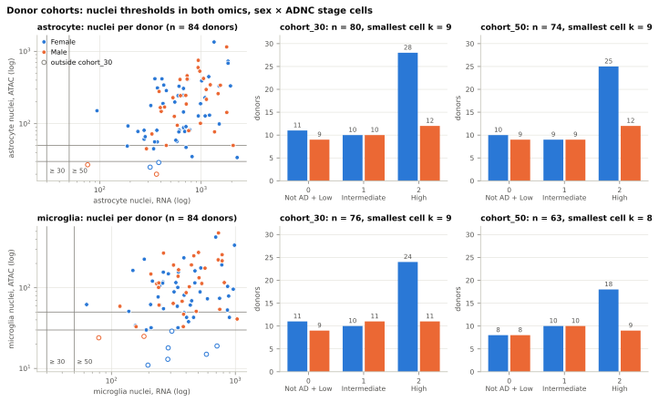

*Construction.* Left: nuclei of the cell type per donor in RNA against ATAC (log scales), from each cell type's donor table, with the cohort thresholds in both omics; hollow markers lie outside cohort_30. Right: donors per sex x ADNC stage cell in each cohort; the cells are checked against the pseudobulk manifest.

*Values.* astrocyte: 84 donors in the donor table; cohort_30 n = 80 (Female 11 / 10 / 28, Male 9 / 10 / 12 by stage 0 / 1 / 2; smallest cell k = 9); cohort_50 n = 74 (Female 10 / 9 / 25, Male 9 / 9 / 12 by stage 0 / 1 / 2; smallest cell k = 9). microglia: 84 donors in the donor table; cohort_30 n = 76 (Female 11 / 10 / 24, Male 9 / 11 / 11 by stage 0 / 1 / 2; smallest cell k = 9); cohort_50 n = 63 (Female 8 / 10 / 18, Male 8 / 10 / 9 by stage 0 / 1 / 2; smallest cell k = 8).

*Reading.* The figure displays outputs already reported; it tests nothing, is an input of no step and changes no reading of the reports that made the outputs.

### Figure 2. Sex x stage trajectories

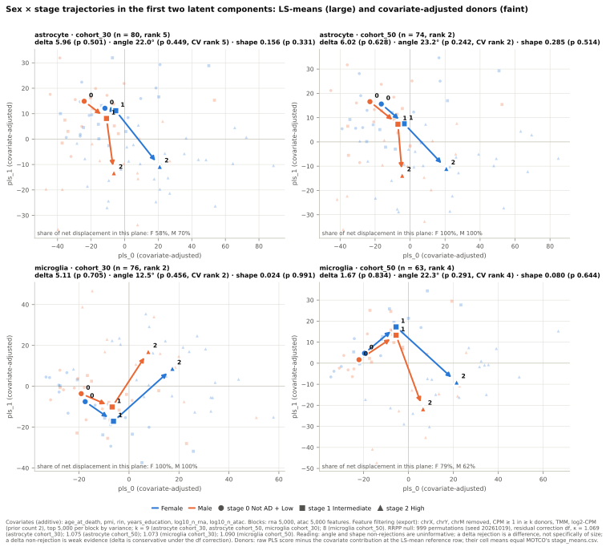

*Construction.* Per cell type and cohort, the primary analysis in its first two latent components: MOTCO's LS-means per sex and stage (stage_means.csv, joined by arrows in stage order) and the covariate-adjusted donor scores (raw PLS score minus the covariate contribution at the LS-mean reference row, whose cell means are checked against stage_means.csv); the share of each sex's net displacement in the plane is read from geometry_shares.csv. The panel titles give each statistic with its p-value and the CV-selected rank; the footnote gives the covariate block, the feature filtering and the RRPP null of the records.

*Values.* astrocyte cohort_30 (n = 80, CV-selected rank 5): delta 5.96 (p 0.501), angle 22.0° (p 0.449, rank 5), shape 0.156 (p 0.331); share of each sex's net displacement in the pls_0 × pls_1 plane: Female 58%, Male 70%. astrocyte cohort_50 (n = 74, CV-selected rank 2): delta 6.02 (p 0.628), angle 23.2° (p 0.242, rank 2), shape 0.285 (p 0.514); share of each sex's net displacement in the pls_0 × pls_1 plane: Female 100%, Male 100%. microglia cohort_30 (n = 76, CV-selected rank 2): delta 5.11 (p 0.705), angle 12.5° (p 0.456, rank 2), shape 0.024 (p 0.991); share of each sex's net displacement in the pls_0 × pls_1 plane: Female 100%, Male 100%. microglia cohort_50 (n = 63, CV-selected rank 4): delta 1.67 (p 0.834), angle 22.3° (p 0.291, rank 4), shape 0.080 (p 0.644); share of each sex's net displacement in the pls_0 × pls_1 plane: Female 79%, Male 62%.

*Reading.* The figure displays outputs already reported; it tests nothing, is an input of no step and changes no reading of the reports that made the outputs. MOTCO results are reported under the binding rules: the CV-selected rank beside angle; angle and shape non-rejections uninformative; a delta rejection a difference, not specifically of size; the covariate block and the feature filtering beside the results. The rank floor defines angle and shape in at least two dimensions without making them powerful (two dimensions, not a second axis with signal), so each analysis's configuration eigengap and null summary belong beside angle. Under the df residual correction the p-values are size-controlled at the configuration MOTCO measured (six covariates, both cohort_30 tables), with delta conservative there, so a delta non-rejection stays weak evidence; the size is inferred from the mechanism (n and the reduced rank), not measured, for cohort_50, the eight-covariate latent arms, the exclusion variants, the forced ranks and the preprocessing variants.

### Figure 3. Latent components by stage

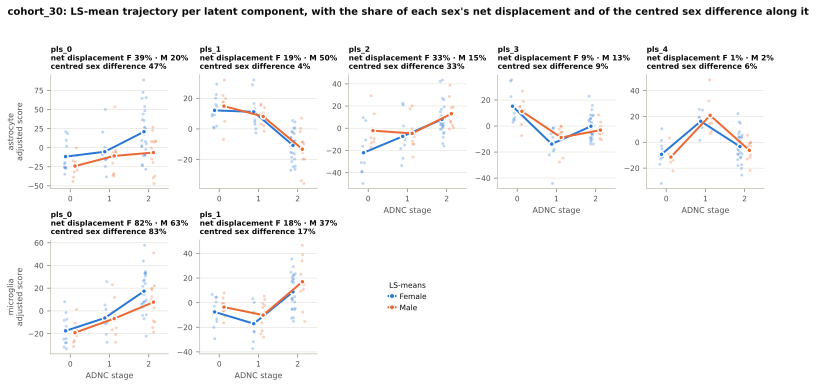

*Construction.* For cohort_30, every latent component of each cell type's primary analysis against ADNC stage: covariate-adjusted donor scores (jittered) and the LS-mean trajectory per sex, with the shares of each sex's net displacement and of the centred sex difference along the component (geometry_shares.csv of axis-diagnostics).

*Values.* astrocyte cohort_30 (n = 80, CV-selected rank 5): shares of the net displacement and of the centred sex difference per component: pls_0 F 39%, M 20%, sex difference 47%; pls_1 F 19%, M 50%, sex difference 4%; pls_2 F 33%, M 15%, sex difference 33%; pls_3 F 9%, M 13%, sex difference 9%; pls_4 F 1%, M 2%, sex difference 6%. microglia cohort_30 (n = 76, CV-selected rank 2): shares of the net displacement and of the centred sex difference per component: pls_0 F 82%, M 63%, sex difference 83%; pls_1 F 18%, M 37%, sex difference 17%.

*Reading.* The figure displays outputs already reported; it tests nothing, is an input of no step and changes no reading of the reports that made the outputs. MOTCO results are reported under the binding rules: the CV-selected rank beside angle; angle and shape non-rejections uninformative; a delta rejection a difference, not specifically of size; the covariate block and the feature filtering beside the results. The rank floor defines angle and shape in at least two dimensions without making them powerful (two dimensions, not a second axis with signal), so each analysis's configuration eigengap and null summary belong beside angle. The diagnostics read sex and stage, so they are diagnostics and never a filter: their outputs feed no export, analysis or sensitivity run, and no preprocessing variant is derived from a diagnostic value.

### Figure 4. Statistics against their RRPP null

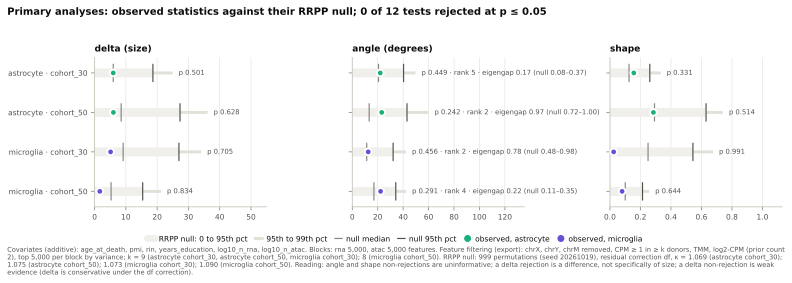

*Construction.* Per primary analysis (both cell types and cohorts), each observed statistic against the summary of its RRPP null from result.json (band to the 95th percentile, thinner band to the 99th, ticks at the median and the 95th percentile); angle carries the CV-selected rank, the pooled configuration eigengap and the 5th to 95th percentile of its permutation null.

*Values.* 0 of 12 tests rejected at p <= 0.05. astrocyte cohort_30 (CV-selected rank 5; configuration eigengap 0.17, permutation null 0.08–0.37): delta 5.96 against null median 5.96 and 95th percentile 18.65 (p 0.501); angle 22.0 against null median 20.6 and 95th percentile 40.3 (p 0.449); shape 0.156 against null median 0.125 and 95th percentile 0.261 (p 0.331). astrocyte cohort_50 (CV-selected rank 2; configuration eigengap 0.97, permutation null 0.72–1.00): delta 6.02 against null median 8.50 and 95th percentile 27.32 (p 0.628); angle 23.2 against null median 13.3 and 95th percentile 43.0 (p 0.242); shape 0.285 against null median 0.292 and 95th percentile 0.630 (p 0.514). microglia cohort_30 (CV-selected rank 2; configuration eigengap 0.78, permutation null 0.48–0.98): delta 5.11 against null median 9.13 and 95th percentile 26.97 (p 0.705); angle 12.5 against null median 11.4 and 95th percentile 32.1 (p 0.456); shape 0.024 against null median 0.250 and 95th percentile 0.544 (p 0.991). microglia cohort_50 (CV-selected rank 4; configuration eigengap 0.22, permutation null 0.11–0.35): delta 1.67 against null median 5.27 and 95th percentile 15.38 (p 0.834); angle 22.3 against null median 17.0 and 95th percentile 34.2 (p 0.291); shape 0.080 against null median 0.100 and 95th percentile 0.214 (p 0.644).

*Reading.* The figure displays outputs already reported; it tests nothing, is an input of no step and changes no reading of the reports that made the outputs. MOTCO results are reported under the binding rules: the CV-selected rank beside angle; angle and shape non-rejections uninformative; a delta rejection a difference, not specifically of size; the covariate block and the feature filtering beside the results. The rank floor defines angle and shape in at least two dimensions without making them powerful (two dimensions, not a second axis with signal), so each analysis's configuration eigengap and null summary belong beside angle. Under the df residual correction the p-values are size-controlled at the configuration MOTCO measured (six covariates, both cohort_30 tables), with delta conservative there, so a delta non-rejection stays weak evidence; the size is inferred from the mechanism (n and the reduced rank), not measured, for cohort_50, the eight-covariate latent arms, the exclusion variants, the forced ranks and the preprocessing variants.

### Figure 5. Every MOTCO analysis

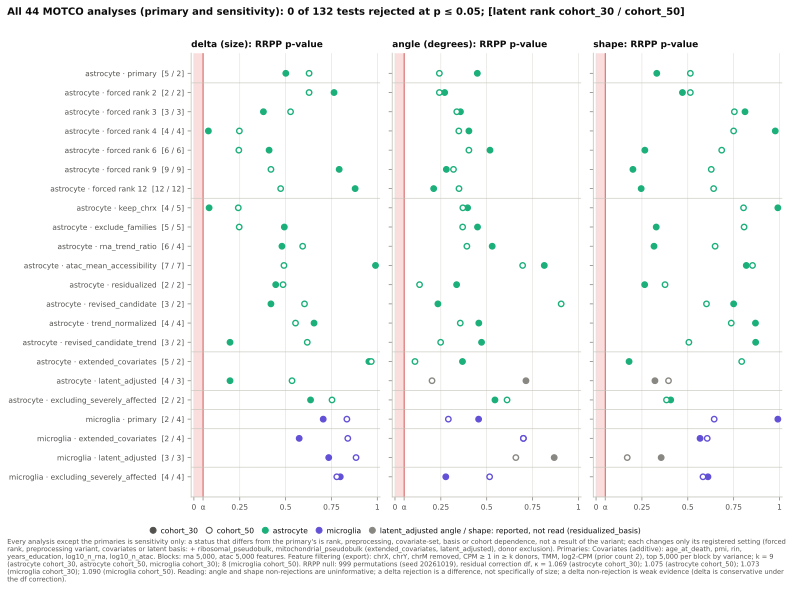

*Construction.* Every MOTCO analysis of the registries outside results/superseded/ (primary, forced ranks, preprocessing variants, latent-sensitivity arms, donor-exclusion variants; per cohort), one row per analysis with the latent rank per cohort, and its RRPP p-value per statistic (filled: cohort_30, hollow: cohort_50); the latent_adjusted angle and shape markers are grey (reported, not read).

*Values.* 44 analyses in 22 rows, 132 p-values; 0 at p <= 0.05: none. Latent rank per analysis (CV-selected, or forced): astrocyte primary cohort_30 5, astrocyte forced rank 2 cohort_30 2, astrocyte forced rank 3 cohort_30 3, astrocyte forced rank 4 cohort_30 4, astrocyte forced rank 6 cohort_30 6, astrocyte forced rank 9 cohort_30 9, astrocyte forced rank 12 cohort_30 12, astrocyte keep_chrx cohort_30 4, astrocyte exclude_families cohort_30 5, astrocyte rna_trend_ratio cohort_30 6, astrocyte atac_mean_accessibility cohort_30 7, astrocyte residualized cohort_30 2, astrocyte revised_candidate cohort_30 3, astrocyte trend_normalized cohort_30 4, astrocyte revised_candidate_trend cohort_30 3, astrocyte extended_covariates cohort_30 5, astrocyte latent_adjusted cohort_30 4, astrocyte excluding_severely_affected cohort_30 2, astrocyte primary cohort_50 2, astrocyte forced rank 2 cohort_50 2, astrocyte forced rank 3 cohort_50 3, astrocyte forced rank 4 cohort_50 4, astrocyte forced rank 6 cohort_50 6, astrocyte forced rank 9 cohort_50 9, astrocyte forced rank 12 cohort_50 12, astrocyte keep_chrx cohort_50 5, astrocyte exclude_families cohort_50 5, astrocyte rna_trend_ratio cohort_50 4, astrocyte atac_mean_accessibility cohort_50 7, astrocyte residualized cohort_50 2, astrocyte revised_candidate cohort_50 2, astrocyte trend_normalized cohort_50 4, astrocyte revised_candidate_trend cohort_50 2, astrocyte extended_covariates cohort_50 2, astrocyte latent_adjusted cohort_50 3, astrocyte excluding_severely_affected cohort_50 2, microglia primary cohort_30 2, microglia extended_covariates cohort_30 2, microglia latent_adjusted cohort_30 3, microglia excluding_severely_affected cohort_30 4, microglia primary cohort_50 4, microglia extended_covariates cohort_50 4, microglia latent_adjusted cohort_50 3, microglia excluding_severely_affected cohort_50 4.

*Reading.* The figure displays outputs already reported; it tests nothing, is an input of no step and changes no reading of the reports that made the outputs. MOTCO results are reported under the binding rules: the CV-selected rank beside angle; angle and shape non-rejections uninformative; a delta rejection a difference, not specifically of size; the covariate block and the feature filtering beside the results. The rank floor defines angle and shape in at least two dimensions without making them powerful (two dimensions, not a second axis with signal), so each analysis's configuration eigengap and null summary belong beside angle. Under the df residual correction the p-values are size-controlled at the configuration MOTCO measured (six covariates, both cohort_30 tables), with delta conservative there, so a delta non-rejection stays weak evidence; the size is inferred from the mechanism (n and the reduced rank), not measured, for cohort_50, the eight-covariate latent arms, the exclusion variants, the forced ranks and the preprocessing variants. Every analysis other than the primary is sensitivity only: a rejection status that differs from the primary's is rank, preprocessing, covariate-set, basis or cohort dependence, not a result of the variant; a CV-selected rank that differs is reported beside angle, not as better or worse; the non-rejection rules hold in every variant; the primary analysis stays primary. The forced-rank sweep is sensitivity only: the CV-selected analysis stays primary, and a rejection status that differs between ranks is rank dependence, not a result at that rank. MOTCO's forced-rank operating characteristics are carried as limitations (Type I checked at forced 4 only, unadjusted; shape power loss and angle leakage at forced 2(K - 1); a wider angle null above n_stages - 1), and the adjusted analysis has no Type I check at any forced rank. The latent_adjusted arm's angle and shape p-values are reported but not read (MOTCO's diagnosis residualized_basis: the stage latent adjustment is liberal on both at this configuration, an excess of the basis the residual correction does not address, so neither a rejection nor a non-rejection is interpretable); its delta is read under the rules above.

### Figure 6. Rank sensitivity

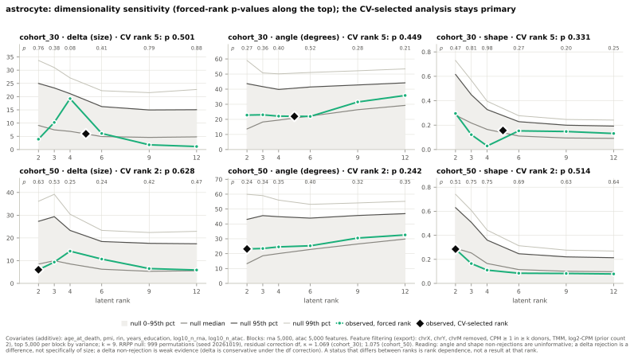

*Construction.* For astrocytes (rank-sensitivity runs on astrocytes only), per cohort and statistic, the observed value at each forced rank of ANALYSIS_FORCED_RANKS against its RRPP null (median, 95th and 99th percentile), the CV-selected analysis at its rank (diamond), and the forced-rank p-values along the top.

*Values.* astrocyte cohort_30: CV-selected rank 5 (p delta 0.501, angle 0.449, shape 0.331); forced ranks 2, 3, 4, 6, 9, 12: p delta 0.764, 0.379, 0.079, 0.410, 0.792, 0.879; angle 0.271, 0.357, 0.403, 0.518, 0.280, 0.211; shape 0.471, 0.812, 0.977, 0.266, 0.201, 0.246. astrocyte cohort_50: CV-selected rank 2 (p delta 0.628, angle 0.242, shape 0.514); forced ranks 2, 3, 4, 6, 9, 12: p delta 0.628, 0.527, 0.248, 0.245, 0.420, 0.473; angle 0.242, 0.337, 0.348, 0.403, 0.319, 0.349; shape 0.514, 0.754, 0.750, 0.685, 0.628, 0.641.

*Reading.* The figure displays outputs already reported; it tests nothing, is an input of no step and changes no reading of the reports that made the outputs. MOTCO results are reported under the binding rules: the CV-selected rank beside angle; angle and shape non-rejections uninformative; a delta rejection a difference, not specifically of size; the covariate block and the feature filtering beside the results. The rank floor defines angle and shape in at least two dimensions without making them powerful (two dimensions, not a second axis with signal), so each analysis's configuration eigengap and null summary belong beside angle. The forced-rank sweep is sensitivity only: the CV-selected analysis stays primary, and a rejection status that differs between ranks is rank dependence, not a result at that rank. MOTCO's forced-rank operating characteristics are carried as limitations (Type I checked at forced 4 only, unadjusted; shape power loss and angle leakage at forced 2(K - 1); a wider angle null above n_stages - 1), and the adjusted analysis has no Type I check at any forced rank. Under the df residual correction the p-values are size-controlled at the configuration MOTCO measured (six covariates, both cohort_30 tables), with delta conservative there, so a delta non-rejection stays weak evidence; the size is inferred from the mechanism (n and the reduced rank), not measured, for cohort_50, the eight-covariate latent arms, the exclusion variants, the forced ranks and the preprocessing variants.

### Figure 7. Axis correlations

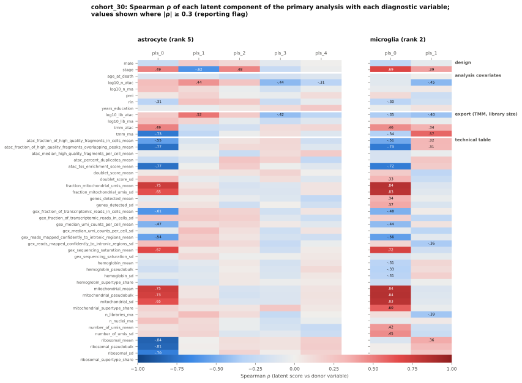

*Construction.* For cohort_30, the Spearman correlation of every latent component of each cell type's primary analysis with every diagnostic variable (axis_correlations.csv of axis-diagnostics: design, analysis covariates, the export's TMM factors and library sizes, the technical table), grouped by source; values are printed where |rho| reaches the reporting flag DIAGNOSTIC_CORRELATION_THRESHOLD.

*Values.* astrocyte cohort_30 (rank 5): 26 of 235 correlations at |rho| >= 0.3; largest |rho| per component: pls_0 ribosomal_mean -0.84; pls_1 stage -0.62; pls_2 stage 0.48; pls_3 log10_n_atac -0.44; pls_4 log10_n_atac -0.31. microglia cohort_30 (rank 2): 37 of 94 correlations at |rho| >= 0.3; largest |rho| per component: pls_0 mitochondrial_pseudobulk 0.84; pls_1 tmm_rna 0.57.

*Reading.* The figure displays outputs already reported; it tests nothing, is an input of no step and changes no reading of the reports that made the outputs. An axis correlated with a technical variable is a measurement-space finding about the analysis, not a reinterpretation of its statistics; the primary analysis stays primary with its non-rejection rules. The diagnostics read sex and stage, so they are diagnostics and never a filter: their outputs feed no export, analysis or sensitivity run, and no preprocessing variant is derived from a diagnostic value.

### Figure 8. The first latent axis

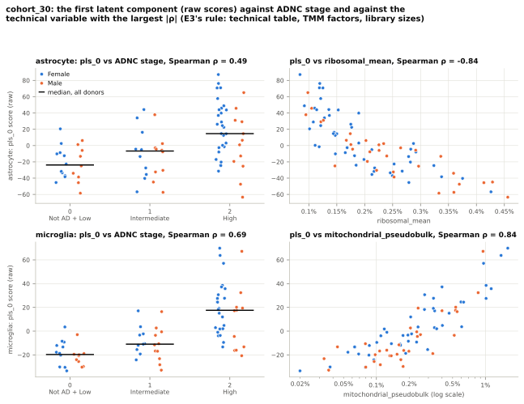

*Construction.* For cohort_30, the raw pls_0 scores of each cell type's primary analysis against ADNC stage (jittered, with the median per stage) and against the technical variable picked by E3's rule (the largest |Spearman| among the technical table's columns and the export's TMM factors and library sizes); both Spearman correlations are recomputed and checked against axis_correlations.csv.

*Values.* astrocyte cohort_30 (n = 80): Spearman of pls_0 with stage 0.49; the largest |rho| among 39 technical variables is ribosomal_mean (donor_technical.csv) at -0.84. microglia cohort_30 (n = 76): Spearman of pls_0 with stage 0.69; the largest |rho| among 39 technical variables is mitochondrial_pseudobulk (donor_technical.csv) at 0.84.

*Reading.* The figure displays outputs already reported; it tests nothing, is an input of no step and changes no reading of the reports that made the outputs. An axis correlated with a technical variable is a measurement-space finding about the analysis, not a reinterpretation of its statistics; the primary analysis stays primary with its non-rejection rules. The diagnostics read sex and stage, so they are diagnostics and never a filter: their outputs feed no export, analysis or sensitivity run, and no preprocessing variant is derived from a diagnostic value.

### Figure 9. Positive control

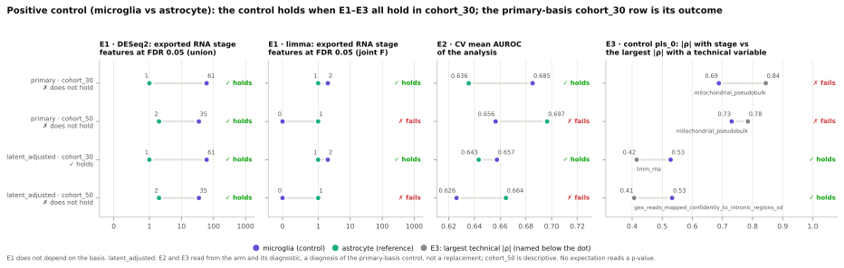

*Construction.* The positive control's expectations E1 (exported RNA stage counts at FDR 0.05 under DESeq2 and limma), E2 (CV mean AUROC) and E3 (|Spearman| of the control's pls_0 with stage against the largest with a technical variable) per basis of POSITIVE_CONTROL_BASES and cohort, control against reference, from positive_control.csv, with each expectation's and the overall outcome as recorded.

*Values.* primary basis, cohort_30 (microglia vs astrocyte): E1 deseq2 61 vs 1 (holds); limma 2 vs 1 (holds); E2 CV mean AUROC 0.685 vs 0.636 (holds); E3 |rho| with stage 0.69 vs mitochondrial_pseudobulk 0.84 (fails); overall does not hold. primary basis, cohort_50 (microglia vs astrocyte): E1 deseq2 35 vs 2 (holds); limma 0 vs 1 (fails); E2 CV mean AUROC 0.656 vs 0.697 (fails); E3 |rho| with stage 0.73 vs mitochondrial_pseudobulk 0.78 (fails); overall does not hold. latent_adjusted basis, cohort_30 (microglia vs astrocyte): E1 deseq2 61 vs 1 (holds); limma 2 vs 1 (holds); E2 CV mean AUROC 0.657 vs 0.643 (holds); E3 |rho| with stage 0.53 vs tmm_rna 0.42 (holds); overall holds. latent_adjusted basis, cohort_50 (microglia vs astrocyte): E1 deseq2 35 vs 2 (holds); limma 0 vs 1 (fails); E2 CV mean AUROC 0.626 vs 0.664 (fails); E3 |rho| with stage 0.53 vs gex_reads_mapped_confidently_to_intronic_regions_sd 0.41 (holds); overall does not hold.

*Reading.* The figure displays outputs already reported; it tests nothing, is an input of no step and changes no reading of the reports that made the outputs. The positive control is about the stage signal, not the sex x stage hypothesis: it holds when E1, E2 and E3 all hold in cohort_30, and the primary-basis cohort_30 row is its outcome; cohort_50 is descriptive. If it holds, the reference's null is not a pipeline failure; if not, the latent construction is in question for any cell type. E1 does not depend on the basis; the latent_adjusted basis is a diagnosis of the primary-basis control, never a replacement (the arm is not promoted). No expectation reads a p-value.

### Figure 10. Pseudobulk stage DE

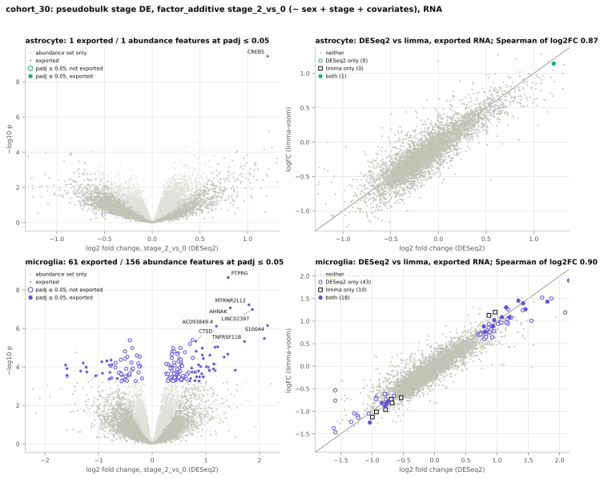

*Construction.* For cohort_30, RNA, factor_additive stage_2_vs_0 (the contrast between the extreme stages): left, the DESeq2 volcano over the abundance-passing features (exported features darker, padj <= 0.05 in the cell type's colour, the eight smallest exported padj labelled); right, the DESeq2 log2 fold change against limma-voom's logFC over the exported features, by significance under each method. The counts are checked against stage_de_summary.csv and method_comparison.csv, a missing DESeq2 padj counting as not significant.

*Values.* astrocyte cohort_30, RNA (5,000 exported of 20,387 abundance features; covariates age_at_death, pmi, rin, years_education, log10_n_rna): exported features at FDR 0.05, DESeq2 factor_additive stage_1_vs_0 0, stage_2_vs_0 1, union 1; limma stage_1_vs_0 0, stage_2_vs_0 1, stage_joint 1. stage_2_vs_0: both methods 1, DESeq2 only 0, limma only 0 (DESeq2 padj missing for 0 exported features, read as not significant); Spearman of log2 fold changes 0.87. microglia cohort_30, RNA (5,000 exported of 20,660 abundance features; covariates age_at_death, pmi, rin, years_education, log10_n_rna): exported features at FDR 0.05, DESeq2 factor_additive stage_1_vs_0 0, stage_2_vs_0 61, union 61; limma stage_1_vs_0 0, stage_2_vs_0 28, stage_joint 2. stage_2_vs_0: both methods 18, DESeq2 only 43, limma only 10 (DESeq2 padj missing for 2,159 exported features, read as not significant); Spearman of log2 fold changes 0.90.

*Reading.* The figure displays outputs already reported; it tests nothing, is an input of no step and changes no reading of the reports that made the outputs. The stage counts describe the stage signal in the pseudobulks; the MOTCO non-rejection rules are untouched. A zero count is none detected at this n; the union counts carry no joint error-rate claim and limma's joint F claim is approximate; a call that differs between DESeq2 and limma is method dependence, not a result of either, and agreement is not replication (same donors and counts). The FDR of padj <= alpha is approximate and Cook's handling is inactive with continuous covariates; the covariates, the feature set and each method's normalization (DESeq2's median of ratios; limma-voom's log-CPM on the export's TMM) are stated beside the counts.

### Figure 11. Split interaction test

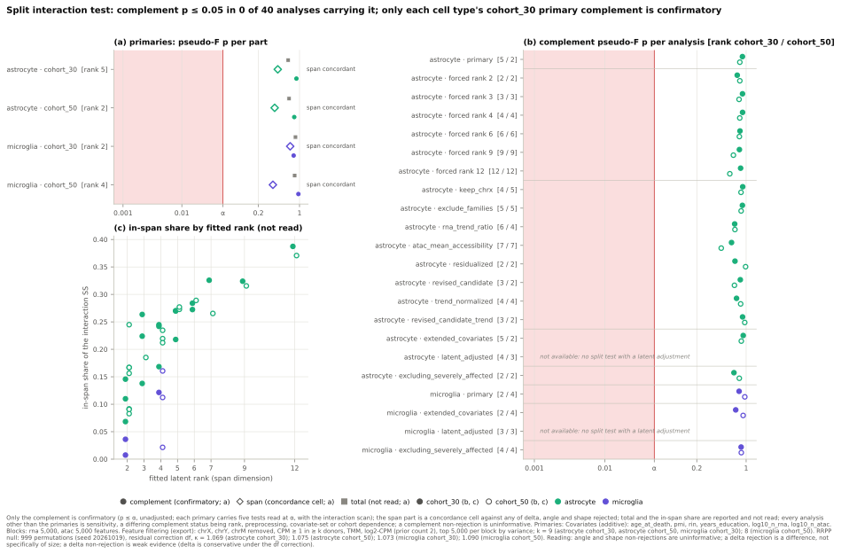

*Construction.* MOTCO's split interaction test from each record's span_split block: (a) per primary analysis (both cell types and cohorts) the pseudo-F p-value of each part on a log axis with alpha, the complement a filled circle (confirmatory), the span a hollow diamond with its concordance cell beside the production statistics, total a grey square (descriptive); (b) the complement p-value of every registered analysis that carries the test, enumerated as in figure 5 (filled: cohort_30, hollow: cohort_50), the latent_adjusted arms listed as not available; (c) the in-span share of the same analyses against their fitted rank, with no reference line: the share is descriptive, grows with the fitted rank, and is read against no null here.

*Values.* 40 of 44 analyses carry the split test (not available: astrocyte latent_adjusted cohort_30, astrocyte latent_adjusted cohort_50, microglia latent_adjusted cohort_30, microglia latent_adjusted cohort_50). astrocyte cohort_30 (rank 5; dimensions total 10,000, span 5, complement 9,995): pseudo-F p total 0.642 (F 0.9219; descriptive), span 0.427 (F 0.9958; concordance), complement 0.886 (F 0.8972; confirmatory); complement not rejected; span cell concordant (span rejected no, any of delta, angle, shape rejected no); in-span share 0.2702. astrocyte cohort_50 (rank 2; dimensions total 10,000, span 2, complement 9,998): pseudo-F p total 0.665 (F 0.9116; descriptive), span 0.378 (F 1.027; concordance), complement 0.814 (F 0.8915; confirmatory); complement not rejected; span cell concordant (span rejected no, any of delta, angle, shape rejected no); in-span share 0.1669. microglia cohort_30 (rank 2; dimensions total 10,000, span 2, complement 9,998): pseudo-F p total 0.854 (F 0.8888; descriptive), span 0.694 (F 0.3874; concordance), complement 0.795 (F 0.9342; confirmatory); complement not rejected; span cell concordant (span rejected no, any of delta, angle, shape rejected no); in-span share 0.0362. microglia cohort_50 (rank 4; dimensions total 10,000, span 4, complement 9,996): pseudo-F p total 0.827 (F 0.8887; descriptive), span 0.353 (F 1.082; concordance), complement 0.957 (F 0.8593; confirmatory); complement not rejected; span cell concordant (span rejected no, any of delta, angle, shape rejected no); in-span share 0.1606. Complement p <= 0.05: none. Discordant span cells: none. In-span share over the analyses drawn 0.0075–0.3874.

*Reading.* The figure displays outputs already reported; it tests nothing, is an input of no step and changes no reading of the reports that made the outputs. MOTCO's split interaction test splits the group x stage interaction energy of the analysed features into the fitted stage-PLS span, its orthogonal complement and all of it. Only the complement is confirmatory: its pseudo-F p-value is read at alpha = 0.05, unadjusted (no adjustment across delta, angle, shape, the complement and the interaction scan, so each primary carries five tests read at alpha), and each cell type's cohort_30 primary gives the result; a complement status that differs from the primary's elsewhere is rank, preprocessing, covariate-set or cohort dependence. The span part is a concordance cell against any of delta, angle and shape rejected in the same analysis, a discordance a finding and never a result; total, the in-span share and the interaction-SS p-values are reported and not read. A complement rejection is a sex x stage difference with interaction energy outside the fitted span, not a different molecular program: it may hold leakage from an in-span difference and what the fitted span missed of the stage program, and it carries no direction, feature list or attribution. A complement non-rejection is uninformative: no power was shown at SEA-AD's stage signal, nor for sparse differences at any signal. The in-span share grows with the fitted rank and is read against no null here. Size was measured on real noise only for the astrocyte cohort_30 export at this configuration (complement 0.012); for cohort_50, microglia, the eight-covariate arm, the exclusion variants, the forced ranks and the preprocessing variants it is inferred. The test is not available with a latent adjustment. Every analysis other than the primary is sensitivity only: a rejection status that differs from the primary's is rank, preprocessing, covariate-set, basis or cohort dependence, not a result of the variant; a CV-selected rank that differs is reported beside angle, not as better or worse; the non-rejection rules hold in every variant; the primary analysis stays primary. The forced-rank sweep is sensitivity only: the CV-selected analysis stays primary, and a rejection status that differs between ranks is rank dependence, not a result at that rank. MOTCO's forced-rank operating characteristics are carried as limitations (Type I checked at forced 4 only, unadjusted; shape power loss and angle leakage at forced 2(K - 1); a wider angle null above n_stages - 1), and the adjusted analysis has no Type I check at any forced rank.

### Figure 12. Per-feature interaction scan

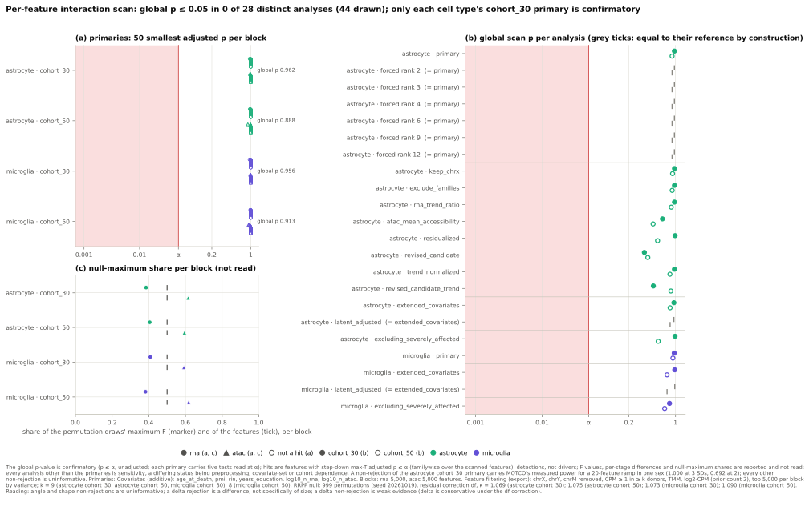

*Construction.* MOTCO's per-feature interaction scan from each record's interaction_scan block and each primary's interaction_scan.csv: (a) per primary analysis (both cell types and cohorts) the 50 smallest step-down max-T adjusted p-values per block on a log axis with alpha, hits filled, the global p-value beside; (b) the global p-value of every registered analysis, enumerated as in figure 5 (filled: cohort_30, hollow: cohort_50), the forced ranks and the latent-adjusted arms drawn as grey ticks because their scan equals their reference's by construction; (c) per primary, each block's share of the permutation draws' maximum F beside its share of the features, with no threshold: the shares are descriptive.

*Values.* 44 analyses carry the scan, 28 of them distinct (the forced ranks and the latent-adjusted arms equal their reference by construction). astrocyte cohort_30 (10,000 features, df 2, 68): global p 0.962, not rejected; maximum F 7.857 (AC091074.2, rna); hits rna 0, atac 0; null-maximum shares rna 0.3854, atac 0.6146. astrocyte cohort_50 (10,000 features, df 2, 62): global p 0.888, not rejected; maximum F 8.588 (chr9:23667507-23675068, atac); hits rna 0, atac 0; null-maximum shares rna 0.4054, atac 0.5946. microglia cohort_30 (10,000 features, df 2, 64): global p 0.956, not rejected; maximum F 8.45 (CCDC26, rna); hits rna 0, atac 0; null-maximum shares rna 0.4084, atac 0.5916. microglia cohort_50 (10,000 features, df 2, 51): global p 0.913, not rejected; maximum F 8.913 (chr13:25847855-25849247, atac); hits rna 0, atac 0; null-maximum shares rna 0.3824, atac 0.6176. Global p <= 0.05: none. Scan concordance cells (scan hits against the exported interaction counts): astrocyte cohort_30 rna: 0 hit(s), DESeq2 0 (concordant), limma 0 (concordant); astrocyte cohort_30 atac: 0 hit(s), DESeq2 0 (concordant), limma 0 (concordant); astrocyte cohort_50 rna: 0 hit(s), DESeq2 0 (concordant), limma 0 (concordant); astrocyte cohort_50 atac: 0 hit(s), DESeq2 0 (concordant), limma 0 (concordant); microglia cohort_30 rna: 0 hit(s), DESeq2 0 (concordant), limma 0 (concordant); microglia cohort_30 atac: 0 hit(s), DESeq2 0 (concordant), limma 0 (concordant); microglia cohort_50 rna: 0 hit(s), DESeq2 0 (concordant), limma 0 (concordant); microglia cohort_50 atac: 0 hit(s), DESeq2 0 (concordant), limma 0 (concordant).

*Reading.* The figure displays outputs already reported; it tests nothing, is an input of no step and changes no reading of the reports that made the outputs. MOTCO's per-feature interaction scan tests each analysed feature's group x stage interaction F with the covariate-adjusted models, combined by the maximum F. Its global p-value is the one confirmatory reading, read at alpha = 0.05, unadjusted (no adjustment across delta, angle, shape, the complement and the scan, so each primary carries five tests read at alpha); a hit is a feature with step-down max-T adjusted p <= 0.05 (familywise over the scanned features), and a rejection comes with at least one hit. Each cell type's cohort_30 primary gives the result; a scan status that differs elsewhere is preprocessing, covariate-set or cohort dependence, and the forced ranks and the latent-adjusted arms equal their reference by construction (the scan reads neither the latent space nor the bootstrap). A hit names a feature whose covariate-adjusted sex difference changes across stages: a detection, not a driver (correlated neighbours can be hits too), with no geometry, trajectory or attribution, changing no reading of delta, angle, shape or the complement; the per-feature F values, the per-stage differences and the null-maximum shares are reported and not read. A non-rejection of the astrocyte cohort_30 primary carries MOTCO's power on that export (a 20-feature ramp in one sex detected in 1.000 of replicates at 3 within-stage SDs, 0.692 at 2), which excludes neither smaller effects, nor effects spread thinly over many features, nor other shapes; every other non-rejection is uninformative. Size was measured on real noise only for the astrocyte cohort_30 export at six covariates (global 0.042, familywise 0.042); elsewhere it is inferred. The null maxima lean on ATAC there (0.618 of them with half the features), and the F is the plain, unmoderated per-feature F. The scan concordance cells beside the stage DE are findings when discordant, never results. Every analysis other than the primary is sensitivity only: a rejection status that differs from the primary's is rank, preprocessing, covariate-set, basis or cohort dependence, not a result of the variant; a CV-selected rank that differs is reported beside angle, not as better or worse; the non-rejection rules hold in every variant; the primary analysis stays primary.

## 13. Reading

Under the policy, power statement and reading predeclared in `67e7cdc` (section 3), in the outcome that occurred:

- **The results.** Neither cell type's `cohort_30` primary rejects the scan: astrocyte global p = 0.962 (maximum F 7.857, `AC091074.2`, RNA; 10,000 features, df 2 and 68), microglia p = 0.956 (maximum F 8.45, `CCDC26`, RNA; df 2 and 64). No feature of either primary is a hit at step-down max-T adjusted p ≤ 0.05; the smallest adjusted p-values are 0.962 and 0.956, the global p-values themselves.
- **The astrocyte `cohort_30` non-rejection carries the power statement.** The export's five files hash as MOTCO's plasmode settings at `v0.20.0` record (task 2.7), so the statement applies: no sparse stage ramp of the plasmode's form was detected. At this export's design, a ramp on 20 features (10 per block) in one sex, with stage weights 0 / 0.5 / 1 and random signs, is detected in 1.000 of replicates at 3 within-stage SDs and in 0.692 at 2 SDs. This excludes neither smaller effects, nor effects spread thinly over many features (where the scan is weak: magnitude power 0.01 against `delta`'s 0.21 on the simulated SEA-AD table), nor differences of any other shape, and it says nothing about a dense or in-span difference.
- **The microglia `cohort_30` non-rejection is uninformative**: no power was measured on the microglia export, and the statement is not transferred to it.
- **Five tests per primary.** Each primary carries `delta`, `angle`, `shape`, the complement and the scan, read at α = 0.05 without adjustment, as predeclared. None of the five rejects in either cell type or cohort, so the absence of an adjustment changes no reading here.
- **Sensitivity.** `cohort_50` (astrocyte p = 0.888, microglia p = 0.913) and every other analysis leave the scan unrejected: the lowest global p over the 28 distinct analyses is 0.341 (astrocyte `revised_candidate`, `cohort_30`). No scan status differs from its primary's, so the scan shows no preprocessing, covariate-set or cohort dependence. The 12 forced ranks and the 4 `latent_adjusted` arms carry their reference's scan byte for byte, as the construction implies, and no dependence is read from them.
- **The concordance cells.** Every scan concordance cell is concordant (28 cells: no hit in any omic of any analysis read, and no exported interaction feature under DESeq2's union or limma's `interaction_joint`), and the two methods agree on every scan cell. That is the cell expected when nothing is detected; it carries no evidence either way, and agreement would not be replication.
- **Not read.** The per-feature F values, the maximum F, the per-stage differences and the null-maximum shares are reported and not read. The shares lean on ATAC in every primary (0.5916–0.6176 of the null maxima with half the features), as MOTCO measured on this export (0.618), so the familywise threshold leans on ATAC; across the distinct analyses ATAC's share ranges 0.2923–0.6927.
- **The production statistics and the split test.** Nothing rejects `delta`, `angle`, `shape` or the complement in any analysis, as before the re-issue; every rank, CV AUROC, statistic, p-value, null summary, span split block and status equals the superseded value. The binding rules stand: `angle` and `shape` non-rejections are uninformative, a `delta` non-rejection is weak evidence under `df`, a complement non-rejection is uninformative, and every analysis other than the primaries is sensitivity.
- **Unchanged readings.** The stage-DE `delta` cells read the re-issued primaries' `delta` status (not rejected) and are all concordant, with the methods agreeing; the per-feature stage-DE tables are byte-identical to the superseded ones. The positive control's values equal the superseded ones: on the primary basis it does not hold in `cohort_30` (E3 fails), on `latent_adjusted` it holds in `cohort_30`. The adoption, mediator, flag and axis checks are unchanged, and the adoption precedence names no candidate. Nothing found here changes an earlier reading.

## 14. Findings

From the comparison script (design D11; superseded → new over the 44 analyses and every p-free output), every difference and every status change:

- None: every value reproduces (byte-identical files or equal values), with equal ranks, CV AUROCs, p-values, rejection statuses, split blocks, stage-DE calls and counts, and E1–E3.

Recorded beside them:

- **Same-machine re-issue.** The superseded outputs were made on this machine on 2026-11-06, so every superseded → new comparison is byte-level: the 176 analysis CSVs and 480 other CSVs are byte-identical, the 112 per-feature stage-DE tables included, and the 50 tables that gained the change's columns are equal on every pre-existing column.
- **23 manifests without a `cell_type`** (written before the cell-type registry) are read as their root's cell type by the figures pre-pass, as in the earlier reports.

## 15. Limitations

Of the interaction scan (spec `motco-interaction-scan`, MOTCO's `interaction-scan-2026-11-09.md`):

- **Size.** On real noise it was measured only for the astrocyte `cohort_30` export at six covariates (global 0.042 at the plasmode anchor; familywise 0.042 under the plasmode's partial null at 2 and 3 SDs). For `cohort_50`, microglia, the eight-covariate latent arms (`df_residual` n − 14), the exclusion variants and the preprocessing variants it is inferred, not measured; the forced ranks and the `latent_adjusted` arms carry their reference's scan.
- **Block balance.** On that export ATAC gives 0.618 of the null maxima with half the features, so the common familywise threshold leans on ATAC: a difference of a given size is somewhat harder to detect on RNA features than per-block thresholds would make it. The re-issued primaries' recorded null-maximum shares lean the same way (sections 4 and 12). Per-block maxima are a possible MOTCO follow-up.
- **The statistic.** The per-feature F is the plain, unmoderated F at n = 80 (n = 51–68 residual degrees of freedom); MOTCO's measured per-feature power on the plasmode is 0.06 at 2 SDs and 0.53 at 3 SDs.
- **The power statement** rests on one stylized plant (a stage ramp on 20 features, 10 per block, in one sex, stage weights 0 / 0.5 / 1, random signs) on one export. It excludes neither smaller effects, nor effects spread thinly over many features (magnitude 0.01 against `delta`'s 0.21 on the simulated SEA-AD table), nor differences of other shapes, and it applies to the astrocyte `cohort_30` primary only.
- **Hits** would be detections, not drivers: correlated neighbours of a differing feature can be hits, and the scan carries no geometry or trajectory claim.
- **Multiplicity.** Each primary carries five tests read at α (`delta`, `angle`, `shape`, the complement and the scan), unadjusted, as predeclared; no adjustment across cohorts or cell types.
- **The scan concordance cells** compare tests that differ in features and scale (z-scored log2-CPM of the exported features against raw counts), covariates (both nuclei counts against the omic's own), null (permutation against parametric) and error criterion (familywise against BH FDR); agreement is not replication (same donors).

Of the split test (carried from `reports/motco-span-split-2026-11-06.md`):

- **Size** measured on real noise only for the astrocyte `cohort_30` export at this configuration (complement 0.012, span 0.050, total 0.040), inferred elsewhere; out-of-span power shown only for a dense rotation at a strong stage signal; the null in-span share grows with the fitted rank (0.236 at rank 5 on this export) and no null share is computed here; not available on the `latent_adjusted` arms.

Carried from the earlier reports (unchanged by this change):

- **The `df` residual correction** is size-controlled at the configuration MOTCO measured (six covariates, both `cohort_30` tables; `corrected-permutation-2026-10-30.md`), with `delta` conservative there (0.029 / 0.031 pooled), so a `delta` non-rejection stays weak evidence; its size is inferred from the mechanism, not measured, for `cohort_50`, the eight-covariate arms, the exclusion variants, the forced ranks and the preprocessing variants.
- **The binding MOTCO rules**: the CV-selected rank beside `angle`; `angle` and `shape` non-rejections uninformative; a `delta` rejection a difference, not specifically of size; the rank floor defines `angle` and `shape` in at least two dimensions without making them powerful, so each primary's eigengap and null summary stand beside `angle` (section 4).
- **The forced-rank sweep** is sensitivity only: MOTCO's forced-rank operating characteristics (Type I at forced 4 only, unadjusted; `shape` power loss and `angle` leakage at forced 2(K − 1); a wider `angle` null above `n_stages − 1`), and no Type I check of the adjusted analysis at any forced rank.
- **The latent arms**: MOTCO's `residualized_basis` diagnosis (the `latent_adjusted` arm's `angle` and `shape` p-values reported, not read), the mediator limitation with the mediator check's flags, MOTCO's Phase 6-only operating characteristics of the latent adjustment, and the nuclei counts and the added fractions both proxying library quality.
- **The preprocessing variants**: MOTCO's operating characteristics were measured on none of the variant blocks; the residualized variants spend degrees of freedom before the permutation null and remove stage and sex signal carried by the technical set; the trend-normalized variants remove a stage or sex effect shaped like a tilt with the artefact.
- **The exclusion variants**: the excluded donors carry the most severe pathology, so the exclusion truncates the late epoch with the quality tail; the flag was made from QC metrics, so the variant conditions on quality by donor selection; the stage-2 cells are smaller; the flag's sex split bears on the sex × stage comparison.
- **The stage DE**: the FDR of padj ≤ α is approximate and Cook's handling is inactive with continuous covariates; the union counts carry no joint error-rate claim and limma's joint F claim is approximate; a call that differs between the methods is method dependence, and agreement is not replication.
- **The positive control** is about the stage signal, not the sex × stage hypothesis; it reads no p-value, no split test and no scan.
